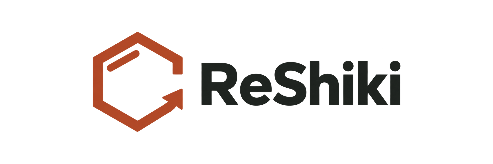
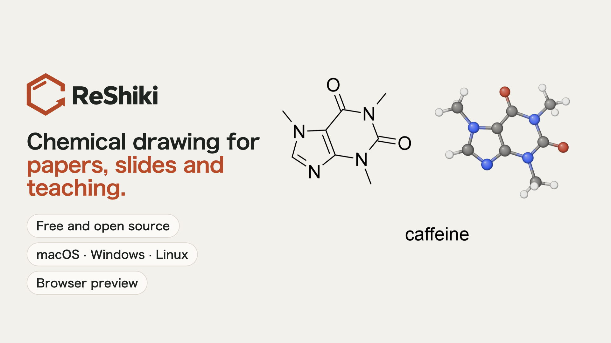

# ReShiki

<picture>
  <source media="(prefers-color-scheme: dark)" srcset="assets/branding/wordmark-dark.png">
  
</picture>

**Chemical drawing, reinvented.** Draw molecules, build reaction schemes and prepare publication figures on an editable canvas. Free for any use, including at work.

**ReShiki (リシキ)** means “REinvention of the wheel for drawing chemical structure.” _Shiki_ is 式, as in chemical equation.

[Download](https://github.com/Ameyanagi/ReShiki/releases/latest) · [User guide](https://reshiki.com/guide/first-molecule/) · [Release notes](https://reshiki.com/developer/changes-0.16/) · [Try it in your browser](https://reshiki.com/demo/)

## What's new in 0.16.0

Drawings kept in your GitHub repositories with a chemistry-aware Compare, a Settings page with copy and export backgrounds and resolutions, name and property captions under molecules, and NMR prediction and shift labels from Python, the command line and agents. Older drawings open normally; [file compatibility](docs/changes-0.16.md#file-compatibility) lists what needs 0.16.0.

## Install

Download ReShiki for macOS (Apple Silicon or Intel), Windows (x64 or ARM64) or Linux (x64 or ARM64). Drawing, chemistry, chemical names and NMR prediction work offline, with nothing else to install. The [installation guide](https://reshiki.com/guide/install/) covers each platform, Nightly builds and the [code signing policy](docs/code-signing-policy.md).

The optional AI assistant uses your own [Codex sign-in](https://reshiki.com/guide/assistant-setup/).

## Use from code

- **Python:** `uv add reshiki` ([Python package](docs/python.md)).
- **JavaScript:** `bun add @ameyanagi/reshiki` for the editor in WebAssembly ([npm package](packages/editor/README.md)), or `bun add @ameyanagi/reshiki-headless` for a converter without it ([npm package](packages/headless/README.md)).
- **AI agents (experimental):** `reshiki --mcp` or `reshiki --cli` ([Connect AI agents](https://reshiki.com/guide/agents/)).

## Acknowledging ReShiki

No citation is required. If you want to acknowledge it:

> Chemical structures and reaction schemes were drawn using ReShiki (https://reshiki.com/).

## Contribute

ReShiki is written in Rust with Iced. Start with [Build and test](https://reshiki.com/developer/development/), then read the [documentation policy](docs/README.md) and the [contribution license agreement](CONTRIBUTING.md). Thanks to our [contributors](docs/contributors.md). [Report a problem](https://github.com/Ameyanagi/ReShiki/issues).

Original ReShiki code and documentation are dual-licensed under the [MIT License](LICENSE-MIT) or [Apache License 2.0](LICENSE-APACHE), at your option. Third-party code keeps its own license; see [LICENSE](LICENSE) and [NOTICE](NOTICE).
