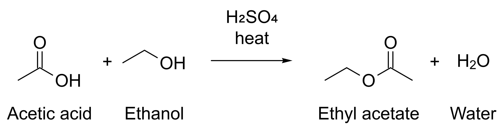

# Command-line reference

**Experimental. In ReShiki 0.12.0 and later.** Commands,
options and output may change in any build.

`reshiki --cli` runs one command and exits. It converts, renders, lays out
and analyzes structures with the same operations as the
[MCP server](agent-api.md), and names them with the app's local naming engine,
without opening the app window. To connect an AI client instead, follow
[Connect AI agents](https://reshiki.com/guide/agents/).

```text
reshiki --cli <command> [options]
```

`--cli` must be the first argument. Use the full path of the executable in
place of `reshiki`, such as `/Applications/ReShiki.app/Contents/MacOS/reshiki`
on macOS ([where to find it](https://reshiki.com/guide/agents/#1-find-the-reshiki-executable)).
`reshiki --cli help` lists the commands, and `reshiki --cli help <command>`
shows one command's help. The [generated reference](agent-reference.md#command-line)
has every help text as the program prints it.

## Commands

| Command             | What it does                                                      |
| ------------------- | ----------------------------------------------------------------- |
| [convert](#convert) | Convert a structure or drawing to another file format             |
| [render](#render)   | Render a preview image of a structure or drawing                  |
| [compose](#compose) | Lay out a Proposal (JSON) and write it as a file                  |
| [analyze](#analyze) | Print molecular properties as one JSON line                       |
| [name](#name)       | Print the systematic name of a structure                          |
| [info](#info)       | Print versions, limits and formats as one JSON line               |
| [tools](#tools)     | Print the agent tool catalog as one JSON line                     |
| [schema](#schema)   | Print the Proposal JSON Schema                                    |
| [skill](#skill)     | Write an Agent Skill folder that teaches AI agents to use ReShiki |
| [help](#help)       | Show the help, or one command's help, as text or JSON             |

## Rules for every command

- Each run takes one command. A command accepts only its own options; any
  other option is a usage error, such as `render does not take --pages`.
- Each option is allowed once. A second `--to` gives `--to given more than once`.
- An option that takes a value uses the next argument as the value, even one
  that starts with `-`.
- `--` ends the options. Every argument after it is the input, so a file
  whose name starts with `-` still works: `reshiki --cli analyze -- -sample.mol`.
- A lone `-` means standard input, or standard output after `-o`.
- Usage errors are found before anything is read or written.

## Input

`convert`, `render`, `analyze` and `name` read exactly one input:

| Input           | Meaning                                                           |
| --------------- | ----------------------------------------------------------------- |
| `INPUT`         | A file. Without `--from`, its extension picks the format (below). |
| `-`             | Standard input. Needs `--from`.                                   |
| `--smiles TEXT` | SMILES text. Cannot be combined with `--from`.                    |

The input extension picks the format, ignoring case:

| Extension                                                                 | Format                             |
| ------------------------------------------------------------------------- | ---------------------------------- |
| `.rsk`, `.reshiki`, `.moruno`                                             | `reshiki`, a ReShiki drawing       |
| `.mol`                                                                    | `mol`                              |
| `.rxn`                                                                    | `rxn`                              |
| `.rsmi`                                                                   | `rsmi`, reaction SMILES            |
| `.cdxml`                                                                  | `cdxml`                            |
| `.cdx`                                                                    | `cdx`                              |
| `.inchi`                                                                  | `inchi`                            |
| `.cif`, `.pdb`, `.ent`, `.vasp`, `.poscar`, `.contcar`, `.xyz`, `.extxyz` | Unsupported crystal input (exit 2) |
| Any other, or none                                                        | `smiles`                           |

Filenames beginning with `POSCAR` or `CONTCAR` are also recognized as crystal input,
ignoring case, when no supported molecular extension identifies the file.
For example, `POSCAR.mol` remains MOL input and `CONTCAR.rsk` remains a
ReShiki drawing. The CLI rejects crystal inputs before reading them or writing
output, including when `--from auto` is used. Open crystal files in the
desktop or browser editor instead.

`--from FORMAT` sets the format instead: `auto`, `smiles`, `mol`, `rxn`,
`rsmi`, `inchi`, `cdxml`, `cdx` or `reshiki`. `auto` tells SMILES, MOL, RXN,
reaction SMILES, InChI and CDXML apart.

An input is at most 16,777,216 bytes (16 MiB), or 16,777,218 bytes for CDX.
A ReShiki drawing with large embedded pictures can open in the app and still
be too large here. Files are read with your own permissions: the
[folder grants](agent-api.md#folder-grants) of the MCP server do not apply.

## Output

`convert`, `render` and `compose` write one file.

- `-o OUTPUT` writes the file to OUTPUT. Without `--to`, the extension of
  OUTPUT picks the format (below). Another extension, or none, is a usage
  error: pass `--to`.
- Without `-o`, or with `-o -`, the file goes to standard output and needs
  `--to`. PDF and PNG are never written to a terminal: redirect the output or
  use `-o`.
- An existing OUTPUT is kept and the command fails, with
  `reshiki: error: OUTPUT exists; pass --force to replace`. `--force` replaces
  it.
- ReShiki writes a temporary file next to OUTPUT and then moves it into place,
  so OUTPUT is either unchanged or complete.

| Output extension  | Format   |
| ----------------- | -------- |
| `.svg`            | `svg`    |
| `.pdf`            | `pdf`    |
| `.png`            | `png`    |
| `.cdxml`          | `cdxml`  |
| `.mol`            | `mol`    |
| `.smi`, `.smiles` | `smiles` |
| `.inchi`          | `inchi`  |

`render` writes only `png` or `svg`. The command line cannot write `.rsk`
drawings, RXN, reaction SMILES, CDX or EMF. To save an `.rsk` file, use the
MCP server's `file_save` or the app.

## Options

| Option              | Commands                       | Meaning                                                                                                  |
| ------------------- | ------------------------------ | -------------------------------------------------------------------------------------------------------- |
| `--smiles TEXT`     | convert, render, analyze, name | Read SMILES text instead of a file or standard input                                                     |
| `--from FORMAT`     | convert, render, analyze, name | Set the input format                                                                                     |
| `--to FORMAT`       | convert, render, compose       | Set the output format: `svg`, `pdf`, `png`, `cdxml`, `mol`, `smiles`, `inchi`; `png` or `svg` for render |
| `-o OUTPUT`         | convert, render, compose       | Write to OUTPUT, or to standard output with `-`                                                          |
| `--pages`           | convert, compose               | Export every publication page as one PDF; PDF output only                                                |
| `--width N`         | render                         | The widest the PNG may be, in pixels: 1 to 8192, default 1600                                            |
| `--height N`        | render                         | The tallest the PNG may be, in pixels: 1 to 8192, default 1000                                           |
| `--force`           | convert, render, compose       | Replace OUTPUT if it exists                                                                              |
| `--receipt`         | convert, compose               | Print one receipt JSON line after writing OUTPUT; needs `-o OUTPUT`                                      |
| `-o FOLDER`         | skill                          | The existing folder that receives the skill folder                                                       |
| `--name NAME`       | skill                          | The skill's name and folder name; default `reshiki`                                                      |
| `--executable PATH` | skill                          | The absolute path of the executable the skill runs; default this executable                              |
| `--force`           | skill                          | Replace the generated files of an existing skill folder                                                  |
| `--receipt`         | skill                          | Print one receipt JSON line after writing the skill                                                      |
| `--json`            | name                           | Print the name and its status as one JSON line                                                           |
| `--json`            | help                           | Print the command catalog as one JSON line                                                               |

A rendered PNG has at most 16,000,000 pixels. A `--width` or `--height` that
is not a whole number is a usage error. A number outside 1 to 8192 fails, as
in `reshiki: error: max_width must be from 1 to 8192 pixels`.

## convert

```text
reshiki --cli convert (INPUT | - | --smiles TEXT) [--from FORMAT] [--to FORMAT]
                      [-o OUTPUT|-] [--pages] [--force] [--receipt]
```

`reshiki --cli help convert` prints the [full help](agent-reference.md#reshiki---cli-convert).

Converts a structure or drawing and makes the file as the app's Export does.

```sh
reshiki --cli convert --smiles 'CCO' -o ethanol.mol
reshiki --cli convert scheme.rsk -o figure.pdf
reshiki --cli convert reaction.cdxml --to smiles
```

For PNG, the size is printed to stderr as a warning, such as
`reshiki: warning: PNG: 737 × 352 pixels at 1200 dpi`. A warning does not mean
the command failed.

With `--receipt`, stdout gets one line that describes the written file. This
receipt is from `convert --smiles 'CCO' -o ethanol.mol --receipt`, shown on
several lines:

```json
{
  "api": {
    "operation_api": 1,
    "stability": "experimental"
  },
  "experimental": true,
  "receipt": {
    "byte_len": 308,
    "detail": null,
    "format": "mol"
  }
}
```

`detail` is the PNG size line for PNG output and `null` otherwise.

## render

```text
reshiki --cli render (INPUT | - | --smiles TEXT) [--from FORMAT] [--to FORMAT]
                     [-o OUTPUT|-] [--width N] [--height N] [--force]
```

`reshiki --cli help render` prints the [full help](agent-reference.md#reshiki---cli-render).

Renders the preview an agent looks at: PNG on white, scaled to fit
`--width` × `--height`, or SVG with a transparent surround. Use `convert` for
figures to publish.

```sh
reshiki --cli render scheme.rsk -o preview.png
reshiki --cli render --smiles 'c1ccccc1O' -o phenol.png --width 800 --height 600
```

## compose

```text
reshiki --cli compose (PROPOSAL | -) [--to FORMAT] [-o OUTPUT|-] [--pages]
                      [--force] [--receipt]
```

`reshiki --cli help compose` prints the [full help](agent-reference.md#reshiki---cli-compose).

Lays out a Proposal in the default style, as ReShiki's assistant composes its
drafts, then writes the drawing as `convert` does. PROPOSAL is a JSON file, or
`-` for standard input, of at most 16 MiB.

A Proposal is the JSON layout plan ReShiki's assistant uses: molecules and
reactions from SMILES, or one sketch diagram with explicit coordinates, plus
the arrangement of the figure. To write one:

1. Start from the complete example
   [esterification.json](images/agent-api-p1/esterification.json): acetic acid
   and ethanol give ethyl acetate and water, with H₂SO₄ and heat as conditions.
2. Check the rules in its JSON Schema. `reshiki --cli schema proposal` prints
   it, and the [generated reference](agent-reference.md#proposal) shows it.
   Every object lists all of its properties: give `[]`, `""` or `null` for the
   parts you do not use. `replace_ids` must be empty, and every structure is
   SMILES; chemical names are not looked up. Labels and `conditions` are drawn
   as typed, so write formulas with Unicode subscripts: `H₂SO₄`, not `H2SO4`.
3. Look at the layout:

   ```sh
   reshiki --cli compose esterification.json -o preview.png
   ```

   It prints `reshiki: warning: PNG: 4773 × 1233 pixels at 1200 dpi` to stderr
   and writes this image:

   

4. Change the Proposal and compose again until the scheme is right. The
   command never replaces a file without `--force`, so add it or give each
   preview a new name:

   ```sh
   reshiki --cli compose esterification.json -o preview.png --force
   ```

   Then write the file you need:

   ```sh
   reshiki --cli compose esterification.json -o esterification.svg --receipt
   ```

   ```json
   {
     "api": {
       "operation_api": 1,
       "stability": "experimental"
     },
     "experimental": true,
     "receipt": {
       "byte_len": 6594,
       "detail": null,
       "format": "svg"
     }
   }
   ```

## analyze

```text
reshiki --cli analyze (INPUT | - | --smiles TEXT) [--from FORMAT]
```

`reshiki --cli help analyze` prints the [full help](agent-reference.md#reshiki---cli-analyze).

Prints the molecular properties of a structure or drawing as one JSON line.
The properties are under `value.analysis`, and `value.analyzed_atoms` lists the
IDs of the atoms analyzed. `mass`, `exact_mass`, `logp` and `tpsa` are rounded
to 9 decimal places to remove floating-point noise. This is
`reshiki --cli analyze --smiles 'c1ccccc1O'`, shown on several lines:

```json
{
  "api": {
    "operation_api": 1,
    "stability": "experimental"
  },
  "experimental": true,
  "validation": {
    "status": "valid"
  },
  "value": {
    "analysis": {
      "acceptors": 1,
      "donors": 1,
      "exact_mass": 94.041864812,
      "formula": "C6H6O",
      "inchi": "InChI=1S/C6H6O/c7-6-4-2-1-3-5-6/h1-5,7H",
      "inchikey": "ISWSIDIOOBJBQZ-UHFFFAOYSA-N",
      "logp": 1.3922,
      "mass": 94.113,
      "rings": 1,
      "smiles": "Oc1ccccc1",
      "tpsa": 20.23,
      "unpaired_electrons": 0
    },
    "analyzed_atoms": ["1", "2", "3", "4", "5", "6", "7"]
  },
  "versions": {
    "app": "0.13.1",
    "document": 33,
    "engine_protocol": 1,
    "operation_api": 1
  },
  "warnings": []
}
```

The result has the same fields as the MCP `analyze` tool's
[result](agent-api.md#results), plus `experimental` and `api`.

## name

```text
reshiki --cli name (INPUT | - | --smiles TEXT) [--from FORMAT] [--json]
```

`reshiki --cli help name` prints the [full help](agent-reference.md#reshiki---cli-name).

Prints the systematic name of one connected molecule, followed by a newline.
The input is read as for `convert`. The name comes from the app's local
structure-to-name engine and is printed only after the OPSIN Rust port reads
it back to the same structure, as in the app's
[Chemical names](chemical-naming-rust.md#structure-to-name) inspector.
Mixtures, salts and structures the engine declines are errors (exit 1), and
stdout stays empty.

```text
$ reshiki --cli name --smiles 'CCC#N'
propanenitrile
```

`--json` prints one JSON line with the name and its
[preferred IUPAC name status](chemical-naming-rust.md#preferred-iupac-name-status).
This is `name --smiles 'CC(=NN)C' --json`, shown on several lines:

```json
{
  "api": {
    "operation_api": 1,
    "stability": "experimental"
  },
  "experimental": true,
  "value": {
    "detail": "Uses a functional-class form such as a hydrazone, a chiral sulfoxide, a mixed chalcogen peroxide or a phosphane oxide with halide or alkoxy ligands; preferred IUPAC names use substitutive or acid-derived forms such as ethylidenehydrazine, (S)-(methanesulfinyl)ethane, [(phenylselanyl)tellanyl]benzene or dimethylphosphinic fluoride (P-68.3.1.2.2, P-93.3.4.1, P-63.3.2, P-68.3.2.3.1).",
    "name": "propan-2-one hydrazone",
    "preferred": false,
    "reason": "functional_class",
    "status": "not_preferred"
  }
}
```

| Field       | Meaning                                                                                                    |
| ----------- | ---------------------------------------------------------------------------------------------------------- |
| `name`      | The name, exactly as plain output prints it                                                                |
| `preferred` | `true` only when `status` is `preferred`                                                                   |
| `status`    | `preferred`, `not_preferred` (known not to be the preferred IUPAC name) or `unverified`                    |
| `reason`    | The rule family behind `not_preferred` or `unverified`, such as `functional_class`; `null` for `preferred` |
| `detail`    | One sentence that explains the status                                                                      |

## info

```text
reshiki --cli info
```

`reshiki --cli help info` prints the [full help](agent-reference.md#reshiki---cli-info).

Prints ReShiki's versions, the limits it enforces and the formats as one JSON
line. `cli` lists the formats the command line reads and writes. `grants` and
`files` describe the file tools of the MCP server; the command line uses
neither.

`reshiki --version` (or `reshiki --cli --version`) prints only the
application version, such as `reshiki 0.13.1`, and exits without opening a
window.

<details>
<summary>Output of <code>reshiki --cli info</code>, shown on several lines</summary>

```json
{
  "api": {
    "operation_api": 1,
    "stability": "experimental"
  },
  "budgets": {
    "concurrency": 2,
    "export_png_pixels": 16000000,
    "history_depth": 20,
    "idempotency_receipts": 32,
    "idle_ttl_seconds": 3600,
    "max_cdx_base64": 22369624,
    "max_documents": 16,
    "max_idempotency_key_bytes": 128,
    "max_ids": 5000,
    "max_inspect_objects": 5000,
    "max_objects": 100000,
    "max_output_bytes": 16777216,
    "max_request_bytes": 25165824,
    "max_session_picture_bytes": 134217728,
    "max_session_weight": 2000000,
    "max_text_bytes": 16777216,
    "op_deadline_seconds": 120,
    "queue": 8,
    "render": {
      "default_height": 1000,
      "default_width": 1600,
      "max_pixels": 16000000,
      "max_side": 8192,
      "min_side": 1
    }
  },
  "cli": {
    "input_formats": ["auto", "smiles", "mol", "rxn", "rsmi", "inchi", "cdxml", "cdx", "reshiki"],
    "output_formats": ["svg", "pdf", "png", "cdxml", "mol", "smiles", "inchi"]
  },
  "experimental": true,
  "files": {
    "read": [
      "rsk",
      "reshiki",
      "moruno",
      "mol",
      "rxn",
      "rsmi",
      "cdxml",
      "cdx",
      "smi",
      "smiles",
      "inchi"
    ],
    "write": ["rsk", "mol", "cdxml", "smi", "smiles", "inchi", "svg", "pdf", "png"]
  },
  "formats": {
    "export": ["svg", "pdf", "png", "cdxml", "mol", "smiles", "inchi"],
    "import": ["auto", "smiles", "mol", "rxn", "rsmi", "inchi", "cdxml", "cdx", "reshiki"]
  },
  "grants": {
    "read": [],
    "write": []
  },
  "operation_api": 1,
  "stability": "experimental",
  "versions": {
    "app": "0.13.1",
    "document": 33,
    "engine_protocol": 1,
    "operation_api": 1
  }
}
```

</details>

The [budget table](agent-reference.md#budgets) explains each limit.

## tools

```text
reshiki --cli tools
```

`reshiki --cli help tools` prints the [full help](agent-reference.md#reshiki---cli-tools).

Prints one JSON line with the MCP server's tool catalog: `notice`,
`data_not_instructions`, `guide_url` and `tools`, where each tool has its
`name`, `title`, `description`, `inputSchema` and `annotations`. It is the
same catalog `tools/list` returns, versioned by `api.operation_api`. The
[tool reference](agent-reference.md#tools) shows it as tables.

## schema

```text
reshiki --cli schema proposal
```

`reshiki --cli help schema` prints the [full help](agent-reference.md#reshiki---cli-schema).

Prints the Proposal JSON Schema that `compose` reads, the same schema the MCP
server publishes. It is one JSON line without `experimental` and `api`, so you
can save it as a schema file:

```sh
reshiki --cli schema proposal > proposal-schema.json
```

## skill

```text
reshiki --cli skill -o FOLDER [--name NAME] [--executable PATH] [--force] [--receipt]
```

`reshiki --cli help skill` prints the [full help](agent-reference.md#reshiki---cli-skill).

Writes an Agent Skill folder, `FOLDER/NAME`, that teaches AI agents to use
ReShiki. [Agent skill](agent-skill.md) explains where to install it.

- FOLDER must exist. ReShiki never creates it. A missing `-o`, or `-o -`, is a
  usage error: `skill writes a folder; pass -o FOLDER`.
- NAME is 1 to 64 lowercase letters, digits and hyphens, with no leading,
  trailing or double hyphen. It cannot contain `claude` or `anthropic`. The
  default is `reshiki`.
- PATH must be absolute. Without `--executable`, the skill runs the executable
  you started.
- If `FOLDER/NAME` exists, the command fails and writes nothing. `--force`
  replaces the generated files and keeps every other file in the folder. A
  symbolic link in place of the skill folder or one of its subfolders is
  refused.
- The command only formats text: nothing is sent over the network.

This receipt is from `reshiki --cli skill -o skills --receipt`, shown on
several lines:

```json
{
  "api": {
    "operation_api": 1,
    "stability": "experimental"
  },
  "experimental": true,
  "skill": {
    "files": [
      "SKILL.md",
      "references/cli.md",
      "references/mcp-tools.md",
      "references/limits-and-errors.md",
      "references/setup.md",
      "assets/proposal-schema.json",
      "assets/examples/esterification.json"
    ],
    "name": "reshiki",
    "path": "skills/reshiki"
  }
}
```

## help

```text
reshiki --cli help [--json] [COMMAND]
```

Prints the overview, or one command's help. `--help` and `-h` work in place of
`help`. With `--json`, it prints the same catalog as one JSON line:

- `commands` lists each command's `name`, `summary`, `usage`, `operand` and
  `options`. Each option has its `flag`, `value`, `default` and `help`. `sets`
  names the MCP tool argument it sets, such as `render.max_width`, and
  `equivalent` names an MCP argument the command line handles itself, such as
  `file_save.overwrite` for `--force`.
- `options_rule`, `output`, `exit_codes` and `environment` state the rules on
  this page.

`reshiki --cli` without a command prints the overview to stderr and exits 2.

## Output and messages

Standard output carries only the result: the file, one JSON line, or one
receipt line with `--receipt`. With `-o OUTPUT` and no `--receipt` it stays
empty. Every JSON line has `"experimental": true` and an `api` object with
`operation_api` and `stability`, except the raw schema from `schema proposal`.

Messages go to standard error, one per line:

| Prefix               | Meaning                                                                                                         |
| -------------------- | --------------------------------------------------------------------------------------------------------------- |
| `reshiki: warning: ` | A warning. The command still succeeds.                                                                          |
| `reshiki: error: `   | The operation failed, or the input or output could not be read or written. Exit 1.                              |
| `reshiki: `          | A usage error (exit 2), or standard output could not be written (`reshiki: could not write output: …`, exit 1). |

## Exit status

| Exit | Meaning                                                                                                                                            |
| ---- | -------------------------------------------------------------------------------------------------------------------------------------------------- |
| 0    | Success                                                                                                                                            |
| 1    | The operation failed, the input could not be read, the output could not be written (or exists, without `--force`), or standard output closed early |
| 2    | A usage error, including an invalid `RESHIKI_AGENT_HEAP_MB`. Nothing was read or written.                                                          |
| 75   | The memory ceiling was reached. Standard error has a `RESHIKI_HEAP_LIMIT <budget> <used> <requested>` line.                                        |

## Memory ceiling

`RESHIKI_AGENT_HEAP_MB` sets the memory ceiling in MiB: 256 to 16384, with
a default of 2048. Another value exits 2 with
`reshiki: RESHIKI_AGENT_HEAP_MB must be a whole number of MiB from 256 to 16384`.
Raise it when a large input exits 75:

```sh
RESHIKI_AGENT_HEAP_MB=4096 reshiki --cli convert large.cdxml -o large.pdf
```

In PowerShell, set `$env:RESHIKI_AGENT_HEAP_MB = 4096` first. The same
variable applies to the MCP server; set it in the client's server settings
([Connect AI agents](https://reshiki.com/guide/agents/#exit-codes)).

## Windows

Windows release builds have no console. Their output and error messages appear
only when you pipe or redirect them. In PowerShell, run the executable with `&`
and end the command with `2>&1 | Write-Output`. Piping also makes PowerShell
wait for the command, and `$LASTEXITCODE` then holds its exit status:

```powershell
& "$env:LOCALAPPDATA\Programs\ReShiki\reshiki.exe" --cli info 2>&1 | Write-Output
$LASTEXITCODE
```

To keep the output in files, redirect it instead:

```powershell
& "$env:LOCALAPPDATA\Programs\ReShiki\reshiki.exe" --cli convert --smiles CCO -o ethanol.mol 2> errors.txt
```

[Windows](windows.md) has more about the release build's console.
