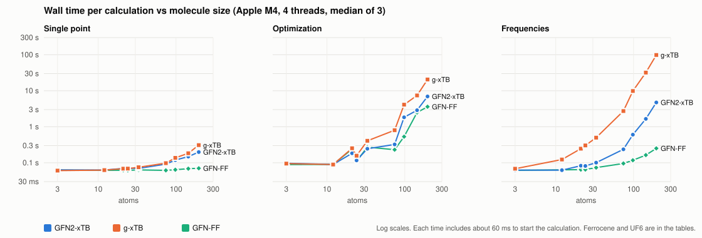

# xTB timings

How long GFN2-xTB, g-xTB 2.0.1 and GFN-FF calculations and conformer searches
take in ReShiki, measured through the same code the desktop app runs.

## What this means for you

- **Single points are instant at every size.** Up to 196 atoms each method
  takes 0.06 to 0.3 s, and most of that is starting the calculation (about
  60 ms). g-xTB costs about the same as GFN2-xTB here.
- **Optimizations take seconds.** At about 100 atoms GFN2-xTB takes 1.8 s and
  g-xTB 4.1 s; at 196 atoms, 7 s and 21 s. g-xTB costs 2–3 times GFN2-xTB from
  about 70 atoms up.
- **Frequencies are where g-xTB is expensive.** Its analytic Hessian costs 16
  times GFN2-xTB at about 100 atoms (10 s against 0.6 s) and 21 times at 196
  atoms (99 s against 4.7 s, with 0.9 GB of memory). Use g-xTB for frequencies
  when you need its accuracy for a molecule up to about 100 atoms, or are ready
  to wait one to two minutes at 150–200 atoms.
- **GFN-FF is the fastest for energies and frequencies**, 10–50 times cheaper
  than GFN2-xTB in the engine, and the way to pre-relax large or floppy
  structures. Its optimizations are only 1.2–3.6 times faster than GFN2-xTB,
  because they need more steps and each step also pays for the optimizer
  itself.
- **Conformer search** with the default settings (100 starts, MMFF94s, normal
  diversity, 20 re-ranked with GFN2-xTB) takes about 2 s at 40 atoms, 9 s at
  60, 13 s at 75 and 32 s at 100 atoms. 300 starts take 2.5 times as long at
  60 atoms and twice as long at 100 atoms. Minimizing all 100 starts with
  GFN2-xTB instead of MMFF94s takes 5 s at 40 atoms and keeps every cluster.
- **Threads:** on this machine 4 threads (its performance cores) are fastest
  for optimizations and g-xTB. 8 or 10 threads, which add efficiency cores,
  are 7–19% slower there. GFN2-xTB frequencies gain up to 10 threads.

## Setup

| Item       | Value                                                                                                                                                                        |
| ---------- | ---------------------------------------------------------------------------------------------------------------------------------------------------------------------------- |
| Code       | `xtb/next` at 05965b403 plus this page's benchmark driver (836ed6ff3); engine axtb 0.2.0 at 9d0388c (g-xTB 2.0.1)                                                            |
| Build      | `cargo build --release --features xtb,conformer-bench` (release profile, as `cargo run --release`; published builds add LTO)                                                 |
| Machine    | Apple M4 test machine (MacBook Air, 4 performance and 6 efficiency cores, 32 GB, no fan), macOS 27.0.1                                                                       |
| Threads    | 4 (`--threads 4`) unless a table says otherwise. The Calculate card's Auto uses up to 8. The conformer search uses its default, Auto: up to 8 one-thread xTB workers at once |
| Repeats    | 3 per case, run round-robin (every case once, then again); medians, with min–max where the spread exceeds 10% of the median                                                  |
| Idle check | Each run started only when other processes used under 6% of all cores over 3 s                                                                                               |
| Date       | 2026-11-26                                                                                                                                                                   |

Single points and frequencies ran through `reshiki --cli calc --task energy`
or `--task hessian`, which sends one request to the same
[xTB worker](../xtb-worker.md) the app starts. Optimizations ran through
`reshiki --cli calculate --task optimize`, which drives the worker with the
app's own optimizer and its Normal convergence. The times are wall times of
the whole command: process start, worker start, setup, calculation and
output. Peak memory is the largest resident set of the command and its
worker. Every calculation started from the same fixed geometry (RDKit ETKDG,
seed 42, minimized with MMFF94s; ferrocene and UF₆ idealized), so the
frequencies are at a geometry that is not a stationary point of each method:
the time is about the same, but the frequencies are not meaningful. In the app,
Optimize + Frequencies first optimizes with Tight convergence.

Each method ran with its defaults: GFN2-xTB at an electronic temperature of
300 K, g-xTB at 0 K. Swapping them (GFN2-xTB at 0 K, g-xTB at 300 K) changed
no time by more than 6% on ritonavir.

## Methods by size

### Single point

| Molecule                       | Atoms |      GFN2-xTB | SCF it. |               g-xTB | SCF it. |              GFN-FF | g-xTB / GFN2 | Peak memory (g-xTB) |
| ------------------------------ | ----: | ------------: | ------: | ------------------: | ------: | ------------------: | -----------: | ------------------: |
| Water                          |     3 |         64 ms |       8 | 61 ms (53 ms–62 ms) |      10 |               62 ms |         1.0× |               15 MB |
| UF₆                            |     7 | not supported |         |               63 ms |      10 |               58 ms |            – |               17 MB |
| Benzene                        |    12 |         63 ms |       7 |               63 ms |       8 |               62 ms |         1.0× |               16 MB |
| Aspirin                        |    21 |         70 ms |      11 |               69 ms |      10 |               62 ms |         1.0× |               18 MB |
| Ferrocene                      |    21 |         70 ms |      10 |               70 ms |      10 |               62 ms |         1.0× |               18 MB |
| Caffeine                       |    24 |         70 ms |      11 |               69 ms |      10 |               62 ms |         1.0× |               17 MB |
| Ala-Phe                        |    33 |         70 ms |      11 | 75 ms (68 ms–76 ms) |       9 |               63 ms |         1.1× |               18 MB |
| Cholesterol                    |    74 |         92 ms |      10 |               98 ms |       9 | 62 ms (51 ms–62 ms) |         1.1× |               28 MB |
| Ritonavir                      |    98 |        119 ms |      12 |              137 ms |      10 |               64 ms |         1.2× |               53 MB |
| Sirolimus (macrocycle)         |   144 |        149 ms |      12 |              184 ms |      10 |               69 ms |         1.2× |               84 MB |
| Cyclosporin A (cyclic peptide) |   196 |        199 ms |      11 |              310 ms |      11 | 70 ms (69 ms–91 ms) |         1.6× |              137 MB |

### Optimization

| Molecule                       | Atoms |      GFN2-xTB | steps |                  g-xTB | steps |                 GFN-FF | steps | g-xTB / GFN2 |
| ------------------------------ | ----: | ------------: | ----: | ---------------------: | ----: | ---------------------: | ----: | -----------: |
| Water                          |     3 |         97 ms |     4 |                  95 ms |     4 |                  89 ms |     3 |         1.0× |
| UF₆                            |     7 | not supported |       |                  90 ms |     3 |                  98 ms |     4 |            – |
| Benzene                        |    12 |         90 ms |     3 |                  90 ms |     3 |                  90 ms |     3 |         1.0× |
| Aspirin                        |    21 |        184 ms |    16 |                 254 ms |    18 |                 240 ms |    23 |         1.4× |
| Ferrocene                      |    21 |        134 ms |     8 | 135 ms (122 ms–136 ms) |     5 |                 138 ms |     9 |         1.0× |
| Caffeine                       |    24 |        117 ms |     6 |                 158 ms |     6 | 112 ms (112 ms–377 ms) |     6 |         1.4× |
| Ala-Phe                        |    33 |        245 ms |    18 |                 408 ms |    24 |                 272 ms |    24 |         1.7× |
| Cholesterol                    |    74 |        323 ms |    14 |                 803 ms |    17 |                 231 ms |    14 |         2.5× |
| Ritonavir                      |    98 |         1.8 s |    50 |                  4.1 s |    49 |                 532 ms |    35 |         2.2× |
| Sirolimus (macrocycle)         |   144 |         2.9 s |    43 |   7.4 s (7.3 s–10.1 s) |    49 |                  2.5 s |    82 |         2.6× |
| Cyclosporin A (cyclic peptide) |   196 |         7.0 s |    58 |                 20.6 s |    75 |                  3.6 s |    87 |         3.0× |

### Frequencies (Hessian)

| Molecule                       | Atoms |            GFN2-xTB | SCF it. |                 g-xTB | SCF it. |                 GFN-FF | g-xTB / GFN2 | Peak memory (g-xTB) |
| ------------------------------ | ----: | ------------------: | ------: | --------------------: | ------: | ---------------------: | -----------: | ------------------: |
| Water                          |     3 |               63 ms |       2 |                 68 ms |      10 |                  62 ms |         1.1× |               17 MB |
| UF₆                            |     7 |       not supported |         |                111 ms |      10 |                  64 ms |            – |               22 MB |
| Benzene                        |    12 | 62 ms (62 ms–69 ms) |       2 |                123 ms |       8 |                  64 ms |         2.0× |               21 MB |
| Aspirin                        |    21 |               83 ms |       2 |                247 ms |      10 |                  65 ms |         3.0× |               29 MB |
| Ferrocene                      |    21 |               75 ms |       2 |                251 ms |      10 |                  64 ms |         3.4× |               29 MB |
| Caffeine                       |    24 |               82 ms |       2 |                304 ms |      10 |                  65 ms |         3.7× |               32 MB |
| Ala-Phe                        |    33 |              101 ms |       2 |                498 ms |       9 |                  74 ms |         4.9× |               42 MB |
| Cholesterol                    |    74 |              236 ms |       2 |                 2.7 s |       9 |    96 ms (88 ms–98 ms) |        11.6× |              109 MB |
| Ritonavir                      |    98 |              606 ms |       2 |                 9.8 s |      10 | 118 ms (114 ms–137 ms) |        16.3× |              256 MB |
| Sirolimus (macrocycle)         |   144 |               1.7 s |       2 |                32.0 s |      10 | 164 ms (155 ms–175 ms) |        19.3× |              502 MB |
| Cyclosporin A (cyclic peptide) |   196 |               4.7 s |       2 | 98.6 s (98.6 s–140 s) |      11 |                 252 ms |        20.9× |              929 MB |

SCF iterations are the worker's count for the converged SCF. With a GFN2-xTB
Hessian the engine reports 2. Optimization steps are accepted optimizer steps; each also
computes a gradient. GFN2-xTB has no parameters for uranium, so UF₆ runs
only with g-xTB and GFN-FF.

In the engine alone (the time the worker reports, without starting the
process), g-xTB single points cost 0.9–1.4 times GFN2-xTB from 74 to 196
atoms. The rest of the wall-time gap at 196 atoms (0.31 s against 0.20 s) is
g-xTB's longer setup when the calculation opens.

## Threads

Ritonavir (98 atoms), median of 3 wall times; speedup against 1 thread.

| Threads | GFN2-xTB optimization | GFN2-xTB frequencies | g-xTB single point | g-xTB frequencies |
| ------: | --------------------: | -------------------: | -----------------: | ----------------: |
|       1 |                2.61 s |               1.57 s |            0.181 s |            27.6 s |
|       2 |        2.02 s (1.29×) |       0.91 s (1.72×) |    0.149 s (1.21×) |    15.6 s (1.77×) |
|       4 |        1.83 s (1.42×) |       0.61 s (2.55×) |    0.134 s (1.35×) |    10.7 s (2.57×) |
|       8 |        1.96 s (1.33×) |       0.53 s (2.94×) |    0.149 s (1.21×) |    11.7 s (2.36×) |
|      10 |        2.05 s (1.27×) |       0.52 s (3.03×) |    0.159 s (1.14×) |    11.6 s (2.38×) |

The M4 has 4 performance cores. Threads beyond 4 run on efficiency cores and
wait for each other, so only the GFN2-xTB Hessian still gains. Optimizations
gain little from threads at this size: each step is short, and the conformer
search uses one thread per worker for that reason.

## Starting a calculation

Water, one thread, median of 10.

| Step                               |      GFN-FF |    GFN2-xTB |       g-xTB |
| ---------------------------------- | ----------: | ----------: | ----------: |
| Start the worker process           |      5.8 ms |      5.7 ms |      5.8 ms |
| Worker ready (first reply)         |     17.2 ms |     17.5 ms |     16.9 ms |
| Open the molecule                  |      0.5 ms |      0.4 ms |      0.9 ms |
| Calculate                          |      0.2 ms |      0.7 ms |      0.5 ms |
| Close and exit                     |      1.1 ms |      1.2 ms |      1.2 ms |
| **Worker total**                   | **24.8 ms** | **25.1 ms** | **25.4 ms** |
| Whole `reshiki --cli calc` command |       62 ms |       63 ms |       62 ms |

Every calculation in the app starts a fresh worker, about 25 ms on this
machine. The command line adds its own start (about 37 ms), which the app
does not pay.

## Conformer search

The app's own search (`src/app/xtb/conformers/pipeline.rs`), driven from the
command line by the developer-only `reshiki --conformer-bench` (build feature
`conformer-bench`). It reads a SMILES, makes the 3D model as the app does for a
calculation, and runs the search with the Calculate card's defaults: 100
starts, MMFF94s, normal diversity, 15 kcal/mol window, 20 representatives
re-ranked with GFN2-xTB, lowest 1 per cluster, Auto threads (8 workers). Median
of 3 runs; the runs differed by under 1%.

| Molecule                                    | Atoms | Starts | Search | Embedding | MMFF94s | Clustering |                  GFN2-xTB re-rank | Valid starts | Clusters | Kept | Saved file |
| ------------------------------------------- | ----: | -----: | -----: | --------: | ------: | ---------: | --------------------------------: | -----------: | -------: | ---: | ---------: |
| Propranolol                                 |    40 |    100 |  2.1 s |     0.7 s |   0.8 s |   < 0.01 s |                             0.6 s |           99 |       34 |   20 |      60 KB |
| Tyr-Gly-Gly-Phe                             |    58 |    100 |  8.8 s |     3.3 s |   3.0 s |   < 0.01 s |                             2.5 s |           76 |       70 |   20 |      89 KB |
| Tyr-Gly-Gly-Phe                             |    58 |    300 | 21.6 s |     9.7 s |   9.0 s |     0.01 s |                             2.9 s |          234 |      171 |   20 |      88 KB |
| Atorvastatin                                |    76 |    100 | 13.4 s |     5.7 s |   4.5 s |     0.01 s |                             3.2 s |           98 |       77 |   20 |     114 KB |
| Ritonavir                                   |    98 |    100 | 32.3 s |    10.6 s |   7.9 s |   < 0.01 s |                            13.8 s |           26 |       26 |   20 |     144 KB |
| Ritonavir                                   |    98 |    300 | 65.9 s |    31.6 s |  23.0 s |   < 0.01 s |                            11.4 s |           70 |       70 |   20 |     143 KB |
| Propranolol, GFN2-xTB minimizes every start |    40 |    100 |  5.0 s |     0.7 s |       – |   < 0.01 s | 4.3 s (minimizing all 100 starts) |          100 |       34 |   34 |      68 KB |

- **Search** is the pipeline from its first step to the ranked result. Making
  the 3D model first adds 0.1 s (40 atoms) to 1.1 s (98 atoms).
- **Embedding** is a separate run of the same starts without minimization;
  it includes setting up the force field and one energy per start. **MMFF94s**
  is the sampling step's time minus that. **GFN2-xTB re-rank** runs from the
  first to the last re-ranked representative; ranking and deduplication after
  it take under 3 ms.
- **Valid starts** are those that embedded and converged with the force field.
  For ritonavir the geometry worker made 77 of 100 (225 of 300) starts, and 51
  (155) did not converge within MMFF94s's step limit, so 26 (70) remained.
- **Saved file** is the `.rsk` document with the 3D model and the result; the
  model alone is 19–49 KB.

## Where the time goes in the engine

Sampling profiles (Time Profiler) of ritonavir, 98 atoms, 4 threads. Shares
of on-CPU samples across all threads; each sample counts toward the innermost
engine function it is in.

| Share of samples                                                    | GFN2-xTB single point | g-xTB single point | GFN2-xTB Hessian | g-xTB Hessian |
| ------------------------------------------------------------------- | --------------------: | -----------------: | ---------------: | ------------: |
| Diagonalization (tridiagonal eigensolver, generalized eigenproblem) |                   49% |                24% |               6% |            3% |
| Hamiltonian / Fock build, density, populations                      |                    8% |                25% |               7% |           11% |
| Exchange (g-xTB)                                                    |                     – |                 4% |                – |           36% |
| Hessian response (CPSCF) and derivative terms                       |                     – |                  – |              55% |           30% |
| Integrals                                                           |                    2% |                 9% |               2% |           11% |
| Electrostatics                                                      |                    3% |                 2% |             < 1% |            7% |
| Dispersion                                                          |                    3% |               < 1% |               2% |          < 1% |
| Matrix multiply on pool threads (caller not on the stack)           |                   12% |                20% |              25% |            1% |
| Idle worker threads, other engine code                              |                   13% |                 9% |               2% |            1% |
| Process start, command line and output                              |                   10% |                 7% |               1% |          < 1% |

The engine is pure Rust (faer for linear algebra). For single points the
eigensolver is the largest cost; for Hessians it is the response equations
and, for g-xTB, its exchange term.

## Reproduce

1. Build: `cargo build --release --features xtb,conformer-bench`.
2. Geometries: for each SMILES in the table above, embed with RDKit ETKDGv3
   (random seed 42), add hydrogens and minimize with MMFF94s to convergence;
   write XYZ.
3. Method timings: `reshiki --cli calc --task energy|hessian --method gfn2|gxtb|gfnff --threads 4 FILE.xyz`
   and `reshiki --cli calculate --task optimize --method … --threads 4 FILE.xyz`,
   each under `/usr/bin/time -l` for the peak memory.
4. Conformer search: `reshiki --conformer-bench FILE.smi [--starts 300] [--minimizer gfn2] [--embed-probe]`
   prints one JSON line with the phase times, counts and file sizes.

The scripts (geometries, round-robin runner with the idle check, worker
start-up timer, profile folding) and every run's raw record are in the
[pull request's evidence](https://github.com/Ameyanagi/ReShiki-evidence/tree/main/pr-reviews/pr1452).

## Limits

- One machine: an Apple M4 without a fan. Long runs can slow down as it
  warms; the round-robin order spreads that over all cases. Expect different
  numbers on other computers, and relative costs to hold better than absolute
  times.
- The command line adds about 37 ms per calculation that the app does not pay;
  the app shows orbitals and bond orders after a calculation, which the
  command line does not compute.
- Molecules are single conformers of one structure each; the step counts of
  optimizations depend on the starting geometry.
