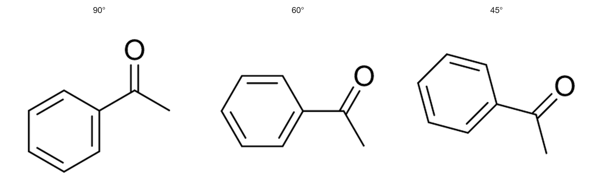
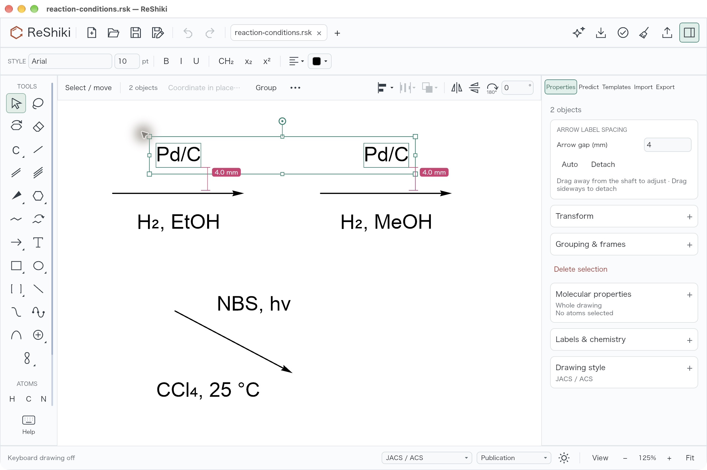

# ReShiki 0.14.0

ReShiki 0.14.0 names structures with a new offline structure-to-name engine
and tells you whether each name is the preferred IUPAC name. Name import reads
more kinds of names, and an optional PubChem lookup covers common names. The
release adds Fischer projections, D/L, axial and steroid α/β descriptors,
IUPAC drawing conventions for double bonds, wedges, charges and salts, and
new template groups. 3D models flag stale conformers, and crystal models gain
ORTEP ellipsoids. The release also ships the first `reshiki` Python package
and touch drawing and real Save in the browser editor. Installed applications
still work on your computer without Python, RDKit or uv.

[Release downloads](https://github.com/Ameyanagi/ReShiki/releases/tag/v0.14.0) ·
[Previous release](changes-0.13.1.md) ·
[Release validation](release-0.14.0-validation.md).

## File compatibility

Most drawings saved in 0.14.0 still use document version **30** and open in
ReShiki 0.13.1. A drawing that uses one of these new features needs 0.14.0:

| Version | Feature in the drawing                                                                          |
| ------- | ----------------------------------------------------------------------------------------------- |
| 31      | A reaction label with a custom gap to its arrow                                                 |
| 32      | ORTEP thermal ellipsoids or molecule-only display on a crystal model                            |
| 33      | A 3D model generated from a structure in 0.14.0, 3D atom labels, or a plain XYZ model           |
| 34      | An amino-acid residue collapsed with two attachment points, such as `-Ala-` between Boc and OMe |

ReShiki 0.13.1 and earlier say that such a drawing was made with a newer
version and ask you to update. ReShiki 0.13.0 and earlier cannot open any
version 30 drawing. Older drawings still open in 0.14.0. If you share files with
someone on an older version, keep a copy saved by that version.

## Highlights

- **Structure to name with a preferred-name status.** Generated names come from
  a Rust port of openclatura and must parse back to the same structure. Each
  name is tagged **Preferred IUPAC name**, **Systematic name, not the preferred
  IUPAC name** or **Systematic name, preference not verified**, with the reason
  on hover.
- **More names in and out.** Salts, isotopologues, radicals, ring assemblies,
  phane, spiro, r/s, endo/exo and (M)/(P) axis names; Import → Name reads salts,
  phane names, signed CIP names, peptides and glycans; **Look up online…** asks
  PubChem after you confirm each query.
- **Stereochemistry and projections.** Fischer projections, D/L, steroid α/β
  and (M)/(P) labels, **Invert Configuration Here**, Ξ/ξ for unknown
  configuration and stereo checks in **Check drawing**.
- **IUPAC drawing conventions.** Double-bond placement, wedge direction, charge
  and radical order, partial charges, salt layout, bracket superscripts and
  hydrogen-isotope labels follow the IUPAC graphical recommendations.
- **Templates.** Steroids, nucleosides, Fischer projections, coordination
  geometry frames, 9H purines and IUPAC names in template search.
- **3D models and crystals.** **Structure changed · Update model**, conformer
  regeneration, 3D atom labels, ORTEP thermal ellipsoids, and boundary copies,
  Repeat and Look along in the 3D crystal view.
- **Python package.** `uv add reshiki` draws, converts and analyzes structures
  from scripts, Jupyter, pandas and Excel with the editor's engine.
- **Browser editor.** Touch drawing, pinch zoom and long-press menus; Save writes
  back to the opened file in Chrome and Edge.

The changes below keep their contributor credits and links to their issues and
reviews. All changes in this release are by @Ameyanagi unless another
contributor is named.

## Chemical names

- **Structure to name with a preferred-name status.** Structure to name runs on
  a Rust port of [openclatura](https://github.com/lamalab-org/openclatura)
  0.4.3 (MIT). Every generated name is parsed back with the OPSIN port and is
  refused unless it rebuilds the structure. The Chemical names inspector shows
  a status tag under each name, and `reshiki --cli name --json` reports
  `status`, `reason` and `detail`. A name is **Preferred IUPAC name** only when
  its whole path belongs to an audited family and no check finds a departure
  from the IUPAC 2013 rules; every other name starts as **preference not
  verified**. Names known to differ from the preferred name, such as substitutive
  names where the preferred name is a phane or multiplicative name, are marked
  **not the preferred IUPAC name** with the rule. The ordinary name of a
  cyclophane is marked not preferred, because its preferred IUPAC name is a
  phane name (P-52.2.5).
  [Chemical names](chemical-naming-rust.md#preferred-iupac-name-status) ·
  [PR #771](https://github.com/Ameyanagi/ReShiki/pull/771),
  [#965](https://github.com/Ameyanagi/ReShiki/pull/965),
  [#930](https://github.com/Ameyanagi/ReShiki/pull/930),
  [#958](https://github.com/Ameyanagi/ReShiki/pull/958).
- **New kinds of generated names.** Charge-balanced salts (`sodium acetate`,
  `disodium sulfate`), isotopologues, radicals and radical ions; identical ring
  assemblies (`[1,1′-binaphthalene]-2,2′-diol`, `2,2′-bipyridine`); spirobi
  names; benzo names for benzene fused to a heteromonocycle
  (`1,3-benzoxazepine`); multiplied fusion components
  (`difuro[3,2-b:3′,4′-e]pyridine`); and every ring of Blue Book Table 2.8,
  plus pyrrolizine and the phenoxazine family, as fusion components. Simple
  cyclophanes gain a phane name such as `1,4(1,4)-dibenzenacyclohexaphane` for
  [2.2]paracyclophane, which had no name before.
  [#890](https://github.com/Ameyanagi/ReShiki/pull/890),
  [#912](https://github.com/Ameyanagi/ReShiki/pull/912),
  [#993](https://github.com/Ameyanagi/ReShiki/pull/993),
  [#910](https://github.com/Ameyanagi/ReShiki/pull/910),
  [#919](https://github.com/Ameyanagi/ReShiki/pull/919),
  [#932](https://github.com/Ameyanagi/ReShiki/pull/932),
  [#964](https://github.com/Ameyanagi/ReShiki/pull/964),
  [#1013](https://github.com/Ameyanagi/ReShiki/pull/1013),
  [#1025](https://github.com/Ameyanagi/ReShiki/pull/1025),
  [#891](https://github.com/Ameyanagi/ReShiki/pull/891) ·
  [issue #860](https://github.com/Ameyanagi/ReShiki/issues/860).
- **Stereodescriptors in names.** Disubstituted cyclohexanes and cyclobutanes
  use r/s (`(1r,4r)-cyclohexane-1,4-diol`), with cis/trans under **Other names**.
  Bicyclo[2.2.1] and [3.2.1] cages list endo/exo/syn/anti names. Atropisomeric
  biaryls are named with (M)/(P), and Ra/Sa as an alternative. Wavy bonds and
  undefined centres no longer block a name; an optional setting writes Ξ/ξ for
  unknown configuration. Descriptor locants are dropped only where the position
  is unambiguous (`(E)-cyclooctene`), and E/Z left unspecified by SMILES or
  InChI input stays unspecified.
  [#889](https://github.com/Ameyanagi/ReShiki/pull/889),
  [#898](https://github.com/Ameyanagi/ReShiki/pull/898),
  [#901](https://github.com/Ameyanagi/ReShiki/pull/901),
  [#899](https://github.com/Ameyanagi/ReShiki/pull/899),
  [#911](https://github.com/Ameyanagi/ReShiki/pull/911),
  [#909](https://github.com/Ameyanagi/ReShiki/pull/909),
  [#988](https://github.com/Ameyanagi/ReShiki/pull/988).
- **Curated aliases and compound classes.** The offline alias catalog adds the
  21 amino-acid templates (`L-alanine`), nucleobases and 24 sugar anomers
  (`β-D-glucopyranose`), matched with exact stereo and tautomer. Molecular
  properties gains a **Classes** row with chips such as lactam, amide and
  ester, each with a one-line definition.
  [#891](https://github.com/Ameyanagi/ReShiki/pull/891) ·
  [issues #861](https://github.com/Ameyanagi/ReShiki/issues/861),
  [#862](https://github.com/Ameyanagi/ReShiki/issues/862).
- **Import → Name reads more names.** Salts and mixtures (`sodium acetate`,
  `triethylamine hydrochloride`), rotation signs beside CIP descriptors
  (`(S)-(+)-ibuprofen`), peptide and glycan symbols, phane names, (M)/(P)
  and Ra/Sa axis descriptors and relative or racemic stereo groups. The
  offline parser follows OPSIN's main branch (commit `42e87ac6`) instead of
  the 2.9.0 release, with its later vocabulary and fixes. An optional **Number
  atoms by name locants** writes the parent locants as atom numbers.
  [#887](https://github.com/Ameyanagi/ReShiki/pull/887),
  [#751](https://github.com/Ameyanagi/ReShiki/pull/751),
  [#888](https://github.com/Ameyanagi/ReShiki/pull/888),
  [#962](https://github.com/Ameyanagi/ReShiki/pull/962),
  [#933](https://github.com/Ameyanagi/ReShiki/pull/933),
  [#973](https://github.com/Ameyanagi/ReShiki/pull/973) ·
  [issue #731](https://github.com/Ameyanagi/ReShiki/issues/731).
- **Confirmed online name lookup.** **Look up online…** in both naming panels
  asks PubChem for a common name the offline parser does not know. Each query
  shows the exact name and destination and needs confirmation; the result opens
  as an editable preview with its PubChem link, and **Insert** is a separate
  step. Local naming stays offline. Reported by @fusion809 in
  [issue #596](https://github.com/Ameyanagi/ReShiki/issues/596).
  [Chemical names](chemical-naming-rust.md#look-up-a-common-name-online) ·
  [Native and browser examples](changes/online-name-lookup.md) ·
  [PR #599](https://github.com/Ameyanagi/ReShiki/pull/599).
- **Typeset and copy names.** Name captions and the inspector set
  stereodescriptors, locants and fusion letters in italics, with primes, small
  capitals and λ, as IUPAC prints them; **Chemical name typography** in View
  turns this off for new captions. **Copy name** also puts HTML and RTF on the
  clipboard, and **Copy As → Name** names one complete molecule. **IUPAC
  locants** in Atom numbers numbers a molecule by its parent locants, and
  hovering a locant highlights its atom.
  [#875](https://github.com/Ameyanagi/ReShiki/pull/875),
  [#874](https://github.com/Ameyanagi/ReShiki/pull/874),
  [#888](https://github.com/Ameyanagi/ReShiki/pull/888).
- **Name corrections.** Many generated names now follow the IUPAC 2013 rules
  more closely, among them: suffix locant 1 on substituted monocycles
  (`2-methylcyclohexan-1-ol`); cumulene locants; anionic centres in the parent
  and cationic before anionic suffixes in zwitterions; phenoxide, alkoxide,
  azaniumyl and anilinium spellings; contracted phenoxy and alkoxy prefixes;
  amine oxides (`pyridine 1-oxide`); toluene and xylene; spiro hydrogen and
  numbering; indicated and added hydrogen in ring names; salt ion order; and
  locants omitted only when no isomer exists. Parent and locant choices no
  longer depend on atom order in the cases reported. SMILES whose cumulene E/Z
  would be lost are refused instead of named without it.
  [#917](https://github.com/Ameyanagi/ReShiki/pull/917),
  [#918](https://github.com/Ameyanagi/ReShiki/pull/918),
  [#923](https://github.com/Ameyanagi/ReShiki/pull/923),
  [#931](https://github.com/Ameyanagi/ReShiki/pull/931),
  [#935](https://github.com/Ameyanagi/ReShiki/pull/935),
  [#941](https://github.com/Ameyanagi/ReShiki/pull/941),
  [#976](https://github.com/Ameyanagi/ReShiki/pull/976),
  [#977](https://github.com/Ameyanagi/ReShiki/pull/977),
  [#978](https://github.com/Ameyanagi/ReShiki/pull/978),
  [#981](https://github.com/Ameyanagi/ReShiki/pull/981),
  [#985](https://github.com/Ameyanagi/ReShiki/pull/985),
  [#986](https://github.com/Ameyanagi/ReShiki/pull/986),
  [#989](https://github.com/Ameyanagi/ReShiki/pull/989),
  [#990](https://github.com/Ameyanagi/ReShiki/pull/990),
  [#991](https://github.com/Ameyanagi/ReShiki/pull/991),
  [#992](https://github.com/Ameyanagi/ReShiki/pull/992),
  [#999](https://github.com/Ameyanagi/ReShiki/pull/999),
  [#1000](https://github.com/Ameyanagi/ReShiki/pull/1000),
  [#1014](https://github.com/Ameyanagi/ReShiki/pull/1014),
  [#1015](https://github.com/Ameyanagi/ReShiki/pull/1015),
  [#1016](https://github.com/Ameyanagi/ReShiki/pull/1016),
  [#1023](https://github.com/Ameyanagi/ReShiki/pull/1023),
  [#1024](https://github.com/Ameyanagi/ReShiki/pull/1024).

## Stereochemistry and projections

- **Fischer projections, D/L and Invert Configuration Here.** A **Fischer
  projections** template group (D- and L-glyceraldehyde, open-chain D-glucose
  and D-ribose, L-alanine, L-serine, sn-glycerol 3-phosphate) stores real
  configurations, kept in native files, MOL, isomeric SMILES and InChI.
  **Convert to Wedge Drawing** and **Convert to Fischer Projection** keep the
  configuration of supported acyclic chains in one Undo step. **Invert
  Configuration Here** switches a Haworth anomer or epimer, a Fischer centre
  or an ordinary stereocentre. Atom labels offer **Show D/L for amino acids and
  sugars** beside R/S.
  [Fischer projections](haworth-projections.md#fischer-projections) ·
  [PR #894](https://github.com/Ameyanagi/ReShiki/pull/894) ·
  [issues #866](https://github.com/Ameyanagi/ReShiki/issues/866),
  [#867](https://github.com/Ameyanagi/ReShiki/issues/867),
  [#868](https://github.com/Ameyanagi/ReShiki/issues/868).
- **Axial chirality and steroid α/β.** Wedged biaryl axes and allenes are
  perceived and labelled (M) or (P) and kept through MOL and CDXML; allenes
  also keep it in SMILES and InChI.
  **Axial descriptors** can show Ra/Sa instead. Double bonds between ligands of
  opposite chirality show (seqCis) or (seqTrans). **Steroid α/β** labels the
  ring centres of a gonane nucleus 3β, 5α, … in place of R/S.
  [#892](https://github.com/Ameyanagi/ReShiki/pull/892),
  [#872](https://github.com/Ameyanagi/ReShiki/pull/872),
  [#893](https://github.com/Ameyanagi/ReShiki/pull/893).
- **Stereo checks.** **Check drawing** reports reversed, ineffective,
  ambiguous and conflicting stereobonds and undefined stereocentres, selects
  them, and offers **Reverse** and **Redraw stereo bonds**, each one Undo step.
  Undefined units can show a Ξ/ξ marker.
  [#876](https://github.com/Ameyanagi/ReShiki/pull/876),
  [#899](https://github.com/Ameyanagi/ReShiki/pull/899).
- **Wedge conventions.** A new wedge puts its narrow end on the atom that can be
  a stereocentre. **Four-substituent stereocentres: wedge + hash pair** in
  Drawing style draws generated structures with a wedge and a hash.
  [#793](https://github.com/Ameyanagi/ReShiki/pull/793).
- **Singlet and triplet carbenes and nitrenes** keep their spin state through
  MOL, CDXML and `.rsk`.
  [#878](https://github.com/Ameyanagi/ReShiki/pull/878).

## Drawing conventions and labels

- **Double-bond placement.** Automatic fusion double bonds favour the ring with
  more other double or aromatic bonds, preferring six-membered rings on a tie.
  Substituted chain double bonds offset toward an attached ring or the side
  with more substituents; equal counts follow ChemDraw's stored-direction tie
  rule. Terminal heteroatom doubles such as C=O stay centred, and **Center
  chain double bonds** in Document Style restores centred chains. Centred
  double bonds join their neighbouring bonds without a notch, and a rotated C=O
  keeps a compact gap to its O label.
  [#792](https://github.com/Ameyanagi/ReShiki/pull/792),
  [#724](https://github.com/Ameyanagi/ReShiki/pull/724),
  [#1027](https://github.com/Ameyanagi/ReShiki/pull/1027) ·
  [issues #778](https://github.com/Ameyanagi/ReShiki/issues/778),
  [#779](https://github.com/Ameyanagi/ReShiki/issues/779),
  [#780](https://github.com/Ameyanagi/ReShiki/issues/780) ·
  [Carbonyl comparison](changes/carbonyl-rotation.md) ·
  [Centred double-bond joins](changes/centered-double-joins.md).

  

- **Charges and radicals.** A charged radical prints the dot first (N•+), with
  an optional mass-spectrometry order. Partial charges δ+/δ− attach to atoms,
  **Make ionic** turns a bond from an alkali or alkaline-earth metal to O, N,
  S or a halogen into an ion pair, and a ring can carry a centred charge.
  [#790](https://github.com/Ameyanagi/ReShiki/pull/790).
- **Isotopes and formulas.** Deuterium and tritium draw as D and T unless the
  molecule has another labelled nuclide. Typing D, 13C or 13CH3 makes a real
  isotope. Displayed formulas list nuclides separately and use IUPAC ion
  notation; Molecular properties adds a calculated elemental analysis and
  shows where its atomic weights come from.
  [#879](https://github.com/Ameyanagi/ReShiki/pull/879),
  [#877](https://github.com/Ameyanagi/ReShiki/pull/877).
- **Brackets and salts.** Brackets carry a superscript (‡, +, −, •+, custom),
  with a **Transition state [ ]‡** preset and a **Bracket ion** command. Salts
  imported from SMILES, InChI or a name are laid out on one baseline, larger
  component first, and new layouts follow the IUPAC orientation guidelines.
  [#883](https://github.com/Ameyanagi/ReShiki/pull/883),
  [#885](https://github.com/Ameyanagi/ReShiki/pull/885).
- **Two-sided residue groups.** Amino-acid residues collapse into one label
  with two attachment points, such as Boc–Ala–Gly–OMe, while every atom stays
  in the document. Saved as document version 34.
  [#900](https://github.com/Ameyanagi/ReShiki/pull/900) ·
  [issue #870](https://github.com/Ameyanagi/ReShiki/issues/870).
- **Drawing hints.** Atom labels and Abbreviations warn when hidden hydrogens
  or charges change what readers see, or when a label reads as an element.
  The isotope field is labelled **Mass number** and checks its element.
  [#873](https://github.com/Ameyanagi/ReShiki/pull/873).
- **Straight inserts.** Molecules inserted from SMILES, names, InChI or the
  assistant, and Clean up results, turn by up to 15° so ring and chain bonds
  sit on the 30° grid. SPhos and XPhos lay out as four separate rings, and
  codeine imported by name keeps its N clear of the C9–C10 bond.
  [#745](https://github.com/Ameyanagi/ReShiki/pull/745),
  [#734](https://github.com/Ameyanagi/ReShiki/pull/734),
  [#735](https://github.com/Ameyanagi/ReShiki/pull/735).

## Templates

- **New groups.** Steroids, nucleosides and nucleotides, more Haworth sugars,
  selenocysteine (Sec) and peptide aliases; **Coordination geometry** frames
  for square planar, trigonal bipyramidal and octahedral centres; and the
  **Fischer projections** group.
  [#881](https://github.com/Ameyanagi/ReShiki/pull/881),
  [#882](https://github.com/Ameyanagi/ReShiki/pull/882),
  [#894](https://github.com/Ameyanagi/ReShiki/pull/894).
- **IUPAC search and 9H purines.** Template search finds rings by IUPAC and
  von Baeyer names and nucleobases and sugars by their symbols. Adenine,
  guanine and purine are drawn as the 9H tautomer, with 7H-purine kept as its
  own entry. Fused ring parents are added, and previews show locants.
  [#880](https://github.com/Ameyanagi/ReShiki/pull/880).
- **Browsing.** Search inside a category says so and offers **Search all**,
  category rows stay in place, and heteroaromatics are listed under
  Heterocycles.
  [#748](https://github.com/Ameyanagi/ReShiki/pull/748).

## Reactions, arrows and graphics

- **Adjustable reaction-label spacing.** Set an attached condition label to an
  exact gap in the current ruler unit, or drag it perpendicular to the arrow
  while it stays attached. Several labels share one gap in one Undo step.
  Custom gaps are saved as document version 31.
  [Adjust label spacing](arrows.md#adjust-label-spacing) ·
  [Native QA evidence](changes/arrow-label-spacing.md) ·
  [PR #603](https://github.com/Ameyanagi/ReShiki/pull/603).

  

- **Arrow meanings and reaction roles.** Reaction roles go only on forward,
  equilibrium and bent arrows. Arrow presets explain their meaning in the
  palette and Help, and retrosynthesis arrows round-trip through CDXML.
  [#884](https://github.com/Ameyanagi/ReShiki/pull/884).
- **Curved arrows** from a bond to its own atom bow clear of the bond, two
  fishhooks from one bond take opposite sides, and heads follow the shaft.
  The inline condition editor opens away from its arrow.
  [#739](https://github.com/Ameyanagi/ReShiki/pull/739),
  [#607](https://github.com/Ameyanagi/ReShiki/pull/607).
- **Pen paths and curves.** Nodes are Corner, Smooth or Symmetric. **Smooth**
  and **Symmetrise** tidy pen paths, Bézier curves and curved arrows, and open
  paths and curves can have arrowheads.
  [#763](https://github.com/Ameyanagi/ReShiki/pull/763),
  [#768](https://github.com/Ameyanagi/ReShiki/pull/768),
  [#777](https://github.com/Ameyanagi/ReShiki/pull/777) ·
  [issue #760](https://github.com/Ameyanagi/ReShiki/issues/760).

## 3D models and crystals

- **Stale models and regenerated conformers.** A model keeps its conformer
  after a chemical edit and shows **Structure changed · Update model**.
  **Update model** and **Regenerate conformer** run in the background, can be
  cancelled, keep the view and appearance and commit one Undo step. **Atom
  labels** offers None, Heteroatoms and All.
  [3D models](3d-keyboard-drawing.md#show-a-molecule-as-a-3d-model) ·
  [PR #659](https://github.com/Ameyanagi/ReShiki/pull/659) ·
  [issue #386](https://github.com/Ameyanagi/ReShiki/issues/386).
- **ORTEP thermal ellipsoids.** CIF models with displacement parameters can
  draw ellipsoids at 30, 50, 70 or 90% probability, with principal-plane
  outlines and a shaded octant, plus **Molecule only** and optional solvent
  hiding. SVG, PNG and PDF export draw them.
  [PR #649](https://github.com/Ameyanagi/ReShiki/pull/649) ·
  [issue #417](https://github.com/Ameyanagi/ReShiki/issues/417).
- **Crystals in 3D.** The 3D model draws boundary copies, and Repeat and Look
  along work in 3D and in Both. Disordered CIF files keep the major disorder
  group and say which one, and crystal ion charges are kept. Space-filling
  seams stay while a model turns.
  [#757](https://github.com/Ameyanagi/ReShiki/pull/757),
  [#754](https://github.com/Ameyanagi/ReShiki/pull/754),
  [#755](https://github.com/Ameyanagi/ReShiki/pull/755),
  [#758](https://github.com/Ameyanagi/ReShiki/pull/758),
  [#759](https://github.com/Ameyanagi/ReShiki/pull/759).

## Python package

- **`reshiki` on PyPI.** Draw, convert and analyze structures from scripts,
  Jupyter, pandas and Excel with the same headless Rust engine as the editor.
  Immutable objects support chained cleanup and styles, and batches report
  errors per row. Wheels for macOS, Windows and Linux on x64 and ARM64 follow
  each release, starting with 0.14.0. Install with `uv add reshiki` or
  `pip install reshiki`; the API is experimental.
  [Python guide](python.md) ·
  [PR #611](https://github.com/Ameyanagi/ReShiki/pull/611),
  [#936](https://github.com/Ameyanagi/ReShiki/pull/936) ·
  [issue #608](https://github.com/Ameyanagi/ReShiki/issues/608).

## Browser editor

- **Touch.** Draw with a finger, pinch to zoom, pan with two fingers and
  long-press for the context menu. The canvas has a label and status
  announcements for screen readers.
  [PR #610](https://github.com/Ameyanagi/ReShiki/pull/610) ·
  [issue #435](https://github.com/Ameyanagi/ReShiki/issues/435).
- **Save.** In Chrome and Edge, Save writes back to the opened file and Save As
  offers a name and location. Other browsers download a named file and keep
  the tab marked unsaved. Reopening an open file returns to its tab.
  [PR #612](https://github.com/Ameyanagi/ReShiki/pull/612) ·
  [issue #428](https://github.com/Ameyanagi/ReShiki/issues/428).
- After a reload, the empty canvas offers to restore unsaved drawings.
  [#752](https://github.com/Ameyanagi/ReShiki/pull/752).

## Desktop

- **Windows Office tabs** name their application (`Drawing in PowerPoint.rsk`),
  Paste Special names ReShiki drawing as the source, and the busy cursor ends
  once ReShiki has taken the drawing.
  [#772](https://github.com/Ameyanagi/ReShiki/pull/772) ·
  [issues #693](https://github.com/Ameyanagi/ReShiki/issues/693),
  [#695](https://github.com/Ameyanagi/ReShiki/issues/695),
  [#697](https://github.com/Ameyanagi/ReShiki/issues/697).
- **Linux launchers** can group ReShiki windows with their launcher and icon.
  Reported by @fusion809 in
  [issue #597](https://github.com/Ameyanagi/ReShiki/issues/597).
  [Metadata checks and limits](changes/linux-window-identity.md) ·
  [PR #598](https://github.com/Ameyanagi/ReShiki/pull/598).
- **macOS printing.** The print worker closes when the editor quits or
  crashes.
  [#775](https://github.com/Ameyanagi/ReShiki/pull/775).
- **Imported files** show their source name in tabs and the window title, and
  restored drafts keep their file name.
  [#606](https://github.com/Ameyanagi/ReShiki/pull/606),
  [#752](https://github.com/Ameyanagi/ReShiki/pull/752).
- **Keyboard focus.** Closing Clean up, the 3D preview and Structure import
  with the keyboard returns focus to the drawing, so the next Delete or Undo
  acts on it.
  [#954](https://github.com/Ameyanagi/ReShiki/pull/954).

## Fixes

- Command palette: full turns do nothing, out-of-range values are greyed before
  Enter, the dialog opens at the top and names its target, and Copy SMILES,
  CDXML and MOL copy the whole drawing when nothing is selected
  ([#729](https://github.com/Ameyanagi/ReShiki/pull/729),
  [#744](https://github.com/Ameyanagi/ReShiki/pull/744),
  [#746](https://github.com/Ameyanagi/ReShiki/pull/746)).
- Inspector and menus: a closed inspector stays closed on Select all,
  Molecular properties stays open, and short context menus keep Copy and
  Delete visible
  ([#749](https://github.com/Ameyanagi/ReShiki/pull/749),
  [#750](https://github.com/Ameyanagi/ReShiki/pull/750),
  [#974](https://github.com/Ameyanagi/ReShiki/pull/974)).
- Drawing: implicit-H labels no longer blink after edits, typing an element
  over a group replaces the group, label-trimmed hashes keep enough marks,
  automatic charges move clear of neighbour labels, typed subscript digits are
  real subscripts and long name captions wrap
  ([#736](https://github.com/Ameyanagi/ReShiki/pull/736),
  [#732](https://github.com/Ameyanagi/ReShiki/pull/732),
  [#733](https://github.com/Ameyanagi/ReShiki/pull/733),
  [#738](https://github.com/Ameyanagi/ReShiki/pull/738)).
- Keyboard drawing: the hotspot stays hidden until you point or type, follows
  the pointer on 3D models, and group keys attach at ring CH; chain previews
  grow as you drag
  ([#747](https://github.com/Ameyanagi/ReShiki/pull/747),
  [#758](https://github.com/Ameyanagi/ReShiki/pull/758),
  [#728](https://github.com/Ameyanagi/ReShiki/pull/728)).
- Name and SMILES inserts keep the view, and the Clean up Apply button stays
  reachable ([#753](https://github.com/Ameyanagi/ReShiki/pull/753)).
- Status and wording for exports, paste, Check drawing, atom mapping and
  recovery; Review atom maps highlights the reviewed pair; broad NMR matches
  are flagged ([#730](https://github.com/Ameyanagi/ReShiki/pull/730),
  [#743](https://github.com/Ameyanagi/ReShiki/pull/743),
  [#741](https://github.com/Ameyanagi/ReShiki/pull/741)).
- Exports draw atom labels with a fallback font when no named label font is
  installed ([#791](https://github.com/Ameyanagi/ReShiki/pull/791)).
- Too much stereochemistry for a SMILES is explained in plain words
  ([#767](https://github.com/Ameyanagi/ReShiki/pull/767)).
- Assistant: clearer Stop and review-failure messages, a taller composer,
  legible wide thumbnails, and replies from Codex subagents are ignored
  ([#727](https://github.com/Ameyanagi/ReShiki/pull/727),
  [#764](https://github.com/Ameyanagi/ReShiki/pull/764),
  [#765](https://github.com/Ameyanagi/ReShiki/pull/765)).
- Agent API and CLI: analysis numbers are rounded to 9 decimal places, and
  queued calls are admitted by live count
  ([#773](https://github.com/Ameyanagi/ReShiki/pull/773),
  [#956](https://github.com/Ameyanagi/ReShiki/pull/956)).

## Known limits

- **Naming:** linear phane and multiplicative names are not generated; such
  substitutive names are marked not preferred. Phane names are marked
  preference not verified. Cumulene E/Z is refused. Some parent and locant
  choices still depend on atom order, and some salt spellings remain
  unverified ([issues #928](https://github.com/Ameyanagi/ReShiki/issues/928),
  [#953](https://github.com/Ameyanagi/ReShiki/issues/953),
  [#966](https://github.com/Ameyanagi/ReShiki/issues/966)).
- **Crystals:** after Repeat 2 × 2 × 2, rock salt's automatic view can still
  overlap Na and Cl labels; Look along c keeps them apart
  ([issue #614](https://github.com/Ameyanagi/ReShiki/issues/614)).
- **Windows signing:** public Windows downloads are unsigned while the SignPath
  Foundation release certificate is pending. Linux downloads are unsigned.

## Build and verification

- **Python wheels and PyPI.** Release tags build abi3 wheels for six targets,
  test them on four, and publish `reshiki` to PyPI through trusted publishing.
  [Releasing](releasing.md#configure-pypi-publishing) ·
  [PR #936](https://github.com/Ameyanagi/ReShiki/pull/936).
- **Structure-to-name harness.** Golden-status, metamorphic and PubChem
  round-trip checks for generated names.
  [Harness](structure-to-name-harness.md) ·
  [#938](https://github.com/Ameyanagi/ReShiki/pull/938),
  [#940](https://github.com/Ameyanagi/ReShiki/pull/940),
  [#963](https://github.com/Ameyanagi/ReShiki/pull/963).
- **CI.** macOS runners moved to macOS 15, and Rust caches are saved from main
  only ([#737](https://github.com/Ameyanagi/ReShiki/pull/737),
  [#605](https://github.com/Ameyanagi/ReShiki/pull/605)).
- **0.13.1 release validation.** The publication record of the tagged source,
  tag runs and public downloads.
  [Validation record](release-0.13.1-validation.md) ·
  [PR #595](https://github.com/Ameyanagi/ReShiki/pull/595).
- **Release preparation.** Update the version, the release notes and the
  documentation for 0.14.0.
