# Unreleased changes

## Fixes

Space-filling models keep hydrogens facing the viewer visible where overlapping
atoms meet. The front cap no longer leaves a hole through its carbon.
@Ameyanagi, [PR #535](https://github.com/Ameyanagi/ReShiki/pull/535), merged.
[Matched renderer review](changes/qa-513.md).

| Before                                                                                 | After                                                                             |
| -------------------------------------------------------------------------------------- | --------------------------------------------------------------------------------- |
|  |  |

PDF export keeps 3D model and crystal shading aligned at publication size.
@Ameyanagi, [PR #536](https://github.com/Ameyanagi/ReShiki/pull/536), under review.
[Matched export review and reproduction](changes/qa-522.md).

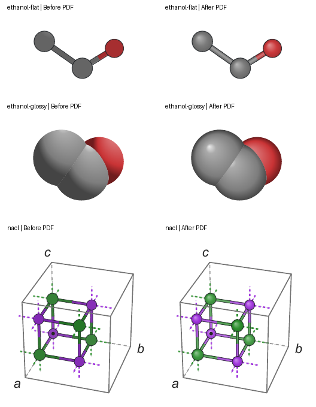

Crystal files passed to the CLI now produce a clear unsupported-format message
instead of a SMILES parse error. Rejection happens before input is read or output
is created. @Ameyanagi, [PR #537](https://github.com/Ameyanagi/ReShiki/pull/537),
under review. [Command examples and validation](changes/qa-490.md).

Under review: @Ameyanagi — long polystyrene and alanine chains import with
separated rings and chemical labels while retaining molecular identity and
stereochemistry in [PR #539](https://github.com/Ameyanagi/ReShiki/pull/539).
[Matched renderer comparisons, inputs, and bounded fallback behavior](changes/long-chain-layout.md).
Import latency is tracked separately in [#508](https://github.com/Ameyanagi/ReShiki/issues/508).

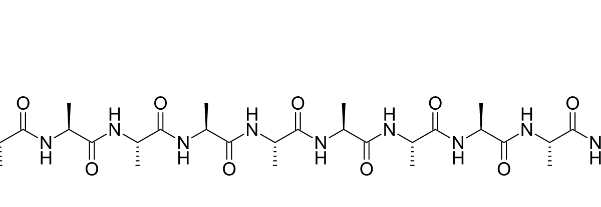

Under review: @Ameyanagi — drag the visible frame edge to move a selected 3D
model while keeping its view and selection in
[PR #540](https://github.com/Ameyanagi/ReShiki/pull/540).
[Matched native desktop evidence and editable fixture](changes/qa-514.md).

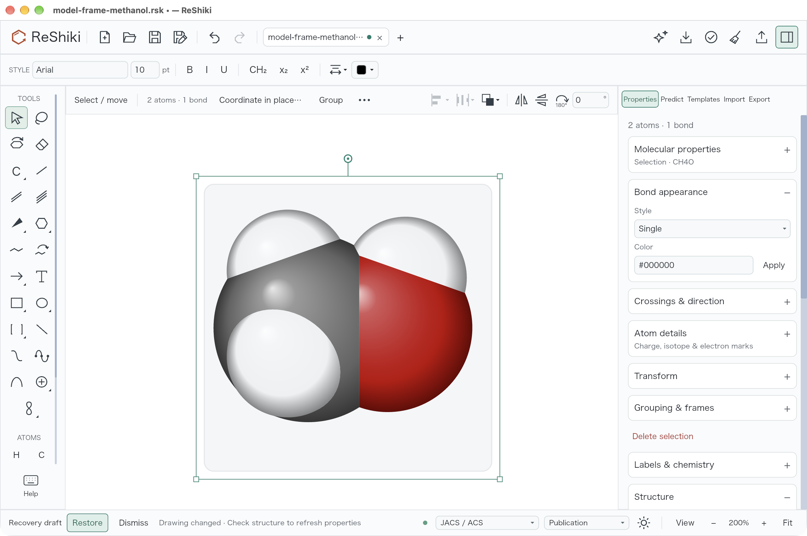

Under review: @Ameyanagi in [PR #541](https://github.com/Ameyanagi/ReShiki/pull/541).

Safari pastes clipboard text into captions and Import fields without turning Command-V into a typed v.

[Evidence, comparisons, and reusable release material](changes/qa-521.md).

Under review: @Ameyanagi in [PR #542](https://github.com/Ameyanagi/ReShiki/pull/542).

Crystal import notes stay with the drawing and survive native save/reopen; the guide now explains the opening view correctly.

[Evidence, comparisons, and reusable release material](changes/qa-crystal-metadata.md).

Under review: @Ameyanagi in [PR #543](https://github.com/Ameyanagi/ReShiki/pull/543).

Edit atom labels beside their structure, read every label type in full, and accept catalog suggestions with one click.

[Matched examples and release material](changes/qa-atom-label-editor.md).

Under review: @Ameyanagi in [PR #544](https://github.com/Ameyanagi/ReShiki/pull/544).

Fragment-name fields start fresh with a new selection or drawing, saved abbreviations show a short confirmation, and content-specific panels return to Properties when the drawing changes.

[Matched examples and release material](changes/drawing-panel-state.md).

Under review: @Ameyanagi in [PR #545](https://github.com/Ameyanagi/ReShiki/pull/545).

Chemical marks and aimed arrowheads stay clear of drawing ink, reaction separators follow visible labels, long terminal text keeps its bond visible, and chemical symbol tools support repeated placement.

[Matched examples and release material](changes/qa-drawing-geometry-2026-10-25.md).

Under review in [PR #557](https://github.com/Ameyanagi/ReShiki/pull/557):
Export dialogs name their format, browser progress and download receipts describe what happened, and the npm package has a complete HTML recipe with the correct release version.
See the [QA report](changes/qa-browser-polish.md) for validation and screenshots.

Contributor: @Ameyanagi.

Under review in [PR #558](https://github.com/Ameyanagi/ReShiki/pull/558):
Crystal substitutions keep their cell and copies, update the drawn formula, and preserve unvalidated bond context after unsupported edits.
See the [QA report](changes/qa-crystal-substitution.md) for validation and screenshots.

Contributor: @Ameyanagi.

Under review in [PR #559](https://github.com/Ameyanagi/ReShiki/pull/559):
Large peptide imports avoid repeated ring searches during label placement. Long-running Structure-input operations show elapsed time and can be cancelled without changing the drawing.
See the [QA report](changes/qa-508-import-performance.md) for measurements and screenshots.

Contributor: @Ameyanagi.

Under review in [PR #560](https://github.com/Ameyanagi/ReShiki/pull/560):
See the label the Text tool will repeat, keep its chemical meaning, and read clear feedback for generic and refreshed drawings.
See the [QA report](changes/qa-label-feedback.md) for validation and screenshots.

Contributor: @Ameyanagi.

Under review in [PR #561](https://github.com/Ameyanagi/ReShiki/pull/561):
Reach 3D controls in one click, bring clipped models into view, recover directly from blocked scale commands, and cancel long native model generation with Escape.
See the [QA report](changes/qa-model-controls.md) for validation and screenshots.

Contributor: @Ameyanagi.

Under review in [PR #562](https://github.com/Ameyanagi/ReShiki/pull/562):
Help prefers shortcuts available in the current drawing mode among equally strong
matches, shows labelled ring-fusion examples, and uses a readable Shift search
hint. See the [QA report](changes/qa-help-polish.md) for validation and screenshots.

Contributor: @Ameyanagi.

Under review: review recovery drafts by title, date and size, restore only the
drawings you need, or move abandoned copies to the Trash. The browser asks before
permanently deleting recovery copies and keeps failed operations retryable.
Contributed by @Ameyanagi in [PR #563](https://github.com/Ameyanagi/ReShiki/pull/563)
for [issue #491](https://github.com/Ameyanagi/ReShiki/issues/491).
[QA report and limits](changes/recovery-manager.md): native Trash interaction was
checked on macOS; Windows and Linux runtime checks remain pending.

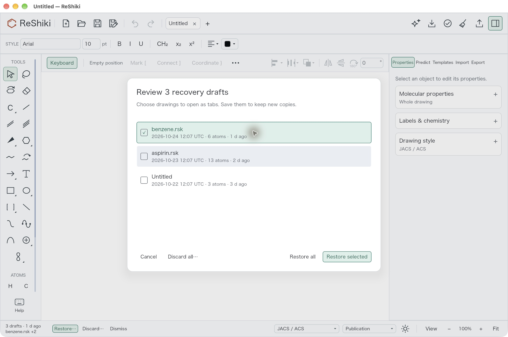

## Under review

Keep whole-drawing formula and mass visible beside selected-fragment properties,
preserve the explicit Molecular header choice in new and replacement tabs, keep
molecular values visible while choosing drawing tools, and correct singular
atom/bond counts — @Ameyanagi in [PR #564](https://github.com/Ameyanagi/ReShiki/pull/564).
This addresses [#548](https://github.com/Ameyanagi/ReShiki/issues/548),
[#550](https://github.com/Ameyanagi/ReShiki/issues/550),
[#551](https://github.com/Ameyanagi/ReShiki/issues/551), and
[#554](https://github.com/Ameyanagi/ReShiki/issues/554).
[Matched renderer and native input evidence](changes/qa-property-continuity.md).

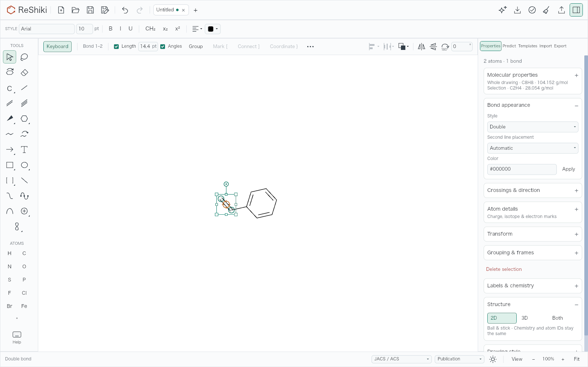

## Under review

**Copy as names unsupported text labels, points to ordinary Copy and exposes the
full refusal behind a visible status cue; narrow windows keep every footer
control visible.** @Ameyanagi in
[PR #565](https://github.com/Ameyanagi/ReShiki/pull/565), addressing
[#499](https://github.com/Ameyanagi/ReShiki/issues/499).

CDXML/CDX refusals identify the actual unsupported label instead of calling the
drawing invalid or listing absent ring curves. They suggest the platform's
ordinary Copy shortcut and native save. Strict export still refuses unsupported
content, and a failed Copy as operation leaves the clipboard unchanged. The
footer reserves its height before delayed progress appears, with a second row
below 1280 logical pixels wide.

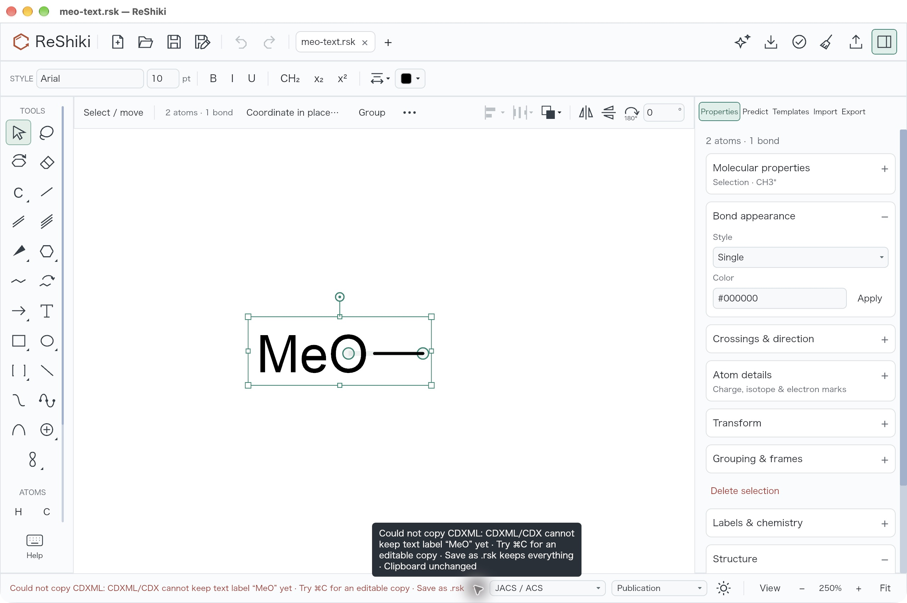

[Matched native images, input fixture and combined footer checks](changes/qa-export-feedback.md)
record the macOS menu/hover interaction and real-renderer layout results.
Windows/Linux native interaction and a new ChemDraw round trip are not claimed.

Under review: inspector page changes keep the drawing in place, and positioning
atom marks keeps its controls visible and is available from the atom's context
menu. @Ameyanagi in [PR #566](https://github.com/Ameyanagi/ReShiki/pull/566), for
[#533](https://github.com/Ameyanagi/ReShiki/issues/533) and
[#534](https://github.com/Ameyanagi/ReShiki/issues/534).
[Matched renderer and native QA](changes/qa-inspector-motion.md).

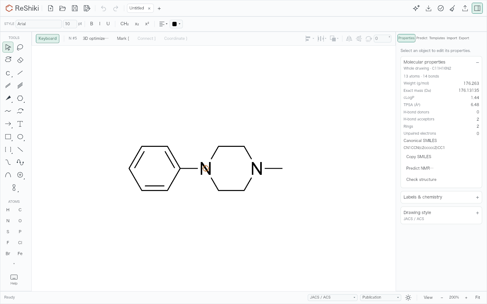

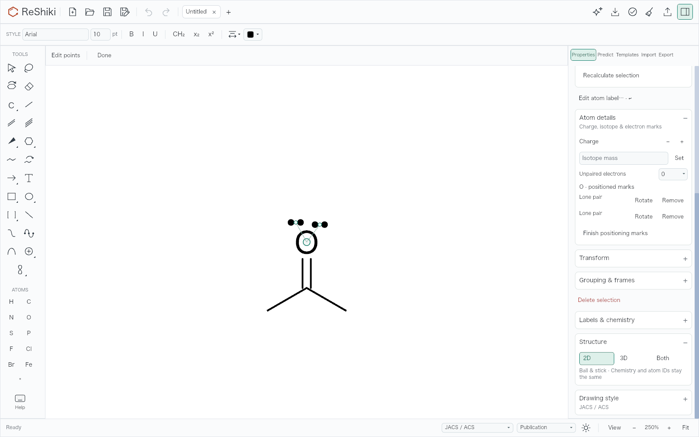

## Under review

@Ameyanagi in [PR #567](https://github.com/Ameyanagi/ReShiki/pull/567):

- Rotation frames follow upright labels, and the angle readout moves clear of label ink while dragging.
- Rotation hints yield when editing an angle, keeping the canvas clear while typing.
- Three atom columns keep all eleven choices visible in a 1600 × 1000 macOS window, with H and C first. The default 1280 × 820 client size still scrolls for lower rows.
- Reopening Structure selects the retained draft for replacement, and Clear empties it.

[Matched before/after images and native interaction verification](changes/qa-drawing-polish.md)
cover all four changes.

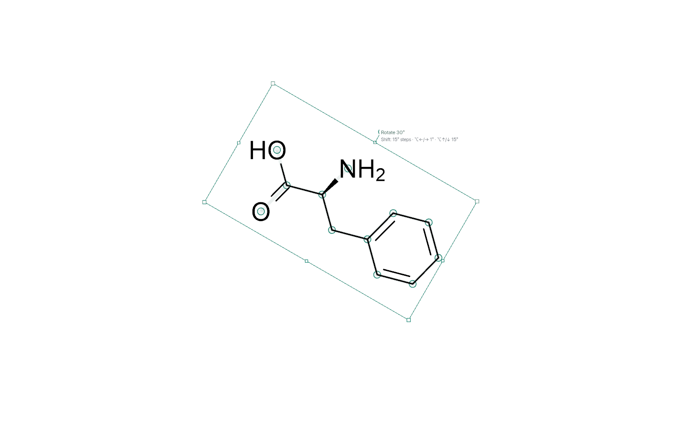

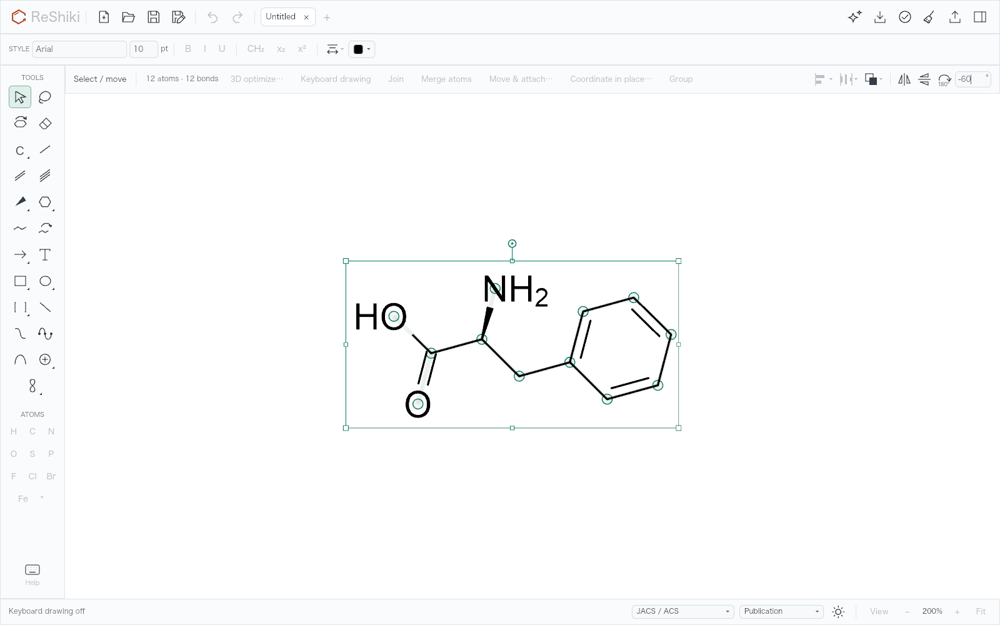

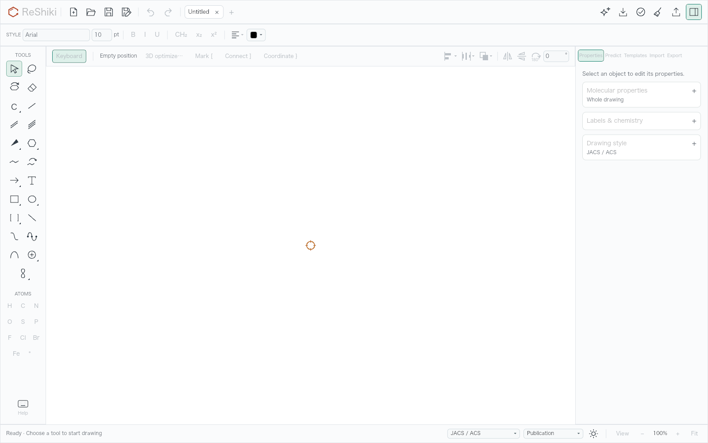

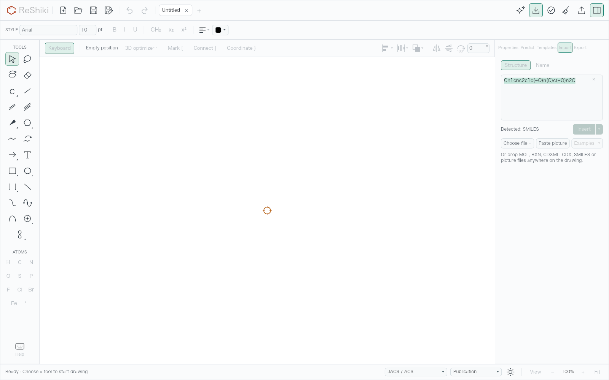

Under review in [PR #568](https://github.com/Ameyanagi/ReShiki/pull/568), by
@Ameyanagi: typed protecting groups retain sugar stereochemistry, choose a clear
reading beside nearby labels and repeat without an editor flash. The
[QA record](changes/qa-stereo-repeat.md) includes stereo round trips, matched
Properties results, native interactions and original gesture clips with capture
timestamps. Placement checks use a bounded local context; oversized or
incomplete context retains the established reading.

- Arrow Properties identifies the selected arrow count in mixed or multiple
  selections, and Atom labels & numbering uses the matching **‹ Properties**
  backlink. @Ameyanagi in [PR #577](https://github.com/Ameyanagi/ReShiki/pull/577)
  for [#575](https://github.com/Ameyanagi/ReShiki/issues/575) and
  [#576](https://github.com/Ameyanagi/ReShiki/issues/576);
  [native review](changes/qa-properties-clarity.md).

Under review: [PR #579](https://github.com/Ameyanagi/ReShiki/pull/579) aligns
opening and reset 3D model faces with their drawings, keeps chemical-name
captions attached during model resizing, and shows rotation instructions before
the first drag. Proper rotations preserve chemical stereochemistry; saved views
and crystal cell orientation retain their existing behavior.

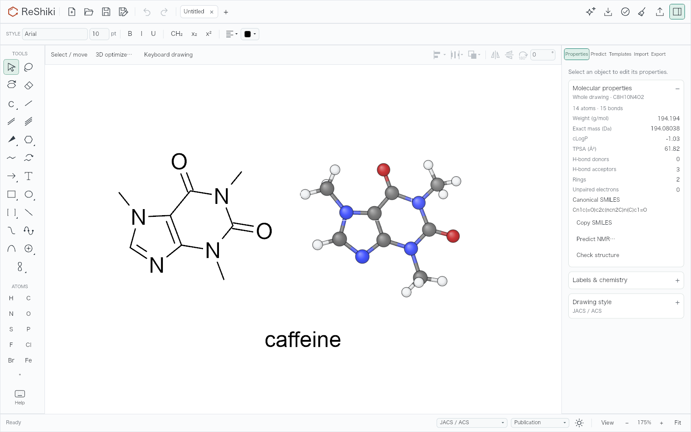

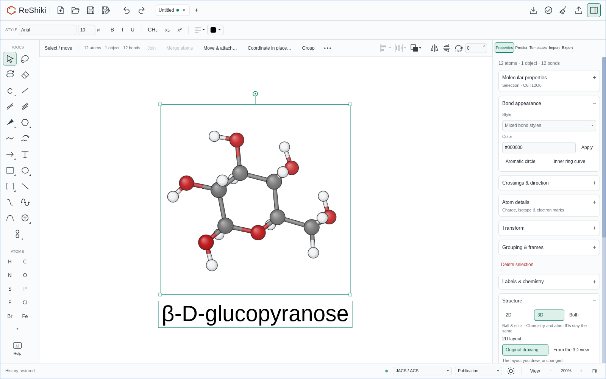

[Matched comparisons, inputs and native/browser checks](changes/qa-model-face-handles.md)
cover the visible changes and the chemical/native round trips.

Under review: @Ameyanagi — ReShiki remembers the chosen canvas brightness for new
drawings and the next launch, while keeping each saved drawing's own appearance
([PR #581](https://github.com/Ameyanagi/ReShiki/pull/581),
[restart and browser reload evidence](changes/qa-remember-appearance.md)). The
independent **View → Interface** preference remains available.

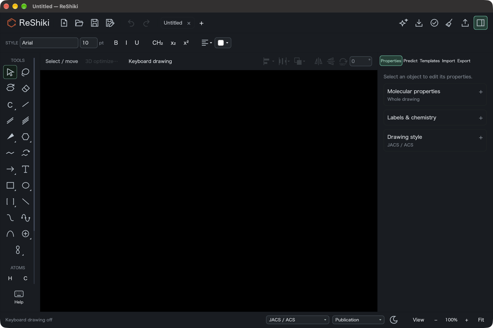

Artemisinin import and cleanup place the peroxide-adjacent methyl outside the
cage and keep the peroxide bond visible, while preserving all seven
stereocentres. Whole-molecule cleanup refusals now say that the drawing is
unchanged instead of asking for an already complete selection.
@Ameyanagi, [PR #538](https://github.com/Ameyanagi/ReShiki/pull/538), under review.
[Matched renderer review](changes/artemisinin-depiction.md).

| Before                                                                                          | After                                                                                                                            |
| ----------------------------------------------------------------------------------------------- | -------------------------------------------------------------------------------------------------------------------------------- |
| 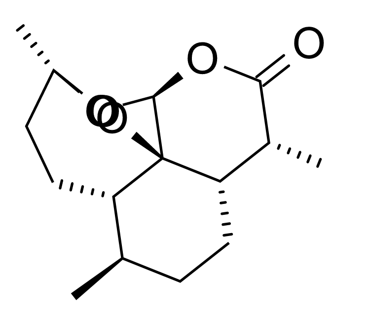 | 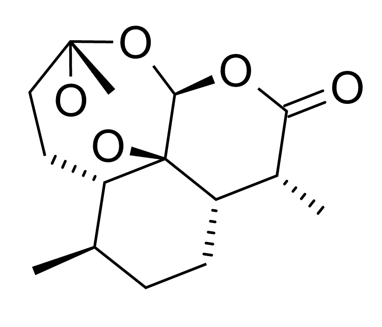 |

See [ReShiki 0.13.0](changes-0.13.md) for the latest release notes.
