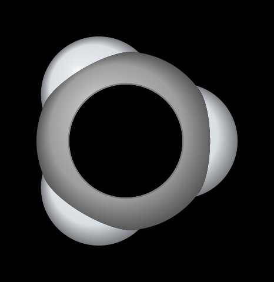
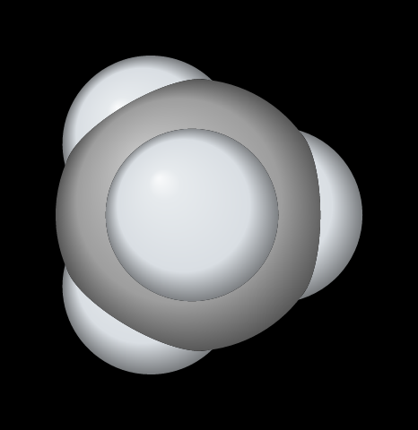

# Unreleased changes

## Fixes

Space-filling models keep hydrogens facing the viewer visible where overlapping
atoms meet. The front cap no longer leaves a hole through its carbon.
@Ameyanagi, [PR #535](https://github.com/Ameyanagi/ReShiki/pull/535), under review.
[Matched renderer review](changes/qa-513.md).

| Before                                                                                 | After                                                                             |
| -------------------------------------------------------------------------------------- | --------------------------------------------------------------------------------- |
|  |  |

See [ReShiki 0.13.0](changes-0.13.md) for the latest release notes.
