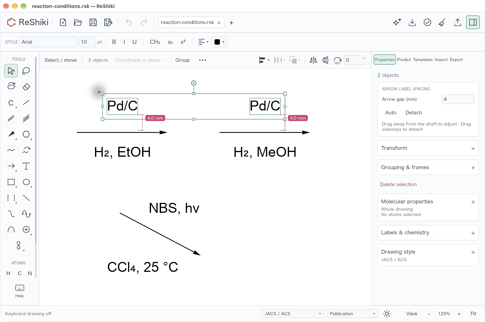
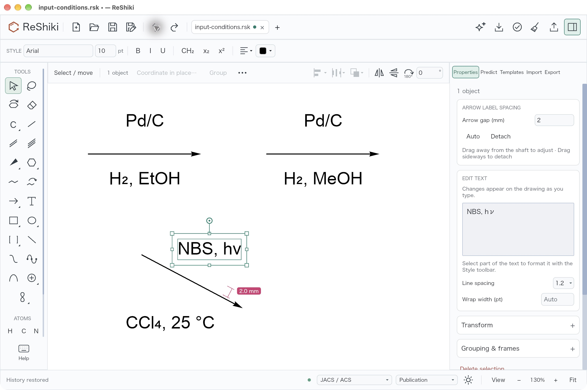
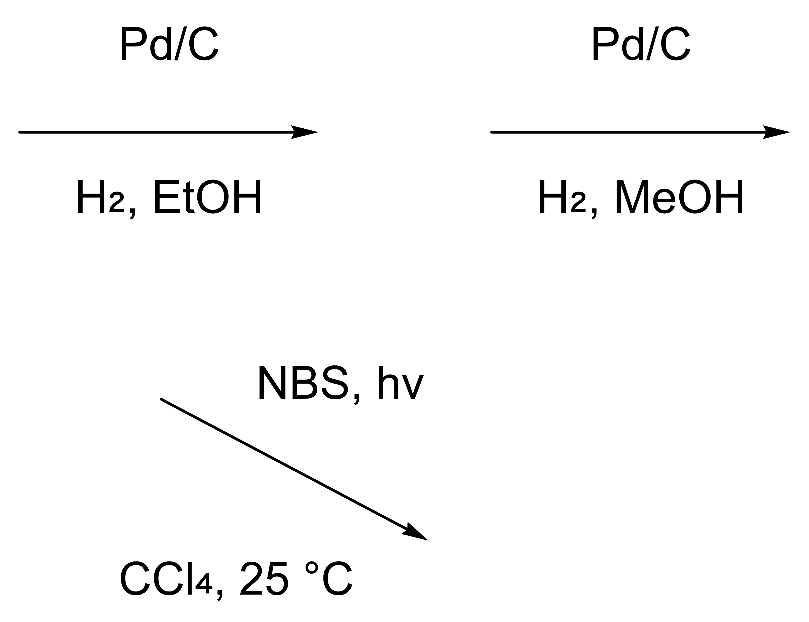

# Attached reaction-label spacing

Under review in [PR #603](https://github.com/Ameyanagi/ReShiki/pull/603), addressing
[issue #600](https://github.com/Ameyanagi/ReShiki/issues/600).
Implementation: @Ameyanagi. The [user guide](../arrows.md#adjust-label-spacing)
explains numeric entry, dragging, Auto and detachment.

An attached condition label now has an optional custom gap. Enter a value in the
current ruler unit and press Enter, or drag perpendicular to the arrow. Several
selected labels can receive one shared gap in one Undo step. Magenta dimensions
show the actual clearance from arrow ink to text box in the final drawing
preview; they are editing guides and stay out of exports.

## Native examples

The two upper labels retain **4 mm** after saving, closing the document and
reopening it from disk. Capture: 125% drawing zoom, Arial 10 pt, JACS / ACS,
light theme; unretouched 2560 × 1704 native screenshot.

The diagonal example measures **2 mm perpendicular to the shaft**. Capture:
130% drawing zoom before Save As, with the same style and theme; unretouched
2560 × 1704 native screenshot.

The native PNG and [SVG export](fixtures/arrow-label-spacing/reaction-conditions.svg)
contain all three arrows and six labels. Both were exported while the two upper
labels were still selected and their gap guides were visible on the canvas.
Neither export contains the guides or selection handles. The default native PNG
export was visually inspected.

Release caption: Give attached reaction conditions the same gap, with visible
measurements that stay out of exports.

## Reusable files and provenance

- [Authored input drawing](fixtures/arrow-label-spacing/input-conditions.rsk)
  and [input provenance](fixtures/arrow-label-spacing/input-provenance.json):
  a deterministic layout fixture, not a GUI save or a chemistry validation.
- [Native saved drawing](fixtures/arrow-label-spacing/reaction-conditions.rsk):
  the actual Save As result, reopened from disk for the equal-gap screenshot.
- [Capture receipt](fixtures/arrow-label-spacing/capture.json): exact image and
  fixture hashes, capture conditions and performed native checks.
- [Producer source manifest](fixtures/arrow-label-spacing/producer.json):
  SHA-256 identities for all 36 recorded source files and the captured binary.

The captured source matches production commit
[`45b7c2b3ae683ce7684ec6dfb6e8fe492242be7a`](https://github.com/Ameyanagi/ReShiki/commit/45b7c2b3ae683ce7684ec6dfb6e8fe492242be7a),
based on `1d0f720334f4ea7cdb246cc7e896f65e1a78591c`. All 36 source-file hashes
in the producer manifest were checked against that commit. The native binary
was built with Rust 1.99.1 for `aarch64-apple-darwin`, dev profile with debug
information disabled. Its SHA-256 is
`ecc5916baef200196a398b9896715ac21ba63b6898f6c61245655635aaeaa66b`.
The producer manifest's SHA-256 is
`f2348e18cb2de0fa12dc37f4b348f887d3a4e2867b413d12250326c7e679247e`.

All native input and screenshots used the macOS application. The published
images are unchanged copies of the captures and native export. This record
shows the implemented behavior; it does not include a baseline screenshot.

## Performed native checks

1. Set the first upper label from Auto to **4 mm**. Undo restored Auto; Redo
   restored 4 mm.
2. Drag the second upper label perpendicular to the shaft by **40 screen
   pixels**. It remained attached and the field showed **2.866 mm**. Numeric
   entry then set it to 4 mm.
3. Select both upper labels and enter **3 mm**. One Undo restored both to 4 mm.
4. On the diagonal label, Auto followed by Undo restored **2 mm**. Detach
   removed the gap controls; Undo restored its attachment and 2 mm gap.
5. Move the diagonal arrow by **100 × 50 screen pixels**. Both attached labels
   followed; Undo restored their positions.
6. Save As, close the document and reopen the saved file. Both upper labels
   retained 4 mm and the reopened document had an empty Undo history. This was
   a document reopen in the same application, not a fresh-process test.
7. Export SVG and PNG with selection guides visible. Both outputs retained the
   three arrows and six labels without editing overlays.

## Automated checks and limits

The full native workspace suite (`cargo test --workspace --locked
--no-default-features`) passed **4,116 tests**, with **190 existing tests
ignored**. The exact workspace/all-targets/no-default-features native Clippy
command passed with warnings denied. Recovery coverage checks ordinary and
custom-gap drafts, then restores format 30 after resetting the last gap to Auto.

The model suite passed **860 tests**, with **11 existing opt-in tests ignored**.
The numeric-control tests passed **3/3** and smart-guide tests passed **8/8**,
including horizontal, diagonal, zero-gap and reconciled-preview geometry.
MCP validation passed the library **56/56**, fake transcripts **18/18**, real
stdio **14/14** and real tools **4/4**. Strict native and WASM Clippy checks
passed, and the generated-reference check passed **1/1**. These are local results;
hosted PR checks are separate.

Sideways detachment, persistence edge cases, zero/reversed arrows, ruler units
and invalid numeric input have automated coverage; they are not claimed as
additional native interactions here. Native input was checked on macOS aarch64,
without a separate Windows, Linux or browser interaction pass for this change.
Only straight arrows without target attachments carry condition labels.

Custom gaps require native format **31**. Drawings with only Auto gaps continue
to save as format **30**; resetting every custom gap to Auto permits that older
output version again. An older reader that does not support the saved version
reports that an update is required. Exports retain resolved text positions,
not the editable native attachment or its gap setting.
