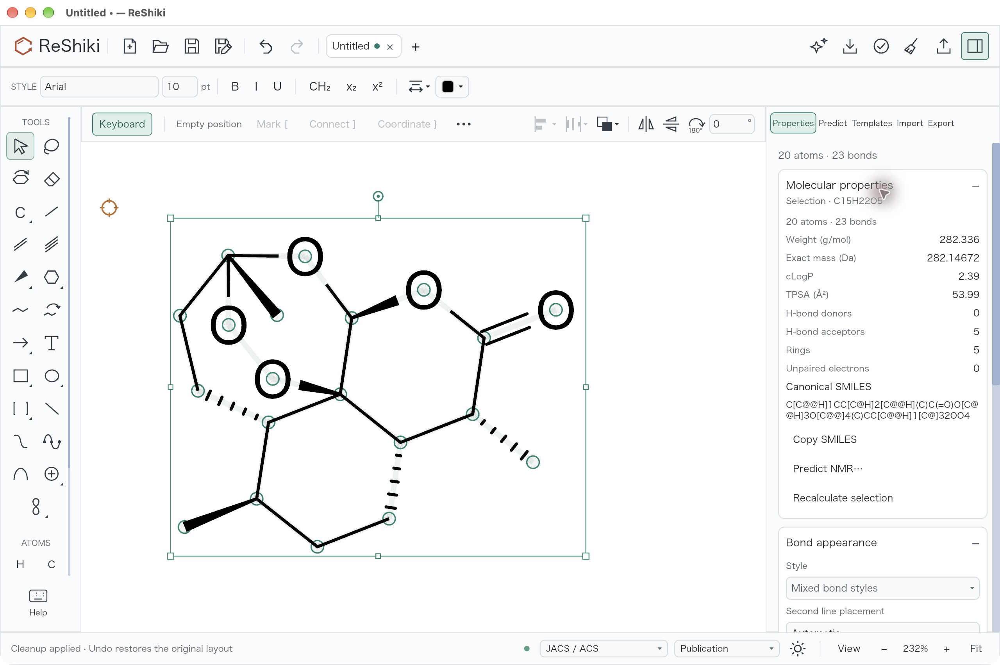
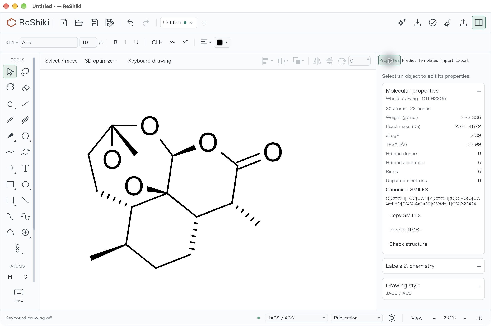

# Artemisinin import and cleanup

Fixes [#515](https://github.com/Ameyanagi/ReShiki/issues/515).

Artemisinin imported from SMILES previously had overlapping peroxide oxygen
labels. Import now retries native ring templates when a bridged ring system has
severe atom overlaps, and uses the retry only when it reduces those overlaps.
The resulting drawing retains C15H22O5 and its isomeric identity, and whole-molecule
cleanup succeeds.

Saved drawings keep their existing coordinates. Cleanup still refuses a change
that would alter the stereochemistry read independently from the original wedges.
When all atoms of the affected molecule are already included, that refusal says
“Cleanup could not preserve visible stereochemistry; drawing unchanged.” Partial
cleanup retains the advice to include the whole molecule.

## Drawing comparison

**Before:** two peroxide oxygen labels overlap.


**After:** the oxygen labels are separated, with the molecular identity retained.


Reusable release caption: “Artemisinin imports with separated peroxide oxygen
labels and can be cleaned up without changing its stereochemistry.”

## Reproduce

Import this SMILES through **Import → Structure**:

```text
C[C@@H]1CC[C@H]2[C@H](C(=O)O[C@H]3[C@@]24[C@H]1CC[C@](O3)(OO4)C)C
```

Select the whole molecule and run **Clean up**, then apply the preview. The
formula remains **C15H22O5**, molecular weight **282.336 g/mol**, and canonical
isomeric SMILES remains:

```text
C[C@@H]1CC[C@H]2[C@@H](C)C(=O)O[C@@H]3O[C@@]4(C)CC[C@@H]1[C@]32OO4
```

The [original overlapping drawing](../../tests/fixtures/qa-artemisinin-before.rsk)
reproduces the refusal separately: open it, select all atoms, and run Clean up.
The original drawing is retained and the message no longer asks for a larger
selection.

## Capture and verification

- Base: `3d80590a`; implementation: `d33d213e`.
- Captured on macOS arm64 with Rust 1.99.0, using the application scene renderer
  and its normal font database. Both images use the same union bounds, white
  background, and 3× raster scale. They contain no selection overlay.
- The before image reconstructs the baseline import using the unchanged native
  no-template depiction API. The after image uses the current engine import
  response. These are renderer captures, rather than screenshots of the desktop
  import dialog. The cleanup result was also rendered and was visually identical
  to the after image.
- Four focused regression tests cover deterministic artemisinin import, rendered
  label-ink separation, source and cleanup isomeric identity, unchanged native
  coordinates for clear imports, rejection of a template that worsens collisions,
  and distinct whole/partial-selection stereo refusal messages.
- The full IO library suite passed: 258 tests, with five opt-in tests ignored.
  Focused Clippy and the normal commit hooks passed.

The native no-template result has two nonbonded atom pairs separated by less than
0.75 depiction units, including an oxygen pair separated by only 0.0731 units
(normal bond length: 1.5). The accepted template result has no pairs below 0.75
and no intersecting atom-label ink boxes. The existing native depiction reference
API and its default coordinate output are unchanged.

## Native desktop import and cleanup

The native debug application at `e2c479d8` was also checked on 2026-10-25,
on macOS 27.0.1 arm64. It ran in a separate application bundle with an isolated
data directory. The window was 1280 × 852 logical pixels on a 2× display;
the screenshots are original 2560 × 1704 JPEG captures, without cropping,
resizing or retouching. The drawing uses Arial 10 pt, JACS / ACS,
Publication colors and a white canvas.

The exact SMILES above was pasted into **Import → Structure** and inserted.
The imported molecule had separated oxygen labels. With the entire imported
molecule selected, **Clean up** opened a preview and **Apply** succeeded.
The application displayed “Cleanup applied · Undo restores the original layout”.
Properties confirmed that the selection contained all **20 atoms and 23 bonds**,
with formula **C15H22O5**, molecular weight **282.336 g/mol** and the canonical
isomeric SMILES recorded above. The import fitted at 232% zoom; opening the
cleanup preview used 223%, and applying it returned to 232%.

The selection overlay in this diagnostic capture establishes the whole-molecule
selection, while the status line records the completed cleanup:



After deselecting the molecule and turning keyboard drawing off, the separated
oxygen labels and whole-drawing properties remain visible:



These native captures supplement the matched renderer comparison above.
A separate native check of `3d80590a` reproduced both the overlapping labels
and the whole-molecule cleanup refusal. Its fitted zoom was 221% and its
inspector state differed, so it is not presented as a matched screenshot pair.
The checks establish the observed desktop behavior; no performance timing is
claimed.

Capture receipt (SHA-256):

- Debug executable: `11d9ab248326d09d1288038a0aeb8f523dfa55f1249b9890d7ef27cf18ced9bc`.
- Native cleanup/status image: `9cb1db22fb05d7ad6e0d144b62522c2262197bc930cac7494567f10527ebaf86`.
- Native drawing/properties image: `7779d72966be6229d0bacdc91156ec97ac64e743a2e3b626d400ddf24e9643f8`.

## Peroxide-adjacent methyl follow-up

Review of the first implementation found a second readability problem. The
peroxide-adjacent methyl pointed into the cage between the oxygen labels. The
graph contained the peroxide O–O bond, but padded rectangular label bounds
clipped its entire visible connector. Separating atom centres alone did not
catch either defect.

The input SMILES is correct. It matches the structures supplied by
[PubChem](https://pubchem.ncbi.nlm.nih.gov/compound/artemisinin) and
[ChEBI](https://www.ebi.ac.uk/chebi/CHEBI:223316). The first implementation's
visible wedges also describe the correct seven stereocentres; its inward methyl
was a poor projection, rather than a reason to flip one wedge or change the
input. An independent RDKit 2026.03.6 check reconstructs the drawing from atom
coordinates and wedge/hash directions, without reading stored stereo or CIP
tags. Both the earlier template drawing and the refined drawing have InChIKey
`BLUAFEHZUWYNDE-NNWCWBAJSA-N`.

The follow-up moves a terminal carbon into the empty exterior sector of a
crowded bridged-ring junction. It keeps the attachment bond length and ring
coordinates, respects fixed atoms, and rejects a move that introduces a severe
atom collision or a bond crossing. Import and cleanup use the same refinement;
wedges are generated from the unchanged chemical state. A separate fused ring
component cannot acquire this treatment merely because another component is
bridged.

For an otherwise missing plain single bond, the renderer can recover the clear
span around rounded glyph corners using its existing font outline
approximation. It retains the requested gap and stroke clearance, and requires
a real gap between the unpadded label rectangles so that the visible connector
also remains available to mechanism-arrow picking. Normal visible bond
endpoints stay unchanged. Unknown rectangular glyph metrics, overlapping ink,
very small label margins and excessively thick strokes retain conservative clipping.

Saved coordinates are not rewritten on opening. Cleanup can refine the
earlier inward-methyl drawing while preserving its visible stereochemistry.
The original overlapping pre-template drawing still receives the existing
atomic refusal instead of silently losing an ambiguous centre.

The independent check after both import and cleanup finds all seven mapped
centres: atom IDs **2 R, 5 S, 6 R, 10 S, 11 R, 12 S and 15 R**. The formula,
molecular weight and canonical isomeric SMILES remain those recorded above.
The source change uses no downloaded reference coordinates, images or molecular
template data. The primary reference depictions were used for comparison.

Follow-up source validation:

- Full model library suite: **806 passed**, with 10 existing opt-in tests ignored.
- Full IO library suite: **263 passed**, with five existing opt-in tests ignored.
- Focused model and IO Clippy, including tests, passed with warnings denied.
- New regressions check actual peroxide scene ink and mechanism-arrow picking,
  fixed atoms, exterior collisions, crossing/touching/collinear bonds, separate
  fused components, visible-only stereo perception, repeated cleanup, unknown
  rectangular glyph metrics, underline bands, thick strokes and conservative
  refusal of an unpickable rounded-corner span.
