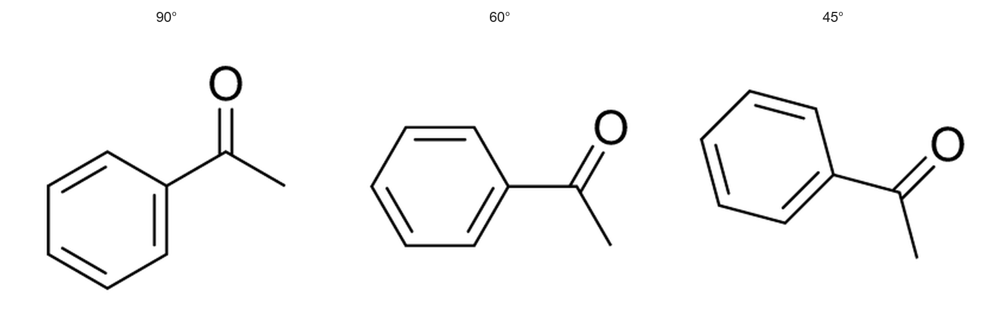

# Carbonyl double bonds during rotation

Plain centered double bonds now meet upright atom labels using each rail's
own path and the label's rounded ink outline. Rotating a carbonyl no longer
leaves the large diagonal gap caused by clipping the backbone to a padded
rectangle before offsetting its two rails. The atom-to-atom bond length was
already unchanged; this fixes the visible strokes.

Drawing and mechanism-arrow targeting share the clipped rail geometry. At
small margins, the unpadded label boxes still own their corners, so a longer
stroke cannot take clicks away from a label. Offset ring bonds, projected
bonds, crossed doubles and non-plain styles keep their existing paths.

## Matched renderer comparison

Before:

After:

Input: [acetophenone.mol](../../tests/fixtures/carbonyl-rotation/acetophenone.mol).
Each column uses a rigid rotation to the shown C=O angle, measured from
positive X in the MOL coordinate system. Each before/after pair uses the
same coordinates, framing, JACS / ACS style, Arial font, and PNG export.
The panels have a white presentation background and identical 2× display
enlargement; captions sit outside the rendered drawing.

Base: `27775eb814c3b9a201cf39fead083aa5ffd83aeb`.
Fixed implementation: `3eac108ed86faf7fb8db82a18ac2160fd5732e6e`.
Both are optimized native builds on Apple Silicon macOS, using the pinned
Rust 1.99.1 toolchain. These are application-renderer exports, not UI captures.

## Validation

- The new excessive-gap regression fails before the fix and passes afterward.
- Four focused tests cover 15° rotation steps, reversed bond order, rounded
  and rectangular label ink, small margins, and selection of visible rail tips.
- Model unit suite: 1,317 passed, 11 opt-in tests ignored.
- Model all-target Clippy in release mode, full-workspace library/binary
  Clippy with all features, and Rust formatting pass.

Upright labels have different silhouettes in different bond directions, so
their visible strokes need not have exactly identical lengths at every angle.
The fix removes excess empty-corner shortening while preserving label clearance
and molecular geometry.
