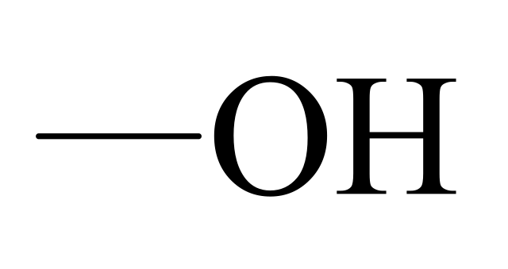
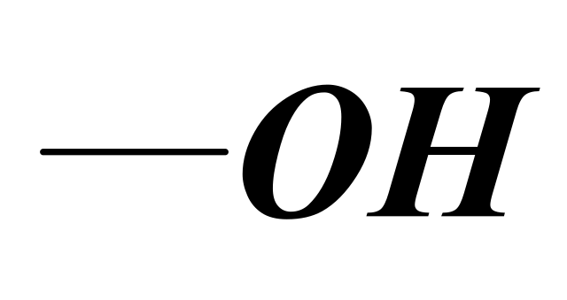
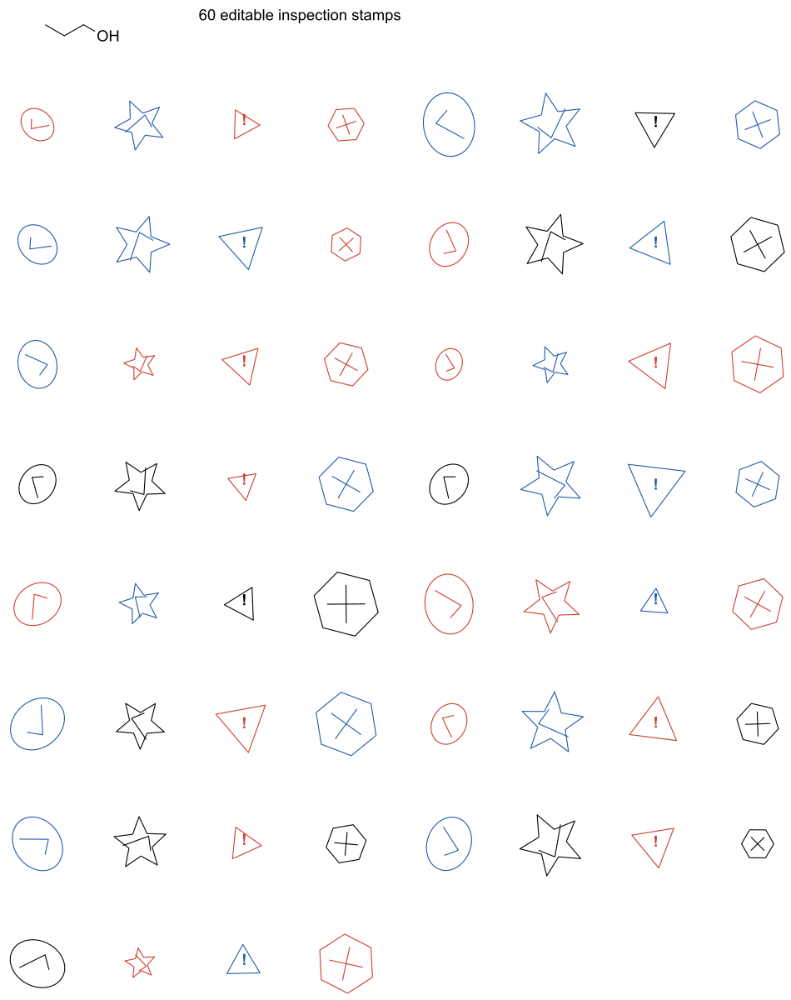

# ChemDraw drawing import and export — 2026-11-17

The retained ChemDraw tests now cover **112 seeded feature cases**, including
multi-page figures, independent and multistep reaction schemes, mixed panels,
and hundreds of vector and bitmap stamp instances. Production fixes address the
failures found during import, editable export, and reimport. Previously failing
source drawings remain in the corpus; their original CDXML/CDX bytes are not
rewritten to make a check pass.

This record separates the original investigation from the completed repair
runs. Earlier receipts remain intact; the final frozen-source runs are named
`final-fixed-*` below.

## Retained inputs and provenance

The [primary corpus](../../tests/fixtures/chemdraw-import-corpus/README.md) contains:

| Input              | Files | Purpose                                                                |
| ------------------ | ----: | ---------------------------------------------------------------------- |
| Drawing CDXML      |   112 | Directly generated editable drawing sources                            |
| Drawing CDX        |   111 | Independent binary encodings of complete drawings                      |
| Full drawing CDS   |   111 | Binary stationery containing the same artwork and packed font defaults |
| Style-source CDXML |     4 | Separate controls with no artwork                                      |
| Style CDS          |     6 | Four style controls plus padded-header and rootless legacy variants    |

The current manifest classifies 101 cases as supported, five as unsupported, and
six as deliberately malformed. Historical failures keep their original filenames,
including names under `unsupported/`, with a `historical_failure` note and updated
behavior expectations. One translucent graphic has no CDX or CDS companion: the
independent encoder cannot represent its `alpha` property, and never strips it.

The base 104 cases include eight figures with 2–6 actual `page` objects, ten
documents with 2–5 reaction schemes and 1–3 steps per scheme, ten editable stamp
grids with 10–60 instances, four bitmap grids with 12–60 pictures, and six mixed
panel figures. Stamp grids and mixed panels alone contain 421 vector stamp
instances and 132 bitmap instances per seed; multi-page figures add more. Cases
105–112 combine these features in new seeded drawings after the first repairs.

These are synthetic inputs constructed from published CDXML/CDX semantics and
`reference/engine/cdx_exchange.py`, with documented local binary adaptations.
They are **not native ChemDraw-authored files**. No production ReShiki exporter
constructs them. The original stamp artwork and tiny generated images contain
no proprietary ChemDraw stamp-library assets. Manifests record seeds, source
inventories, object IDs, expected counts and caption strings, limitations, and
SHA-256 hashes.

The [12 semantic controls](../../tests/fixtures/chemdraw-import-semantics/README.md)
have CDXML/CDX/CDS companions for visibility, typography, stroke widths, page
metadata, and modern versus legacy curve heads. Additional
[text-default fixtures](../../tests/fixtures/chemdraw-text-defaults/README.md)
retain independently encoded zero-style CDXString inputs for the text encoder
regression. Twenty page-boundary CDXML/CDS pairs retain large labels, wrapping,
line-height, XYZ, and mixed-dimensional fragment failures with single-page
controls. Four reference-encoder diagnostic CDS files remain explicit negatives.
The unused-palette CDXML regression has no binary companion because its unused
out-of-range channel cannot be represented by normalized binary color channels.

CDS is ChemDraw stationery. A full stationery file can contain artwork, while a
style-only file need not. The probe's `--drawing-cds` mode imports full stationery
through the binary drawing pipeline, then exports actual CDS through CDXML
serialization and `exchange::to_cds`. Its default CDS mode exercises the separate
style loader, which reads fonts and bond dimensions and deliberately excludes
artwork, page layout, colors, and independent caption typography. The two modes
have separate receipts and expectations.

## Implemented repairs

- **Several molecules at a non-default bond length.** Prepared coordinates are
  copied back to every fragment after scaling. The paired 14.4 pt and 24 pt
  controls now use the same coordinate frame for bond appearance association;
  reaction panels no longer fail simply because they contain two molecules.
- **Hidden drawing objects.** `Visible=no` on supported free graphics, captions,
  arrows, and curves omits those presentations with one import notice. Empty
  source mappings keep group membership and references valid; hidden fill paths
  cannot merge into visible outlines. Existing invisible wildcard anchors keep
  their connectivity, and attached hidden charge marks keep their native
  representation. Unsupported hidden chemical atoms, bonds, and atom-label text
  are rejected instead of deleting chemistry or making it visible silently.
- **Inherited label typography.** Document bold, italic, underline, and color
  apply to atoms without a redundant text child. Explicit node, text, and run
  overrides keep their precedence. Document font family and size remain in the
  drawing style.
  An unused palette does not trigger validation of a synthetic text style;
  actual used styles still validate. The unchanged scene reference suite and
  four focused palette controls cover this boundary.
- **CDX/CDS text encoding.** Unstyled and partly styled spans resolve their
  Label or Caption defaults before binary serialization. The encoder no longer
  invents plain Arial 10 pt runs. Unicode text uses the supported UTF8Text
  property, including when the source has no font table.
- **Editable generic drawings.** Supported generic choices and polymer repeats
  export as drawing data without first requiring a single concrete molecular
  identity. Repeat membership, crossing bonds, labels, and supported definitions
  survive the checked drawing path; unrepresentable definitions still refuse
  export. Molecular identifiers and properties retain their separate generic
  structure restrictions.
- **Legacy curve heads.** Published `CurveType` head flags are translated to
  modern head/tail properties while preserving other style flags. Supported
  multisegment splines keep their geometry.
- **Several pages.** Supported top-level pages are placed vertically on one
  editable canvas, with an explicit notice. Page content and logical membership
  are imported; original page boundaries, paper settings, and empty pages are
  not retained. Nested pages remain unsupported.
- **Page spacing and binary coordinates.** Page placement measures resolved
  paragraph layout, including wrapping and explicit line heights, and rendered
  atom-label extents, including above/below hydrogen placement. Native XYZ
  coordinates use their own exact translation grid, including mixed 2D/3D
  fragments. Binary coordinate decoding preserves every signed 16.16 tick
  through its XML bridge. Independently encoded
  [page-boundary controls](../../tests/fixtures/chemdraw-page-boundaries/README.md)
  retain the failures and their single-page controls.
- **Exported drawing bounds.** Editable exports expand their drawing space to
  contain large figures and vertically arranged pages, including painted
  extents beyond the original control points.
- **Drawing stationery discovery.** File import recognizes full `.cds` artwork
  through the CDX drawing reader. The style import workflow remains separate.
- **Clipboard fallback and omitted bond lengths.** A failed editable drawing
  no longer falls through to coordinate-generating SMILES, reaction SMILES,
  InChI or name import. Layout-bearing alternatives and reported picture
  fallback remain available. The detached chemistry preparation uses the same
  30 pt default as the presentation reader when `BondLength` is omitted; the
  original source and low-level molecular reader contract stay unchanged.
- **Passive drawing operations.** Open, import, copy, paste, Analyze, export,
  printing, background label refresh, and Undo/Redo retain authored geometry.
  Paste remaps IDs and translates all incoming objects by one common offset,
  without reconciling links against the receiving drawing. Hydrogen-label
  caches can refresh without recounting authoritative radicals or singlet
  state. Actual edits and explicit Clean Up still reconcile linked objects in
  their Undo transaction. Save records the snapshot actually written, rather
  than silently moving a later saved-state snapshot.

The independent [clipboard layout controls](../../tests/fixtures/chemdraw-clipboard-layout/README.md)
retain irregular bonds, arrows, captions and graphics in explicit-length and
default-length CDXML/CDX/full-CDS variants. Unsupported shadow graphics retain
their failures alongside misleading SMILES fallback text. The
[passive geometry controls](../../tests/fixtures/passive-drawing-geometry/README.md)
add a deliberately unsettled native drawing with linked arrows, names,
conditions and a property caption, plus independent CDXML/CDS property-caption
sources. Regression checks cover partial copy, insertion into a nonempty
drawing, late labels, save, Analyze, Undo/Redo, native radical state and a
subsequent real edit proving that links still work.

Two documentation/code inconsistencies were resolved during the investigation.
CDX was already exposed by the application's open/save controls; it was not a
missing UI format. Conversely, [Generic structures](../generic-structures.md#files)
already documented represented CDXML/CDX semantics, but the engine's generic
identity guard blocked editable drawing exports. The drawing route now follows
that documented boundary.

## Visual checks

These paired images render retained pre-fix and fixed importer snapshots with
the same application renderer and a matched coordinate frame. They are newly
rendered evidence, not historical application screenshots. The
[capture provenance](../images/chemdraw-import-corpus/capture-provenance.json)
records input hashes, snapshot revisions, rendering commands and framing.

| Case                                                               | Before                                                                                               | After                                                                                                 |
| ------------------------------------------------------------------ | ---------------------------------------------------------------------------------------------------- | ----------------------------------------------------------------------------------------------------- |
| Hidden red rectangle, with the blue visible control fixed in place |       |                     |
| Inherited bold italic atom label                                   |  |  |

The full drawing CDS retains the molecular control, caption and 60 editable
vector stamps without clipping:



## Generation, failure retention, and repair cycles

The historical baseline used 104 feature cases at seeds `20261117`, `7`, and
`20261118`, plus 12 semantic controls and existing/native controls. Its 690 probe
inputs produced 475 accepted inputs and 215 rejections. Per seeded corpus,
30 drawing rejections were the unexpected fragment-scaling failure and 16
editable export attempts failed on polymer repeats. These baseline receipts
remain under `artifacts/chemdraw-import-corpus/`; they describe the old behavior.

Subsequent runs added complete CDS companions and stricter checks of geometry,
text/style runs, chemistry, arrows, and repeat definitions. The first repair
cycle exposed further legacy-head and page/fragment placement problems. Those
failures were retained rather than being relabelled as unsupported. Later
checks also corrected two oracle assumptions: imported page-wrapper groups
contribute real logical groups, and stable chemistry must be matched by
geometry and element rather than by rounded sort order or transient IDs.

| Completed receipt   | Feature cases | Drawing imports accepted / rejected | Successful exports and reimports per output format | Findings |
| ------------------- | ------------: | ----------------------------------: | -------------------------------------------------: | -------: |
| `final-primary`     |           104 |                            279 / 31 |                       279 each for CDXML, CDX, CDS |        0 |
| `final-112`         |           112 |                            303 / 31 |                       303 each for CDXML, CDX, CDS |        0 |
| `fresh-99173`       |           112 |                            303 / 31 |                       303 each for CDXML, CDX, CDS |        0 |
| `fresh-72317-final` |           112 |                            303 / 31 |                       303 each for CDXML, CDX, CDS |        0 |

Each 112-case run above contains 334 drawing inputs and six separate style
inputs. The 31 drawing rejections match deliberately malformed or unsupported
inputs; all six style controls pass. The preceding `fresh-72317` receipt retains
the group-count and atom-correspondence findings that prompted the oracle
corrections. No source bytes were changed to resolve those comparisons.

These receipts are intermediate milestones. After the final page, precision,
and palette repairs, all three seeds were rerun against the frozen importer:

| Final receipt              |    Inputs | Accepted drawings | Expected rejections | Style controls | Successful export/reimports |
| -------------------------- | --------: | ----------------: | ------------------: | -------------: | --------------------------: |
| `final-fixed-20261117`     |       340 |               303 |                  31 |              6 |                         909 |
| `final-fixed-72317`        |       340 |               303 |                  31 |              6 |                         909 |
| `final-fixed-99173`        |       340 |               303 |                  31 |              6 |                         909 |
| `final-fixed-supplemental` |        84 |                80 |                   4 |              0 |                         240 |
| **Total**                  | **1,104** |           **989** |              **97** |         **18** |                   **2,967** |

All final receipts have zero unexpected findings or probe errors. Every accepted
drawing exports and reimports as CDXML, CDX, and actual CDS. Supplemental
rejections are the retained reference-encoder line-height diagnostics.

After the clipboard and passive-layout repairs, the same three seeds and all
supplemental cases were run again as `final-clipboard-*`. The new supplemental
run adds nine clipboard positives, three retained shadow-graphic negatives and
two property-caption sources. The completed batch contains **1,118 inputs**:
**1,000 accepted drawings**, **100 expected rejections** and **18 style
controls**, with **3,000 successful CDXML/CDX/CDS export/reimports** and zero
findings or probe errors. No historical failing input was removed.

The reports explicitly identify working-tree builds rather than claiming their
base commit alone identifies the code. The delivery metadata records the latest
tested probe SHA-256:
`11d983b0394758a989dbac8759acbb3a66dd2de59017c4d2f8b870cc3a976fbd`.

Focused regression runs cover CDXML and CDX visibility, inherited faces,
explicit overrides, hidden charge/dummy compatibility, and unchecked drawing
notice propagation. Independent CDS/CDX text fixtures cover default inheritance
and Unicode multi-run serialization. The 17 existing scene stage/order checks
also pass. Python lint, formatting, typing, reference tests, and dependency
checks pass with targeted reruns after the new integration shard assignments
and module-index artifact exclusion were fixed. Raw outputs and the detailed
status history are in `validation/python-summary.json` and
`validation/python-final-summary.json` under the artifact root. Final Python
discovery passes 280 tests with 11 documented skips; the corpus runner's tests
also cover geometry comparison for atomless drawings. The final routine checks
are recorded in `validation/python-docs-passive-final-summary.json`: Ruff, Ty
(including explicit fixture-generator checks), 185 reference tests, 59 minimal
dependency tests, the module index, and the documentation build all pass. The
documentation build checks 13,703 links and assets. Regenerating the two
typing-adjusted fixture sets changed none of their 84 fixture files.

The broad Rust workspace run recorded 5,922 passing tests and five failures in
four targets. Four were expected CDS extension lists that needed updating; the
fifth was an arbitrary page-gap threshold, replaced with a check that the actual
rendered caption bounds do not overlap and 72pt typography remains intact. All
five pass in focused reruns. The eight drawing/reference targets pass, including
1,025 independent codec cases; exact coordinate comparisons still detect a
single changed fixed-point tick. Historical Python codec bytes remain unchanged.

Rust formatting, workspace Clippy with all targets and all features, pre-commit
and pre-push hooks, JavaScript checks, documentation check/build, and the rebuilt
application's engine check pass. Raw receipts retain the original failures and
their successful reruns. GitHub checks are tracked on
[PR #1214](https://github.com/Ameyanagi/ReShiki/pull/1214).

## Native application evidence

ChemDraw **26.0.0.6599** opened the canonical
`092-stamps-editable-grid-60.drawing.cds` directly. Its filename, 60-stamp caption,
molecular control, and colored vector grid were visible. This confirms that the
retained full CDS is drawing stationery readable by the native application.

Earlier desktop checks showed the two-fragment reaction panel's CDXML with its
blue arrow and frame, and reproduced the original ReShiki bond-association
failure. Native ChemDraw also confirmed the binary-arrow correction described
below. ReShiki **0.15.0** displayed the 60-stamp CDXML in that earlier run.

The rebuilt application opened
`112-freshmix-seeded-mixed-008.drawing.cds` through its CLI, inferred the binary
format from the extension, and exported a 40,557-byte CDXML drawing. It emitted
the expected page-stacking and external-reaction-metadata notices. The isolated
GUI QA application launched, but the computer-use bridge timed out attaching to
it; this record does not claim a final GUI inspection.

Native ChemDraw **26.0.0.6599** also opened the independent irregular-layout
CDXML and copied it using ordinary Select All and Copy, without Clean Up. The
captured native CDX and its independently decoded CDXML produce byte-identical
ReShiki documents. Sixteen checked geometric anchors share one translation,
with a maximum import residual of 0.0000089 world units. Six editable
CDXML/CDX/CDS roundtrips stay within 0.0000543 world units. ChemDraw itself
converts the source NaOH caption to a contracted fragment and the plus mark to
a chemical charge; the receipt distinguishes that native interpretation from
ReShiki import behavior. Capture files and the detailed geometry receipt remain
local validation artifacts.

## Remaining interchange boundaries

- External reaction-step roles, condition references, and mapping-pair metadata
  are not retained. Visible molecules, arrows, captions, and supported graphics
  remain editable, and the import notice states the metadata loss. Multiple
  visible schemes do not imply native semantic reaction definitions.
- Shaded/doubled curves, shadows, ordinary-graphic transparency, vector/OLE-only
  pictures, and the tested oval without explicit axes remain explicit negatives.
- Rotated, skewed, or mirrored semantic paired-bracket frames cannot be retained
  by the supported axis-aligned `BoundingBox` encoding. Dashed and dotted
  semantic brackets also cannot retain their stroke pattern in that encoding.
  CDXML/CDX export, and CDS export derived from it, refuse with advice to keep
  native `.rsk`. Positive axis-aligned solid square, round, and curly bracket
  pairs remain editable. The
  [native sources](../../tests/fixtures/chemdraw-generic-export-boundaries/README.md)
  retain these failure boundaries separately from the canonical 112 cases.
- Page stacking is a drawing import, not a publication-page roundtrip.
  [Publication pages](../publication-pages.md) documents the separate native
  page-layout model. Style import does not promise drawing or page preservation.
- Graphic parameter types, exact graphic counts after external splitting, and
  arbitrary inherited external styles are outside the supported boundary.
  [Editable graphics](../graphics.md) records those limits. Binary fixed-point
  coordinates and twentieth-point text sizes allow documented rounding; count
  matches and an absence of probe findings do not prove full visual fidelity.

## Published format discrepancies

The vendor-hosted [CDXML DTD](https://static.chemistry.revvitycloud.com/cdxml/CDXML.dtd)
cannot be parsed unmodified by `xmllint`: its `AS` enumeration includes invalid
XML enumeration tokens such as `+` and `?`. Its curve sizing names also differ
from modern native files. Validation does not claim strict DTD conformance;
well-formedness, documented semantics, independent binary checks, retained
source hashes, and native spot-checks supply separate evidence.

The historical SDK and Python reference identify arrows with object code
`0x8027`. Native ChemDraw opened that CDX but omitted its arrow. A generator-local
mapping to the native-observed `0x8021` restored it, confirmed by reopening in
ChemDraw. Production ReShiki accepts both codes. Source fixture generators
record this adaptation and use packed `LabelStyle` (`0x080a`) and `CaptionStyle`
(`0x080b`) defaults for actual stationery; no application exporter constructs
their inputs.

## Reproduction

```sh
python3 scripts/generate_chemdraw_import_corpus.py --check
python3 scripts/check_chemdraw_import_corpus.py --strict
cargo test -p reshiki-io --test chemdraw_import_semantics
cargo test -p reshiki-io --test chemdraw_multipage
cargo test -p reshiki-io --test chemdraw_multipage_boundaries
cargo test -p reshiki-io --test chemdraw_visibility_and_label_faces
cargo test -p reshiki-io --test generic_editable_export
cargo test -p reshiki-io --test chemdraw_clipboard_layout
cargo test -p reshiki-io --test passive_drawing_geometry
```

For a new batch, preserve existing failures and choose a new output directory:

```sh
python3 scripts/generate_chemdraw_import_corpus.py --seed 99173 --extra-cases 8 --output artifacts/chemdraw-fresh-99173
python3 scripts/check_chemdraw_import_corpus.py --manifest artifacts/chemdraw-fresh-99173/manifest.json --output-dir artifacts/chemdraw-fresh-99173-results --strict
```

The runner compares every drawn graphic outline of a reimport with the import:
its points, stroke, fill, line width, pattern, picture and whether it sits in
front of the structures. Outlines are matched by position, because exchange
turns shapes into paths and may split them. Stacking order among graphics is not
compared.

The runner keeps input results, production exports, reimports, native snapshots,
and SVG previews separate. Local receipts live under
`artifacts/chemdraw-import-corpus/`. The final `chemdraw-fixtures-fixed.zip` and
`fixed-delivery/index.html` contain sources, exports, previews, provenance,
failure history, and final run receipts. ZIP CRC, gallery links, source hashes,
and source regeneration from the extracted layout pass. The original bundle is
retained separately as historical evidence. Installed proprietary stationery
sources used as controls are not redistributed.
