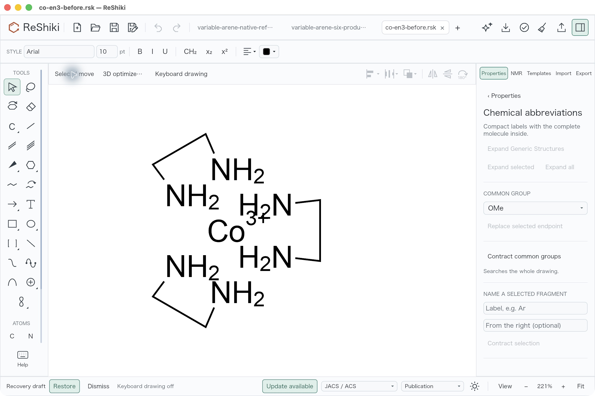
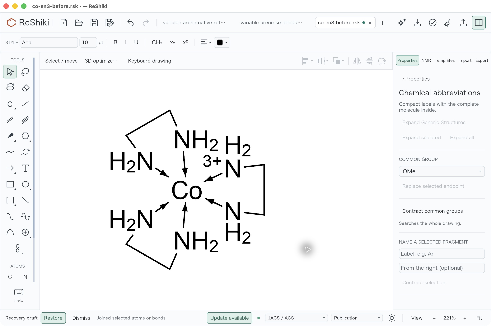
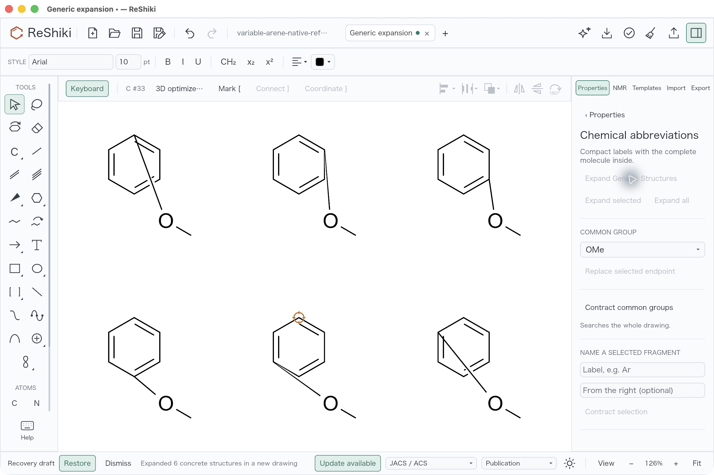

# Combined Join and generic-structure review

[Integration PR #300](https://github.com/Ameyanagi/ReShiki/pull/300) combines
coordination contacts, ordinary Join, supported generic expansion, adaptive
chemistry limits, Assistant guidance and the Windows/Office workflows.
Contribution: @Ameyanagi, project creator and maintainer.

## Deferred work

The maintainer requested merging the current implementation with **Join accuracy
left TODO**. [Co(en)3 issue #246](https://github.com/Ameyanagi/ReShiki/issues/246)
must remain open. These are outstanding requirements, not completed fixes:

- Improve coordination arrowhead proportions and the protruding rounded shaft
  tip. Review short donor–metal spans and surrounding charge/label clearance.
- Improve Join selection and placement accuracy against observed reference
  behavior. Exactly one donor and the metal currently create one contact per
  Ctrl+J (Cmd+J on macOS); selecting a complete ligand is a different operation.
- Correct variable-position expansion layout. Keeping the original substituent
  coordinates can produce ring-crossing attachment bonds and unsuitable lengths.
- Complete native Windows checks on the combined source, including a measured
  display scale above 100%. Historical 96-DPI results and numerical sizing tests
  do not establish high-DPI desktop acceptance.

## Actual combined macOS result

The following untouched native screenshots were captured on 2026-10-11 from
source `ce40d2386207807514d0fa9b793b2ba16ebcb62d`, tree
`05c86306e22c42c43b557637f1f094a6161d88b7`. The signed default-build executable
SHA-256 is `0a036aec87ad3058f94d8d8099a7f1bb1c16547161c5652e7bbe971a0ca2b102`.
Later documentation and test-expectation changes do not alter shipping behavior;
these captures retain their actual producer identity.

Open the unchanged [Co(en)3 input](../../tests/fixtures/coordination/co-en3-before.rsk).
Select a donor nitrogen and cobalt, press Cmd+J, and repeat for each donor.

| Before adding contacts                                                                                              | After six contacts; arrow appearance remains TODO                                                                                                             |
| ------------------------------------------------------------------------------------------------------------------- | ------------------------------------------------------------------------------------------------------------------------------------------------------------- |
|  |  |

Both views use 221% zoom, light theme, JACS / ACS, Arial 10 pt and keyboard
drawing off. They are full 2560 × 1704 captures. Automatic hydrogen-label and
charge placement changes after joining; the after title has an unsaved indicator.
The inactive test tabs and recovery banner are retained. The before drawing
contains 13 atoms and nine covalent bonds; the [saved after drawing](../../tests/fixtures/coordination/integration-review/co-en3-six-contacts-ce40.rsk)
contains 13 atoms and 15 bonds. All six new bonds are order-5 contacts directed
from N IDs 2/5/6/9/10/13 to Co ID 1. Atom positions, charge +3, six NH2 donors
and the nine covalent bonds are preserved; derived carbon label-H caches refresh
from zero to two. A controlled single contact passes Undo/Redo, and closing the
saved tab then reopening it starts with both history commands disabled.

For generic expansion, the six-position arene fixture produces six explicit
eight-atom/eight-bond products. One Undo empties the new output tab, Redo restores
it, and native save followed by actual tab closure/reopen retains the products.
The source stays unchanged. **The output layout is defective**, as shown below;
the graph and history checks do not qualify its visual quality.

This output view is at 126% with keyboard drawing on. It is a defect record,
not a matched comparison or an accepted drawing example. The
[saved defective output](../../tests/fixtures/coordination/integration-review/variable-arene-six-products-ce40.rsk)
is retained for follow-up reproduction.

## Automated checks

The composed source passed all eight normal commit hooks and 40 focused test
functions: 37 generic tests, one aromatic mapping test and two local naming
identity tests. Existing geometry checks apply to byte-identical geometry source;
they were not rerun as part of those 40 functions.

The first combined CI run failed on macOS, Linux and Windows at the same stale
V3000 LINKNODE test expectation. The reader now validates typed LINKNODE records;
the old test expected a record referencing nonexistent atoms to be skipped.
The correction retains that malformed case, checks its missing-atom diagnostic
and adds a framing diagnostic case. The exact focused test passes locally.
Production parser behavior is unchanged. Required CI must pass before merge.

Reusable caption: Join adds donor-to-metal contacts in place; Co(en)3 arrow
appearance and Join accuracy remain TODO, with issue #246 open.
