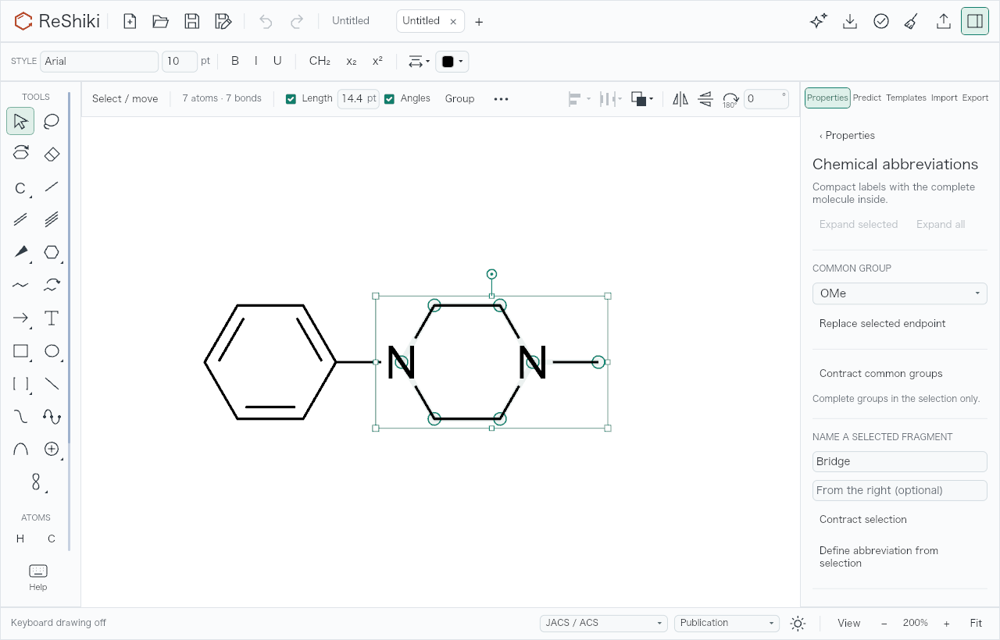
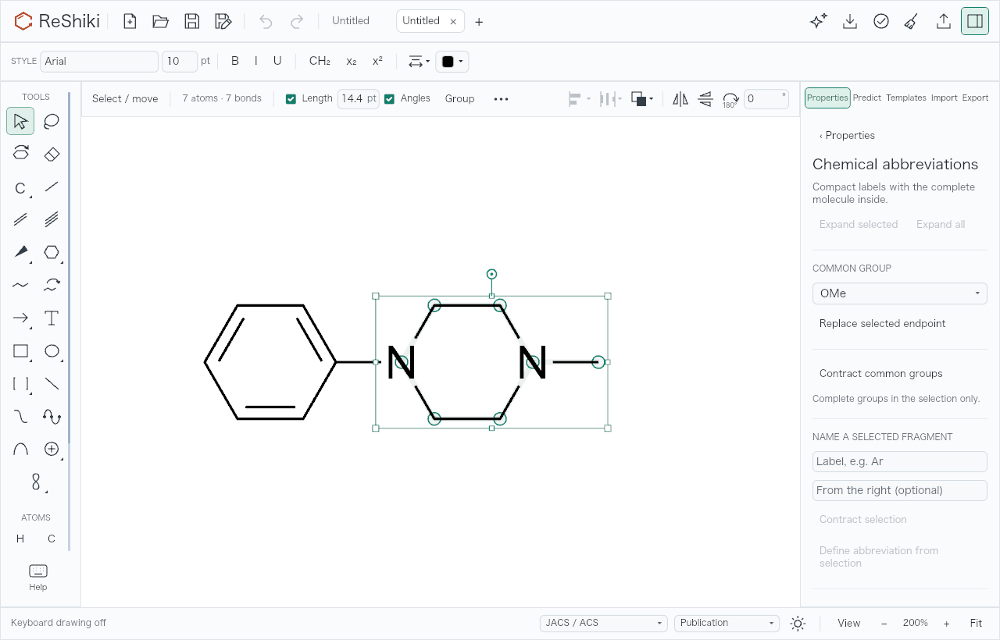
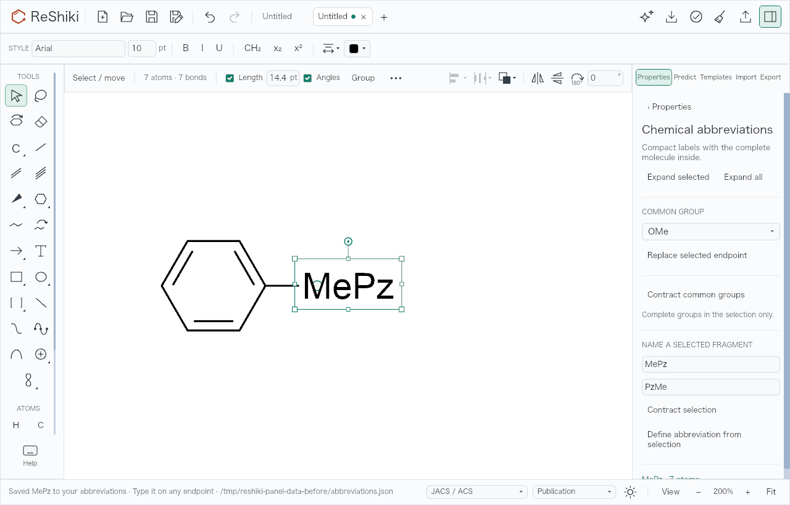
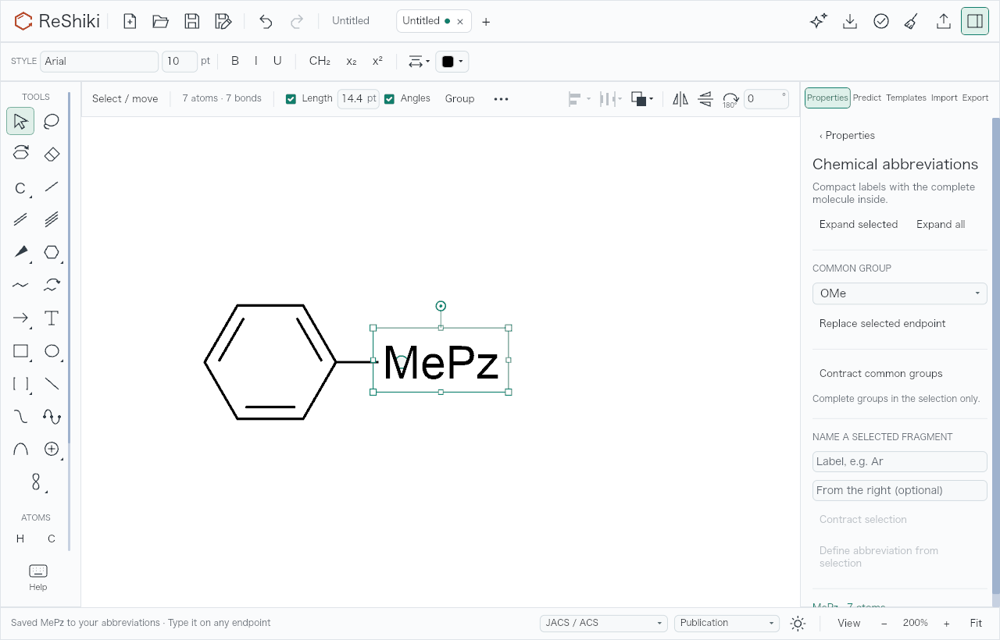
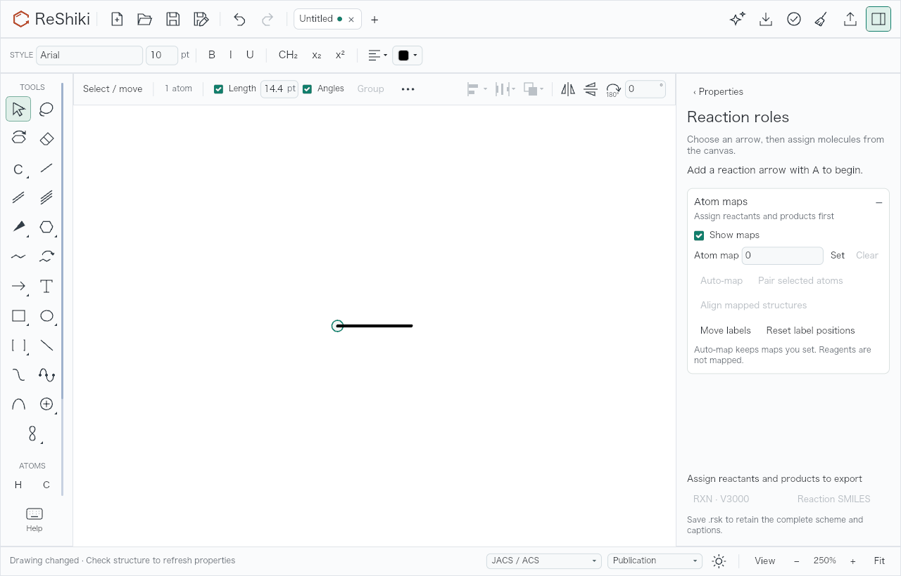
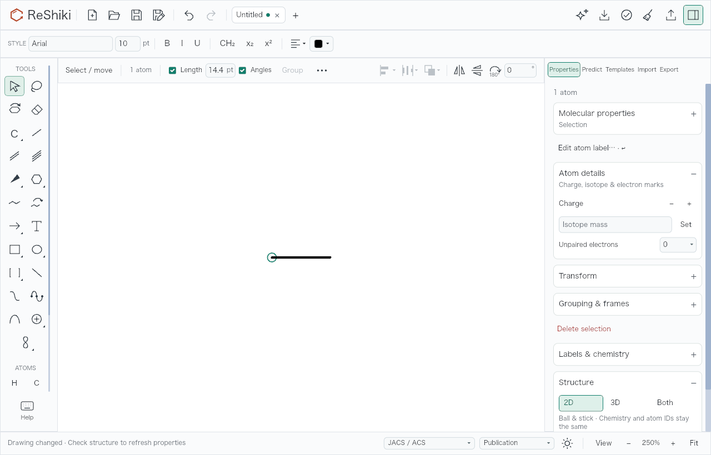
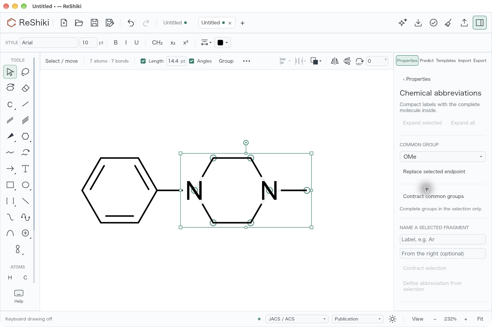
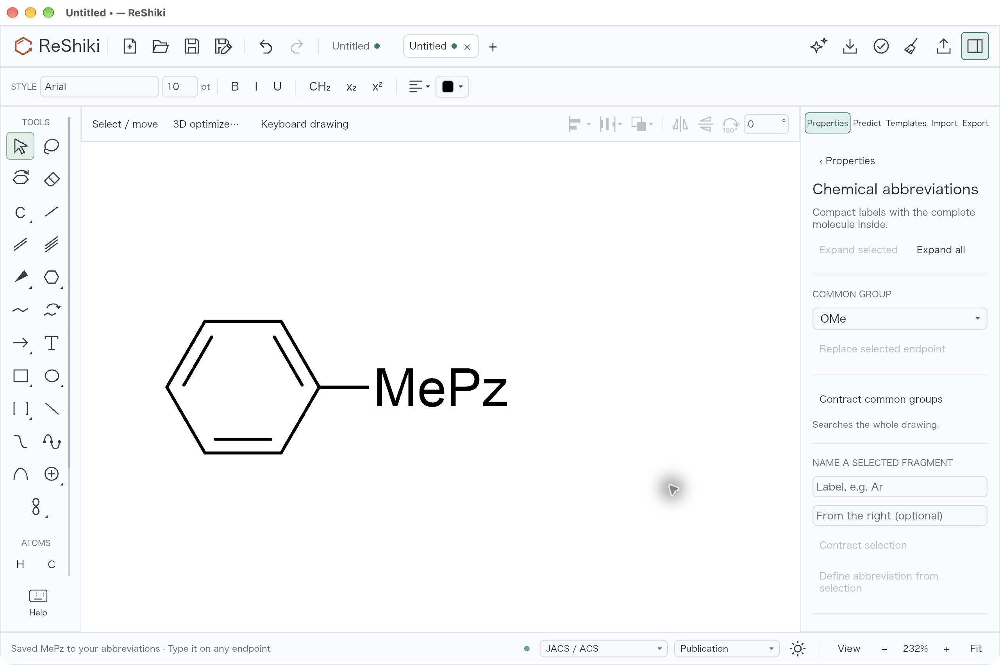
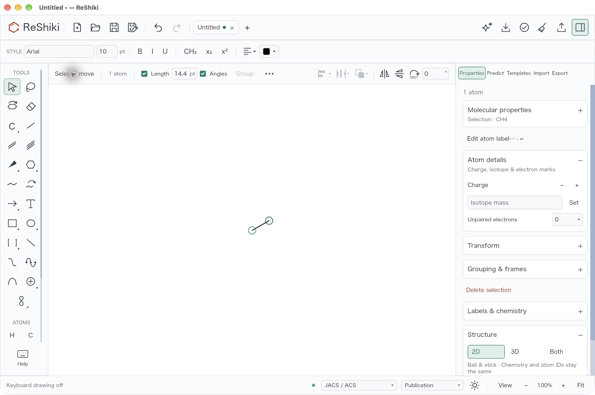

# Drawing-panel state across drawings

Fixes [#496](https://github.com/Ameyanagi/ReShiki/issues/496),
[#501](https://github.com/Ameyanagi/ReShiki/issues/501), and
[#510](https://github.com/Ameyanagi/ReShiki/issues/510).

Defining an abbreviation now confirms the saved label without displaying the
application data path. Both fragment-name fields clear after a successful Define
and whenever the selected atoms or front drawing change. A refused Define keeps
the draft while the selection stays the same. Returning to an earlier selection
does not bring its old draft back.

Reactions, atom labels, chemical abbreviations, and Names return to Properties
when switching, creating, closing, replacing, or restoring the front drawing.
Drawing style, Templates, Import, Export, theme tools, Pages, and Assistant keep
their session behavior. Existing Predict docking behavior is preserved. Saved
abbreviations, the common-group choice, and catalog warnings remain available.
Temporary routing of a background tab's results does not change the visible
panel or its draft.

## Matched application-renderer comparisons

The before build is `3d80590a`. The after implementation is `b8a08205`. Both run the same opt-in
[capture test](../../src/app/drawing_panel_capture.rs) through the actual app view
and WGPU renderer on macOS 27.0.1 (26A434), Apple M1, arm64, debug build. The
renderer surface is 1280 × 820, with JACS / ACS drawing style, Publication theme,
Arial 10 pt, light canvas, and PNG output. Keyboard drawing is off in the captured
states. Selection markers are intentional because the selected fragment and atom
are the subjects of these checks.

The base worktree received only the capture test and test-helper visibility
needed to run it. It contains no production fix. Before and after use separate,
empty application data directories, `/tmp/reshiki-panel-data-before` and
`/tmp/reshiki-panel-data-head`. The before status therefore shows a synthetic path,
with no personal account information. These are renderer captures; the separate
desktop interaction check below uses the native app.

### Fresh fragment fields

Import propane (`CCC`), select its middle carbon, type `Bridge`, and attempt
Define. That selection has two external bonds, so the refusal is expected. Create
a new tab, import `CN1CCN(c2ccccc2)CC1`, select its piperazine ring and N-methyl
(seven atoms), and open Chemical abbreviations at 200% zoom. The head shows both
empty placeholders rather than the previous drawing's `Bridge` draft.

| Before                                                                                                                                | After                                                                                                                                |
| ------------------------------------------------------------------------------------------------------------------------------------- | ------------------------------------------------------------------------------------------------------------------------------------ |
|  |  |

Release caption: **Fragment-name fields start fresh when the selection or drawing
changes, preventing a previous label from being saved for a different group.**

### Define confirmation

For that same fragment, enter `MePz` and the reverse label `PzMe`, then choose
Define abbreviation from selection. Both builds save and collapse the group in
one drawing edit. The head clears both fields and shows the short confirmation
without the data directory. The two images use the same 200% zoom and selection.

| Before                                                                                                                                        | After                                                                                                                                    |
| --------------------------------------------------------------------------------------------------------------------------------------------- | ---------------------------------------------------------------------------------------------------------------------------------------- |
|  |  |

Release caption: **Saving an abbreviation shows a short confirmation that keeps
the application data path out of screenshots and recordings.**

### Properties after closing a drawing

Open Reaction roles in another scratch drawing, close it, discard the remaining
scratch drawings through the last tab, and add ethane to the replacement Untitled
drawing. Select an end atom at 250% zoom. Before, Reaction roles hides atom actions.
After, Properties exposes Edit atom label. The different panel widths naturally
shift the canvas center slightly; the surface size, zoom, input coordinates,
style, and operation are the same.

| Before                                                                                                                                 | After                                                                                                                                   |
| -------------------------------------------------------------------------------------------------------------------------------------- | --------------------------------------------------------------------------------------------------------------------------------------- |
|  |  |

Release caption: **A new or different drawing returns content-specific inspector
pages to Properties, keeping the selected atom's actions visible.**

## Native desktop interaction check

The same arm64 debug build ran in an isolated QA app with its own
`RESHIKI_DATA_DIR`. No user catalog was changed. Screenshots are unretouched
2560 × 1704 native PNG captures; their framing differs from the matched renderer
comparisons above.

1. Import `CCC`, select the middle carbon, enter `Bridge`, and choose Define. The
   expected refusal retains the field for the same selection.
2. Create a new tab, import `CN1CCN(c2ccccc2)CC1`, turn off keyboard drawing, and
   rectangle-select the seven-atom piperazine/N-methyl fragment. Open Chemical
   abbreviations. Both placeholders are empty, at 232% fitted zoom.
3. Enter `MePz` / `PzMe` and choose Define. The group collapses, both fields clear,
   and the unblanked status reads:
   `Saved MePz to your abbreviations · Type it on any endpoint`.
   Click empty canvas before capturing to remove the hover tooltip;
   the confirmation remains visible.
4. Open Reaction roles and close/discard that active drawing. Properties appears
   for the preceding drawing. Open Reaction roles there and close/discard the
   last drawing. The replacement Untitled drawing starts in Properties. With
   keyboard drawing on, click empty canvas and press `1` to draw a bond, then leave
   keyboard drawing. At 100% zoom, Edit atom label is visible for the selected
   end atom.







## Validation and reproduction

App tests cover normalized selection order, selection A → B → A invalidation,
first input before a context has been synchronized, same-context Define refusal,
successful file write and both-field clearing, tab switches, fresh and reused
default tabs, active and last-tab close, file replacement, draft restore, retained
session pages/catalog choices, and background tab swaps with recursive updates.
The Define file-write test uses a separate process and an isolated data directory,
and asserts that the confirmation includes neither that directory nor the home
directory.

Validation on this branch:

- Full app binary suite: **1117 passed, 0 failed, 123 ignored**. The explicit
  naming helper points to the freshly built executable; the ignored visual
  capture and child test are run separately where appropriate.
- Focused Clippy with test targets:
  `cargo clippy --locked --bin reshiki --tests -- -D warnings`.
- Both matched capture runs completed with the real WGPU renderer; each PNG was
  inspected for state, legibility, clipping, and unrelated/private content.
- Native checks above passed, including real catalog persistence and unblanked
  success status.

To regenerate the head renderer images with an empty disposable catalog:

```sh
mkdir -p /tmp/reshiki-panel-capture-data
RESHIKI_DATA_DIR=/tmp/reshiki-panel-capture-data \
RESHIKI_PANEL_QA_DIR=/tmp/reshiki-panel-captures \
cargo test --locked --bin reshiki \
  app::drawing_panel_capture::drawing_panel_state_renderer_evidence \
  -- --exact --ignored --nocapture
```

Routine success-message expiry and catalog-management UI are outside this change.
Diagnostic errors and catalog warnings retain their existing path details.
