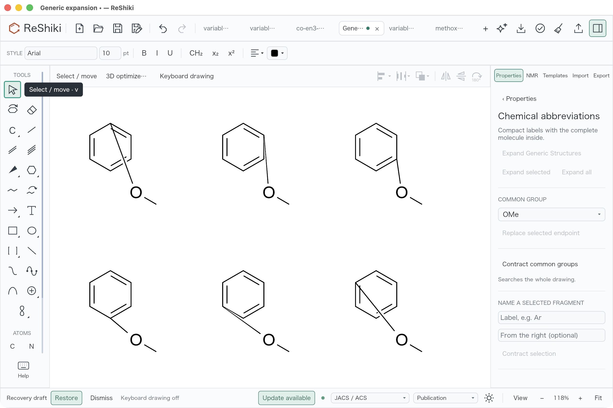
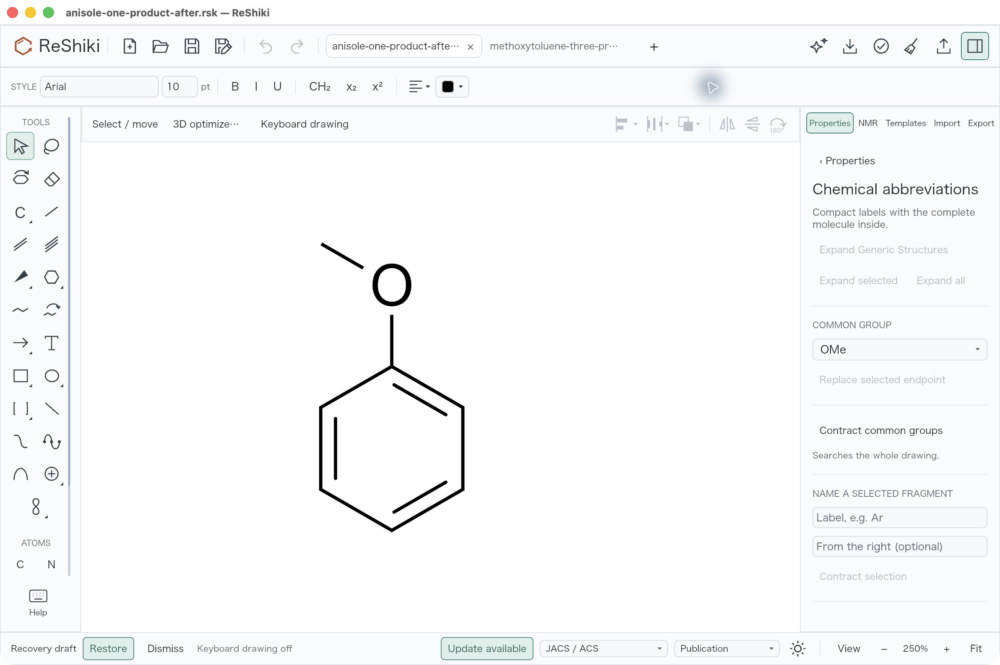
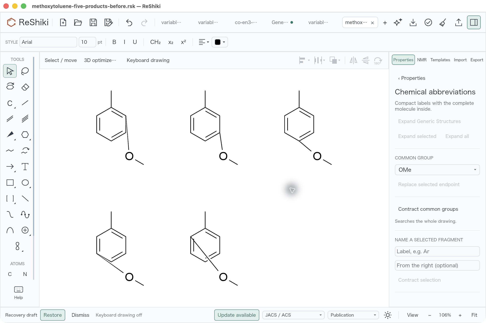
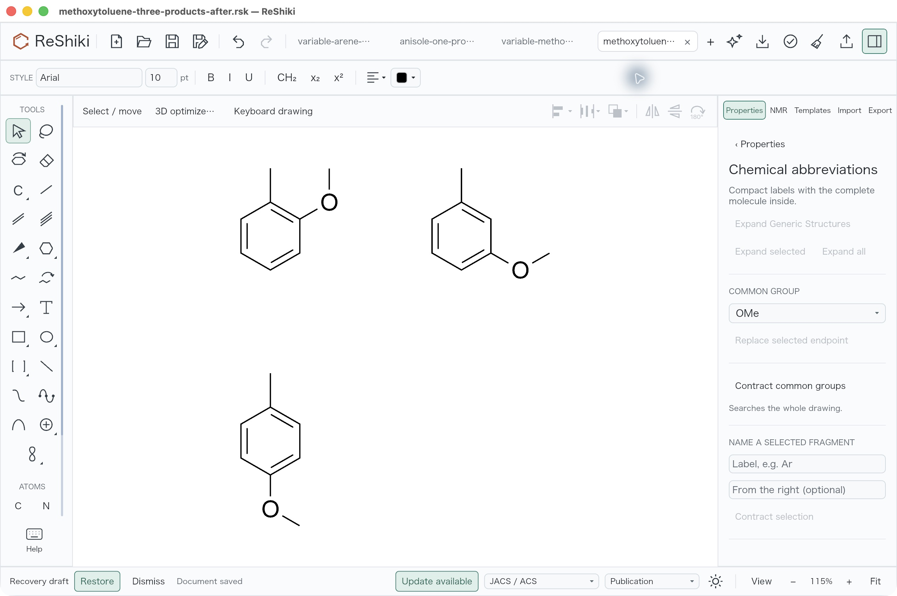

# Ring expansion placement and unique chemical products

Contribution: @Ameyanagi, project creator and maintainer. Native macOS review
passes; CI is recorded in the pull request. This change is unreleased.

## Problem and correction

A six-position benzene attachment produced six equivalent anisoles. The
substituent kept its original coordinates, so generated bonds could cross the
ring or have unsuitable lengths. An unlike fixed substituent produced five
positional drawings instead of three distinct methoxytoluenes.

Expansion now keeps the host fixed, rigidly places a detachable substituent
outward and uses the drawing style's normal connector length. Ordinary C/N/O/S
roots with one single-bond branch neighbor use a 120° attachment angle. Internal
fragment distances are preserved. Collision checks include saved/refreshed
label ink and the connector against the host and nonincident moving bonds.

An exact bounded chemical-graph comparison keeps the first representative of
each unique product. Elements, isotopes, charge, atom maps, stereochemistry and
directed dative bonds remain meaningful; coordinates and drawing IDs do not
create a different molecule.

## Before and after

Open the [nine-atom/eight-bond arene input](../../tests/fixtures/generic-structures/variable-arene-native-refused-v26.rsk)
or [ten-atom/nine-bond substituted input](../../tests/fixtures/generic-structures/variable-methoxytoluene-v26.rsk)
and choose **Expand generic structures** in the right-click menu or the
**Generic structure** card in **Properties**.

| Input                                             | Before                                                           | After                                      |
| ------------------------------------------------- | ---------------------------------------------------------------- | ------------------------------------------ |
| Six equivalent arene positions                    | Six duplicated, malformed anisoles                               | One clean anisole                          |
| Five positions with a different fixed substituent | Five positional drawings with duplicates and ring-crossing bonds | Three clean products: ortho, meta and para |

| Before                                                                                                              | After                                                                                                             |
| ------------------------------------------------------------------------------------------------------------------- | ----------------------------------------------------------------------------------------------------------------- |
|                    |                           |
|  |  |

These are unmodified native desktop JPEGs at the same 2560 × 1704 window size,
light appearance, JACS/ACS style and Arial 10 pt, with keyboard overlays off.
Fit framing changes as product counts shrink: arene views display 118%/250%,
and substituted views 106%/115%. They are not presented as equal-zoom captures.

Before producer: `ce40d2386207807514d0fa9b793b2ba16ebcb62d`; signed executable
SHA-256 `0a036aec87ad3058f94d8d8099a7f1bb1c16547161c5652e7bbe971a0ca2b102`.
After producer: `47b14dab27f7de32120d16c11d53ab563cca1dd9`, tree
`756461b3da53b36df47fd2f6214b9a1a6aff69e9`; signed executable SHA-256
`5d0d995c56353e40406e37369b70060c58200ca17d9079a926fed667936a7b28`.
The ordinary locked default-feature build and macOS bundle pass source,
dependency, architecture and strict ad-hoc-signature checks. Later evidence or
documentation commits are not relabeled as the screenshot producer.

The [receipt](https://github.com/Ameyanagi/ReShiki/blob/evidence/review-archive-2026-10/docs/evidence/generic-ring-expansion/native-review-receipt.json)
records input, output and image hashes, actual build identity, displayed zooms
and measured saved-file geometry. The [historical combined review](coordination-join-integration.md)
retains its original defect evidence.

## Verification

The complete local model suite passes **351 tests, zero failures, ten ignored**.
This includes 59 generic tests covering raw ring poses, one/three unique graphs,
120° angles, fixed host geometry, rigid fragment distances, saved/refreshed ink,
stereo/map/isotope distinctions, native round-trips, and atomic refusal for
crossing, touching, precision and work-limit cases. Normal commit checks pass:
workspace check, Clippy with warnings denied, Rust formatting and oxfmt.
The ten ignored tests include the two deferred six-contact Co(en)3 tests under
issue #246; those are separate from this correction.

Actual desktop expansion produces one 8-atom/8-bond anisole and three
9-atom/9-bond methoxytoluenes. Undo empties each new output tab in one step;
Redo restores it. Both files were saved, the application quit/relaunched, and
the outputs reopened with preserved geometry and fresh disabled Undo/Redo.
Both source input hashes remain unchanged.

The saved products independently verify attachment bond lengths of 42 within
0.000008 world units and methoxy angles of 120° within 0.000021°. The three
substituted ring attachment distances are 1, 2 and 3 edges. Host rings and the
fixed methyl group retain their geometry up to tiling translation and f32
rounding; internal methoxy geometry remains rigid.

Download the actual [anisole output](https://github.com/Ameyanagi/ReShiki/blob/evidence/review-archive-2026-10/docs/evidence/generic-ring-expansion/anisole-one-product-after.rsk),
[three-product output](https://github.com/Ameyanagi/ReShiki/blob/evidence/review-archive-2026-10/docs/evidence/generic-ring-expansion/methoxytoluene-three-products-after.rsk)
or [five-product before output](https://github.com/Ameyanagi/ReShiki/blob/evidence/review-archive-2026-10/docs/evidence/generic-ring-expansion/methoxytoluene-five-products-before.rsk).
Fresh-process reopen captures show [anisole and its formula](../images/generic-ring-expansion/anisole-reopened.jpg)
and [all three products and their graph counts](../images/generic-ring-expansion/methoxytoluene-reopened.jpg).

## Limits

Raw admission remains at 500 candidates and 100,000 raw atoms before duplicate
removal. Copies, chemistry, layout, display measurement and identity comparison
share the existing 5,000,000 work allowance. An exhausted budget or invalid
candidate rejects the request without installing partial output.

This is local rigid placement, with refusals for shared/bridged anchors,
unsupported concave or overlapping poses, and mixed variable/link/repeat
placement on the same component. It does not redraw internally crowded fragments
or arbitrary independent artwork. Explicit hydrogen vertices may remain distinct
from attached-hydrogen representations. See the [workflow](../generic-structures.md)
for retained restrictions.

Join selection/placement accuracy and Co(en)3 appearance remain TODO;
[issue #246](https://github.com/Ameyanagi/ReShiki/issues/246) stays open. Combined
native Windows and measured above-100% DPI acceptance remain pending.

## Archived evidence

The historical evidence cited in this record is preserved in [docs/evidence/generic-ring-expansion](https://github.com/Ameyanagi/ReShiki/tree/evidence/review-archive-2026-10/docs/evidence/generic-ring-expansion) on the evidence archive branch.

| Archived files                                                                                                                                         | What they record                                                                   |
| ------------------------------------------------------------------------------------------------------------------------------------------------------ | ---------------------------------------------------------------------------------- |
| [docs/evidence/generic-ring-expansion](https://github.com/Ameyanagi/ReShiki/tree/evidence/review-archive-2026-10/docs/evidence/generic-ring-expansion) | Anisole and methoxytoluene native results and the qualified native review receipt. |
