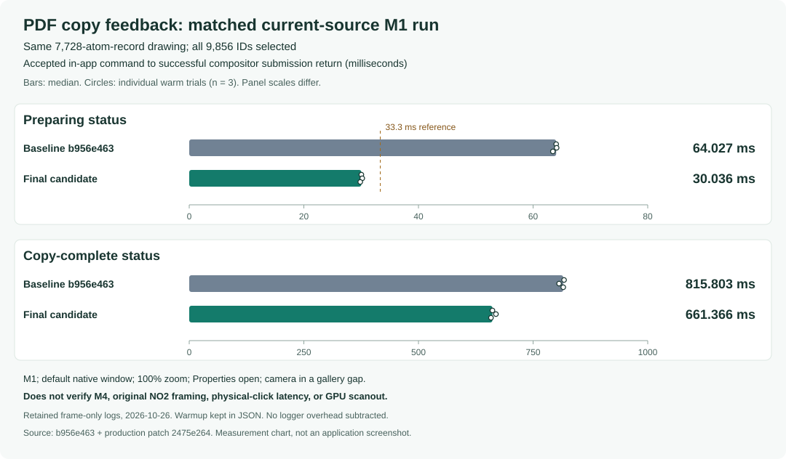

# Large-selection PDF progress: current-source follow-up

This follow-up to [#574](https://github.com/Ameyanagi/ReShiki/issues/574) reduces
the local median accepted-command → Preparing presentation from **64.027 ms to
30.036 ms**, and copy-complete presentation from **815.803 ms to 661.366 ms**.
All measured copies present Preparing on the first draw, with the menus closed.
The copied PDF retains the same complete object graph and rendered pixels.

**The 33.3 ms budget is met in this controlled M1 comparison. The original M4,
1600 × 1000 pt outer window, NO₂-chain target, physical-click latency and GPU
scanout remain unverified.** This is a matched current-source follow-up to the
[earlier ordering and cache fix](large-selection-copy-feedback.md), with a fresh
baseline; the two notes describe different capture conditions.

## Measurement and scope

Both builds use base `b956e46347f644372e3c01128b99ca64ac208e2d`. The candidate
adds the eleven-file production patch whose SHA-256 is
`2475e264f814a5ca82f7122a9c39b83fa287793486e518ec2febfa5f5ab84dc5`.
The same environment-guarded QA instrumentation is applied to both builds;
its patch SHA-256 is
`7af802254fee97971dec19c9ff5d3b0df9728f77c35013441b1f6f8c5f81d6ae`.
No diagnostics ship in production.

The input is the issue's original
[tiled16-v26.rsk](https://gist.githubusercontent.com/Ameyanagi/0f2d480dd9a4e8cb1843ecd12660f93f/raw/tiled16-v26.rsk),
SHA-256 `71229e202a3a0ba5765af5ac4bd94f4396613237f421cb4c828925c589b553da`:
7,728 atom records, 6,864 bonds and 256 abbreviations. All 9,856 selectable IDs
are selected. Both optimized ARM64 builds run on Apple M1, macOS 27.0.1,
Rust 1.99.0, at 100% zoom with Properties open and the default native window.
The camera is in a blank gap between gallery tiles. Right-clicking that gap
preserves the full selection; CUA/AX then invokes Copy as → PDF. Each build has
one retained warmup followed by three quiet warm copies.

| Warm copy | Baseline Preparing | Candidate Preparing | Baseline complete | Candidate complete |
| --------- | -----------------: | ------------------: | ----------------: | -----------------: |
| 2         |          64.027 ms |           30.036 ms |        817.544 ms |         661.366 ms |
| 3         |          64.106 ms |           30.192 ms |        806.649 ms |         668.962 ms |
| 4         |          63.453 ms |           29.846 ms |        815.803 ms |         658.183 ms |
| Median    |          64.027 ms |           30.036 ms |        815.803 ms |         661.366 ms |

The shared monotonic clock starts at the accepted in-app command and ends when
the compositor's presentation submission returns successfully. It excludes OS
input delivery and GPU completion or display scanout. These are three warm
trials per build, not a latency distribution. No logging overhead is subtracted.
Separate phase-mode trials attribute work but do not supply the deadline result:
the final view takes 7.85–8.21 ms and layout 5.19–5.84 ms. The original recordings,
raw logs, failed intermediate candidates and PDF differences remain retained.
[Portable timing and equivalence receipts](../../tests/fixtures/large-selection-copy-feedback/current-source-timings.json)
include warmup, source/binary/log hashes and measurement limits.

## Narrow query changes

- Bonded-selection checks index the abbreviation-expanded selection once per
  call, preserving membership and the existing partial-selection rule.
- Cursor interaction rejects model turning early when the document has no shown
  model. Existing hit testing remains in use whenever any shown model exists.
- Existing-model controls avoid resolving a molecule when no models exist.
  Structure generation continues to use the original selected-molecule query.
- Label-contrast checks build a call-local set of hidden abbreviation members.
  Each group exempts its own anchor; another group can still hide that anchor.
  Warning order, carbon/dummy rules, attachments, ink and background checks stay
  intact.
- Depth targeting returns sorted unique real atom IDs directly when all current
  non-centroid atoms are seeded. Partial selections retain the original covalent
  component traversal, including dative disconnection and centroid exclusion.

These temporary indexes and necessary-condition checks introduce no persistent
cache. They leave PDF conversion, rendering, menu forwarding and clipboard frame
admission unchanged. The existing request serial, originating tab/epoch/revision,
selection, window and frame-time guards still reject stale or foreign work;
close/replacement cancels, and duplicate requests remain serialized.

## Output and regression checks

Both PDFs contain one page, 776,466 bytes and sixteen indirect objects. Raw bytes
and object numbering differ. Comparing the full resolved trailer and every
object-rooted graph, with multiplicity, yields the same SHA-256
`1c7d167d99c1417973f0f2d24cc9b7aa6dc44d5eff40a3d619c81fe5622a3eb2`.
The comparison retains array order and encoded/decoded stream hashes, normalizing
only serialization order, object IDs and xref offsets. Complete 1600 × 1280 px
overview and 1840 × 1470 px first-tile detail renders are byte-identical, with
zero differing RGBA pixels; both were visually inspected independently.

Focused release tests pass on macOS and, on the exact frozen patch, Linux x86_64:

| Suite                          | Passed |
| ------------------------------ | -----: |
| Workspace selection            |      6 |
| Canvas model interaction       |     17 |
| App model selection/generation |     36 |
| PDF frame ownership            |      8 |
| Contrast parity                |      3 |
| Depth component parity         |      7 |
| Total                          |     77 |

The two existing opt-in model renderer tests remain ignored. Regressions cover
expanded abbreviations, model add/remove and generation controls, overlapping
anchors, consecutive edits, dummy/carbon/fill/halo contrast, complete and partial
depth seeds, centroids, dative bonds, extras and duplicate IDs. The Linux receipt
is pinned in the portable data; this is functional validation, not Linux timing.
Native all-feature workspace library/binary Clippy, the required three-package
WASM Clippy, Rust formatting, JavaScript lint, documentation-tree validation and
changed-document formatting pass. No dependency, lockfile or production
instrumentation change is included.

Release caption: **Large-selection PDF copy presents progress sooner by avoiding
repeated selection, model, contrast and depth queries.** The controlled M1 median
is 30.036 ms to Preparing and 661.366 ms to completion, with unchanged PDF output;
the original report's hardware and physical-input conditions remain qualified.
