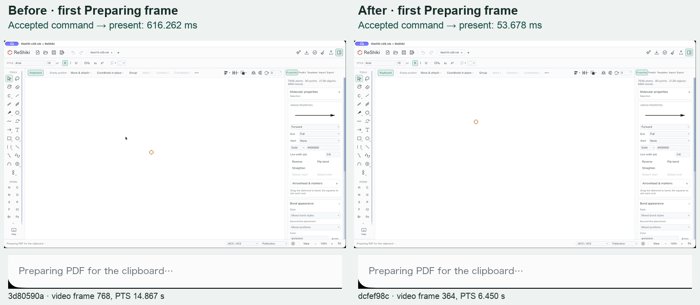
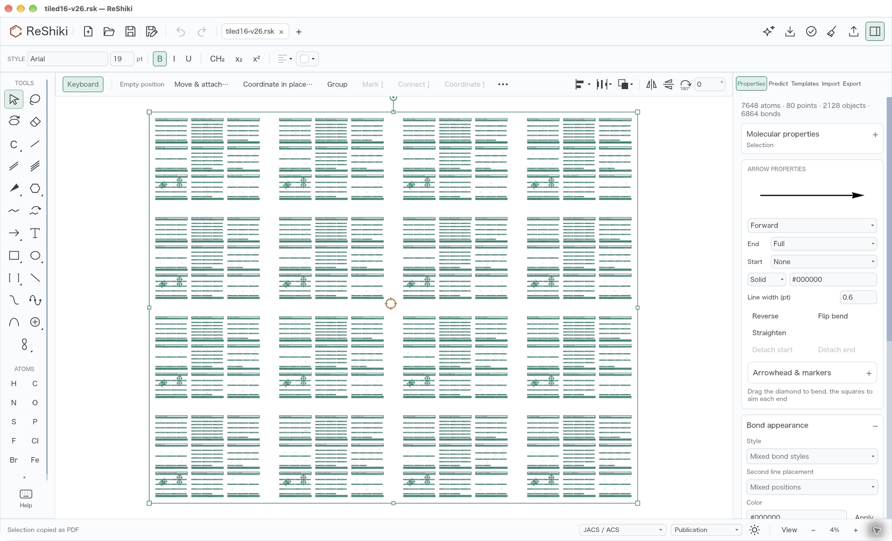
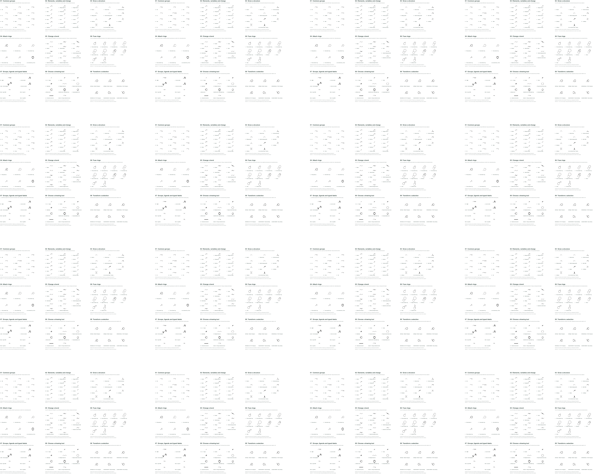

# Large-selection PDF copy feedback

This change addresses [#574](https://github.com/Ameyanagi/ReShiki/issues/574).
On the issue's complete 7,728-atom drawing, the local M1 native comparison reduces
accepted-command → first progress presentation from 616.262 ms to 53.678 ms, and
accepted-command → copy-complete presentation from 1,564.521 ms to 776.795 ms.
The first requested redraw contains closed menus and “Preparing PDF for the
clipboard…”. PDF preparation starts after that redraw acknowledgment.

**The measured 52–54 ms M1 result does not verify the literal 33.3 ms budget or
the report's M4 hardware.** It establishes the corrected ordering, a roughly
91% acknowledgment improvement and roughly twice as fast completion in the
conditions below. It is one quiet warm copy per build, not a latency distribution.

Both images are the first visible Preparing frame. Timing labels come from the
application's shared monotonic clock. Frame numbers and PTS identify original
video samples; they are not physical-click timestamps. Annotations are outside
the unretouched application frames. The recording indicator in the title bar is
part of the native capture.

## Native comparison

| Local release build                   | Accepted → Preparing presented | Accepted → Copied presented |
| ------------------------------------- | -----------------------------: | --------------------------: |
| Baseline `3d80590a`                   |                     616.262 ms |                1,564.521 ms |
| This change, `dcfef98c`               |                      53.678 ms |                  776.795 ms |
| This change + pointer work `2a6d0074` |                      52.191 ms |                  771.451 ms |

The combined sample verifies composition with [PR #578](https://github.com/Ameyanagi/ReShiki/pull/578).
This settled Copy as PDF case does not require that PR; pointer-motion response
is a separate measurement. No pointer implementation was copied into this PR.

The metric begins when the context-menu command is accepted by `Action::Run`
and ends at a successful native compositor presentation submission. It excludes
OS input delivery and GPU scanout. A temporary, environment-guarded QA patch
uses one shared clock for command dispatch, status assignment, actual footer
draw and successful presentation. The footer's existing style callback returns
the same panel style; it changes no widget, layout or drawing. Its captured
condition requires the full Preparing status and closed context menus. The
first successful Preparing presentation matches draw serial 1 on both final
builds and precedes the Copied presentation. No diagnostic code ships.

[Timing, binary and original-movie receipts](../../tests/fixtures/large-selection-copy-feedback/native-timing.json),
[baseline QA-only patch](../../tests/fixtures/large-selection-copy-feedback/frame-trace-before.patch),
[final QA-only patch](../../tests/fixtures/large-selection-copy-feedback/frame-trace-after.patch)
and [video cadence](../../tests/fixtures/large-selection-copy-feedback/video-cadence.json)
retain the source, binary, patch and original recording hashes. Original MOVs,
PDFs, binaries and complete decoded frames stay outside Git in the owned QA574
evidence directory. Frames were decoded with AVAssetReader; no frame-rate
conversion or reconstruction was used. The original captures are variable rate,
with a 16.667 ms median sample interval. Whole-movie maximum gaps include idle
capture periods; the cadence receipt separately records progress transitions.

## Input and reproduction

The input is the issue's original
[tiled16-v26.rsk](https://gist.githubusercontent.com/Ameyanagi/0f2d480dd9a4e8cb1843ecd12660f93f/raw/tiled16-v26.rsk):
5,796,846 bytes, SHA-256
`71229e202a3a0ba5765af5ac4bd94f4396613237f421cb4c828925c589b553da`.
It contains 7,728 atom records, 6,864 bonds, 256 abbreviations, 2,112 captions
and 16 arrows. Select All contains 9,856 IDs. The application reports
“7648 atoms · 80 points · 2128 objects · 6864 bonds”. The file is referenced by
URL and hash, not regenerated or bundled here.

The matched native windows are local arm64 release builds on macOS 27.0.1,
Apple M1, with the same observed **1680 × 1020 pt outer size**, 100% zoom,
Properties open, Select tool, keyboard drawing on and the complete selection.
All bundles use separate `RESHIKI_DATA_DIR` directories and the same local helper.

1. Launch the isolated app with its supported `--open` option and the exact file.
2. Use the native AX window Zoom action. Before selection, leave keyboard drawing,
   run the command palette's Actual size command, then Select All and enable
   keyboard drawing again. This avoids setup work being mixed into the measurement.
3. Open the full-selection context menu in the central gap, then Copy as → PDF.
   Complete one warm copy and repeat for the quiet recording.
4. Record the exact native window with `screencapture -x -k -v -V 45 -l WINDOW_ID`.
   Start one encoder at a time, then invoke the staged PDF action through CUA.
5. After the copy-complete receipt, save only that owned PDF pasteboard result.
   Inspect the saved original movie and its per-sample timestamps.

The native framing differs from the report: supported window Zoom provides
1680 × 1020 rather than 1600 × 1000 pt, and the 100% camera is centered between
gallery tiles. Menu-opening positions differ within that gap; each command
retains the same complete selection. This is not the report's NO₂-chain target
or the same visible-ink/pointer-off-menu workload. CUA's AX click has no reliable
physical-click timestamp or marker, so tool round-trip time and focus borders
are not used as click latency. No M4 result is claimed.

The Fit overview below was captured after timing, at 4%, to verify the copied
scope. Selection handles are intentional in this complete-selection check.

## What changed

Large selections no longer resolve every selected atom label to display the
first usable toolbar alignment. Captions skip the unused atom-alignment query;
mixed caption colors establish a mixed swatch before resolving every atom's
automatic ink. Label order, abbreviation-anchor normalization, paint identity,
empty-caption handling, UTF-8 spans and scope rules retain their existing values.
The selected-molecule query stops at its first atom outside the initial component.
Properties builds its constrained atom scope only when the crystal subsystem's
`touches(doc, &[])` predicate reports a constrained drawing. That existing
predicate also composes with retained distance provenance without a live cell.

PDF admission keeps the cheap owned snapshot and format refusal path. An App-owned
pending request stores its original tab, epoch, revision, selection, request
serial, window and time. It explicitly requests a redraw. The raw subscription
retains the event's actual window ID; foreign, old or pre-request frames cannot
release it. After the owning redraw acknowledgment, existing preparation and
publication run with the original tab's guards. Missing windows, closed tabs,
replacement and changed selection/revision cancel without publishing. Duplicate
clipboard work stays serialized. Other formats keep their existing preparation
path.

The context menu now retains a stable wrapper around the canvas. Opening and
closing previously replaced its widget tree, discarding the scene, selection
and text caches just before progress appeared. The closed wrapper delegates real
cursor input, drawing, widget operations and overlays to its base. Menu boundaries
reset transient pointer/click/gesture state; actual modifier changes keep the
retained canvas current while the open menu still captures input. This prevents
stale click coordinates and released Shift from affecting the next gesture.

A native diagnostic trace isolated one view construction (15.935 ms), one layout
(22.086 ms), two widget operations totaling 0.228 ms, a first canvas interaction
of 89.950 ms and canvas draw of 166.047 ms before the cache correction. It recorded
no repeated redraw update or accessibility Snapshot before the first draw. The
actual-App cache regression fails under the former bare-base topology and passes
with the stable wrapper.

The opt-in `app::clipboard::latency_qa::gallery_pdf_copy_phase_profile` retains
component CPU measurements on the real Iced/wgpu tree at a 1600 × 968 logical
client viewport. Three warm trials reduced view construction from 272.98 ms to
15.19 ms and toolbar alignment from 78.10 ms to 0.02 ms. Those phases establish
the lazy-query improvement, not native acknowledgment latency. The harness drains
the actual routed task but does not execute native widget operations or emulate
the menu/cursor lifecycle; the native trace and recordings supply that evidence.

## PDF equivalence

All three owned results are 776,466 bytes, one page, with MediaBox
7352.1934 × 5877.6963 pt and 16 indirect objects. The full resolved object graphs
match: dictionary order, physical serialization order, object IDs and xref offsets
are normalized, while array order and every encoded/decoded stream hash are
preserved. Poppler renders at 2400 px are byte-identical. Raw PDF byte order can
vary even between two baseline copies, so raw byte identity is not claimed.

[Complete equivalence receipt](../../tests/fixtures/large-selection-copy-feedback/pdf-equivalence.json).
The shared resolved-graph SHA-256 is
`1c7d167d99c1417973f0f2d24cc9b7aa6dc44d5eff40a3d619c81fe5622a3eb2`;
the shared render SHA-256 is
`146276a90765d75034f8b88561992cd1106cd57c44ba02242e8d239600cfe25e`.

## Validation

- Final standalone native binary: **1,119 passed, 125 opt-in tests ignored**,
  with a fresh exact-source naming helper. All ten real-renderer menu tests pass
  separately, including closed forwarding, submenu mouse/touch capture, keyboard
  navigation, IME containment, shortcut dispatch, scrollbar release, held/released
  Shift and dismissal followed by a click with no intervening motion.
- Eight PDF barrier regressions cover actual routed-task draining, actual raw
  subscription identities, stale/foreign/earlier acknowledgments, window binding,
  close/replacement, tab switching, duplicate requests and original-tab results.
  Headless platforms retain their synchronous unavailable-format refusal.
- Actual `App.view` retains the same scene `Rc` across menu open, submenu and PDF
  dismissal. The former topology is a verified failing control.
- Model library: 801 passed, 10 opt-in tests ignored at the lazy-query source;
  all 60 model selection/geometry cases pass. Color, label-order and crystal-scope
  regressions pass. Combined rendering separately checks retained distance notice
  and composition without a cell, plus ordinary disconnected analysis, alongside
  the Properties-continuity changes.
- Native test-target Clippy, normal all-feature workspace library/binary Clippy
  hooks, formatting, and required three-package WASM Clippy pass.
- Independent source review identified the retained-input risks; the corrected
  boundary reset/modifier forwarding and final native ordering have no remaining
  actionable finding.

The QA-only patches reference the repository's existing vendored `iced_winit` 0.14.1
(MIT); existing notices remain intact. No new production package is introduced:
`iced_runtime` was already locked and used by Iced/tests, and is now a regular
dependency for its redraw effect. Cargo.lock is unchanged. Original additions
are offered under MIT OR Apache-2.0.

Release caption: **Large-selection PDF copy presents progress before preparation,
retains the canvas caches, and preserves the copied output.** The local M1 result
is 53.678 ms to progress and 776.795 ms to completion; the M4/33.3 ms target remains
unverified.
