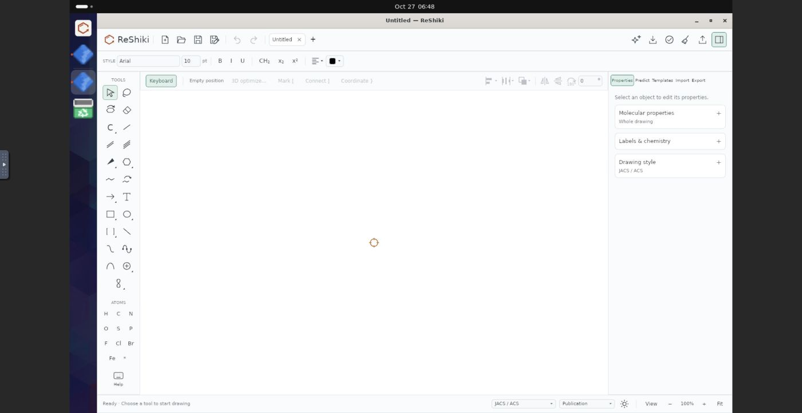
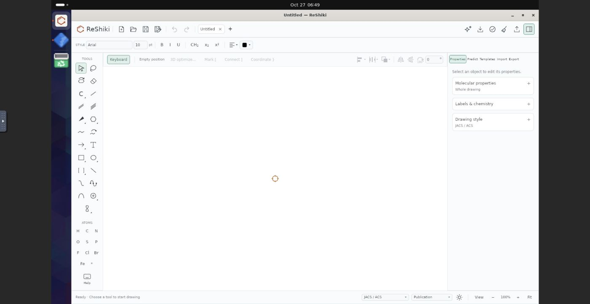

# GNOME dock grouping (X11)

Matched, unretouched captures for [PR #598](https://github.com/Ameyanagi/ReShiki/pull/598), taken by @Ameyanagi through CUA/noVNC on 27 October 2026.

- Before: `1d0f720334f4ea7cdb246cc7e896f65e1a78591c`.
- After: `b263eb00e8c2f58687450d3f54e820f7b21af916`.
- Environment: isolated Ubuntu 24.04 ARM64 container on DGX1, GNOME Shell `46.0-0ubuntu6~24.04.16`, Ubuntu Dock `90ubuntu3`, X11/Xvfb and software rendering.
- Both show the same empty **Untitled** drawing, maximized, at 100% zoom with light appearance, JACS/ACS style and Arial 10. Each JPEG is 1400 × 723; the pointer position differs.

The same pinned `reshiki.desktop` and source PNG icon were installed before both runs: `Name=ReShiki`, `Icon=reshiki`, `StartupWMClass=reshiki`, `Exec=/app/reshiki --open %f`.

1. In Terminal, launch `env -u DESKTOP_STARTUP_ID /app/reshiki`, removing the startup token that could otherwise associate a window with its launcher.
2. Maximize with the title-bar button and capture the baseline. Close it through the title bar.
3. While no ReShiki process is running, switch `/app/reshiki` from the baseline to the fixed binary. Recall the identical Terminal command, maximize in the same way and capture the result.

**Before:** the pinned ReShiki icon stays separate from an extra generic running ReShiki icon. The other generic icon is Terminal.

**After:** the running indicator belongs to the pinned ReShiki logo; the extra generic ReShiki icon is gone. Terminal remains separate.

This establishes dock grouping in the captured GNOME/X11 session. It is not a GNOME Wayland dock test; the earlier [window-metadata checks](linux-window-identity.md) retain their separate X11/Wayland scope.

## Desktop context and attribution

These are original QA screenshots of ReShiki within GNOME and Ubuntu Dock. The visible desktop UI and artwork retain their upstream rights and terms; see the [GNOME Shell license](https://github.com/GNOME/gnome-shell/blob/46.0/COPYING) and [Ubuntu Dock package/source information](https://packages.ubuntu.com/noble-updates/gnome-shell-extension-ubuntu-dock). The desktop software is the test environment, not code or binaries added to ReShiki packages.

Image SHA-256: before `fd41c90b42797de8a6cfd9b0cd6aa2f9473a5f21612eeaf77b568e9510525148`; after `b660127f8bf1a16afead330cb799aa2e52c67cc7f4e22cfdf58a7c8965c93309`.
