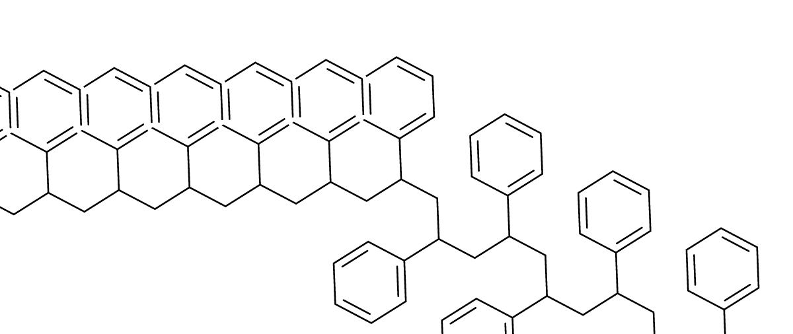
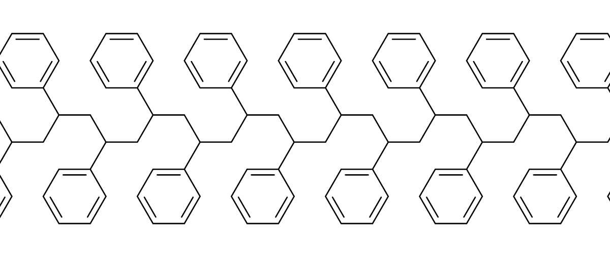
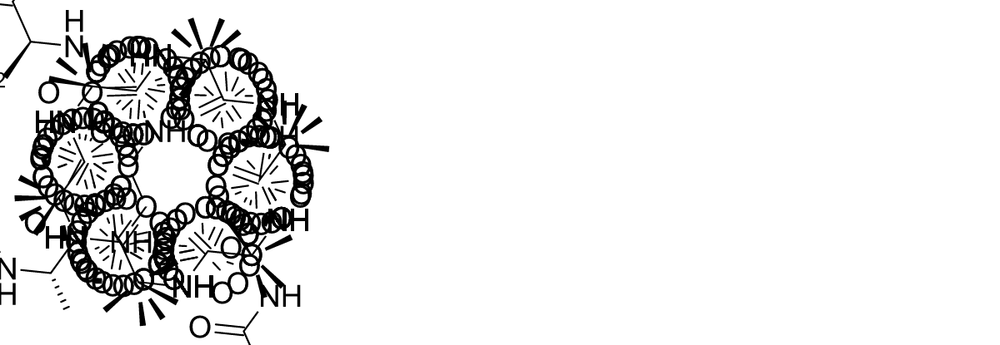

# Readable long-chain imports

Fixes [#507](https://github.com/Ameyanagi/ReShiki/issues/507).

Long polystyrene and alanine chains can now import as open, readable drawings.
The application first computes the existing native layout. For a crowded long
backbone, it tries two deterministic backbone seeds and accepts a result only
after checking atom separation, bond crossings and overlaps, ring containment,
and the rendered chemical-label ink. Chemical state and stereo tags remain
unchanged; the normal import pipeline generates wedges from the new coordinates.

The policy is deliberately limited to a nonring single-bond tree backbone of at
least 32 atoms, with small substituent components joined at one place. A crowded
long chain that cannot be safely repaired keeps its original drawing and reports:

> Layout still has overlaps or could not be fully checked · Review the drawing before export

The warning reaches the existing application status and CLI warning output.
Unrelated imports retain their original coordinates and warnings. The native
depiction reference API and its default coordinate output are unchanged.

## Drawing comparisons

Polystyrene ×100, before:



Polystyrene ×100, after:



Poly-L-alanine ×200, before:



Poly-L-alanine ×200, after:


The same checks and matched captures cover every reported input:

| Input               | Atoms / bonds | Before                                                                     | After                                                                     |
| ------------------- | ------------- | -------------------------------------------------------------------------- | ------------------------------------------------------------------------- |
| Polystyrene ×30     | 240 / 269     | [Drawing](../images/long-chain-layout/polystyrene30-before-detail.png)     | [Drawing](../images/long-chain-layout/polystyrene30-after-detail.png)     |
| Polystyrene ×75     | 600 / 674     | [Drawing](../images/long-chain-layout/polystyrene75-before-detail.png)     | [Drawing](../images/long-chain-layout/polystyrene75-after-detail.png)     |
| Polystyrene ×100    | 800 / 899     | [Drawing](../images/long-chain-layout/polystyrene100-before-detail.png)    | [Drawing](../images/long-chain-layout/polystyrene100-after-detail.png)    |
| Alanine ×200        | 1001 / 1000   | [Drawing](../images/long-chain-layout/alanine200-before-detail.png)        | [Drawing](../images/long-chain-layout/alanine200-after-detail.png)        |
| Poly-L-alanine ×200 | 1001 / 1000   | [Drawing](../images/long-chain-layout/stereo-alanine200-before-detail.png) | [Drawing](../images/long-chain-layout/stereo-alanine200-after-detail.png) |

Reusable release caption: “Long polystyrene and alanine chains import with
separated rings and chemical labels, while retaining their molecular identity
and stereochemistry.”

## Reproduce and verify

Generate the inputs with Python, then paste each into **Import → Structure**:

```python
print('CC(c1ccccc1)' * 30)   # Also test 75 and 100.
print('NC(C)C(=O)' * 200 + 'O')
print('N[C@@H](C)C(=O)' * 200 + 'O')
```

The peptide formula remains **C600H1002N200O201**. The stereochemical case retains
all 200 centers. Regression tests clear stored atom and bond stereo fields from
the generated drawing, independently perceive the wedges and coordinates, and
compare canonical isomeric SMILES with the source molecule. Every source-state
JSON snapshot remains unchanged. Repeating each fallback gives identical
coordinates.

Run the focused tests with an isolated application-data folder and the repository's
normal native helper setup:

```sh
cargo test --locked -p reshiki-io --lib chain_layout -- --nocapture
```

Setting `RESHIKI_CHAIN_QA_DIR` writes original and improved RSK/SVG artifacts for
all five inputs. The original uses the unchanged default native depiction call;
the improved drawing uses the same application policy as import. These diagnostic
drawings retain the default chemical-label and wedge geometry; hidden CIP
annotations are left unset. Published captures were made on an Apple M1 running macOS arm64 with
Rust 1.99.0 from base `3d80590a` and implementation `d4fa3b3a`.

The images are application-renderer closeups. Each pair has the same frame,
scale, white background, and atom anchor. Polystyrene closeups cover atom indices
134–173, anchored at 134; peptide closeups cover 200–239, anchored at 200. The
viewport includes all drawing content within that frame, including the original
collisions. No bonds, labels, or wedges were redrawn or removed. These captures
do not represent desktop import-dialog interaction.

The exact CLI render route was also checked with `--width 3200 --height 2000`:
polystyrene ×30 and poly-L-alanine ×200 both completed successfully, with clear
output and no warnings. The observed debug-build command times were 5.68 s and
8.67 s respectively on this capture machine. These are whole CLI-command
observations, not comparisons with release-build application timings.

Six focused tests passed, along with the full IO library suite (260 passed, five
opt-in tests ignored), the root native-engine workflows (three tests), and the
native import-batch round trip (one test). Focused Clippy and normal commit hooks
also passed. A CLI render of an excluded E/Z-containing polystyrene input
preserves the original output and writes the overlap warning to stderr.

## Bounds and refusal behavior

The fallback handles at most 4096 atoms and 6144 bonds. Each component outside
the backbone must contain at most 16 atoms and have one backbone attachment.
Explicit E/Z, atropisomeric, and non-tetrahedral stereo are excluded initially.
There are at most two candidate calls, each with a 20-million-unit solver cap.
Geometry uses a spatial grid and bounded comparison work. Ring checks include
disjoint-ring centroid separation and point-in-polygon containment; fused rings
retain their shared boundaries. Exhausted checks cannot approve a candidate.

Controls cover crossing and collinear bonds, atom–edge crowding, chemical-label
obstacles, and a small ring wholly inside a larger ring despite having no close
atoms or crossed edges. An exhausted candidate budget retains the original
coordinates and emits the warning. An actual long E/Z-containing input also
retains its coordinates and sends the warning through import.
