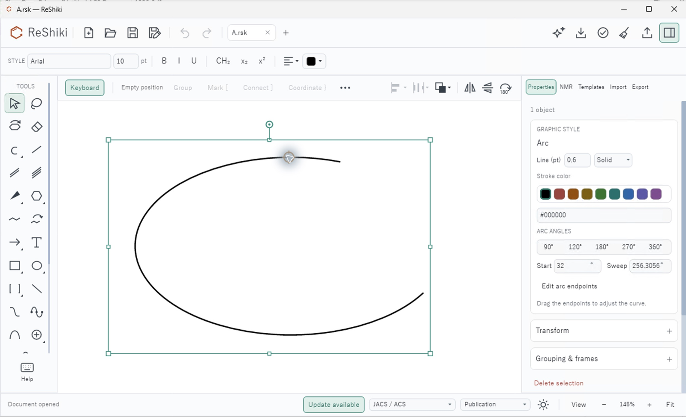
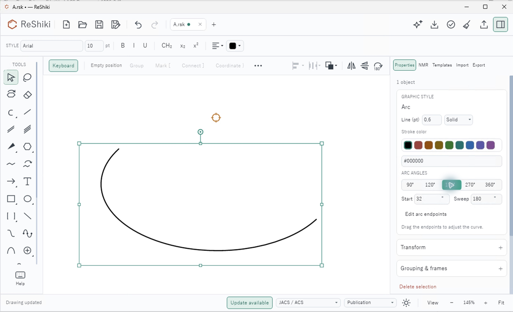
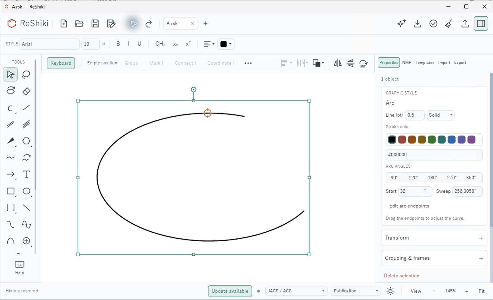
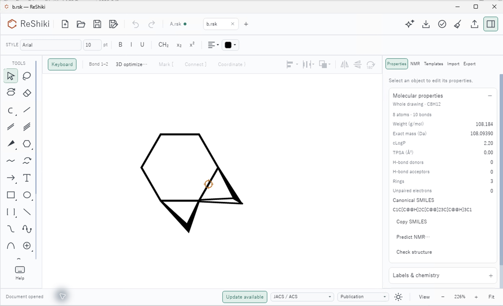
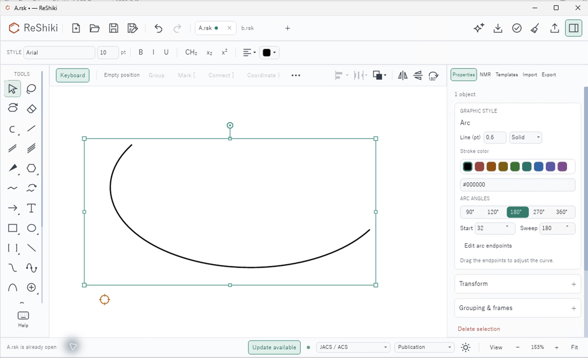
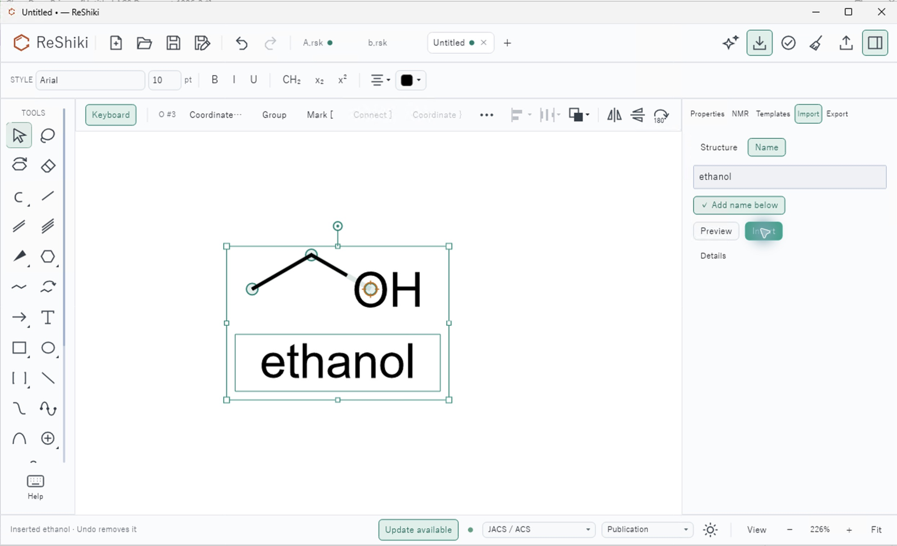
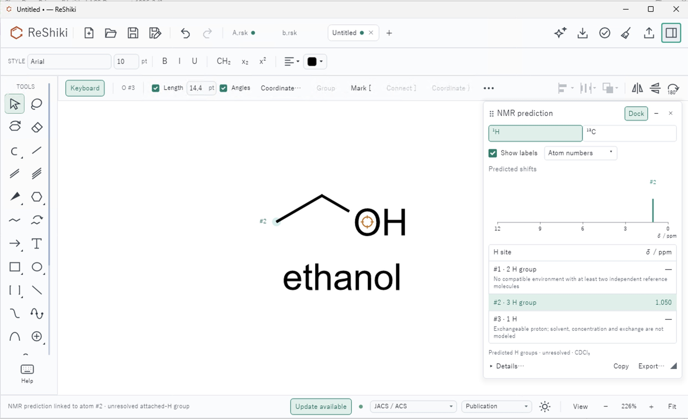

# Published Nightly on Windows: 2026-10-11

The published Windows x64 Nightly passes the recorded CLI/load checks and
scoped desktop interactions at **96 DPI / 100% scale**: arc editing with
Undo/Redo, document-tab activation, direct local-name insertion and floating
NMR selection. Fresh Office clipboard/save-back and high or mixed DPI
acceptance remain pending. Review, captures and verification: @Ameyanagi.

## Fixes and package qualification

[PR #304](https://github.com/Ameyanagi/ReShiki/pull/304) supplies the built naming-helper path for all six release targets after the [original Nightly failures](https://github.com/Ameyanagi/ReShiki/actions/runs/38116417137). Seven local workflow tests cover those paths. [PR #305](https://github.com/Ameyanagi/ReShiki/pull/305) separately retries transient OLE clipboard acquisition failures while retaining bounded attempts, other errors and drawing/CDX/image priority. The [retry review](windows-ole-clipboard-retry.md) preserves the failing CI log, native Rust 1.98.1 receipt and passing Rust 1.99.0 qualification with both new contention cases.

[Nightly run 38123945065](https://github.com/Ameyanagi/ReShiki/actions/runs/38123945065) published [0.11.0-nightly.20261011.38123945065.1](https://github.com/Ameyanagi/ReShiki/releases/tag/nightly-0.11.0-nightly.20261011.38123945065.1) from `8e38151190eb2c3814df23a3eb166fb21c972d64`. All six platform builds passed: 12 successful jobs, two intentional skips and zero failures. Public Windows downloads are unsigned; test-signing artifacts remain internal.

The downloaded public Windows x64 ZIP equals the tested Actions portable artifact. SHA-256:

- ZIP: `4e2f18ccadeedc3b84e0c08fed6ba119cd72df2ac20454f152a2c3c2a47af160`
- Executable: `cf5f2df896d1df208c7b46b06cb0402047005cc4587de2c9b648d0c6e817cefd`

Native Windows Codex 0.156.1 ran the validator once in Session 2 with `gpt-6-sol` / `xhigh` and YOLO enabled for that run; `gpt-6.1-sol` was unsupported in that session. CLI information, ethanol conversion, MOL analysis, native RSK rendering and graphics information all exited zero. Four output-format checks also passed. An earlier source guard exited 128 before validation; its receipt remains preserved. Command-scoped Git trust resolved the guard without global changes, confirming the exact source and clean tracked files.

## Desktop and capture conditions

The [verification receipt](../images/nightly-windows-20261011-v1/verification.json) records package/image hashes, route receipts and measured window/DPI data. The fresh editor was PID **10072**, Session **2**, on `WinSta0\Default`, Windows **10.0.26200.0**. Measured DPI was **96**, scale **1**, and `window_fits_work_area` was true: the outer 1260 × 762 physical-pixel window fit inside the 1276 × 778 work area.

Captures show light appearance, JACS/ACS publication style and Arial 10 pt. Each 2556 × 1712 screenshot from the macOS Windows App remote session was cropped to the ReShiki window and uniformly resized to 1600 × 975. Untouched originals are retained privately; their hashes and crop box are in the public receipt. No AI content or retouching was used. Native measurements establish Windows DPI; canvas zoom is reported separately below.

## Arc edit, Undo and Redo

Open a copy of [adjustable-arc-desktop.rsk](../../tests/fixtures/adjustable-arc-desktop.rsk)
as `A.rsk`, select its arc and open **Properties**. At 145% canvas zoom, the
initial Start is **32°** and Sweep is **256.3056°**. Choose the **180°** preset,
then use toolbar Undo and Redo. Undo restored 256.3056°; Redo restored 180°.
Start remained 32°.

This is a before/after **interaction comparison in the same published app**,
not a visual comparison of the OLE retry fix.

| Before: 256.3056°                                                                                                                | After preset: 180°                                                                                                   | Undo: 256.3056°                                                                                                             |
| -------------------------------------------------------------------------------------------------------------------------------- | -------------------------------------------------------------------------------------------------------------------- | --------------------------------------------------------------------------------------------------------------------------- |
|  |  |  |

## New-file, duplicate-file and no-argument activation

Leave the 180° edit unsaved. Launch the same executable with a copy of
[bond-join-regression.rsk](../../tests/fixtures/bond-join-regression.rsk) as `b.rsk`.
It opens a second tab in the existing editor. Launch it again with `A.rsk`:
the existing tab activates, exactly two tabs remain, and the unsaved 180° edit
survives. Launch the executable without arguments: the same editor activates
and retains its tabs. These checks invoke the executable directly; they do not
establish file-manager association or Office save-back acceptance.

| Second file: new tab, 226% zoom                                                                                        | Duplicate A: existing unsaved tab, 153% Fit zoom                                                                                               |
| ---------------------------------------------------------------------------------------------------------------------- | ---------------------------------------------------------------------------------------------------------------------------------------------- |
|  |  |

The screenshots use different Fit zooms and are not equal-scale comparisons.
The native route receipts confirm all three secondary processes exited zero
within ten seconds while editor PID 10072 remained the owner:

| Invocation   | Secondary PID | Exit | Observed result                          |
| ------------ | ------------: | ---: | ---------------------------------------- |
| `b.rsk`      |          7448 |    0 | Second tab in existing editor            |
| `A.rsk`      |         12892 |    0 | Existing tab; unsaved edit retained      |
| No arguments |         14596 |    0 | Existing editor activated; tabs retained |

## Local name insertion and floating NMR

Create a new tab, choose **Import → Name**, enter `ethanol`, enable
**Add name below**, and choose **Insert** directly. No Preview action was used.
The editable ethanol structure and its caption appeared together at 226% zoom.

Open NMR prediction for this ethanol, float the palette, enable **Show labels**
with **Atom numbers**, select proton site **#2**, and hide the right dock.
The floating spectrum remained visible, and selecting the predicted row
highlighted the corresponding atom on the wide canvas at the same 226% zoom.

| Direct name insertion                                                                                                              | Floating NMR, site #2 selected                                                                                                                                          |
| ---------------------------------------------------------------------------------------------------------------------------------- | ----------------------------------------------------------------------------------------------------------------------------------------------------------------------- |
|  |  |

Only **one of three proton sites** is supported in this ethanol result:
site #2, the 3 H group, has a predicted shift of **1.050 ppm**. Site #1 lacks
enough compatible reference molecules, and the exchangeable proton at site #3
is not modeled. The spectrum shows predicted shifts; it does not simulate
J coupling or second-order effects. This capture is not a complete experimental
ethanol spectrum.

## Remaining scope

- This desktop review covers 96 DPI / 100% scale only. High and mixed DPI remain pending.
- Fresh Office/ChemDraw clipboard and Office save-back checks were not repeated; earlier controlled desktop evidence remains historical.
- The `(+)-lactic acid` GUI case was not repeated in this session; its native CI regressions passed.
- Cage opacity, attached-arrow transforms, generic expansion and native save/reopen were not repeated in this Windows session.
- Join/Co(en)3 accuracy remains TODO; [issue #246](https://github.com/Ameyanagi/ReShiki/issues/246) stays open.

Reusable caption: **The published Windows Nightly retains arc edits through Undo,
Redo and tab activation, and displays a linked ethanol caption with a floating
atom-linked NMR report at 100% display scale.**
