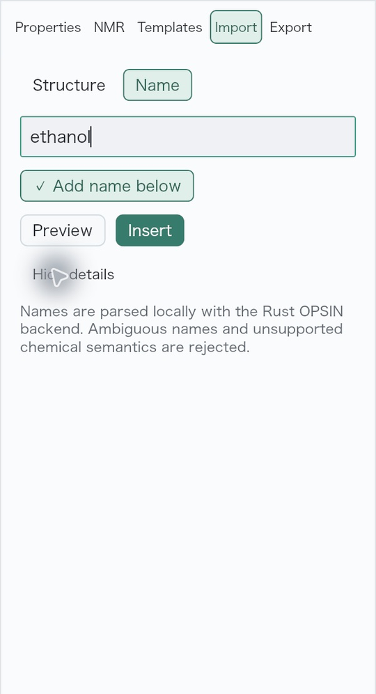
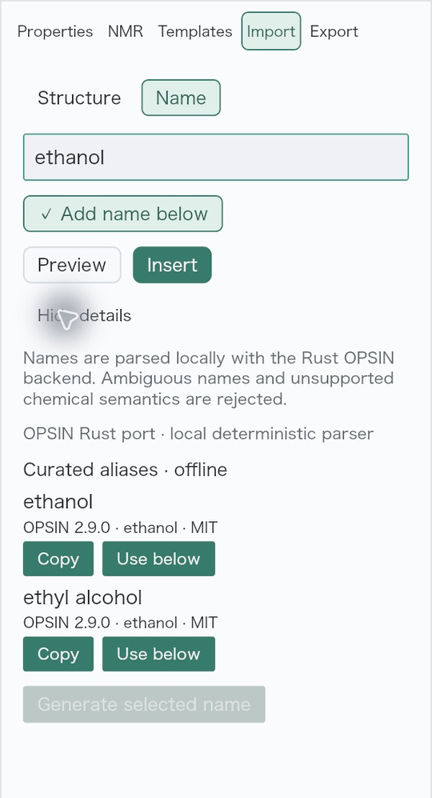
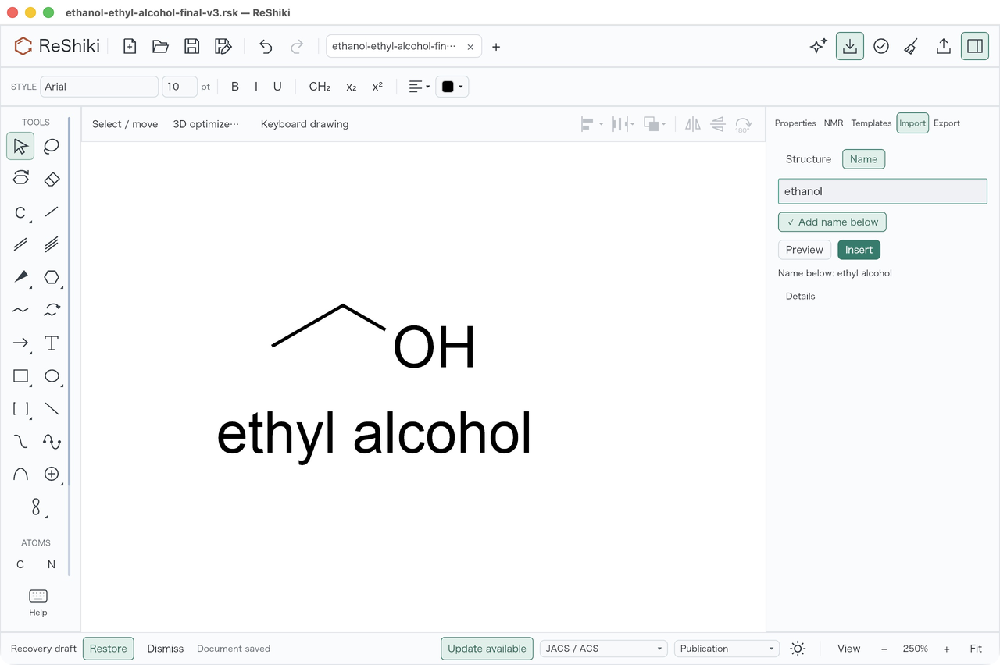
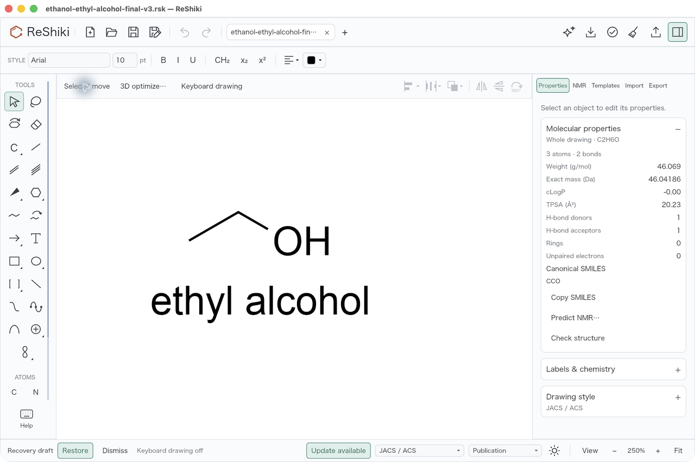
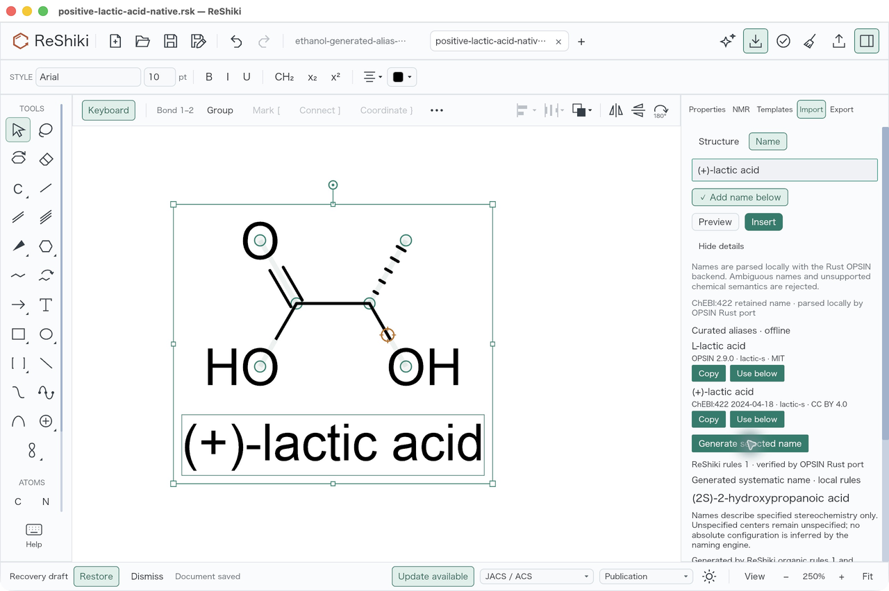
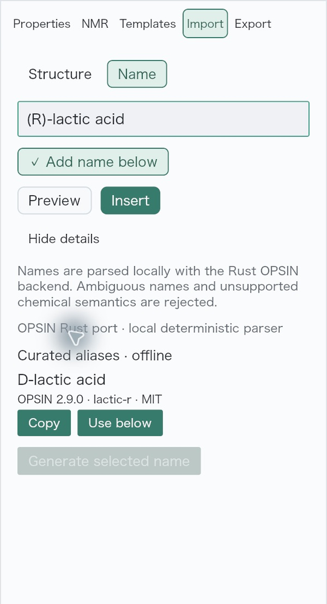

# Curated offline chemical-name aliases

Issue [#50](https://github.com/Ameyanagi/ReShiki/issues/50) already has local
Rust name-to-structure and verified structure-to-systematic-name workflows.
Their ordinary results carried no common-name or synonym list. This follow-up
adds a finite, provenance-backed alias catalog without a naming service or a
new runtime dependency. This contribution is under review and unreleased.
Focused tests and the qualified macOS native workflow below passed; publication
and its exact-head CI remain separate checks.

## User behavior

**Import → Name → Details** resolves a name without requiring Preview. It
shows **Curated aliases · offline**, separate from generated systematic names.
**Copy** copies only the chosen alias. **Use below** chooses the next Insert's
linked caption without rewriting the input. Editing the input clears old
aliases; with Details still open, **Resolve name** requests the new result
without opening Preview or inserting. It is disabled while parsing or when the
input is empty. From a complete selected molecule,
**Generate selected name** presents the systematic result and its curated
aliases, each with distinct Copy and caption actions. Reusing a caption does
not add duplicates; one Undo restores the preceding state.

The initial catalog contains 40 names for 30 exact identities. Ethanol has
`ethanol` and `ethyl alcohol`; S-lactic acid has `L-lactic acid` and
`(+)-lactic acid`, R-lactic acid has `D-lactic acid`, and unspecified lactic
acid has only `lactic acid`. Specified E/Z is retained. Isotopes, charges and
uncatalogued structures do not inherit an approximate alias. A missing entry
explicitly says **No curated aliases available in the bundled catalog.**
This finite selection is not a complete synonym database or universal IUPAC
naming implementation. Optical signs are never interpreted as a general
R/S rule.

See the [user guide](../chemical-naming-rust.md#curated-offline-aliases--under-review)
and [catalog sources, coverage and checks](../../src/naming/catalog/README.md).
Selected OPSIN 2.9.0 resources retain MIT terms; the existing ChEBI:422
`(+)-lactic acid` fact retains CC BY 4.0 attribution. [Notices](../../licenses/name-aliases/NOTICE)
are included by the ordinary binary license collector. The project creator
and maintainer is @Ameyanagi; this original integration follows ReShiki's
MIT OR Apache-2.0 terms without relicensing third-party data.

## Acceptance status

### Native comparison

| Before: existing local name details                                                                                | After: curated aliases in Details                                                                                                     |
| ------------------------------------------------------------------------------------------------------------------ | ------------------------------------------------------------------------------------------------------------------------------------- |
|  |  |

Both views use the input `ethanol`, light appearance, Arial 10 / JACS and 100%
canvas zoom. Each published image uses the same crop `(1960, 272, 2560, 1380)`
of its original 2560 × 1704 native capture, resized to 540 × 997. This excludes
unrelated baseline tabs. The baseline application is at `47b14dab`; its naming
and model source matches the implementation base `3a39aea7`. It predates the
alias controls and is not the final candidate.

The final v3 native session verified Copy by pasting the copied alias back into
the input, **Use below**, restoration of the original caption choice, and direct
Insert with Preview closed. The resulting ethanol graph and linked **ethyl
alcohol** caption were one Undo step; Redo restored both. Native Save As and a
fresh process retained them with Undo and Redo disabled. These two published
images resize the full native capture to 1280 × 852; the canvas is at 250%.

The S-lactic image is from the qualified v2 session at 250%, resized to
1280 × 852. Its selection intentionally identifies the generated-name target.
That session inserted exact **(+)-lactic acid** without Preview and verified
the generated **(2S)-2-hydroxypropanoic acid**, distinct from **L-lactic acid**
and **(+)-lactic acid** aliases. It also replaced an ethanol caption through a
generated alias; Undo and Redo restored the preceding and replacement text.

In final v3, editing with Details expanded cleared aliases. **Resolve name**
then showed only **D-lactic acid** for R-lactic acid, only **lactic acid** for
unspecified lactic acid, and an explicit no-alias result for an uncatalogued
supported name. Those Details-only checks left the canvas empty; they are not
new saved R or unspecified-stereo graphs. The R image uses the same Details
crop and resize as the comparison. Whitespace disabled the actions; unsupported
**(+)-ethanol** rejected without a history step, and correcting the input to
ethanol recovered normally. Parsing completed too quickly to inspect the
pending button state natively; the actual renderer regression verifies it.

### Identity, caption and producer evidence

The [compact native audit](fixtures/offline-name-synonyms/native-audit.json)
records fixture hashes, independent graph/caption checks and which history
observations came from the GUI operator. Saved files do not contain Undo stacks.

| Native fixture                                                                                                  | Independently checked content                                                                                                                         |
| --------------------------------------------------------------------------------------------------------------- | ----------------------------------------------------------------------------------------------------------------------------------------------------- |
| [v2 direct insert](fixtures/offline-name-synonyms/ethanol-ethyl-alcohol-native.rsk)                             | Neutral C2H6O, 3 atoms / 2 single bonds, one `ethyl alcohol` annotation and one complete CCO association                                              |
| [v2 generated alias replacement](fixtures/offline-name-synonyms/ethanol-generated-alias-replacement-native.rsk) | The only two persisted changes are annotation text and association text, both `ethyl alcohol` → `ethanol`; graph, IDs and formatting remain exact     |
| [v2 (+)-lactic acid](fixtures/offline-name-synonyms/positive-lactic-acid-native.rsk)                            | Neutral C3H6O3, 6 atoms / 5 bonds, explicit S graph `C[C@H](O)C(=O)O`, one complete linked caption; finite parity check independent of display caches |
| [final v3 direct insert](fixtures/offline-name-synonyms/ethanol-ethyl-alcohol-final-v3.rsk)                     | Independently checked ethanol graph and complete linked caption; bytes happen to equal the v2 direct-insert fixture                                   |

Signed executable SHA-256 for the v2 S-lactic and generated-caption captures:
`01f96ea9cf2e41cd65fc0bd28fe66d570fa7da13a6e5080628a25b6a9aff1fe7`.
Final v3 signed executable SHA-256:
`d2c75542e8fdae7b52caaaf0cdbbe4ec9aa2273c0e0d2564f14aa56bea0a8738`.
The runtime-validated v3 source was captured against base
`3a39aea7d6d686ff626b5aed2c35fe3e292510a5` in the frozen implementation patch
`51222a4b97f38dee80fe6761f89bfd01d73cb4bebc74cab28cfde3fea6b10aba`,
before this documentation update. Only the Details control and its tests differ
from v2; the chemistry, catalog and identity code are unchanged. All 19 owned
compiler artifacts were rebuilt, and source/index guards passed. No schema,
parser-resource, reverse-grammar, process-limit or runtime prerequisite changed.

### Scoped checks

| Check                                                            | Qualification and result                                                                                             |
| ---------------------------------------------------------------- | -------------------------------------------------------------------------------------------------------------------- |
| Naming library                                                   | 26 passed on v2; unchanged library/catalog/worker source in v3                                                       |
| App naming                                                       | 28 passed on v3; five renderer opt-ins run separately                                                                |
| Actual renderer                                                  | All five opt-ins passed on v3, including accessible alias actions, scrolled Insert, and Resolve name's pending state |
| Strict all-target app Clippy, scoped rustfmt and Git diff checks | Passed on v3                                                                                                         |
| Native macOS review                                              | Qualified v2 and final v3 actions and saved-file checks above passed                                                 |

These are 59 distinct focused test functions, not a full workspace rerun. The
catalog tests reconstruct every complete curated alias against independently
specified graphs and check atom-order/map invariance without relaxing stereo,
charge or isotopes. Caption tests cover guarded application, one-step history,
no duplicates and public native save/reopen. No export was retested for this
follow-up; it reuses the existing association contract. Historical naming
images qualify only their original producers.

Reusable figure caption: Choose a provenance-labelled offline alias, insert the
editable molecule and its linked caption together, then replace the caption
without duplicating or changing the molecular graph. The generated systematic
name remains separately identified.
