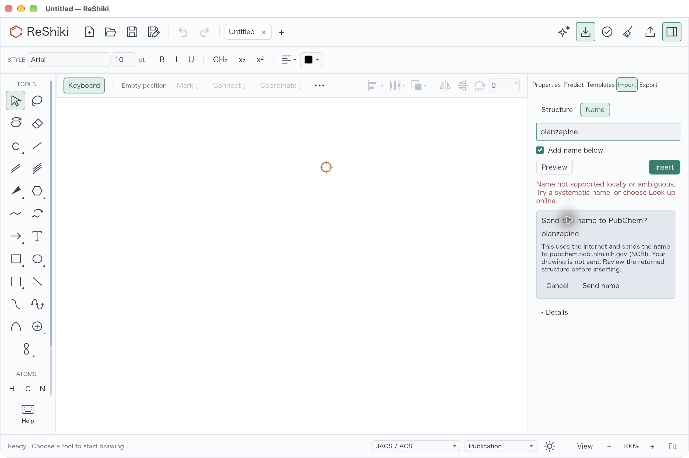
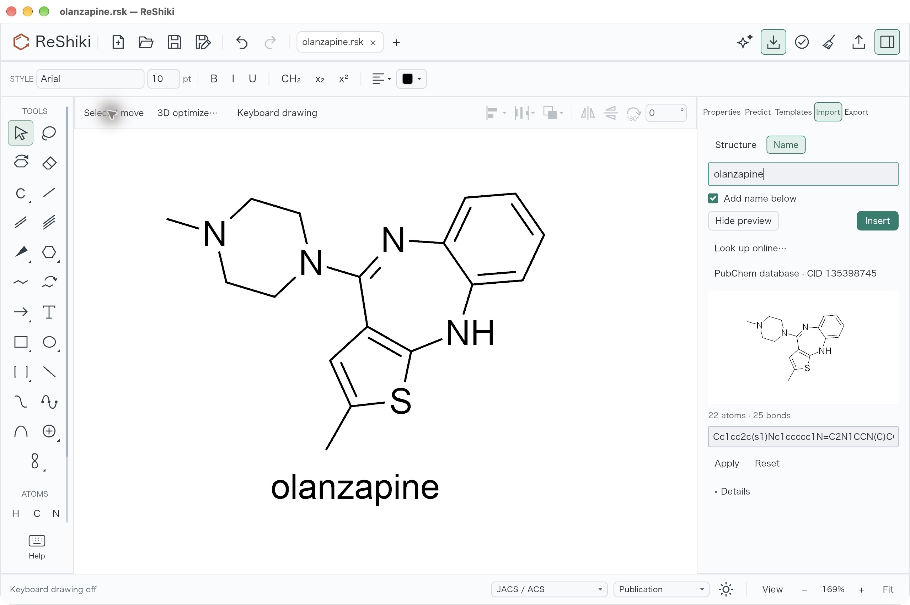
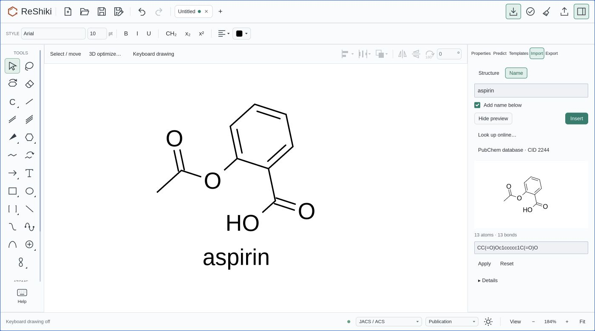

# Confirmed online name lookup

[Issue #596](https://github.com/Ameyanagi/ReShiki/issues/596) reports common names
outside the local parser's vocabulary. **Look up online…** now offers a general
[PubChem lookup](https://pubchem.ncbi.nlm.nih.gov/docs/pug-rest), with confirmation
for each exact query. Local parsing stays offline. Lookup returns an editable
preview; **Insert** remains a separate action. No drug-name database is bundled.

These are native macOS ARM captures from an isolated app built with Rust 1.99.1
against `1d0f7203` plus this change. Both use light appearance, Arial 10 and
JACS/ACS. The confirmation is at 100% canvas zoom; the inserted result uses
Fit at 169%. They illustrate the new workflow, not a comparison of depictions.

The native check resolved **olanzapine** (CID 135398745) and **clozapine**
(CID 135398737) after separate confirmations. Cancel dismissed confirmation
without starting lookup. Olanzapine remained preview-only until Insert;
one Undo removed the molecule and caption, and Redo restored both. The
[saved drawing](fixtures/online-name-lookup/olanzapine.rsk) independently
analyses as `C17H20N4S`, InChIKey `KVWDHTXUZHCGIO-UHFFFAOYSA-N`, matching
[PubChem CID 135398745](https://pubchem.ncbi.nlm.nih.gov/compound/135398745).
**Clozapine hydrochloride** was rejected as disconnected, leaving the drawing
empty. No counterion was removed or free base substituted.

The Chrome browser check used a development WASM build of the same source.
**Aspirin** resolved to CID 2244 with 13 atoms and 13 bonds after confirmation.
Cancel dismissed the first confirmation; a fresh confirmation enabled lookup.
The result stayed in the preview until Insert, and Undo/Redo removed/restored
the molecule and caption together. No browser warnings or errors were recorded.
The local test page deliberately used `Referrer-Policy: unsafe-url`; lookup
requests explicitly use `no-referrer`. Successful lookup verifies browser
transport, but request headers were not independently captured.

The browser capture uses light appearance, Arial 10, JACS/ACS and 184% zoom.
All published captures are unretouched JPEG screenshots.

Ordinary Cargo 1.99.1 passed all **40 naming-library tests and 49 app-naming
tests**, including six renderer opt-ins. Coverage includes per-dialog consent,
stale successful replies, preview-only completion, identity/caption/history,
ambiguous CIDs, charge/isotope/stereo preservation, cancellation, deadlines and
streamed response limits. Native captures used executable SHA-256
`93b6959760f76370c4afc6590079ce6c082547bfae30d5f0eb4f1fbeed9a3a67`.

The lookup accepts one complete-name CID and its full SMILES, never a first
match or a connectivity-only substitute. PubChem can be unavailable or lack a
name; database matches still require review. Only single connected molecules with supported stereochemistry can be imported. See the [user guide](../chemical-naming-rust.md).

Release-note caption: Confirm an online name lookup, review its PubChem source
and editable structure, then insert it with one Undo step.
