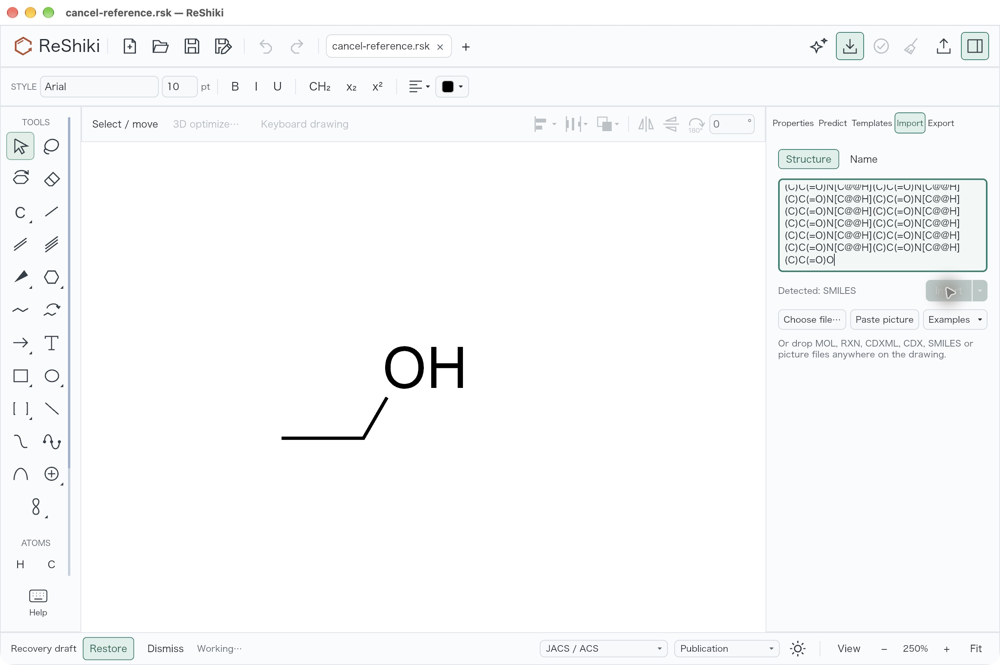
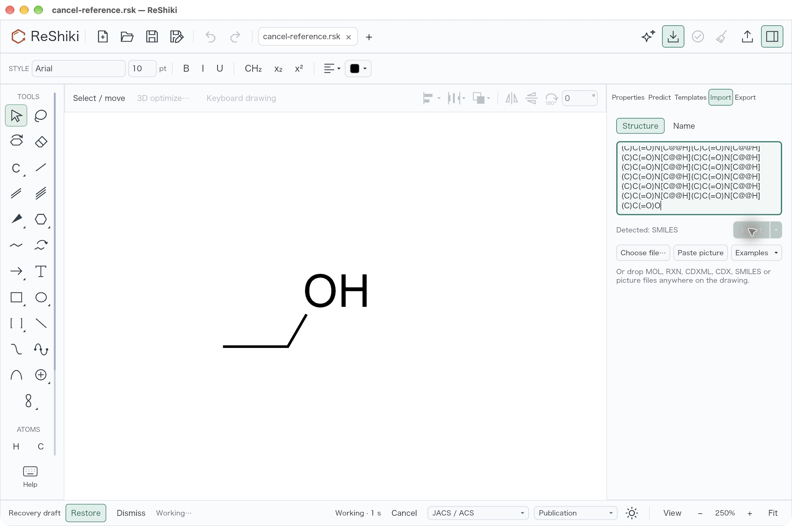
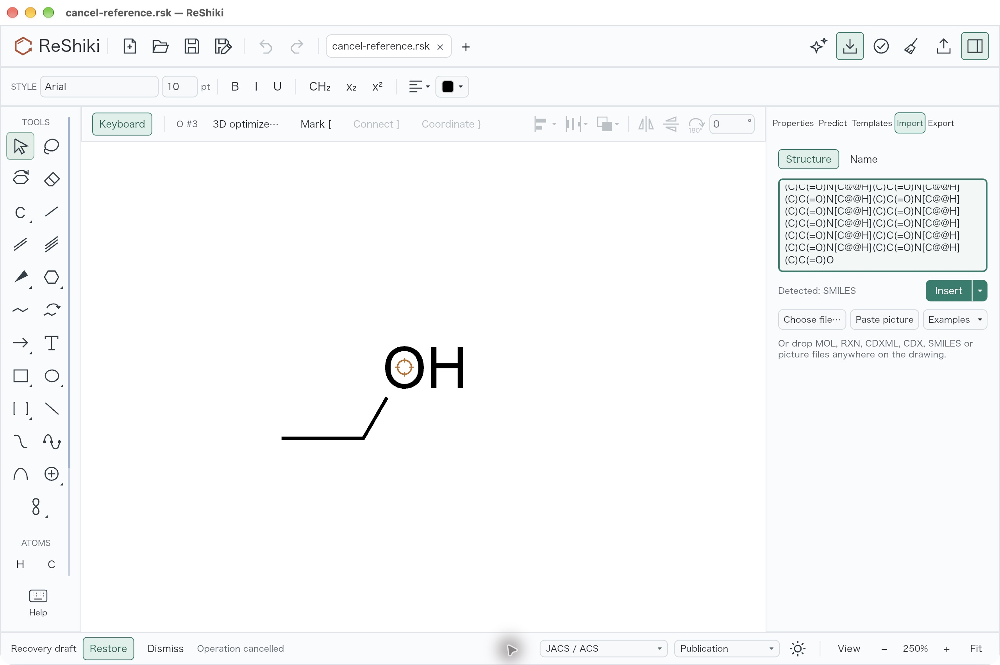
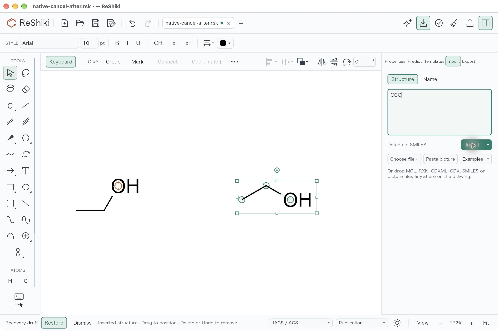

# Large peptide import: rendering cost and cancellation

Issue [#508](https://github.com/Ameyanagi/ReShiki/issues/508) reports a long blank
canvas when inserting a 200-residue alanine chain. The engine's MOL-conversion
benchmark did not include the app's label placement, fitting or first paint.

## Profile and rendering fix

Sampling the reported crowded drawing found repeated whole-peptide searches
while placing implicit hydrogen labels. The label collision check asks which
side of nearby double bonds faces a ring. A terminal carbonyl cannot belong to
a ring, but the search walked the whole connected peptide from its carbon end
before establishing that fact. The same search ran for many candidate label
positions.

`ring_center` now returns immediately if either endpoint has fewer than two
neighbours. It preserves the existing search and smallest-ring choice for all
other bonds. Regression checks cover both endpoint directions, short and
1,000-atom backbones, a cyclic double bond, and exocyclic carbonyl rails.

The change leaves coordinates, chemistry and rendered content unchanged. For
both inputs below, the PNG from the official 0.13.0 CLI is byte-identical to the
fixed PNG. Exact native fixtures also produce identical scene SVG hashes before
and after the guard. The crowded layout itself is addressed separately by
[PR #539](https://github.com/Ameyanagi/ReShiki/pull/539).

## Inputs and environment

```python
alanine200 = 'NC(C)C(=O)' * 200 + 'O'
stereo_alanine200 = 'N[C@@H](C)C(=O)' * 200 + 'O'
```

Each imports as 1,001 atoms and 1,000 bonds. Measurements below were taken on
25 October 2026, macOS 27.0.1, Apple M1, 8 CPU cores and 16 GiB memory. This is
not the issue reporter's Apple M4. Other QA compilation was running during the
interleaved CLI measurements; all versions were measured on this same host and
by the same subprocess wall-clock method. The candidate is an optimized Rust
1.99.0 release build of `9738d8cc`; baselines are the official arm64 release
executables from 0.12.0 and 0.13.0, with their downloaded archive hashes verified.

## Matched CLI render measurements

Command: `reshiki --cli render input.smi -o output.png` with
identical default PNG settings. Three interleaved runs per version and input;
every run exits successfully with empty stderr. Times include process startup.

| Input               | 0.12.0, seconds     | 0.13.0, seconds       | Candidate, seconds  |
| ------------------- | ------------------- | --------------------- | ------------------- |
| Alanine ×200        | 6.580, 6.827, 3.690 | 9.357, 10.292, 6.593  | 2.239, 2.384, 1.562 |
| Stereo alanine ×200 | 7.666, 7.422, 6.590 | 10.511, 11.864, 9.706 | 3.974, 4.372, 3.257 |

Median PNG-render time falls from 9.357 to 2.239 seconds without specified
stereo, and from 10.511 to 3.974 seconds with stereo. Both candidate medians
are below 0.12.0 on this host. These are CLI render timings, not app Insert
timings.

PNG SHA-256, identical for official 0.13.0 and the candidate:

- Alanine: `5286227ade583c0540b952fa6347dbb056f37e17b264e56440a3b5bc0760f212`
- Stereo alanine: `ab7dadbe78d6a672dad7cb4f6b32b37cf73ddb002d7dd07923f354810d1aee37`

## App-stage measurements

An opt-in release-profile check runs the real parser, native depiction,
drawing construction, analysis, document insertion, fitting, label refresh and
scene renderer. It asserts the imported atom/bond counts and one-step Undo.
It deliberately keeps the original depiction so this result measures the
rendering fix independently of the separate long-chain layout change.

| Stage, seconds                 | Alanine ×200 | Stereo alanine ×200 |
| ------------------------------ | -----------: | ------------------: |
| Parse                          |        0.028 |               0.023 |
| Native layout                  |        0.075 |               0.074 |
| Drawing and initial labels     |        0.004 |               0.004 |
| Analysis                       |        0.244 |               0.968 |
| Append and commit              |        0.002 |               0.002 |
| Fit                            |        0.105 |               0.112 |
| First scene                    |        0.762 |               0.903 |
| Background labels and settling |        0.009 |               0.036 |
| Refreshed scene                |        0.780 |               0.915 |

This check separates work costs; it does not include native event delivery,
GPU presentation or screenshot polling. Run it with:

```sh
cargo test --release --locked --bin reshiki \
  profile_polyalanine_insert_stages -- --ignored --nocapture
```

A separate actual native Insert check used the same optimized candidate, JACS /
ACS style, Publication colours and the default 1280 × 852-point window. The
non-stereo drawing was present in the first screenshot at about 2.3 seconds.
Continuous accessibility/screenshot observations of a fresh stereo import
showed a fully settled drawing and re-enabled Check drawing at 4.453 seconds.
The saved non-stereo drawing contains exactly 1,001 atoms and 1,000 bonds;
one click on Undo removes the complete stereo import. Observation overhead is included. These native
checks establish completion and responsiveness on M1, not a measured M4 limit.

The official 0.13.0 executable could not be launched as a renamed isolated GUI
bundle on this host, although its CLI runs succeeded. No matched baseline GUI
time is claimed.

## Elapsed progress and cancellation

Structure-input Insert and Import, along with other chemistry operations using
`App::run`, expose elapsed seconds and a Cancel control after one second. Escape
first closes a higher-priority menu or editor, then cancels the chemistry job.
A cleanup rerun also keeps Cancel available while its earlier preview remains
open. The separate multi-file import batch path is outside this change. Native
desktop cancellation is the acceptance target here; synchronous browser
calculations are not made interruptible.

Each job and Cancel activation carries its tab, file epoch, drawing revision and
request serial. A late result or an old Cancel activation cannot affect a newer
request. Cancellation releases the controls without changing the drawing,
selection, camera or Undo history. It aborts the async future and terminates an
active native InChI helper through the existing drop behavior. A bounded blocking
calculation already running may finish without publishing its result.

The cancellation implementation is `efe47d07`; the rendering measurements above
use the earlier optimized `9738d8cc` build, so they do not claim timing for the
new progress control. Eight focused state/native-task tests cover cancellation,
retry after success/failure, old and duplicate results, old button activations,
background tabs, file replacement, tab close, modal priority and cleanup previews.
An opt-in real-renderer test activates the actual delayed Cancel control.

An actual native check of that final source used the reported stereo peptide
with a saved ethanol drawing already open. Cancel appeared at the 1.243-second
observation and a second run exposed it at 1.220 seconds before Escape cancelled
the operation. Both retained the clean window title and disabled Undo. Saving
after Cancel gave the original three atoms and two bonds, with the document
identical at native `f32` precision. A subsequent `CCO` insertion succeeded,
producing six atoms and four bonds with Undo enabled. These observations used
an unoptimized development build and establish behavior, not latency.

| Before one second                                                                | Delayed progress and Cancel                                                            |
| -------------------------------------------------------------------------------- | -------------------------------------------------------------------------------------- |
|  |  |

| Cancel retains the original drawing                                                         | A new import succeeds afterward                                           |
| ------------------------------------------------------------------------------------------- | ------------------------------------------------------------------------- |
|  |  |

The screenshots are original native captures from `efe47d07`. The recovery
banner belongs to the isolated QA data directory. Its redesign is tracked
separately in [#491](https://github.com/Ameyanagi/ReShiki/issues/491).

## Verification

- Full model library suite: 802 passed, 10 existing opt-in tests ignored.
- Final cancellation-head app suite: 1116 passed, 123 existing opt-in tests
  ignored, with the exact native naming helper. The delayed Cancel renderer test
  was run separately and passed.
- Focused all-target model Clippy and normal all-feature workspace commit hooks
  passed, as did formatting and the optimized app-stage profiling check.
- Optimized native build and actual Insert passed for both reported inputs.
  Native save verified the non-stereo atom/bond counts; one-step Undo removed
  the complete stereo import.
- Native Cancel, Escape and retry passed against the final cancellation source;
  saved drawings verify unchanged state after cancellation and the subsequent
  successful insertion.

Release caption: **Large peptide imports avoid repeated whole-molecule ring
searches when placing labels. Long-running Structure-input operations show
elapsed time and can be cancelled without changing the drawing.**
