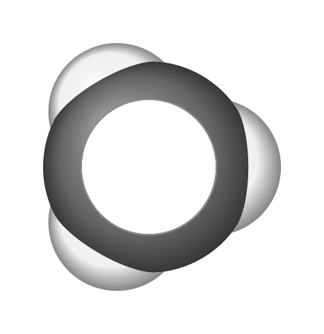
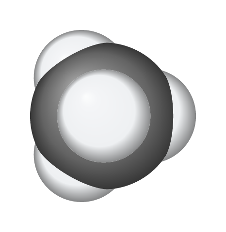
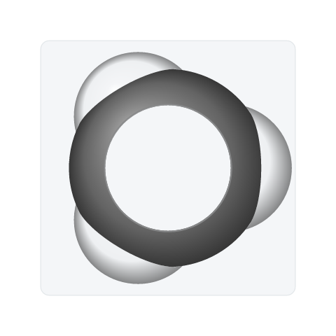
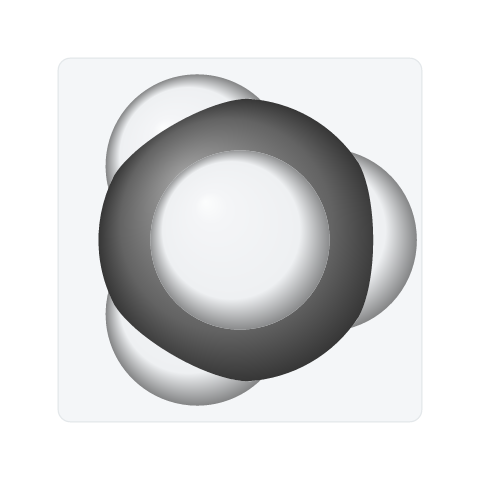

# Space-filling hydrogen caps (#513)

Hydrogens pointing toward the viewer now fill the visible cap where their
spheres meet a larger atom. Previously, the carbon was cut around the cap
while the hydrogen lost its center, leaving a hole through the model.

The fix distinguishes cuts inside and outside a fully visible meeting circle.
An outside cut keeps the cap as a hole in its clipping region, so other atoms
can still cover the cap correctly. The cap axis determines which side is
covered; checking only the ball's front point would misclassify small caps
away from that point.

## Matched renderer captures

The input is an idealized tetrahedral methane with C–H distances of 1.09 Å,
one hydrogen pointing directly at the viewer, and the saved view set to
Space-filling, Glossy, All hydrogens, no perspective and no depth fade.
This uses the minimal C/H geometry reported in #513, in a complete methane
molecule. It is a deterministic replacement for the original caffeine view;
the attached caffeine drawing was not available for this capture.

| Background | Before                                                                                         | After                                                                                                                   |
| ---------- | ---------------------------------------------------------------------------------------------- | ----------------------------------------------------------------------------------------------------------------------- |
| White      |   |                 |
| Soft card  |  |          |
| Dark       |    |  |

- Input: [editable methane drawing](../../tests/fixtures/models3d/front-hydrogen-methane.rsk).
- Generator: [space_filling_cap_qa.rs](../../crates/model/examples/space_filling_cap_qa.rs).
- Before renderer: `3d80590a`, with the capture example added and no rendering changes.
- After renderer: `48d3c169122a164cb53a93e078ef143babe68b53`.
- Platform: macOS 27.0.1, arm64, Rust 1.99.0 development build.
- Capture: the actual application scene renderer's SVG, rasterized with resvg
  at a fixed 480-pixel longest side. These are renderer outputs, not desktop
  screenshots; UI zoom does not apply. The source drawing, framing, size,
  style and background match within each pair. No image retouching was used.
- Reproduce: `cargo run -p reshiki-model --locked --no-default-features --example space_filling_cap_qa -- OUTPUT_DIRECTORY`.
  The example writes the native drawing, SVG and PNG files. The before and
  after native drawings are byte-identical.

## Validation

- A direct C/H regression checks that the hydrogen center and cap are visible,
  the carbon leaves that region clear, and the seam remains present.
- Independent sight-ray/sphere intersections check both missing and incorrectly
  included surface regions in 108 cases: orthographic and perspective views;
  tilts on either side of the near-axis transition; three azimuths; and an
  additional sphere cutting the hydrogen cap. Samples close to polygonal rims
  and seams are excluded from the analytic comparison.
- An exact 3–4–5 sphere intersection checks the limiting case where a meeting
  circle lies on the smaller ball's rim.
- `cargo test -p reshiki-model --locked --no-default-features`: 803 passed,
  10 existing manual/reference tests ignored.
- `cargo clippy -p reshiki-model --all-targets --locked --no-default-features -- -D warnings`: passed.
- Rust formatting and `git diff --check`: passed.

The fix changes shared model geometry used by the canvas and exports. These
captures verify SVG/PNG rendering. PDF shading is tracked separately in #522;
this change does not repair that export transform.

Release-note caption: **Space-filling models keep hydrogens facing the viewer
visible where overlapping atoms meet.** Reuse the dark-background pair above.
