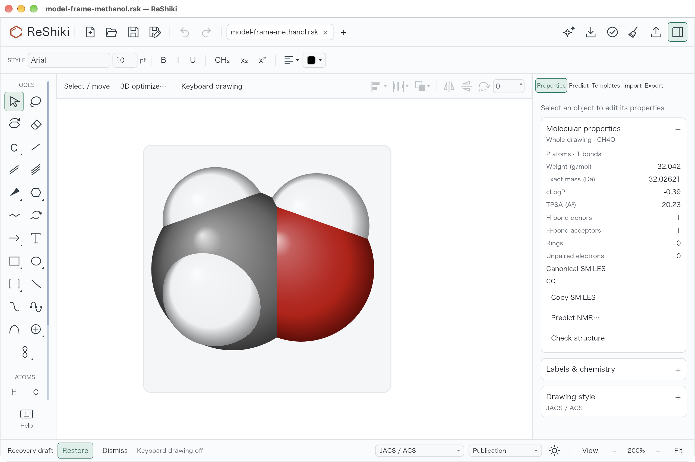
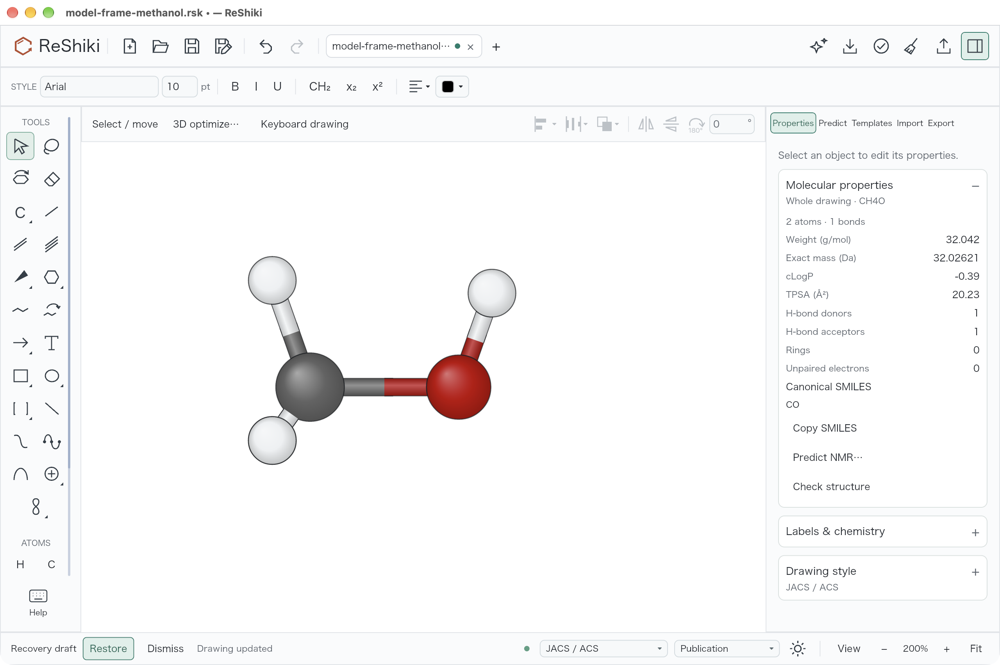
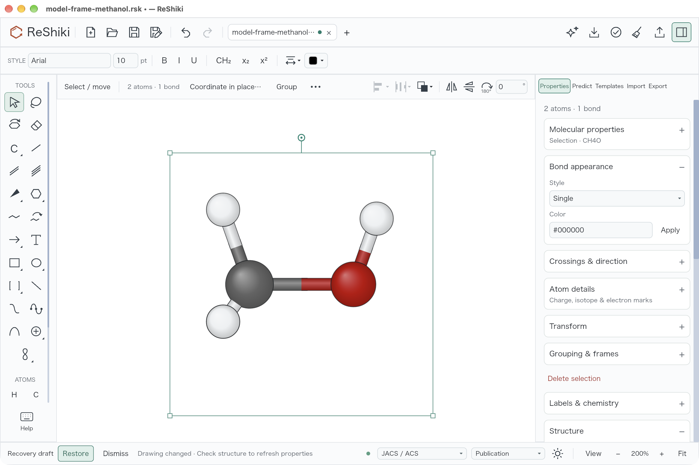

# Move a 3D model from its visible frame (#514)

Dragging near a selected 3D model's visible outline now moves it and keeps it
selected. The outline shows a move cursor, or a copy cursor while Cmd/Ctrl is
held. Dragging inside still turns the model, and corner handles resize it.

The move band follows the same padded outline the canvas draws, within eight
screen pixels on either side. Previously, the drawn outline lay outside the
model's hit area, so a drag there started an empty selection instead.

## Matched native desktop evidence

Both columns show the result of the same drag from four points inside the
left outline, 60 points right and 25 points down. Before the fix the frame
disappears and the model stays put. After the fix the frame and model move
together, with the model still selected and its orientation unchanged.

| Model                             | Before the fix, after the drag                                                                                                             | After the fix, after the same drag                                                                                        |
| --------------------------------- | ------------------------------------------------------------------------------------------------------------------------------------------ | ------------------------------------------------------------------------------------------------------------------------- |
| Space-filling, Glossy, soft card  |  |  |
| Ball & stick, Flat, no background |         |       |

Input: [editable methanol model](../../tests/fixtures/models3d/model-frame-methanol.rsk).
This is an idealized, complete methanol molecule with a fixed conformer and
rotation `[1, 0, 0, 0]`, rather than the unavailable aspirin attachment from
the original report. It does not generate a new conformer during the check.

Capture details:

- Base: `3d80590a41b9d9e8efd818d23395ac51bd264ca8`.
- Fixed application: `4ada30d9f86b1248135bfd4235e60288c2d2ee47`.
- Native development builds, macOS 27.0.1, Apple M1, Rust 1.99.0.
- Window: 1280 × 852 points, captured at 2560 × 1704 pixels.
- View: 200%, JACS / ACS drawing style, Publication colors, light canvas,
  all hydrogens, no perspective and no depth fade.
- Each pair uses the same native drawing, camera, framing, style, background
  and drag. The screenshots come directly from the macOS window capture;
  no drawing was retouched. Selection frames are included because they are
  the interaction under review.

To reproduce:

1. Open the fixture in the native app, leave keyboard drawing if it is active,
   and select the molecule with Cmd/Ctrl+A.
2. In Commands, run `zoom 200`. Keep Properties open at the top.
3. Drag four points inside the left outline by `(60, 25)` points. In the
   captured window this is `(255, 496)` to `(315, 521)`, or `(510, 992)` to
   `(630, 1042)` in the 2× screenshot's pixel coordinates.
4. For the second pair, set Ball & stick, Flat, and Background None under
   Properties → 3D model, return the inspector to the top, and repeat the drag.

The fixed frame's top-left corner moves from approximately `(251, 255)` to
`(311, 280)` points. Undo returns it in one step. A separate native check
also moves it from four points outside the right outline, using `(737, 496)`
to `(797, 521)`. The baseline drawing interior is pixel-identical before and
after its failed drag. The fixed model retains the same pose after translation.

## Regression checks

- The new outline regression fails against the base: the cursor is `None`
  where a move is expected.
- All four edges, four pixels inside and outside the visible outline, at
  50%, 100% and 200% zoom; 3D and Both; Ball & stick without a card and
  Space-filling with a card.
- Move/copy cursors and ordinary, Alt, and Cmd/Ctrl drags; linked captions;
  interior turning at nine and 25 pixels inside the outline; corner resizing;
  and the original hit area of an unselected model.
- Foreground text, arrows and graphics retain their hits over a model's outline;
  background graphics do not block it.
- The application test reads the native fixture, performs a real canvas gesture,
  and checks one undo frame, retained selection and view quaternion, native-file
  round-trip preservation of the model, and exact Undo/Redo restoration.
- `cargo test --locked --no-default-features --bin reshiki canvas::`: 178 passed,
  17 existing manual/rendering tests ignored.
- The focused model tests pass, including the application Undo/Redo check.
- Root-package all-target Clippy with warnings denied, the normal workspace
  all-feature library/binary Clippy hook, workspace Rust formatting, and the
  native application build pass.

Release caption: **Drag the visible frame edge to move a selected 3D model
while keeping its view and selection.** Reuse the soft-card image pair above.
