# Atom labels stay readable and keep their chemical context

The atom-label editor opens beside the atom and its surrounding structure, using
the drawing's actual position in the window. The drawing stays at full contrast.
The popup keeps its position as helper text, suggestions and reverse-spelling
fields change, moving only when it needs room or the drawing/window moves.
Select keeps its modal behavior; the Text tool still commits a draft when the
user continues to another atom.

Label type and Alignment each have a full-width control, so every choice is
readable. The label fields have persistent captions. A group's normal and reverse
spellings, such as OMe and MeO, are identified even after both boxes contain text.
Text label mode hides the unused reverse spelling and retains its draft when
switching back to Chemical abbreviation.

Catalog-name suggestions are buttons. **Use Morph** replaces `morpholino` and
selects Chemical abbreviation; **Apply** remains the next action. `Acetyl` offers
separate **Use Ac** and **Use COMe** buttons. Both explicitly choose the chemical
group, so accepting Ac creates acetyl rather than actinium. The helper names the
actual expansion route: **Labels & chemistry → Chemical abbreviations**.

This covers QA findings [#492](https://github.com/Ameyanagi/ReShiki/issues/492),
[#493](https://github.com/Ameyanagi/ReShiki/issues/493),
[#498](https://github.com/Ameyanagi/ReShiki/issues/498),
[#500](https://github.com/Ameyanagi/ReShiki/issues/500) and
[#509](https://github.com/Ameyanagi/ReShiki/issues/509).

## Matched renderer evidence

Before images use `main` at `3d80590a`; after images use this change. Both builds
ran the same opt-in `atom_label_editor_layout_and_interaction_evidence` harness,
with only the test harness added to the before build. These are application
renderer outputs, cropped without resizing or retouching. Each pair uses the
same crop, fixture, camera, operation, theme and 1× PNG export. The green target
indicator identifies the atom being edited.

### Glucose C3 hydroxyl, `OBn` draft, 200%

Before:

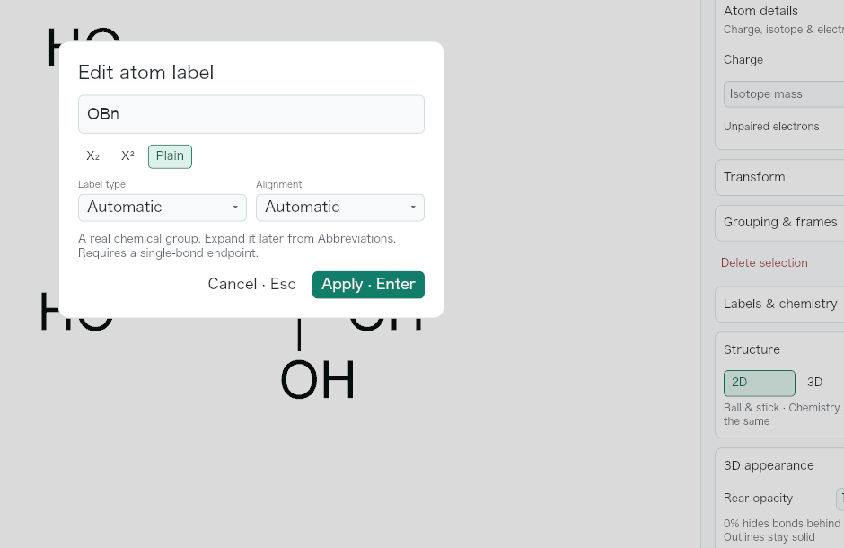

After:

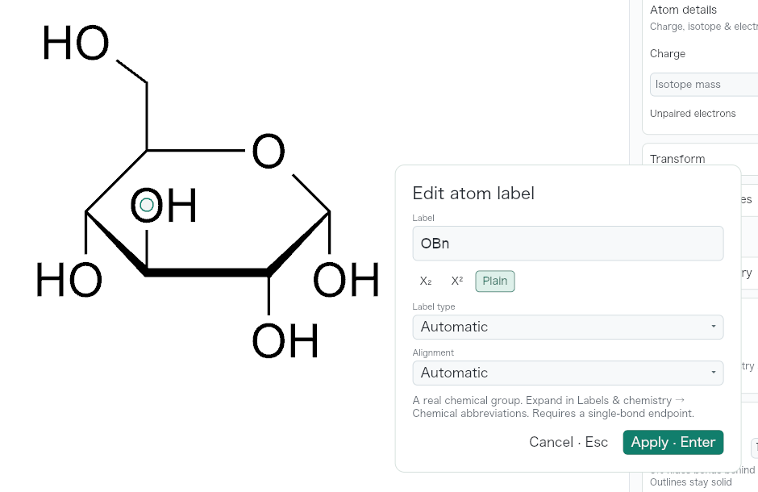

### Right end of para-substituted benzene, `O2N` draft, 200%

Before:

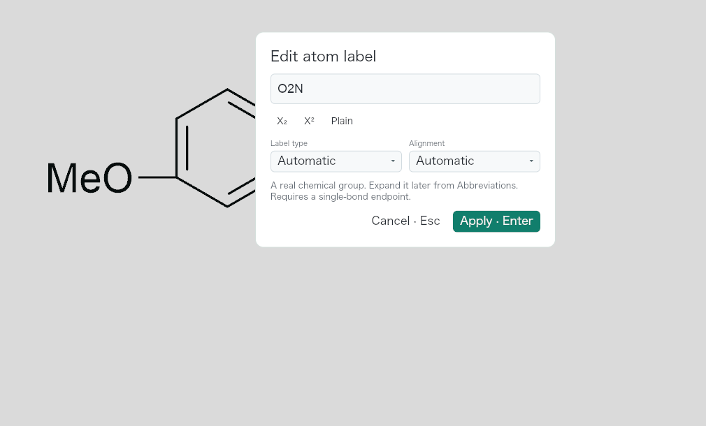

After:

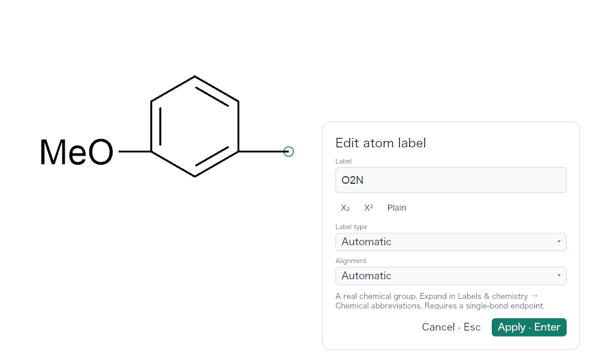

### Open Label type list, light chrome

Before:

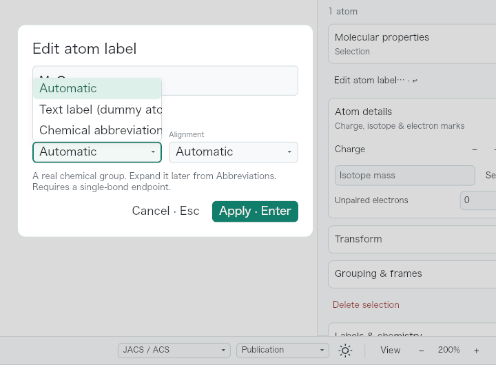

After:

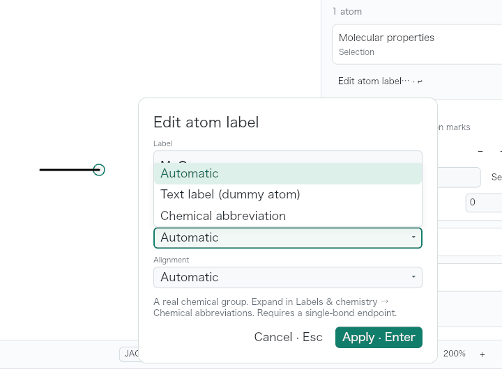

### Open Label type list, dark chrome

Before:

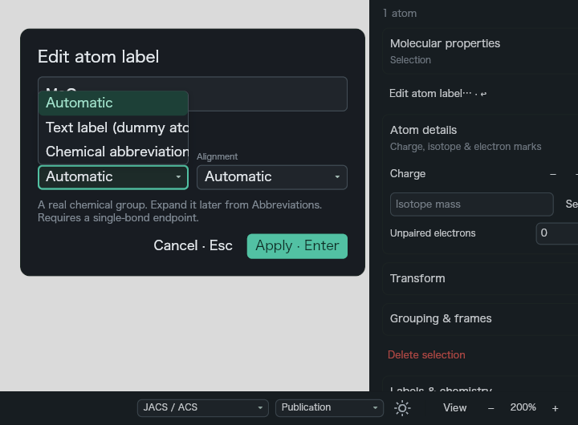

After:

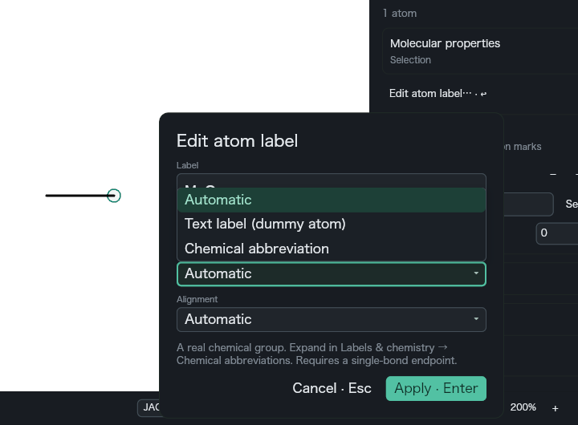

### Methoxy group, normal and reverse spellings

Before:

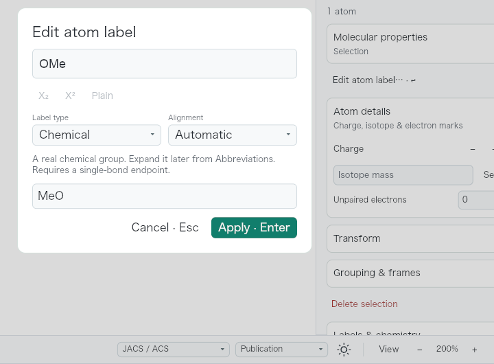

After:

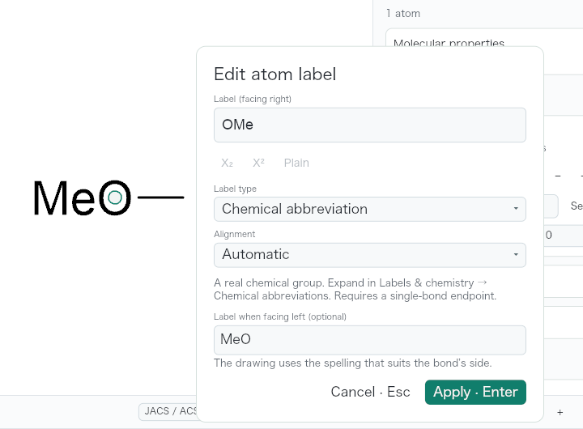

### Methoxy draft switched to Text label

Before:

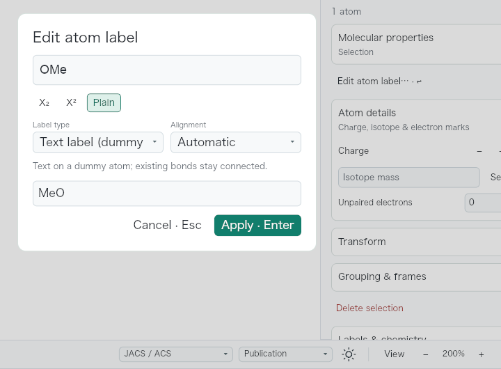

After:

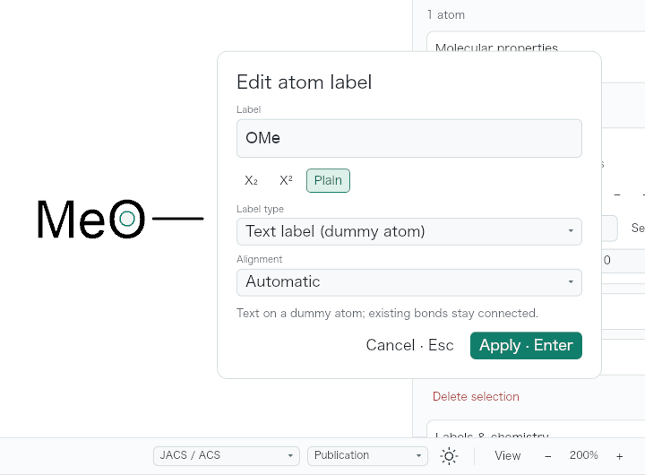

### `morpholino` entered on ethane

Before:

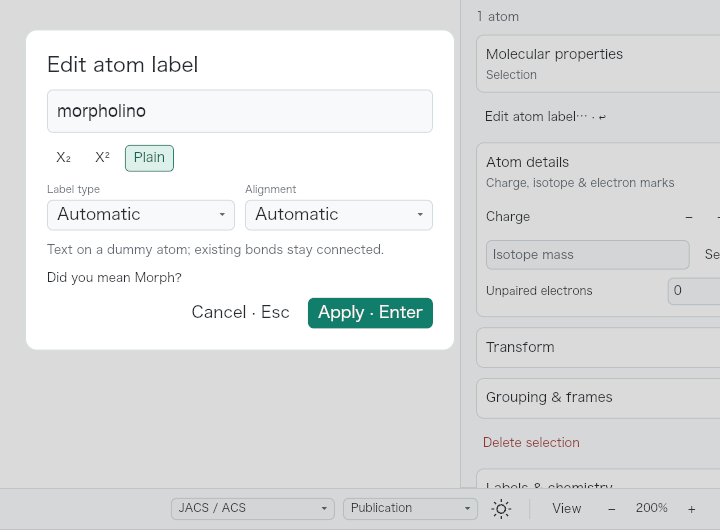

After:

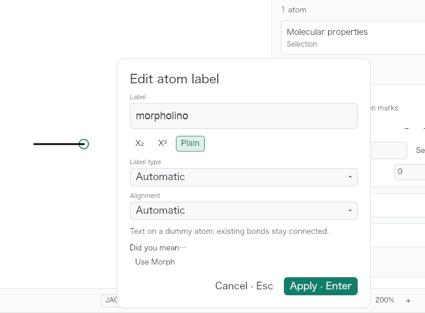

One actual pointer click on **Use Morph** leaves the draft open with `Morph`,
Chemical abbreviation and the updated chemical-group explanation:

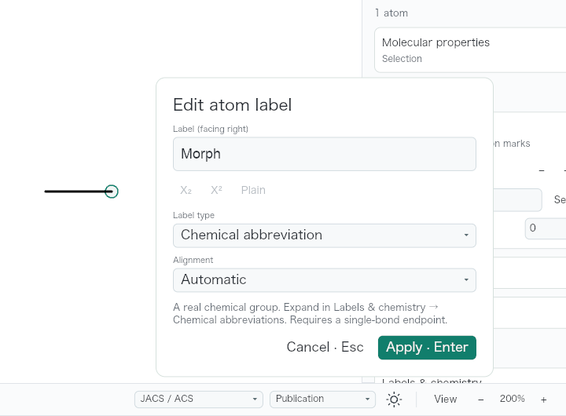

## Native desktop interaction

A separate native debug build was checked on macOS at 1280 × 852 logical pixels
with a 2× display scale. The glucose fixture used 200% zoom; the
[ethane fixture](../../tests/fixtures/qa-atom-label-editor/ethane.rsk) used the
application's fitted 250% zoom. This is additional desktop evidence, with
capture conditions separate from the matched renderer pairs above.

- Clicking glucose's C3 hydroxyl and pressing Enter focused the label field;
  typing `OBn` left the hydroxyl, bond and ring visible. Escape canceled the
  draft; reopening showed the original `O`.
- On ethane, a pointer click on **Use Morph** changed the draft to `Morph` and
  Chemical abbreviation while leaving Apply available. Enter applied the group;
  selecting the whole molecule showed **C5H11NO**. Undo restored ethane.
- Entering `Acetyl` exposed separate Ac and COMe controls. Clicking **Use Ac**
  selected Chemical abbreviation; Enter produced **C3H6O**. Undo restored ethane.
- With the Text tool active, changing the left endpoint to `N` and clicking the
  right endpoint committed the first draft, displayed H2N on the left, and opened
  the unchanged `C` draft on the right. Escape and Undo restored the fixture.

The following unretouched native-window crop shows the accepted Morph draft,
its Chemical abbreviation choice, focus caret and separate Apply action:

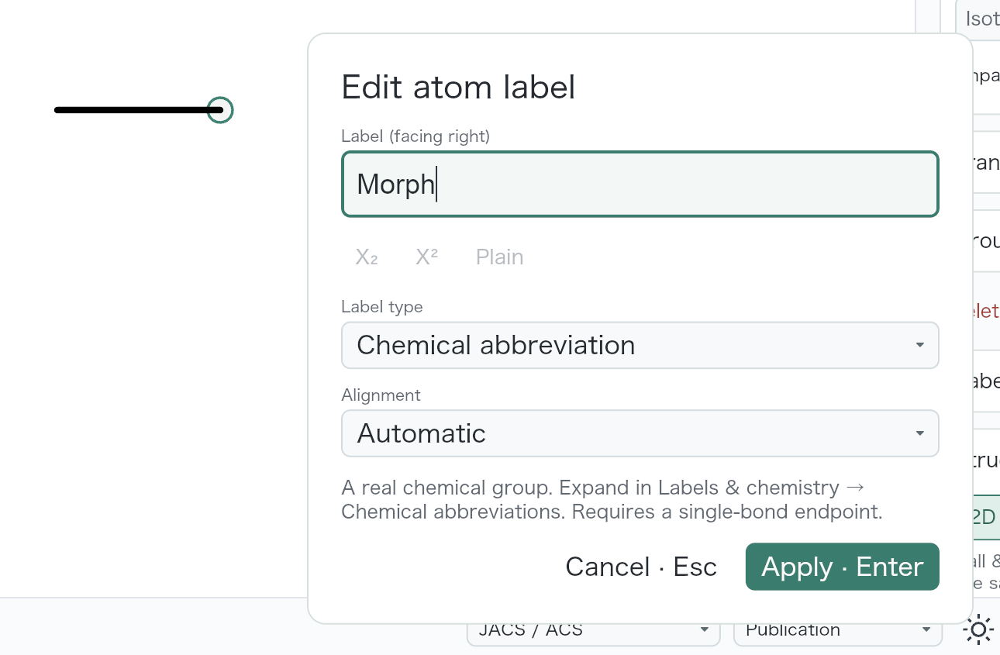

## Reproduction and checks

Captures use macOS arm64, the native Iced/wgpu application renderer and the
JACS / ACS drawing style with Publication colors. The chrome is light except
for the explicitly labeled dark-menu pair. No drawing export or import
conversion is involved in the renderer captures.

The menu, spelling and suggestion pairs use a 1040 × 680 logical-pixel window,
the minimum macOS window size, with Properties open and 200% canvas zoom. Begin
with ethane at world positions `(-42, 0)` and `(0, 0)`. Select the right endpoint,
press Enter, type `MeO`, and open Label type. For the spelling pair, reverse the
bond's direction, apply `OMe`, reopen the group and then choose Text label. For
the suggestion pair, use fresh ethane and enter `morpholino`.

The placement pairs use a 1600 × 1000 window at 200%, with the edited atom at
the center of the actual drawing canvas. Load
[glucose-c3.rsk](../../tests/fixtures/qa-atom-label-editor/glucose-c3.rsk),
select atom 9 (the inward C3 hydroxyl), press Enter and type `OBn`. This fixture
comes from the expanded α-D-glucopyranose Haworth template. Load
[p-xylene-end.rsk](../../tests/fixtures/qa-atom-label-editor/p-xylene-end.rsk),
select the right terminal carbon, press Enter and type `O2N`. This fixture is a
para-substituted benzene with the left methyl already replaced by MeO, built
using the application's benzene and abbreviation models.

The renderer check measures the real popup and choice widths, dispatches actual
menu and suggestion clicks, and verifies fully visible editor/Apply/Cancel
controls. It covers center and all four canvas corners at 1040 × 680,
1280 × 820 and 1600 × 1000, with the inspector open and closed, rulers enabled,
and both Select and Text tools. Placement considers the actual opening pointer
before accepting popup mouse input. Compact drawings also use visible molecule
bounds captured once when opening the editor; drawings above 64 atoms skip this
optional measurement and retain the measured popup/target fallback.

Chemical regression checks apply and undo Morph, Ac and COMe on ethane, confirming
C5H11NO and C3H6O, respectively, and no actinium atoms. Existing script, label,
alignment, Text-tool click-through and modal shortcut regressions remain covered.

```sh
cargo test --locked -p reshiki-model --lib atom_text
cargo test --locked -p reshiki --bin reshiki app::atom_text -- --include-ignored --test-threads=1
cargo test --locked -p reshiki --bin reshiki first_escape_cancels_focused_atom_label_without_applying_the_draft -- --ignored
```

To regenerate the full uncropped renderer outputs, set
`RESHIKI_ATOM_LABEL_QA_DIR` to a scratch directory and run the second command.
For the matched base, add only the same visual test module to `3d80590a` and set
`RESHIKI_ATOM_LABEL_QA_BASELINE=1`. Scratch captures and build products are not
committed.

Release-note caption: **Edit atom labels beside their structure, read every label
type in full, and accept catalog suggestions with one click.** Reuse the glucose
placement pair and the accepted-Morph image above.
