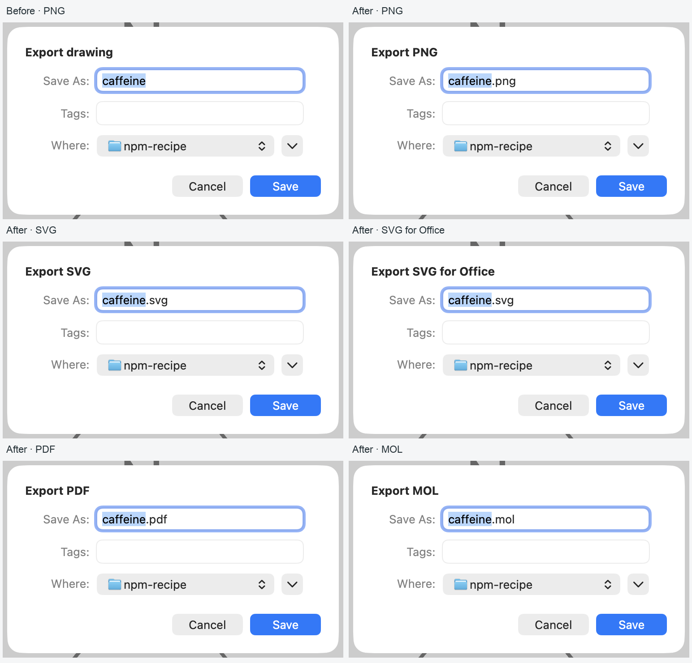
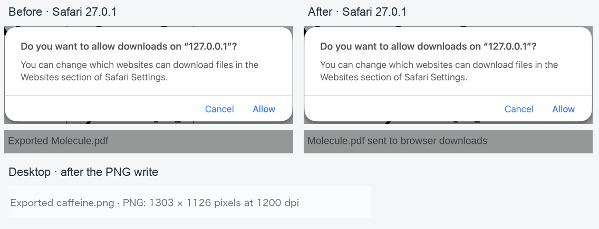
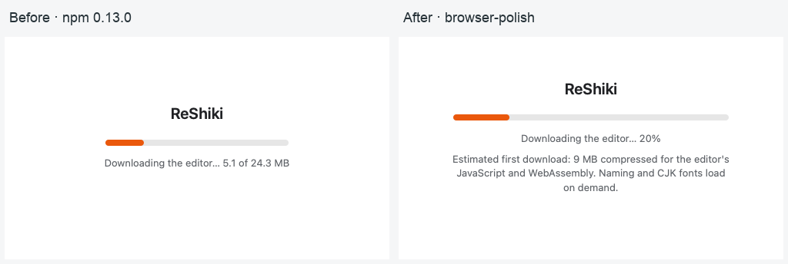
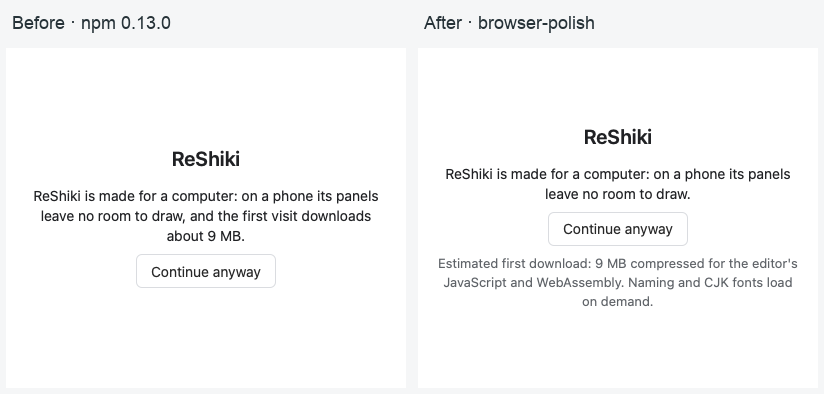
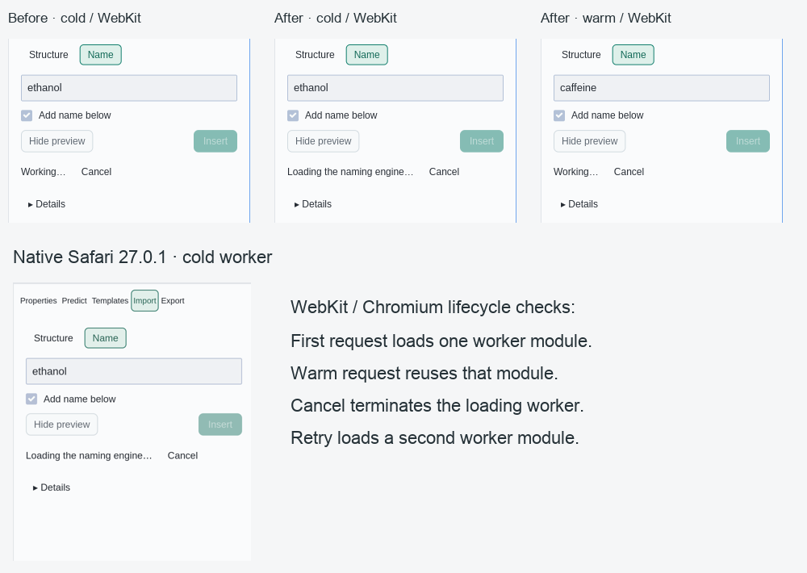
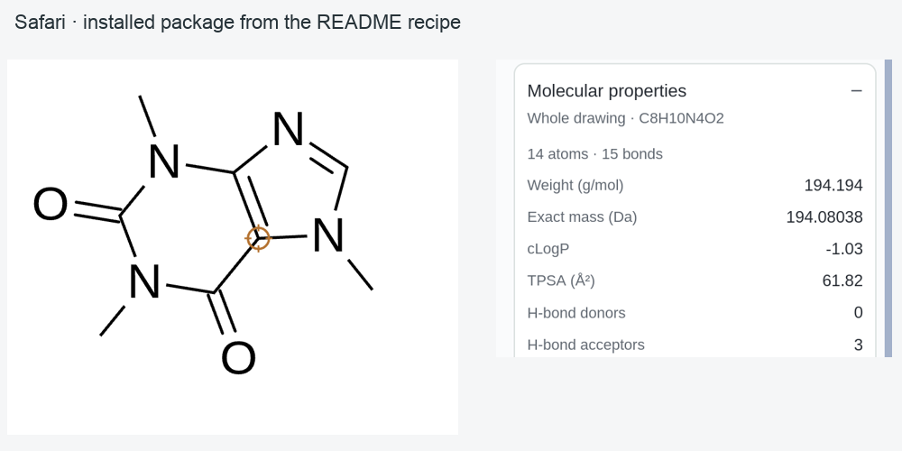

# Browser integration and feedback QA

This record covers #511, #523 and #525–#528. The base is ReShiki 0.13.0
(`3d80590a`), including the published `@ameyanagi/reshiki@0.13.0` package.
The implementation head is `d042866e`, on `fix/qa-browser-polish`.
Contributor credit and release-note links are maintained separately.

## Export titles and download handoff

All figure and structure exports share a format-aware save-sheet title:
`Export PNG`, `Export SVG`, `Export SVG for Office`, `Export PDF`, `Export MOL`,
and the corresponding uppercase name for other structure formats. Suggested
filenames, extension filters and native extension handling are unchanged.

Native macOS 27.0.1 captures use the same `caffeine.rsk`, created by opening the
recipe's caffeine MOL and using Save As. Settings are Arial 10 pt, JACS / ACS,
Publication, light canvas, 233% zoom, and a 1280 × 852 pt window. The native
bundles differed in macOS's remembered extension visibility: the baseline
hid `.png`, and the candidate displayed it. The code change only changes the
title. All five candidate sheets were checked and cancelled. A separate PNG
export was saved successfully (1303 × 1126 pixels at 1200 dpi).



Release caption: Export save sheets identify the file format before saving.

The browser's Save and Export receipts now say
`filename sent to browser downloads`. The page cannot observe a browser's
permission decision or a cancelled download. Desktop export still says
`Exported filename`. Existing export details remain after `·`.

In native Safari 27.0.1, the baseline and candidate were opened on the same
local HTTP origin with downloads set to Ask. Both mounted the recipe's caffeine
MOL, at 250% drawing zoom, in the same 1680 × 1020 pt Safari window. The PDF
export prompt was captured before answering it. Cancel was checked, then the
export was retried and Allow was checked. The new status is truthful throughout
that browser decision. The desktop PNG write retains its completed-write receipt.
The published board uses intact crops of the permission sheet and status line;
labels are outside the screenshots.



Release caption: Browser downloads report the handoff while native exports
continue to report a completed file write.

The focused native suite checks format labels, browser/native receipt text,
detail suffixes, export cancellation and duplicate-export protection:

```sh
cargo test --bin reshiki app::figure_export::tests --locked
```

Five tests pass on macOS; the Windows-only EMF test also remains in the suite.
The browser/native wording helper accepts the platform choice explicitly, so
both receipts are tested by the native test runner.

## Loading feedback

The browser naming client tracks a newly spawned worker until its `Loaded`
message. A worker remains ready while busy and between successful requests.
Dropping a cancelled, timed-out or failed request terminates the worker and
clears loading state. A new request then starts a new worker and shows
`Loading the naming engine…` again. Import → Name and the Names panel share
the label; Cancel stays available. Desktop naming still uses `Working…`.

While local naming is pending, a browser-only subscription refreshes the view
every 100 ms. Its message returns before document handling and modal gates,
so this redraw cannot commit text drafts or close menus.

The demo counts decoded WASM bytes against the packaged raw size and shows a
percentage. An unprocessed development page, whose raw size is unknown, uses
an indeterminate bar; compressed `Content-Length` is never a denominator.
The package script separately sums `gzip -9` sizes of the four initial assets:
`src/editor.js`, `src/fonts.js`, `dist/editor/reshiki.js` and its WASM. It stamps
that estimate into the page after rewriting content hashes and before adding
any retained previous-release assets. The phone gate and loading card both
show the estimate. The docs use the same rounded 9 MB compressed estimate;
naming and CJK fonts are identified as downloads on demand. For this build,
the packaged raw editor WASM is 24,269,986 bytes and the four initial assets
sum to **9,029,024 bytes with gzip -9**, which rounds to 9 MB. This is an estimate
of compressed asset bodies; server encoding and HTTP overhead can differ.





Release caption: The demo separates decoded progress from its compressed
first-load estimate.

Browser checks use fresh Playwright contexts with WebKit 27.2 and Chromium
156, at 1400 × 900 pixels and 400 × 1000 pixels. A local server sends real
editor WASM with gzip and holds 16 KiB compressed chunks for 20 ms to keep
progress visible. The old page reaches `5.0 of 24.3 MB`; the new label is a
percentage. In both versions the phone gate issues zero editor-WASM requests
before Continue anyway. An additional check serves the unprocessed page
with compressed `Content-Length` but no raw-size metadata; both engines keep
the bar indeterminate and omit a numerical download counter. The images show
actual browser renders.

Readiness checks delayed the real worker WASM response by 5 seconds and held
completed binary replies for 1.5 seconds, so both phases could be captured.
The cold request loads one module and displays the loading label; a second
request posts work to the same worker without another module request and shows
`Working…`. The first preview is closed before changing the name and opening
the second preview. Cancelling during the cold load calls `Worker.terminate`;
the retry fetches a second module and displays the loading label again. Both
WebKit and Chromium passed these request/termination assertions. No QA API was
added to the app.

Native Safari separately confirmed the cold-load label. That capture used a
12-second worker-WASM delay and an 8-second reply hold to keep the state visible
during native capture. Native Safari corroborates the cold state; the warm and
cancel/retry lifecycle assertions above are from WebKit and Chromium.



Release caption: Naming says when its engine is loading and uses Working once
the worker is ready.

## Installed HTML page and release version

The npm README now has an end-to-end recipe from an empty folder, including
an import map for `editor`, `element` and `embed`, a complete page, a MOL
fixture command and Python's static-server command. It explains the package's
relative `src/` and `dist/` layout, same-origin naming worker, WASM MIME type,
HTTP serving, and the custom element's `ready` promise.

The recipe was followed with Bun 1.4.2 and the published npm 0.13.0 package.
Python 3.9.6 served `.wasm` as `application/wasm`. Chromium and WebKit loaded
caffeine as `Cn1c(=O)c2c(ncn2C)n(C)c1=O`, showed C8H10N4O2 and 194.194 g/mol,
and previewed ethanol as CCO / three atoms / two bonds through the same-origin
worker. Neither browser reported a page error. The example deliberately uses
the verified supported name ethanol.

The same README-only folder was opened in native Safari 27.0.1 and Chrome
155.0.8059.85. Both displayed caffeine with the expected formula and mass.
Chrome's console logged `Ready: Cn1c(=O)c2c(ncn2C)n(C)c1=O`, confirming the
custom element's `ready` promise and immediate `save` call. The Safari board
shows two intact crops from one screenshot, at 143% drawing zoom, to keep the
molecule and properties readable.



Release caption: The npm README includes a complete plain HTML integration
recipe, including the custom element's ready promise.

`version()` now returns the root application's release version. The existing
web build script reads root `Cargo.toml`, tracks it for rebuilds, and exports
`RESHIKI_VERSION`, while retaining the WASM linker's 32 MiB stack argument.
The Bun test compares the API result with root `package.version`, including
any prerelease suffix. A standalone build-script probe verified both `0.13.0`
and `0.14.0-rc.1`, and verified that both emit
`-zstack-size=33554432`. Internal crate versions remain independent.

Published npm 0.13.0 returns `0.1.0` before this change. The built library
returns `0.13.0`. A local npm archive was stamped with root version `0.13.0`,
as the release workflow does after tests, and its `version()` result matches
that package version. The built library's result is also checked against the
root release by `scripts/build_wasm.sh --test`.

## Reproduction and checks

From a repository checkout, use the toolchain in `rust-toolchain.toml`, Bun,
uv, and the `wasm32-unknown-unknown` target:

```sh
scripts/build_wasm.sh --test
scripts/package_web_demo.sh
cargo fmt --all --check
cargo clippy --workspace --lib --bins --all-features --locked -- -D warnings
bun run lint:js
bun run --cwd website check
```

The standard commit hooks ran without bypasses. Native Clippy and all five
focused export tests pass. WASM Clippy passes for `reshiki`, `reshiki-web` and
`reshiki-web-worker`. The full package suite, with `RESHIKI_CLI` pointing at the
built native app and its InChI helper configured, reports **56 passed, zero
failed, zero skipped**, with 97 assertions across four files. The initial
build-script test run reported 26 passed and 30 optional CLI comparisons
skipped; the complete run supersedes that skip count.

Astro reports zero errors, warnings and hints. The docs build checks 13,467
local links/assets, the agent API output, and 1,360 downloadable colors.
There are no new Rust integration-test targets or changes to platform CI
shard registration. All published crops were inspected for clipping,
legibility and unrelated information.
