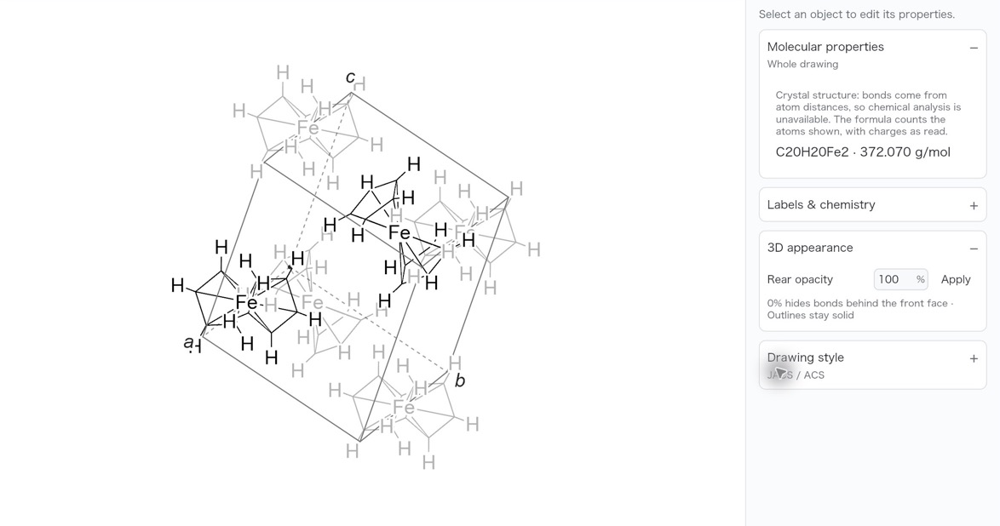
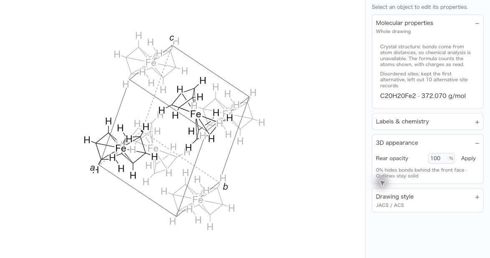
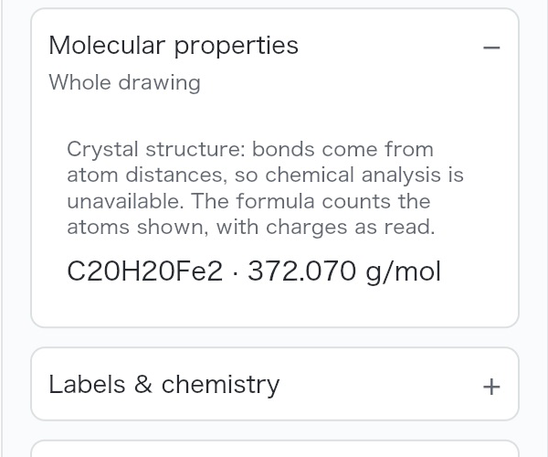
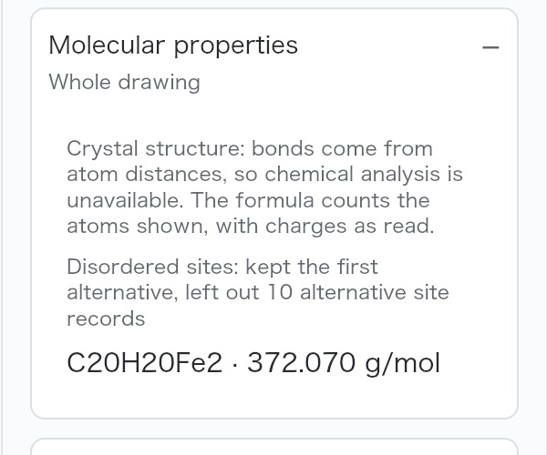

# Crystal opening documentation and retained import notes

Issues [#516](https://github.com/Ameyanagi/ReShiki/issues/516) and
[#520](https://github.com/Ameyanagi/ReShiki/issues/520).

The 3D drawing guide and `crystal::read` documentation now agree with the
reader: a structure with a unit cell opens as a 2D drawing in its cell;
**Show as 3D** displays its model. A molecule without a cell, such as plain
XYZ, opens as a 3D model. This documentation correction changes no drawing.
The crystal reader's opening-mode regression tests cover both cases.

Import decisions now stay with the model in **Properties → Molecular
properties**, including CIF disorder, PDB alternate locations and atoms
omitted as overlaps. Saving and reopening retains these notes. CIF disorder
counts describe alternative site records before symmetry expansion; PDB
alternate-location counts describe atom records. Overlap counts describe
atoms after expansion and wrapping. Notes describe the source import and do
not indicate an ongoing chemical error.

## Matched desktop comparison

Input: the unmodified [COD 7033930 ferrocene fixture](../../tests/fixtures/crystal/cod-7033930.cif),
revision 180045 (2016-03-25), from Yasuhiro Miyamoto and Satoshi Takamizawa,
[doi:10.1039/C4DT03922J](https://doi.org/10.1039/C4DT03922J). The fixture preserves
the original public-domain notice; source and CC0 provenance are recorded in
[the fixture README](../../tests/fixtures/crystal/README.md).

Both screenshots come from the real macOS app on 2026-10-25, at 78% zoom,
JACS / ACS style, Publication colours and a light canvas. They use the same
input, default opening view, scale, framing and renderer. The baseline is
`3d80590a`; the candidate is `1a0213c9`. Each was opened with **Open**,
**Molecular properties** expanded and keyboard drawing switched off with F8.
The images crop the same canvas and Properties region and are scaled to
1174 × 618 pixels; unrelated QA tabs and the status bar are outside the crop.
The drawing and its formula are unchanged. The complete source screenshots
were captured before cropping; no drawing content was changed.

| Before: import note disappears from Properties                                                                                        | After: note stays with the model                                                                                                                   |
| ------------------------------------------------------------------------------------------------------------------------------------- | -------------------------------------------------------------------------------------------------------------------------------------------------- |
|  |  |

Properties close-ups preserve the screenshot pixels at their original size:

| Before                                                                                                                                        | After                                                                                                                                 |
| --------------------------------------------------------------------------------------------------------------------------------------------- | ------------------------------------------------------------------------------------------------------------------------------------- |
|  |  |

## Save and reopen

In the candidate app, **Save As** wrote `ferrocene-notes.rsk`. The tab was
closed with ⌘W and the saved drawing reopened with **Open**. Properties still
shows the ten-record note and `C20H20Fe2 · 372.070 g/mol`. The saved JSON has
`models[0].notes` containing the same note and document version 29.

The notes field is optional, defaults to empty and is omitted when empty.
Validation accepts at most 16 notes of 512 bytes each and rejects blank notes
and control characters. The additive provenance text needs no new document
version. Older readers can open the drawing but may discard these optional
notes when they save it. The parser still discards unrelated source text.

## Verification

- `cargo test -p reshiki-io crystal::tests --lib --locked`: 47 passed, including
  COD 7033930 import plus save/reopen, synthetic disorder, PDB alternate-location
  and nonperiodic XYZ overlap notes.
- `cargo test -p reshiki-model import_notes_are_optional_and_bounded_provenance
--lib --locked`: passed, covering omitted defaults, selection scope, native
  round trip and malformed-note limits.
- `cargo build --bin reshiki --locked`: passed.
- Normal commit hooks passed: workspace library/binary Clippy with all features,
  Rust formatting and Markdown formatting. Existing dependency deprecation and
  future-compatibility warnings remain outside this change.

Reusable release caption: **Crystal import notes stay with the drawing.**
Properties records omitted disorder alternatives, and native save/reopen
retains the explanation beside the formula. Alt text: “Ferrocene in its unit
cell, with Properties recording ten omitted alternative site records.”
