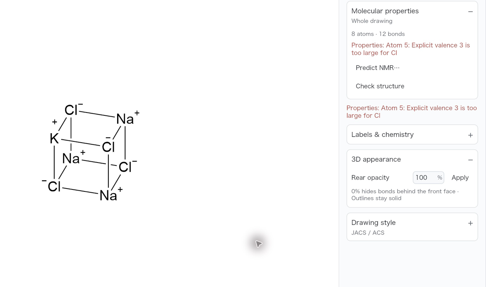
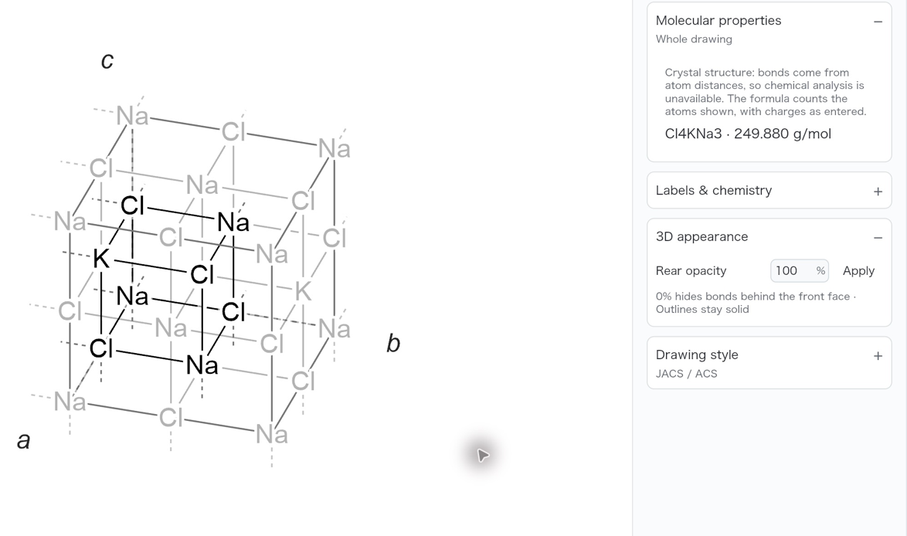
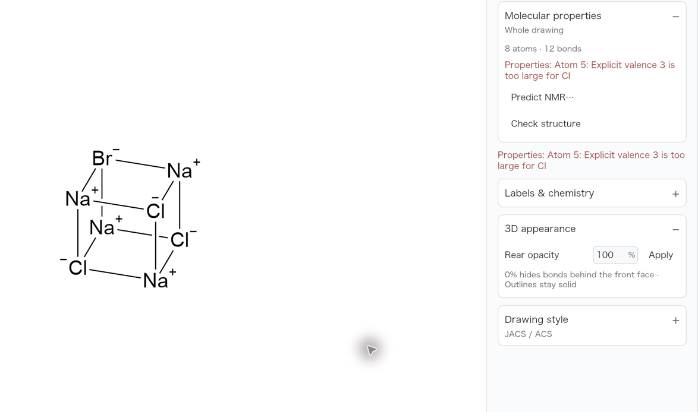
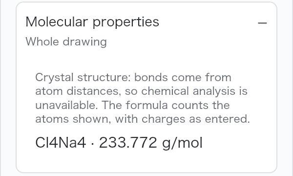
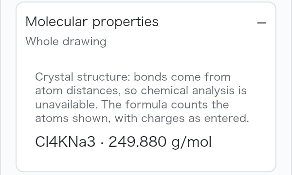
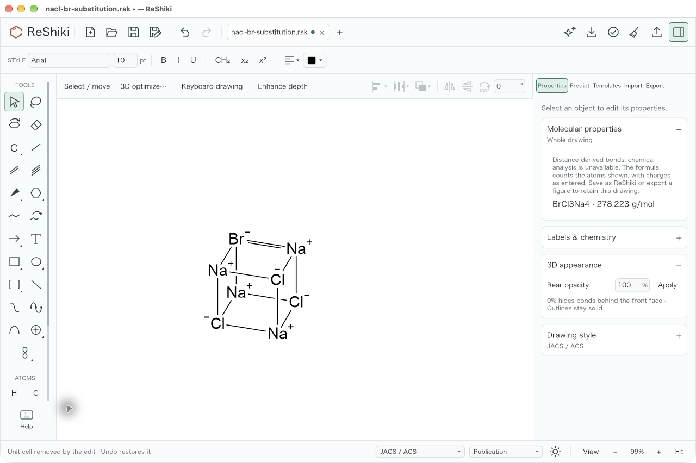
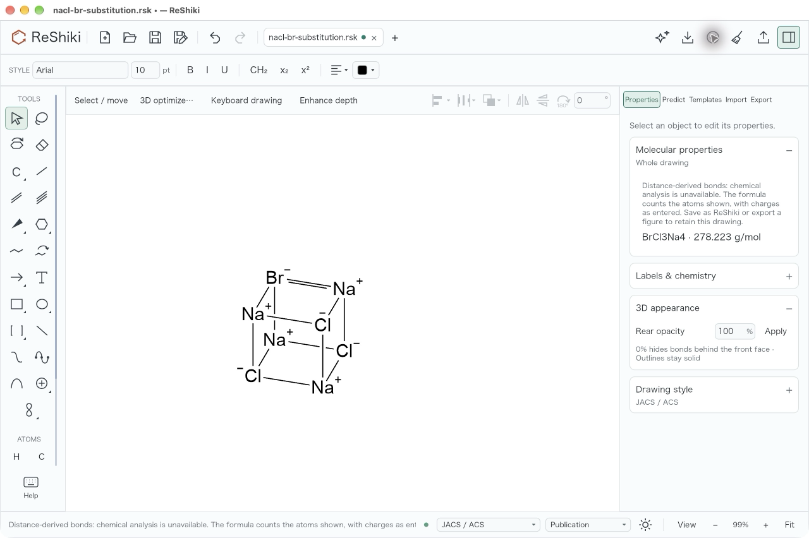

# Crystal substitutions retain the unit cell

[Issue #517](https://github.com/Ameyanagi/ReShiki/issues/517).

Changing only an in-cell atom's element or formal charge now keeps the crystal
model, lattice, repeat, charge visibility, site labels and displacement
parameters. The lighter copies read the edited element, and Properties counts
the edited cell: replacing one Na⁺ with K⁺ gives `Cl4KNa3`.

Other chemical and stereo edits still remove the model when its imported
geometry is no longer a supported representation. The app says that the unit
cell was removed and that Undo restores it. Surviving distance-derived edges
retain their unvalidated crystal context, so they cannot silently become
ordinary chemical bonds after save/reopen, copying, or a later edit.

## Matched native examples

Input: [the NaCl CIF fixture](../../tests/fixtures/crystal/nacl.cif), without
cleanup or lattice changes. Both builds ran on macOS 27.0.1, arm64, with JACS /
ACS style, Publication colours, a light canvas, Repeat 1/1/1 and hidden ion
charges. Each before/after pair uses the same 99% zoom, opening view, camera
position and target atom. The issue's original screenshots used 150%; these
captures use the whole-cell opening fit in the QA window.

The baseline is `3d80590a`. Substitution, Undo and native reopening captures use
implementation `a4c21929`; the final removal-status and skipped-check captures
use `53d2acbc`, which preserves the removal notice after a bond shortcut.
`c7f6cdab` changes test fixtures only. These are real desktop application
screenshots. The matched views crop the same canvas and Properties region and
are resized to 1174 × 694 pixels; no drawing content was redrawn or retouched.
The complete original screenshots are retained with the local QA artifacts.

For each substitution, open a fresh NaCl cell, switch keyboard drawing off
with F8, select the dark atom, press Return, replace its label, click Apply and
click empty canvas. The sodium target is atom 3, at the left of the dark cube;
the chloride target is atom 8, at its upper left. The exact entered text is
`K+` or `Br-` respectively.

**Before the fix, after Na⁺ → K⁺:** the cell, axes and lighter copies disappear;
the distance bonds produce the misleading chloride valence error.

**After the fix, after the same Na⁺ → K⁺ edit:** the cell and lighter K copies
remain, with `Cl4KNa3 · 249.880 g/mol` in Properties.

**Before the fix, after Cl⁻ → Br⁻:** the same loss of the cell and the same
misleading valence analysis occur.

**After the fix, after the same Cl⁻ → Br⁻ edit:** the cell and pale Br copies
remain, with `BrCl3Na4 · 278.223 g/mol`.

## Undo, saving and reopening

One native ⌘Z after the potassium edit restores NaCl and
`Cl4Na4 · 233.772 g/mol`. Redo restores the substituted crystal. **Save As**
wrote a new `.rsk`; the tab was closed with ⌘W and the file reopened with
**Open**. The lattice, K copies and edited formula are still present.

| One Undo                                                                                                                                                        | Saved drawing reopened                                                                                                                                              |
| --------------------------------------------------------------------------------------------------------------------------------------------------------------- | ------------------------------------------------------------------------------------------------------------------------------------------------------------------- |
|  |  |

Inspection of the actual native files saved by the desktop app confirms:

| Saved drawing                                          | Version | Models with a cell | Source sites | Distance-context edges | Repeat         | Ion charges shown |
| ------------------------------------------------------ | ------- | ------------------ | ------------ | ---------------------- | -------------- | ----------------- |
| Na⁺ → K⁺                                               | 30      | 1                  | 8            | 12                     | 1/1/1          | No                |
| Cl⁻ → Br⁻                                              | 30      | 1                  | 8            | 12                     | 1/1/1          | No                |
| Br crystal after the unsupported bond-order edit below | 30      | 0                  | 0            | 12                     | Not applicable | Yes               |

Both retained cells keep the original 5.6402 Å lattice vectors. The automated
round trips also cover Repeat 2/1/1. Source site labels and ADPs remain import
provenance: a K substitution can retain its source label `Na1`. Imported bond
geometry and periodic crossings are not recalculated for the substituted
radii; this is a figure edit, not a crystallographic refinement.

## Edits that remove the cell

Starting from the saved Br-substituted crystal, select the upper Br–Na bond
and press 2 to change its order. The model and cell are removed, and the
status says **Unit cell removed by the edit · Undo restores it**. Properties
still reports the drawn composition and explains that the remaining edges
are unvalidated distance-derived drawing data. The shortcut's ordinary
“Double bond” caption no longer hides the removal notice.

Clicking **Check drawing** reports that chemical analysis is unavailable. It
shows neither the former chloride valence error nor a claim that chemistry
passed. A separate native file saved after this edit contains no model and
retains all 12 distance-context markers.

The guard covers the entire connected component that contains a retained
distance edge. Separate ordinary molecules retain their usual analysis.
Deleting inferred edges and drawing fresh edges in a separate ordinary edit
does not permanently taint the drawing. During a compound operation that
adds an in-cell edge and prunes objects before the live model is reconciled,
the new in-cell edge conservatively keeps unvalidated crystal context too;
the regression test confirms that a disconnected ordinary component is not
marked.

## Format and verification

Native format 30 is deliberate: an older reader must not discard a semantic
provenance field and resume valence analysis. The actual version-29 baseline
CLI refused the saved file with exit 1 and a newer-version/update message.
Released ReShiki 0.13.0 and earlier therefore cannot open newly saved files.
Legacy version-29 live-cell models acquire provenance when opened. A legacy
file whose model was already discarded has no source context to recover;
reopen the original crystal source in that case.

MOL and molecular identifiers refuse the unvalidated graph explicitly.
CDXML/CDX can export its editable drawing with a notice that the lattice,
periodic copies and distance provenance are omitted and that reimported bonds
may be read as chemistry. Native and PNG/SVG/PDF figure exports remain
available. The cell-only **From the 3D view** path projects the retained
coordinates directly, so it does not require chemical preparation; ordinary
molecular conformers keep the existing preparation path.

| Check                                                                                                  | Result                                                                          |
| ------------------------------------------------------------------------------------------------------ | ------------------------------------------------------------------------------- |
| `cargo test -p reshiki-model --lib --locked`                                                           | 814 passed; 10 existing opt-in tests ignored                                    |
| `cargo test -p reshiki-io --lib --locked`                                                              | 264 passed; 5 existing opt-in tests ignored                                     |
| Full app suite with the pinned native naming helper                                                    | 1115 passed; 121 existing opt-in tests ignored                                  |
| Native substitution, one-step Undo, Save As, close/reopen, bond-order removal notice and Check drawing | Verified as shown above                                                         |
| Normal commit hooks                                                                                    | All-feature workspace library/binary Clippy and Rust/Markdown formatting passed |

The model controls include element-only, charge-only and combined edits;
neutral Br entry; strict rejection of isotope, radical, implicit-H policy,
explicit-H, wildcard, unknown-element, bond-order and stereo-source edits;
retention of true colour/depth and double-line presentation; cell/copy
rendering after priming the copy cache; legacy load/prune, fragment copy/paste,
merge provenance and native round trips. The app controls include element-tool
clicks, charge shortcuts, the public bond shortcut, and one-step flatten/Undo
of NaCl and a multi-molecular CO₂ crystal while preserving lattice and sites.
The engine controls include valid but unvalidated graphs, protocol/document
validation, both CDXML/CDX paths, strict appearance refusal, identifier/MOL
refusal and an independent water molecule's normal analysis.

Reusable release caption: **Crystal substitutions keep their cell and copies.**
Changing Na⁺ to K⁺ updates the lighter copies and formula without losing the
lattice. Alt text: “A NaCl unit cell with one potassium substitution, pale K
copies and Cl4KNa3 in Properties.”
