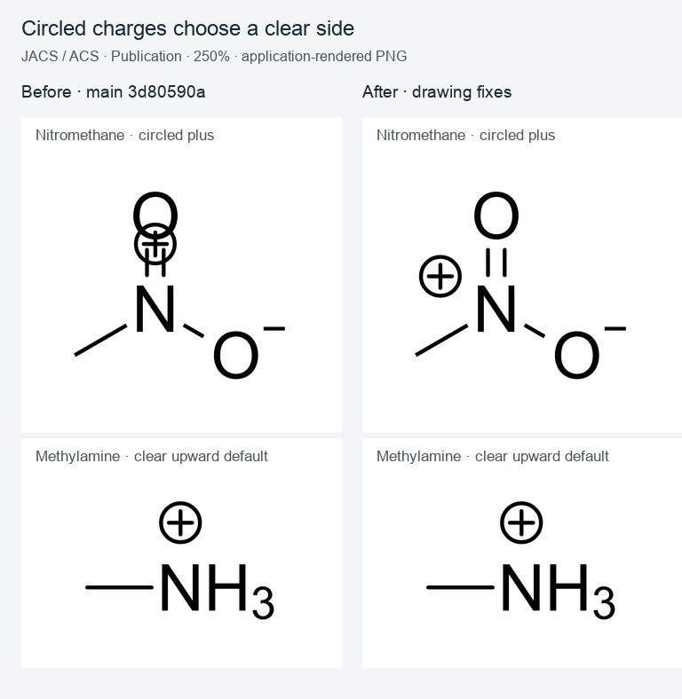
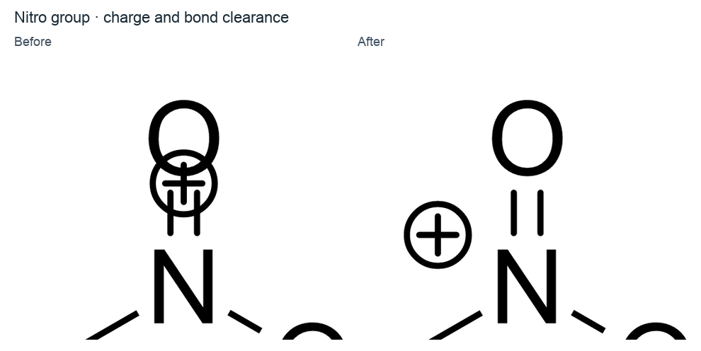
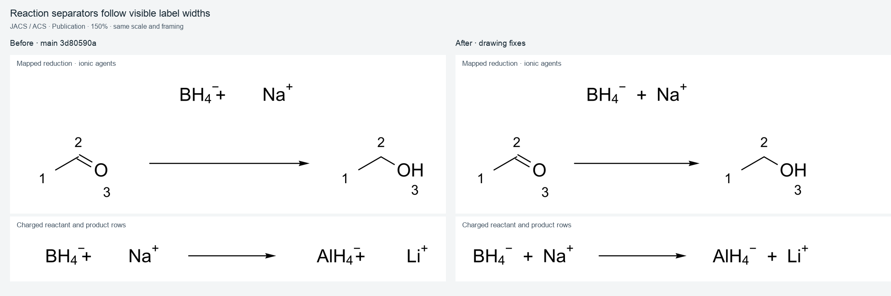
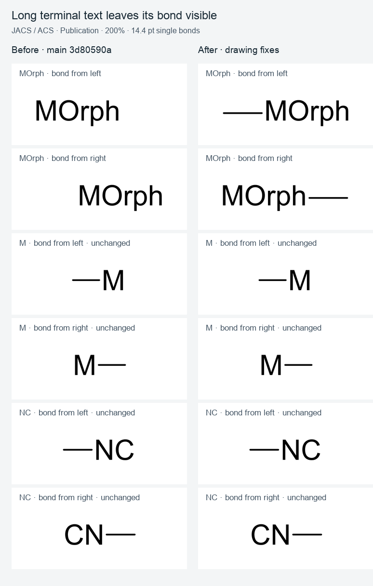
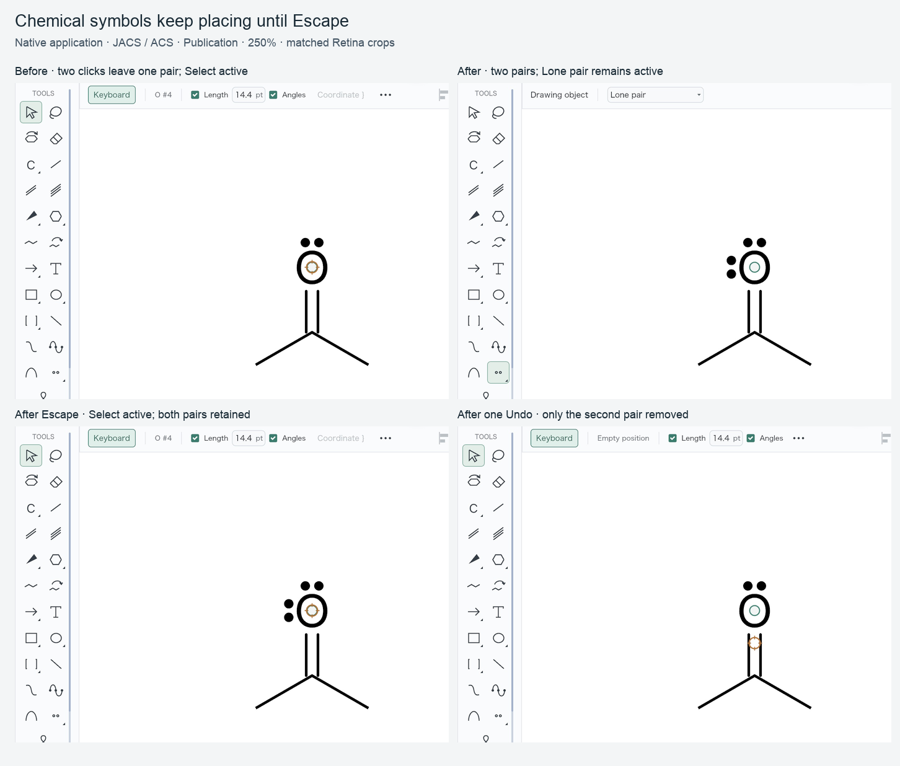
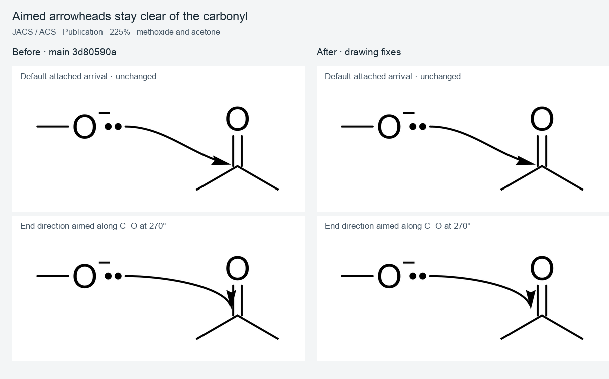
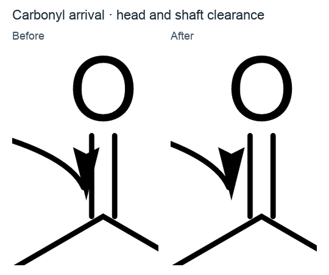
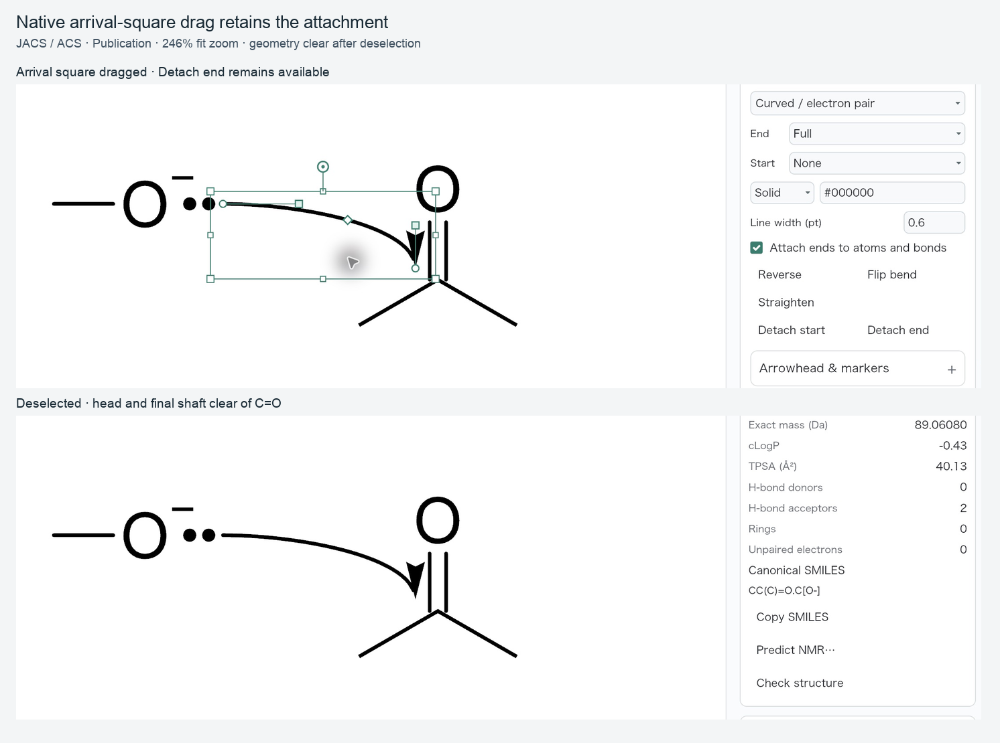

# Drawing placement QA: marks, reaction rows, text and mechanism arrows

This review covers [#494](https://github.com/Ameyanagi/ReShiki/issues/494),
[#495](https://github.com/Ameyanagi/ReShiki/issues/495),
[#497](https://github.com/Ameyanagi/ReShiki/issues/497),
[#504](https://github.com/Ameyanagi/ReShiki/issues/504), and
[#506](https://github.com/Ameyanagi/ReShiki/issues/506).

The matched renderer comparisons use base `3d80590a` and implementation
`61a5b5ae` (initial drawing fixes `5ec483ae`, followed by atom-map ink bounds).
Both were built locally on macOS 27.0.1 (26A434), Apple M1,
`aarch64-apple-darwin`, in separate checkouts. They use JACS / ACS, Publication,
a white canvas and the application SVG/PNG renderer. PNG exports are 1200 dpi;
the boards uniformly resize them to the stated canvas zoom, with the same
world-coordinate frame on both sides. Enlarged details crop the same world
rectangle. Captions and labels sit outside the molecular ink.

## Circled charges avoid nearby chemistry (#494)

Input: `C[N+](=O)[O-]`, oriented with N=O pointing up. Set N to charge 0,
then click it once with Circled plus and Attach to atoms enabled. At 250%,
the old mark crosses both N=O rails and the upper O. The new mark moves to
the nearest clear 15° step. A methylamine control retains its clear upward
placement.





The nitro mark offset changes from approximately `(0, -29.1667)` to
`(-25.2591, -14.5833)` world units. Placement checks rendered bond strokes,
neighbour label ink and existing marks after refreshing hydrogens for the new
charge. Existing marks and stored offsets do not pass through this search.
The CDXML regression reimports the new offset within 0.01 world unit and
retains charge +1. A real desktop click on the prepared neutral N at 250%
produced the same clear position; after deselection, Properties showed CH₃NO₂,
61.040 g/mol and `C[N+](=O)[O-]`.

Release caption: **New charges and radicals choose a clear side when their
usual placement would touch bonds, neighbouring labels or atom marks.**

## Imported reaction separators follow visible labels (#495)

Inputs:

```text
[CH3:1][CH:2]=[O:3]>[BH4-].[Na+]>[CH3:1][CH2:2][OH:3]
[BH4-].[Na+]>>[AlH4-].[Li+]
```

Import as reaction SMILES. At 150%, the agent separator previously crowded
BH₄⁻ and left a wide gap before Na⁺. The new layout measures the completed
label ink, centres the separator between participants and fits the arrow and
product row to the agent width. The second fixture checks charged reactant
and product rows too. Product-mapping alignment uses the same ink extents,
including separately rendered map-number indicators; an additional regression
uses six-digit atom maps.



The import regression checks every separator's horizontal centre against its
neighbours' visible-ink midpoint within 1 pt, verifies that its glyph stays
outside label ink, and checks arrow/product clearance.

Release caption: **Imported reaction plus signs sit evenly between visible
labels, including hydrogens, counts, charges and atom maps.**

## Long free text keeps a short terminal bond visible (#497)

Input: a horizontal 14.4 pt single bond, with `MOrph` typed on the end atom
using Automatic text attachment. At 200%, the centred word used to hide the
entire bond. The new layout meets that bond with the label's near edge when
centring would hide more than half of it. Both bond directions are shown.
`M` and `NC` remain unchanged in both directions; the typed `NC` control can
read `CN` when its chemical spelling reverses to meet a bond from the right.



This fallback is confined to Automatic free text with no recognized chemical
attachment glyph, exactly one bond, and a direction within 22.5° of
horizontal. Explicit attachment settings, internal labels and vertical bonds
retain their existing placement. The regression checks a visible bond span
longer than half the 14.4 pt bond and no line beneath the label ink.

Release caption: **Long terminal text leaves its short horizontal bond
visible, while short labels keep their usual position.**

## Chemical symbol tools keep placing (#504)

Choose Lone pair once, then click acetone's O twice. Each click commits one
mark and one Undo step. Chemical symbols stay active for attached and free
placements; Escape selects Select, and choosing another tool stops repeating.
Orbitals retain their existing single-placement behaviour.

Real desktop checks at 250% on base `3d80590a` and implementation `5ec483ae`:

- Selected Lone pair once and clicked the same O twice. Base retained one
  pair and selected Select; the fix retained two pairs and the Lone pair tool.
- Pressed Escape: Select became active and both pairs remained.
- Pressed Cmd+Z once: exactly the second pair disappeared.



These are matched native window crops from 2× Retina captures, with the same
fixture, framing and 250% application zoom. Selection indicators are retained
because the active tool and atom-owned mark placement are the subject.

Release caption: **Choose a chemical symbol once and place several marks;
Escape returns to Select and Undo removes one placement at a time.**

## Aiming an attached arrow along C=O stays clear (#506)

Input: imported methoxide and acetone, with C=O vertical and methoxide's O
135 world units left and 35 units above the carbonyl carbon. Add a lone pair
25 units to the right of methoxide O and create an attached Curved / electron
pair arrow from that pair to the carbonyl carbon. Drag the head-direction
square to aim straight along the C=O axis (270°), then deselect. At 225%, the
old head merges into the left rail. The new end moves sideways while keeping
its aim and attachment. The default arrival is unchanged. Its SVG is byte-identical at base and head,
as are the methylamine, M and NC control exports.





The regression sweeps 235° through 305° in 5° steps and checks positive
rendered head-ink clearance, the same carbonyl target, preserved aim and
stable reconciliation at each step. A real desktop check on `5ec483ae` opened
the same default-arrow fixture, selected its curve and dragged only the arrival
square upward. The head shifted clear of the left rail, **Detach end** remained
available, and the clearance remained after deselecting. The native fit zoom was
246%; the matched renderer boards above use the requested 225%.



Repeated aims begin from the same default endpoint, so backing distances and sideways offsets do not accumulate.

Release caption: **Attached curved-arrow heads remain clear of bond strokes
when their arrival direction is aimed along a bond.**

## Reproduction and automated checks

The fixtures are generated by
[`examples/drawing_geometry_qa.rs`](../../examples/drawing_geometry_qa.rs):

```sh
cargo run --example drawing_geometry_qa -- /tmp/drawing-geometry-qa
```

Run the same example at the base and implementation commits. It writes editable
`.rsk` files, application SVG and PNG exports, and a local gallery. For the
base comparison, copy this example into a detached base checkout without
changing its rendering or chemistry code. No earlier screenshot is retouched.

Validation:

- `cargo test -p reshiki-model --lib --locked`: 804 passed, 10 ignored.
- `cargo test -p reshiki-io --lib --locked`: 256 passed, 5 ignored.
- `cargo test --bin reshiki app::canvas_edit:: --locked`: 21 passed.
- Native application builds at base and head.
- Normal commit hooks: workspace library/binary Clippy with all features and
  warnings denied, Rust formatting, and Markdown formatting passed.

The model checks include bond and neighbouring-label clearance for an actual
`CircledCharge` mark, saved-mark preservation, methylamine's upward control,
short-text controls, explicit/internal/vertical label exceptions, the complete
carbonyl aim sweep, preserved arrow attachment and repeated-aim stability.
The IO checks include ionic agent/reactant/product rows, six-digit map-number
spacing and a circled-charge CDXML round trip. The app check verifies two placements, retained Lone pair
tool, one-mark Undo, and Select after Escape.

A second worker reviewed the implementation and indicator followup read-only,
including mark refresh and obstacles, terminal-label exclusions, reaction
separator ownership, indicator ink and arrow reconciliation. It found no
actionable blocker. The final full model and IO suites were rerun after the
indicator followup and remained green.
