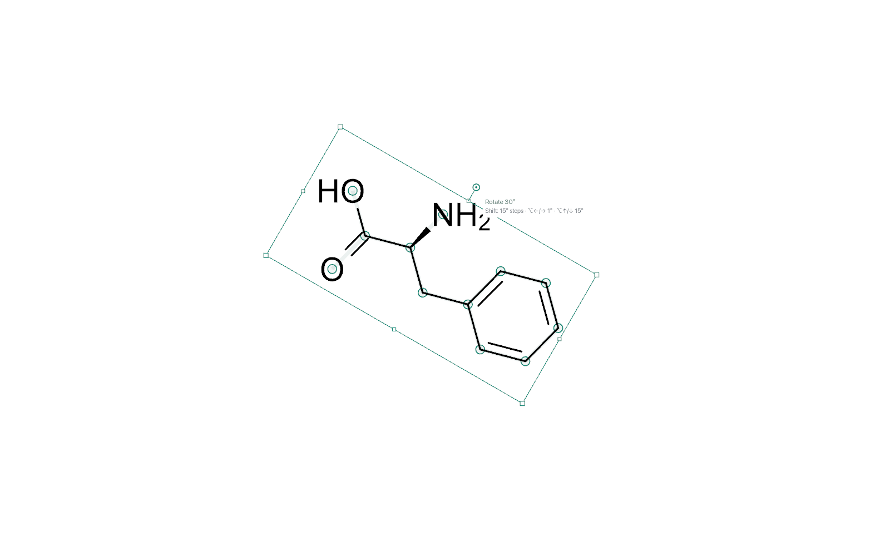
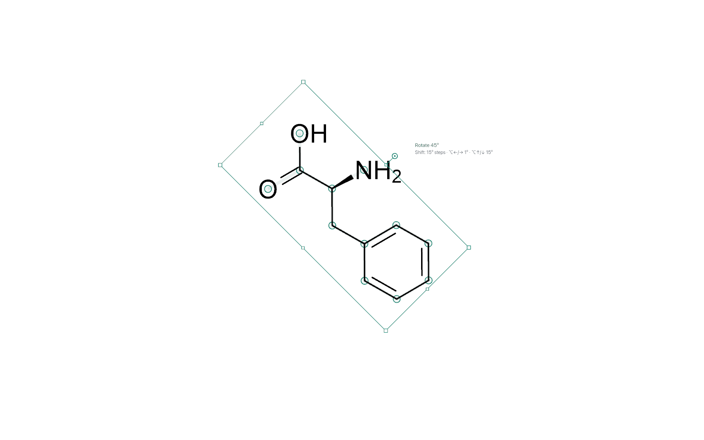
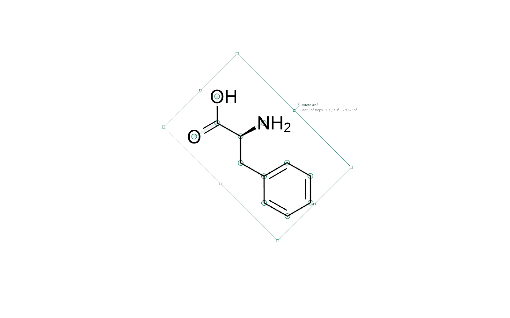
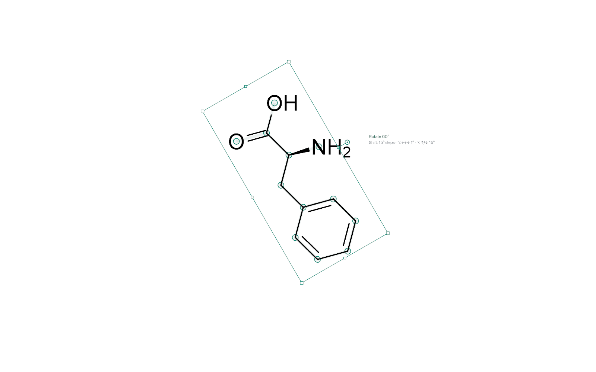
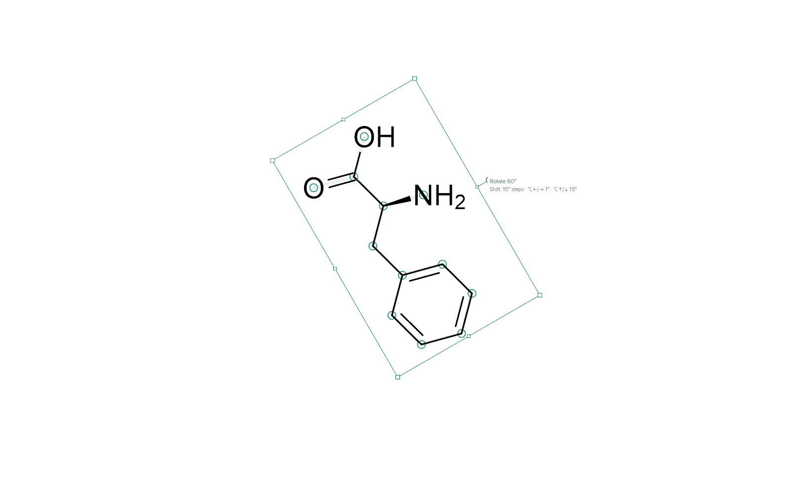
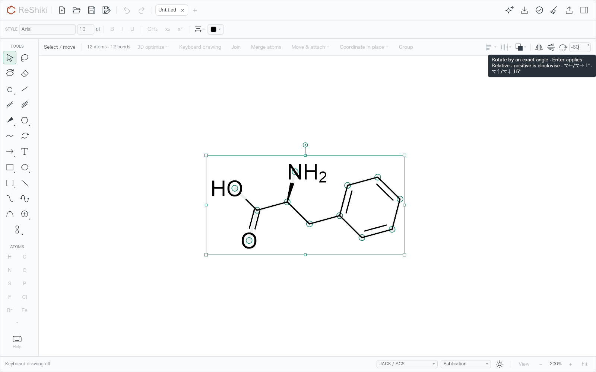
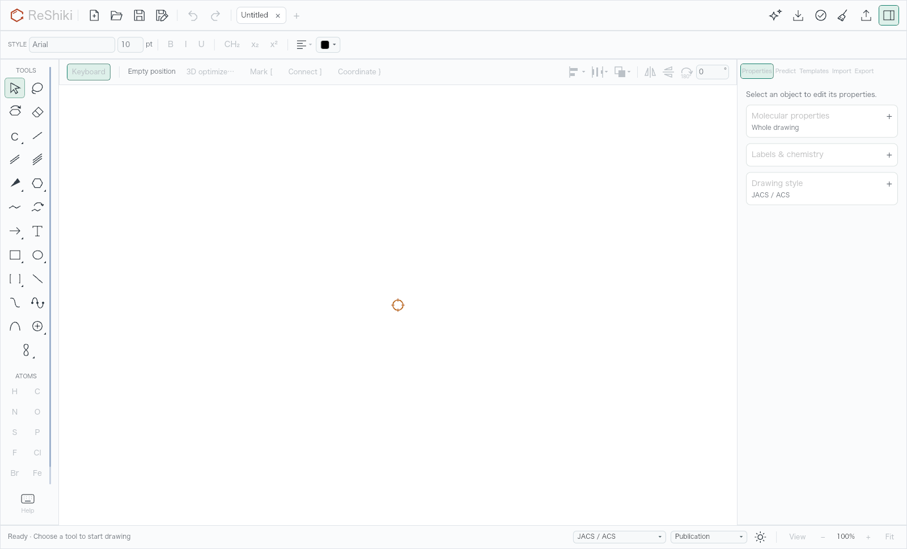
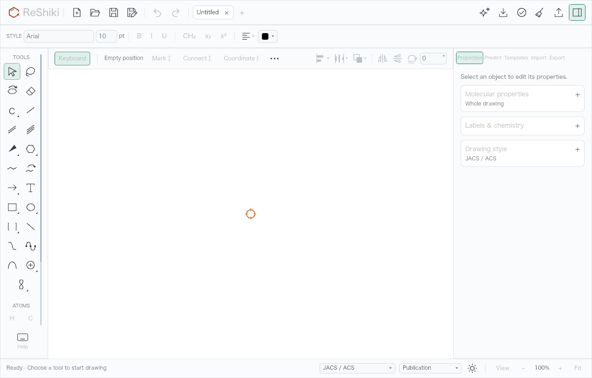
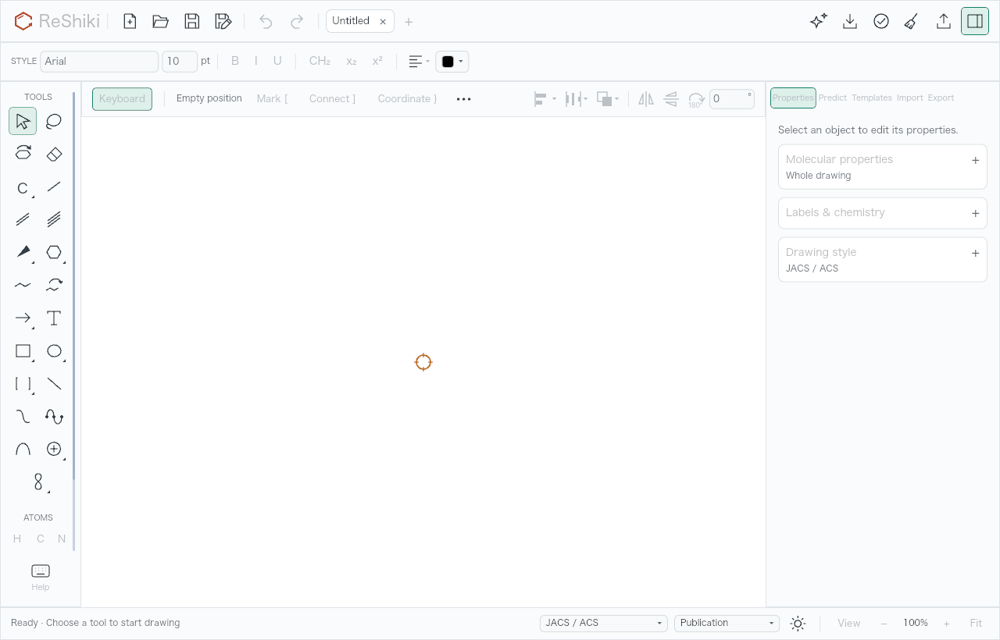
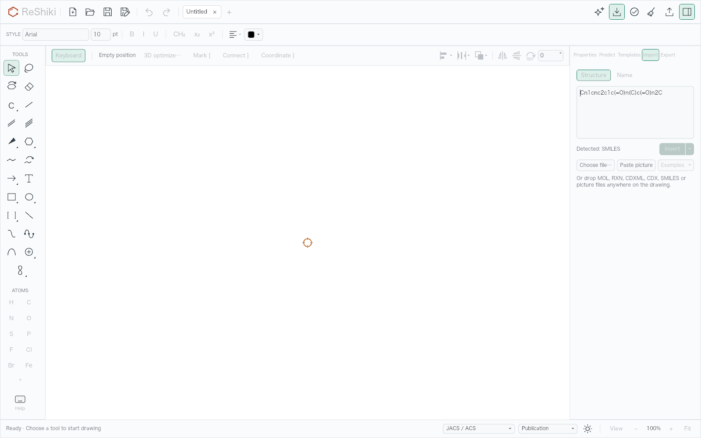

# Rotation overlays, atom palette and Structure input

Shipped in 0.13.1 in [PR #567](https://github.com/Ameyanagi/ReShiki/pull/567), by @Ameyanagi.

This review covers [#552](https://github.com/Ameyanagi/ReShiki/issues/552),
[#553](https://github.com/Ameyanagi/ReShiki/issues/553),
[#555](https://github.com/Ameyanagi/ReShiki/issues/555) and
[#556](https://github.com/Ameyanagi/ReShiki/issues/556). Rotation controls stay
clear of upright labels, angle hints yield to editing, the atom palette uses
three columns, and reopening Structure selects its retained draft for replacement.

## Sources and capture conditions

- Comparison base: `3d80590a41b9d9e8efd818d23395ac51bd264ca8` (`origin/main`, 0.13.0).
- Production source and native binary: `fb15e12af420b956d78c5d8930fe5e2c7fb8fcc6`.
- Shared capture harness and final matched PNG set: `50f1ec3ce5353c9c4209ff1f92c1b072e6269227`.
- Host: Apple M1, macOS 27.0.1 (26A434), arm64, Rust 1.99.0; unoptimized native development build.
- Appearance: JACS / ACS drawing style, Publication colours, light canvas.

The [phenylalanine fixture](../../tests/fixtures/phenylalanine-rotation.rsk)
comes from the real local import of `N[C@@H](Cc1ccccc1)C(=O)O`, followed by cleanup
of the whole drawing. Both versions read the same saved fixture. Held rotation
captures use the actual canvas program, 200% zoom and a 1600 × 1000 canvas:
30° at a 171 pt pointer radius, and 45° / 60° at 230 pt. The rotation-field and
Structure comparisons use a 1600 × 1000 application client area.

The palette comparison represents a 1600 × 1000 **outer macOS window**. Its
renderer client area is 1600 × 968, excluding the 32 pt native title bar.
The observed default native capture is 2560 × 1704 pixels at 2× scale, matching
the application's configured 1280 × 820 client area plus that title bar.
The default-size comparison therefore uses the configured 1280 × 820 client area.
All eleven atom buttons are fully visible at the larger size. The default size
still scrolls to reach lower atom rows; H and C remain first.

All images below are original application or canvas renderer output. A detached
base checkout received the same test drivers and fixture, with no production
changes. The native interaction check used an expanded window and 250% auto-fit;
its exact observations are retained in the [native receipt](qa-drawing-polish-native.json).

## Matched visual review

| Case                                          | Before                                                                                                                       | After                                                                                                                                      |
| --------------------------------------------- | ---------------------------------------------------------------------------------------------------------------------------- | ------------------------------------------------------------------------------------------------------------------------------------------ |
| Tight rotation path, 30°: readout clips NH₂   |                          |                       |
| Wide rotation path, 45°: frame crosses H₂     |                            |                                   |
| Wide rotation path, 60°: frame crosses H₂     |                                       |                                           |
| Typing −60° with the pointer on the field     |  |                     |
| Palette in a 1600 × 1000 outer window         |               |                                        |
| Palette at the default 1280 × 820 client size |                      |            |
| Reopening Structure with the caffeine draft   |       |  |

## Verification

The model library suite passed **800 tests**, with 10 existing opt-in tests
ignored. The native app suite passed **1,111 tests**, with 126 opt-in tests ignored,
using this source's built executable as the required naming helper. All four
dedicated real-renderer checks passed on both versions. The final palette
recapture also asserts the clipped baseline row and every head button's complete
visibility. Test-target Clippy, normal all-feature workspace Clippy and formatting
hooks passed.

The geometry regression turns phenylalanine through 30°, 45° and 60°, checks
every upright label-ink corner against the turned display frame, and checks the
readout rectangle against label ink. It preserves the gesture pivot and confirms
the released box is axis aligned. Highlighted selections reuse one join-geometry
construction at each angle for both 8- and 128-atom selections.

The real-widget checks cover both rotation fields: idle hover still opens the
hint, typing retains focus, the focused hint is absent, Enter applies −60° as one
Undo step and resets the field to 0, and Undo restores every coordinate. They also
activate all eleven atom buttons, verify Structure selection on reopening and
Name → Structure, replace the draft with one paste, activate Clear, type again and
launch the original Command-Enter insert shortcut.

The actual native check additionally:

1. Selected the dummy atom from the expanded palette without scrolling.
2. Typed −60° into the context field with no persistent tooltip, applied it and
   restored the original drawing with one Undo.
3. Dragged and released the real rotation handle; one Undo returned a clean title
   and disabled Undo. The released selection box was axis aligned.
4. Inserted caffeine, closed every drawing, reopened Import in the replacement
   empty Untitled drawing and replaced the selected caffeine draft with exactly
   `CCO` using one paste.
5. Activated Clear, observed disabled Insert and Clear controls, typed `C`, and
   inserted it with Command-Enter.
6. Switched Name → Structure and replaced its retained `C` with exactly `CO` in
   one paste. The QA app was closed with no remaining dialogs.

Reproduce the renderer set with `RESHIKI_DRAWING_QA_DIR` set to an output directory:

```sh
cargo test --bin reshiki drawing_polish_renderer -- --ignored --nocapture
```

The dedicated drivers are in [the app QA module](../../src/app/drawing_polish_qa.rs)
and [the held-canvas QA module](../../src/canvas/drawing_polish_qa.rs).

## Reusable release captions

- Rotation frames follow upright labels, and the angle readout moves clear of label ink while dragging.
- Rotation hints yield when editing an angle, keeping the canvas clear while typing.
- Three atom columns keep all eleven choices visible in a 1600 × 1000 macOS window, with H and C first.
- Reopening Structure selects the retained draft for replacement, and Clear empties it.
