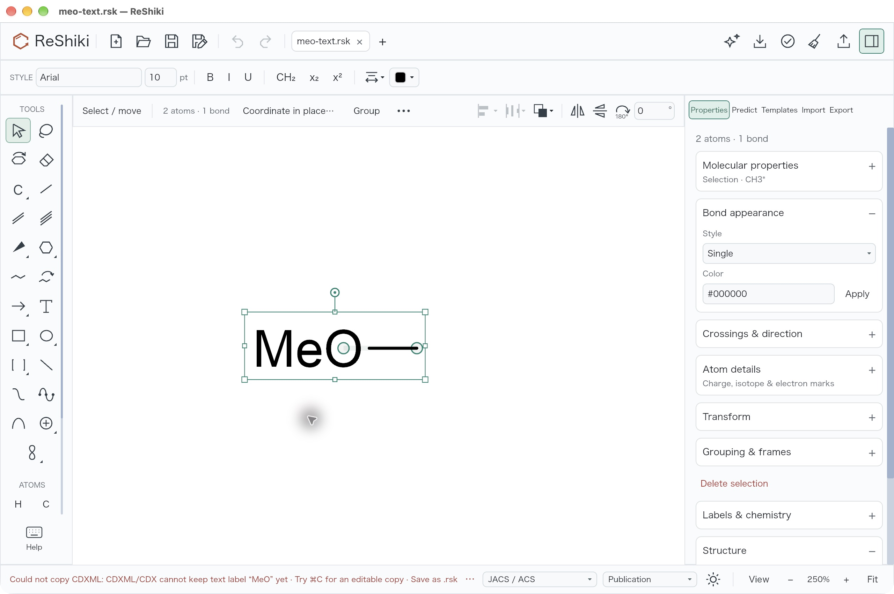
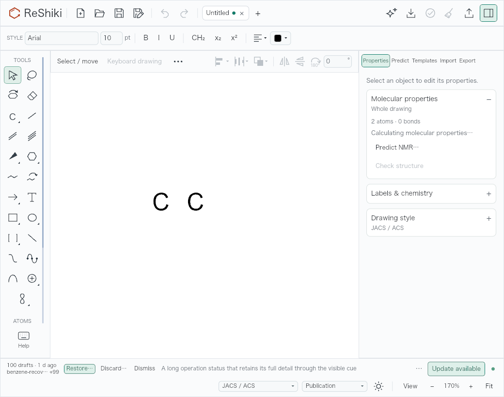
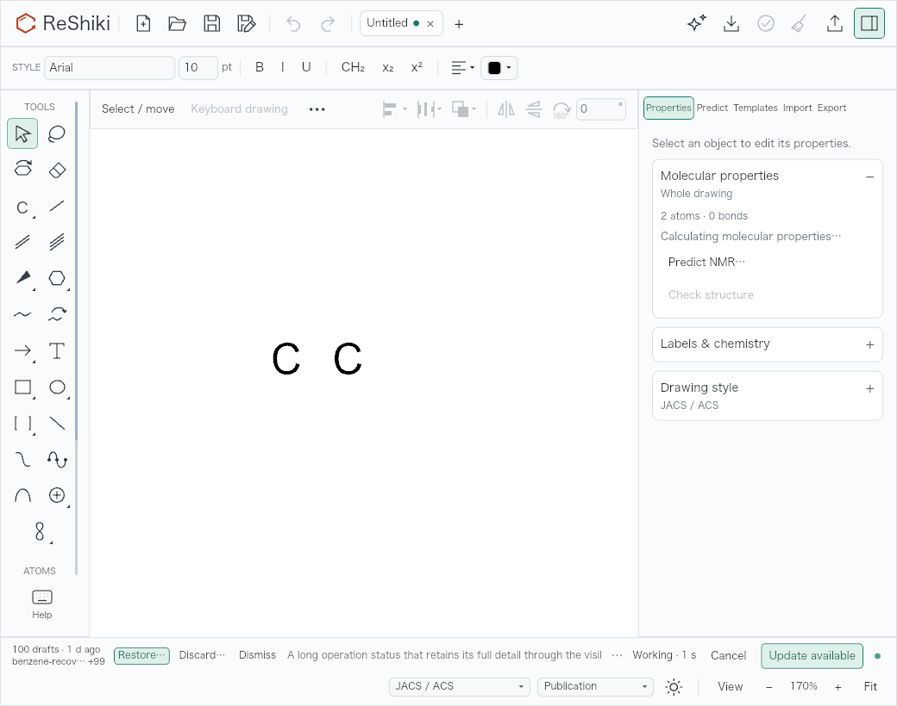
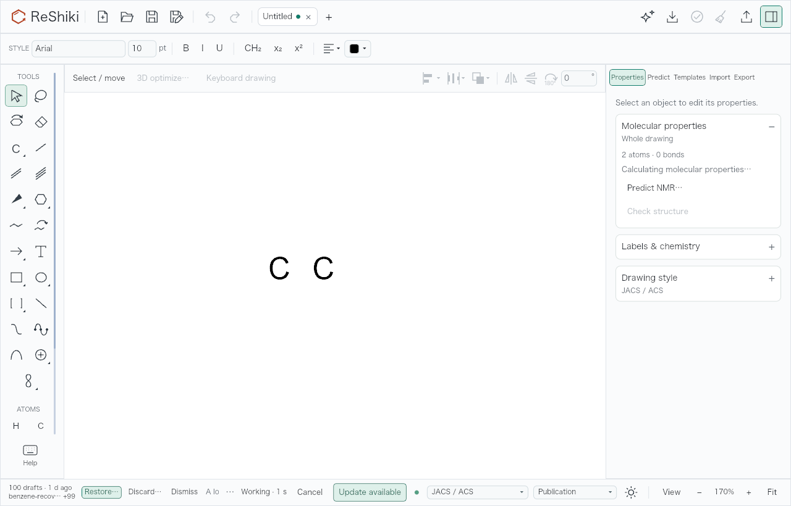
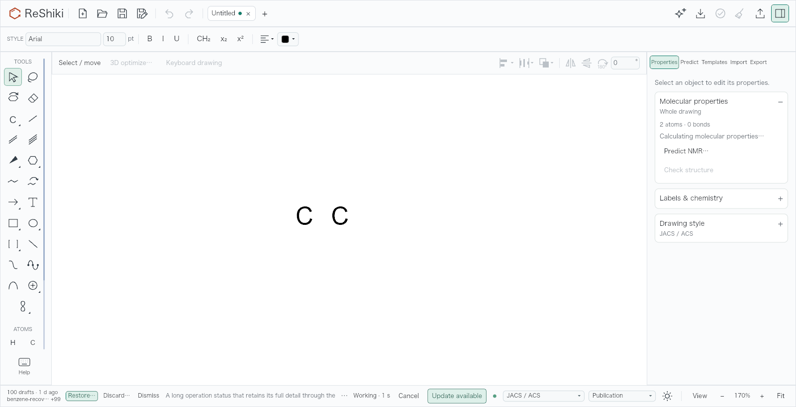

# Copy as identifies unsupported text labels

Strict CDXML/CDX export now names the first free text label that it cannot keep,
and counts any additional labels. A label such as `MeO` is reported as an
unsupported feature, without describing the drawing as invalid or mentioning
ring curves that are absent. Inner ring curves have a separate refusal.

The Copy as refusal suggests **⌘C** on macOS or **Ctrl+C** elsewhere for an
editable copy, and native `.rsk` to keep the complete drawing. Ordinary Copy
retains its existing editable-label conversion and possible picture fallback.
Strict Copy as and file export continue to refuse the unsupported content;
failed Copy as conversion leaves the clipboard unchanged.

Long or multiline status messages now have a visible **…** cue beside the text.
It sits outside the clipped status area, so the drawing-style controls cannot
hide it. Hover over the text or the cue to read the full message.

This addresses [#499](https://github.com/Ameyanagi/ReShiki/issues/499).

## Reproduce

Open [meo-text.rsk](../../tests/fixtures/qa-export-feedback/meo-text.rsk), select
both atoms and right-click → **Copy as → CDXML**. The fixture is ethane with the
left endpoint changed to a literal `MeO` text label on a dummy atom. It contains
no ring curves. This is the same drawing produced by importing `CC`, editing the
left atom, entering `MeO`, choosing **Text label (dummy atom)** and applying.

The refusal names `MeO` and suggests ordinary Copy. Hover over the **…** beside
the status text for the complete explanation. **Copy as → CDX** and strict
CDXML/CDX file conversion use the same unsupported-feature guard.

## Matched native desktop evidence

Before uses `3d80590a`; after uses the implementation at `7979a5c4`.
Both debug applications ran on macOS 27.0.1 (26A434), Apple M1,
`aarch64-apple-darwin`, with separate application bundles and isolated data
directories, on 2026-10-25. Each capture uses the same fixture, selected two atoms, native
**Copy as → CDXML** menu action, 1280 × 852 logical-pixel window, 2× display
scale, 250% canvas zoom, Arial 10 pt, JACS / ACS and Publication colors.
Keyboard drawing was turned off with **F8**, **⌘A** selected both atoms, and
right-clicking the bond opened **Copy as → CDXML**. The after hover capture
places the pointer over the visible status ellipsis.

The images are original 2560 × 1704 JPEG window captures, without cropping,
resizing or retouching. Selection handles remain because the selected drawing
and Copy as operation are the subject. Open the images at full size to inspect
the status line.

Before, the status calls the drawing invalid, combines two possible causes
and loses the advice beyond the drawing-style controls:


After, the status names `MeO`, includes **Try ⌘C for an editable copy**, and
retains a visible **…** beside the clipped line:



Hovering that cue shows the complete refusal, including **Save as .rsk keeps
everything** and **Clipboard unchanged**. The drawing and selection remain in
place, and Undo remains disabled:


The interaction check covers the macOS menu and hover path. It does not claim a
new ChemDraw round trip, native Windows/Linux interaction coverage or an M4
performance measurement.

Capture receipt (SHA-256):

- Before executable: `b02b0ce7571b30f20105728b5650aba88e4c619030094f985f1c1c2e0c1102c5`.
- After executable: `55e20a28d3f2ba29271113e05f9881c102f5dc7b941193ad78562bede49b6ae3`.
- Before image: `2ebe2034807df027096a506e107235715b9bbc8590d6cae72f6e08d4087c432c`.
- After image: `09c41217c174f2a951657c5941dd1daaf15ae187ec49240d3e9421a0f73a0565`.
- Full-message image: `363eacfedfb5e90943182721ce159646698a1032e0ab283e7fa493f323c1f19a`.

## Verification

Base: `3d80590a`; implementation: `7979a5c4`.

- Four focused IO tests cover separate text-label and ring-curve refusals,
  Unicode excerpt bounds, quote/whitespace/bidi sanitization, additional-label
  counts, unchanged source drawings, ordinary Copy retaining the label, and
  malformed drawings retaining their Invalid classification.
- The actual asynchronous Copy as path is checked for both CDXML and CDX.
  It preserves the document and Undo history, adds the platform's ordinary Copy
  shortcut and returns without a clipboard publication task. All 18 application
  clipboard tests pass, including stale selection/revision/tab handling.
- The application renderer measures the cue at 1040, 1280 and 1600 pixels wide.
  It remains outside the message's clipped bounds and inside the status bar.
  Short messages omit the cue; multiline notices retain it.
- Focused IO Clippy including tests, the native debug build, and the normal
  workspace Clippy and format commit hooks pass.
- Native CLI conversion of the same fixture to CDXML exits with the specific
  unsupported-label message and no output data. Its generic “Try Copy” advice
  names the command; the application adds the platform shortcut for Copy as.

```sh
export CARGO_BUILD_JOBS=2
cargo test --locked -p reshiki-io --lib exchange::drawing::tests
cargo test --locked -p reshiki --bin reshiki app::clipboard::tests -- --test-threads=1
cargo test --locked -p reshiki --bin reshiki long_status_keeps_its_full_message_cue_outside_the_clipped_text -- --ignored
```

## Combined footer layout check

The footer reserves its notification row before delayed progress appears.
Below 1280 logical pixels wide, document style, color, View and zoom controls
occupy a second row. At 1280 and 1600 pixels they retain a single row. Row count
depends on window width, so showing progress or update controls does not resize
the canvas.

A combined QA working tree on `3d80590a` includes this change, the recovery
review controls from #491 and delayed engine progress/Cancel from #508. The
application's real headless renderer produced the following original PNGs on
the same M1 host, at 1× scale and 820 logical pixels high. These are renderer
captures, separate from the native menu/hover evidence above. The scene has two
carbon atoms, camera center (11, 17), 170% zoom, 100 synthetic recovery
candidates, an available-update state, a saved-draft indicator and a multiline
status. Engine progress and the update result are supplied by the test without
launching a worker or making a network request.

At 1040 pixels, the status, recovery and update controls occupy the first row;
View, zoom and Fit remain fully visible in the second row before progress:



When Working · 1 s and Cancel appear, both rows keep the same position:



The combined recovery, update and progress controls fit a single row at 1280:



The 1600-pixel layout also remains a single row:



The combined check measures the complete visible bounds of Restore, Discard,
Dismiss, Update, Cancel, View, zoom out/in and Fit. It also checks the full-status
cue. At each width, recovery and update are independently on/off and elapsed
progress changes from 0 to 1 to 4 seconds: all 36 states pass. Footer bounds,
Fit bounds, canvas viewport, camera center and zoom stay identical across those
progress transitions.

| Window width | Footer height | Fit horizontal bounds | Right margin |
| ------------ | ------------- | --------------------- | ------------ |
| 1040         | 80            | 992.796–1026          | 14           |
| 1280         | 44            | 1232.796–1266         | 14           |
| 1600         | 44            | 1552.796–1586         | 14           |

The permanent opt-in status test additionally covers both sides of the width
breakpoint (1279 and 1280), short/long/multiline notices, and recovery/update
combinations. It verifies unchanged footer height and Fit position as those
notifications change, plus complete visible bounds for the View/zoom/Fit and
Update controls. These checks supplement native interaction evidence; they do
not establish external ChemDraw import behavior or add supported interchange
features.

Release-note caption: **Copy as names unsupported text labels, points to ordinary
Copy and exposes the full refusal behind a visible status cue.** Reuse the
matched native pair and full-message image above.
