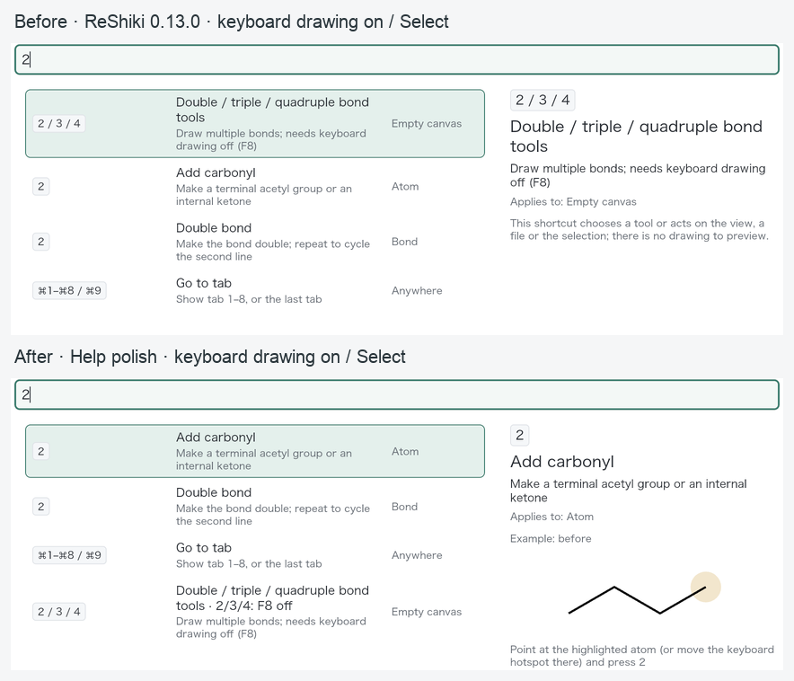
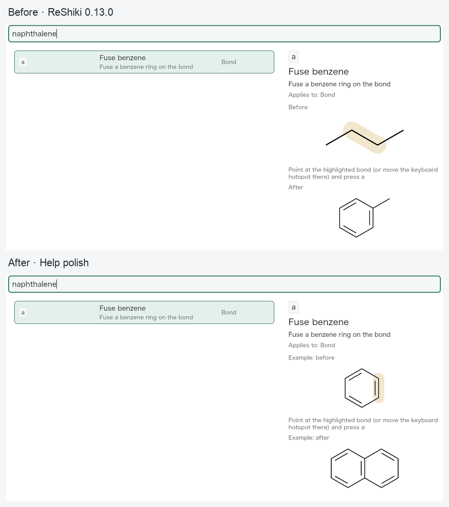
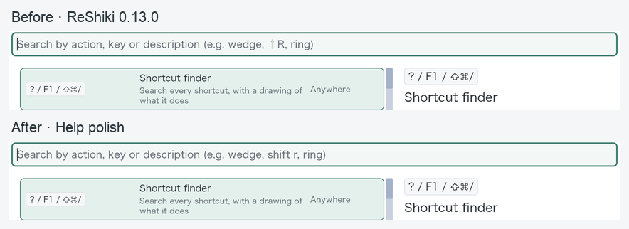
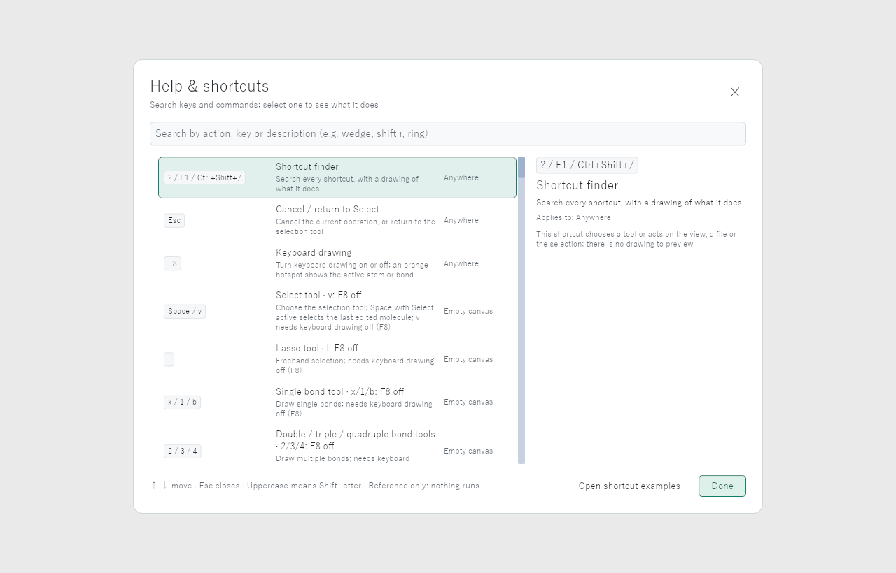

# Help ranking and example QA

This record covers #546, #547 and #549. The production baseline is ReShiki
0.13.0, `3d80590a`; the implementation head is `fde8d312`. Release-note and
contributor entries are maintained separately.

## Mode-aware lookup

Help keeps text-match score first. With keyboard drawing enabled and Select or
Lasso active, an available mapping wins an equal-score tie over a classic
empty-canvas mapping. The mode comes from the tab's stored enabled state and
current tool, so opening Help does not falsely turn it off. An empty query
retains registry order. Keyboard drawing off, or another drawing tool active,
retains the original tie-break. The command palette's text scoring is unchanged.

Eight classic tool rows now carry explicit per-key metadata and an F8-off note
when relevant. Mixed rows identify only their restricted keys: v in the Select
row and Shift+E in the circled-plus/orbital row. Space and Shift+G remain available.



Release caption: Help ranks shortcuts for the current drawing mode first among
equally strong matches and identifies keys that need F8 off.

## Truthful fusion examples

Every contextual preview is labelled **Example: before** / **Example: after**.
The four ring-fusion rows use a benzene bond through the same `hotkeys::ring_edit`
operation that the canvas uses. The fixture's eligible double edge is vertical,
so the resulting fused system stays horizontal and readable in the short pane.
Other atom/bond examples retain their appropriate chain fixtures.

The benzene-fusion test verifies six atoms/six bonds before, ten atoms/eleven
bonds after, formula **C10H8**, and two perceived rings. A separate test checks
all four fusion rows produce a chemically valid bicyclic example. The existing
suite still verifies that every example changes its drawing.



Release caption: The fusion examples show a ring fused onto another ring;
searching naphthalene illustrates benzene becoming naphthalene.

## Written Shift example

The search placeholder now uses **shift r**, a spelling already supported by
Help search. This avoids requiring a modifier-symbol font in a plain text-input
placeholder and works with the word-based key labels on Windows and Linux.



Release caption: Help's search hint uses the readable, cross-platform spelling
shift r.

## Capture conditions and native input

The three boards are intact crops of actual macOS application screenshots,
with headings outside the screenshots. Both versions use a fresh isolated data
profile, blank tab, Select, keyboard drawing initially on, Arial 10 pt, JACS / ACS,
Publication, light canvas, 100% drawing zoom, and a 1280 × 852 pt window
(2560 × 1704 captured pixels). The Help panel itself uses its normal fixed text
sizes. Host: macOS 27.0.1 on Apple M1. The same crop and resize are used for each
before/after pair. All published boards were inspected for clipping and legibility.

Native checks on the candidate:

- F1 opens Help and focuses its search field.
- Typing `2` selects Add carbonyl; Down selects Double bond and Up returns.
- Replacing the query with `double` selects Double bond.
- `naphthalene` selects Fuse benzene and displays the labelled fused-ring pair.
- Escape closes Help; F8 disables keyboard drawing; reopening and searching `2`
  selects the classic multiple-bond tools row.
- Neither Help lookup nor navigation changes the blank drawing: Undo and Redo
  remain disabled. Both isolated QA apps were closed without dialogs afterward.

The baseline native app reproduced the original tools-first `2` ranking,
chain-based fusion example and symbol placeholder under the same conditions.

## Renderer checks and Windows evidence

`help_renderer_evidence` renders the actual Help widgets and live examples at
1280 × 820 and 1040 × 680. It writes empty, `2`, `double`, `naphthalene`, and
F8-off `2` states plus OS/font/backend metadata. Matched local captures use
macOS, Hiragino Sans and WGPU. For the baseline capture, only this renderer-only
test harness was copied into the unmodified `3d80590a` worktree; production
Help code was unchanged.

```sh
RESHIKI_HELP_QA_DIR=artifacts/qa-help-polish \
RESHIKI_DATA_DIR=artifacts/qa-help-polish-profile \
cargo test --locked --bin reshiki \
  app::help::tests::help_renderer_evidence -- --exact --ignored
```

The native Windows job in `checks.yml` runs the same scoped test with
`--no-default-features`, using the normal application renderer and its available
backend. [Checks run 40197759034](https://github.com/Ameyanagi/ReShiki/actions/runs/40197759034)
on `3a6f219f66298fdf58d225b4b4e6d025bf8174ec` produced the actual Windows
artifact `qa-help-polish-x86_64-pc-windows-msvc` (artifact ID `12601920085`).
The Windows capture and upload steps passed. The artifact contains ten PNGs
and the [renderer metadata](../images/qa-help-polish/windows-renderer-metadata.json):
**Windows, Yu Gothic, WGPU**, on `windows-2022`, target
`x86_64-pc-windows-msvc`.

All ten Windows images were reviewed at the two test sizes. The plain `shift r`
hint fits in the search field and the key chips use the Windows `Ctrl+Shift+/`
spelling. The `2` and `double` captures select the contextual mappings, F8-off
`2` keeps the classic tools first, and naphthalene shows the labelled fused-ring
example. The complete empty-state capture below preserves the original
1280 × 820 renderer pixels; it is not resized or retouched.



Release caption: Help uses the readable spelling shift r alongside Windows
word-based modifier chips.

These are Windows application-renderer captures, with no native Windows
operating-system input claim. Native desktop input is covered separately on
macOS above; the three matched before/after boards remain the macOS captures.

## Validation

- Help behavior suite: **12 passed**, with the opt-in renderer test run separately.
- Renderer harness: **one passed** locally per version and on Windows CI,
  producing ten images in each capture set.
- Existing command-palette suite: **30 passed**.
- The new benzene-fusion chemistry regression fails on the production baseline
  (four atoms/three bonds instead of the required benzene six/six) and passes
  on this branch.
- `cargo clippy --workspace --lib --bins --all-features --locked -- -D warnings`: passed.
- Native application build, Rust formatting and ordinary commit hooks: passed.

No Rust integration-test target or platform Python test-shard entry was added.
The Windows workflow addition is limited to this renderer capture and its pinned
artifact upload action.
