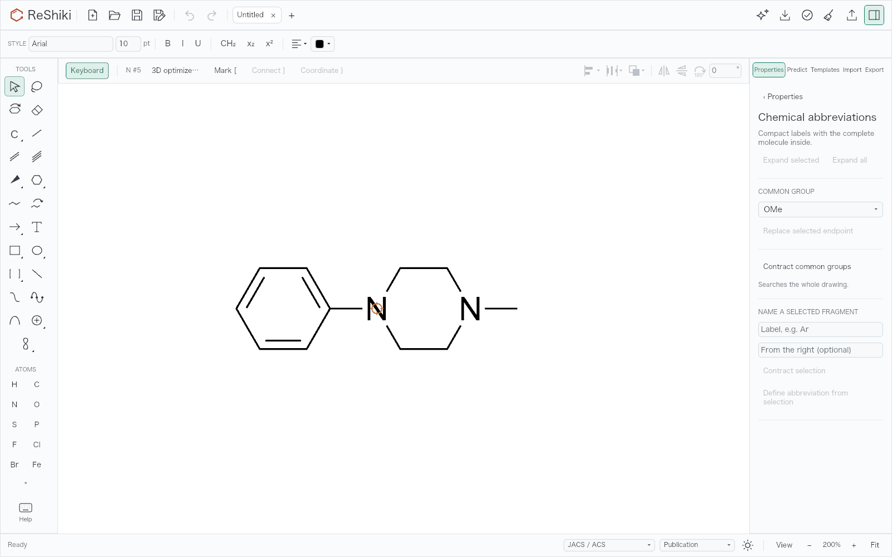
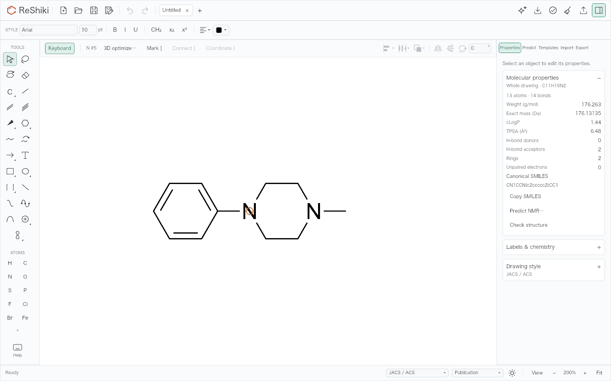
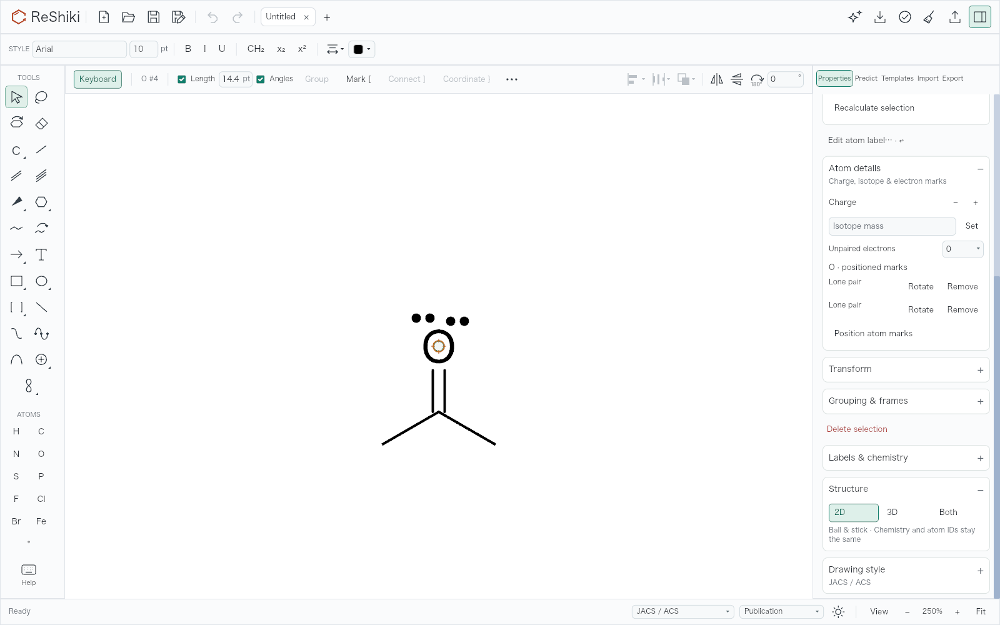
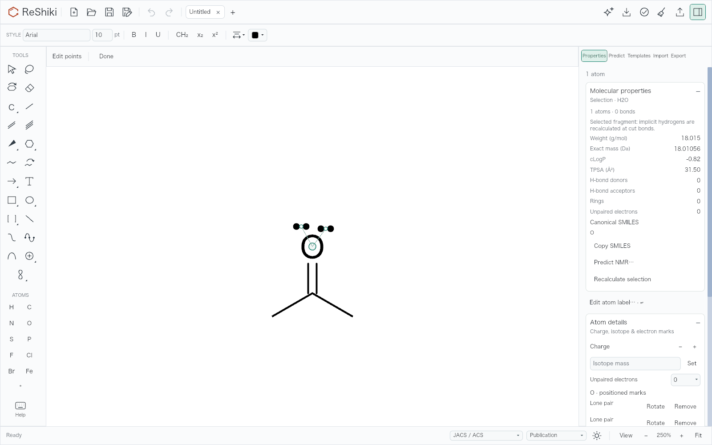
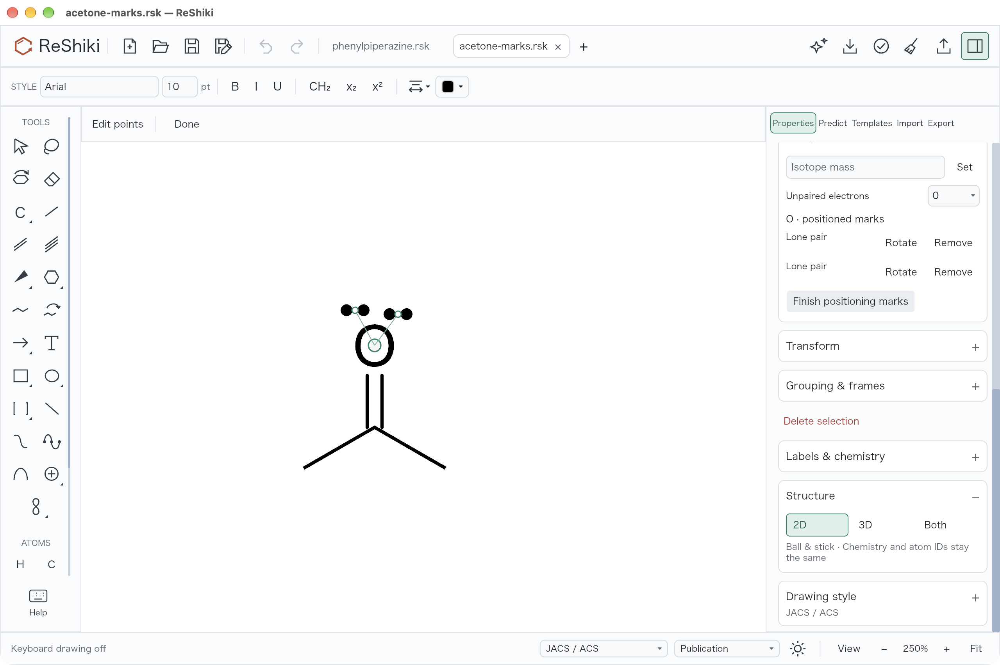
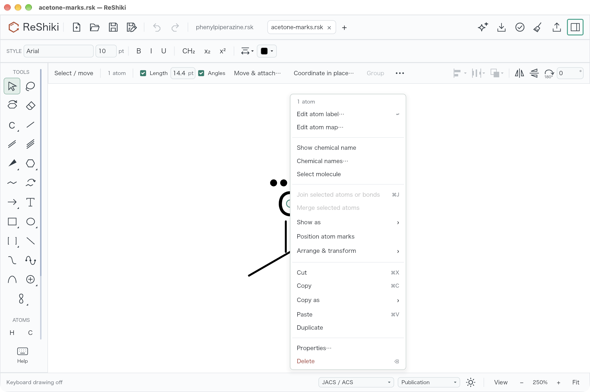

# Inspector page and atom-mark positioning QA

This change addresses [#533](https://github.com/Ameyanagi/ReShiki/issues/533) and
[#534](https://github.com/Ameyanagi/ReShiki/issues/534).

- Switching between open inspector pages preserves the drawing's position in
  the window, zoom, selection, and Fit preference. The adjustment accounts for
  viewport changes already made by selection or optimization handlers. A new
  drawing, background result, explicit Fit, or real window resize keeps its own
  camera behavior.
- **Position atom marks** retains the Properties scroll position when that page
  is already open. It still reveals Properties when the inspector is closed or
  another page is showing. Arrow and graphic tools keep their existing reveal
  behavior. Right-clicking a selected atom with positioned marks also offers
  **Position atom marks**.

## Matched renderer evidence

Baseline: `3d80590a41b9d9e8efd818d23395ac51bd264ca8`. Fixed production code:
`cdbe8d03`. Both runs use the same native documents, camera, selected atom,
fonts, drawing style, panel expansion state, scroll operation, and commands.
The captures come directly from the application's Iced/Metal renderer on
macOS 27.0.1, Apple M1, arm64, debug build, at **1600 × 1000 logical pixels and
scale factor 1**. No screenshot pixels were retouched.

The initial PNGs and the serialized documents are byte-identical between runs.
Each initial image is published once. SHA-256 prefixes are `94876889954778a7`
for the page example and `11780ddd5a4e9e2d` for the mark example.

### Switching pages

The input is the report's `CN1CCN(c2ccccc2)CC1`, imported through the real engine,
at 200% zoom. Open Chemical abbreviations, then return to Properties. The
inspector grows from 256 to 300 points. A reference atom at canvas-local
`(320, 404)` moves to `(298, 404)` on the baseline and stays at `(320, 404)` after
the fix. The canvas's left edge is unchanged, so these are respectively a
22-point and zero-point displacement in the window. Zoom stays at 200%.






### Positioning atom marks

The input is acetone, `CC(C)=O`, with two explicit lone pairs attached to oxygen,
at 250% zoom. Oxygen is selected, Molecular properties is expanded and contains
the actual calculated fragment properties, and Properties is scrolled to its
atom-mark rows. The harness locates the rendered **Position atom marks** text,
presses and releases the actual button with pointer events, and executes the
widget operations returned by the application.

On the baseline, the button changes to **Finish positioning marks** but moves
from `y = 526.4` to `y = 981.4`, outside the panel's visible content. After the
fix it stays visible at `y = 526.4`. Both runs enter Edit points at 250% zoom.






## Inputs and validation

The native fixtures are
[phenylpiperazine](../../tests/fixtures/inspector-motion/phenylpiperazine.rsk) and
[acetone with marks](../../tests/fixtures/inspector-motion/acetone-marks.rsk).
The opt-in
[renderer harness](../../src/app/workspace/inspector_motion_qa.rs) reproduces both
inputs through the real SMILES importer and the public attached-mark operation.
It writes the native files, screenshots, and numeric receipts to its output
directory.

```sh
RESHIKI_DATA_DIR=/tmp/reshiki-inspector-motion-data \
RESHIKI_QA_INSPECTOR_OUTPUT=/tmp/reshiki-inspector-motion-output \
cargo test -p reshiki --bin reshiki --locked \
  app::workspace::inspector_motion_qa::inspector_motion_renderer_evidence \
  -- --ignored --exact --nocapture
```

For the baseline, the same self-contained test file and its `cfg(test)` module
declaration were temporarily added with `RESHIKI_QA_INSPECTOR_BASELINE=1`.
Cleanup restored both files and verified a clean baseline worktree.

The six new motion regressions check all 13 × 13 inspector page pairs at 50%,
200%, and 250% zoom, same-page scroll retention and other-page reveal, nested
context commands, existing optimization compensation, intentional camera
changes, file opening, background results, subsequent Fit, and real resize.
The marked-atom menu test checks both availability and dispatch without editing
the document or adding history. All 87 new and related context-menu, selection,
optimization, and NMR tests passed, along with the matched renderer test in both
worktrees. Binary/test Clippy, normal commit hooks, native build, formatting,
and the documentation tree/Astro checks also passed.

## Native desktop interaction

The fixed debug app used an isolated `RESHIKI_DATA_DIR` on the same M1/macOS
27.0.1 host. The native window was **1280 × 852 points**, including its title
bar; macOS `screencapture` saved **2560 × 1704 Retina PNGs**. These are supplemental
desktop examples; the matched baseline/fixed comparisons are the renderer
captures above. The native session turned keyboard drawing off with F8.

- Open phenylpiperazine, run `zoom 200` from the `:` command palette, expand
  Labels & chemistry, and open Chemical abbreviations. Returning through
  **‹ Properties** preserves the drawing's position and 200% zoom.
- Open marked acetone, select oxygen, set `zoom 250`, expand Molecular
  properties, and scroll to the lone-pair rows. Clicking **Position atom marks**
  enters Edit points while the two lone-pair rows and **Finish positioning
  marks** remain visible in the same position. Finish returns to Select.
- Close the inspector, right-click oxygen, and choose **Position atom marks**.
  The command is present, closes the menu, starts Edit points, and opens
  Properties at the top as intended for a newly revealed panel.

The title stayed unedited and Undo stayed disabled throughout these controls.
The disposable app exited with no dialog or pending process.





Reusable release caption: **Inspector page changes keep your drawing in place;
positioning atom marks keeps its controls visible and is available from the
atom's context menu.**
