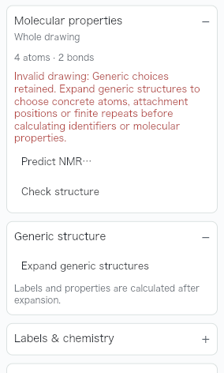
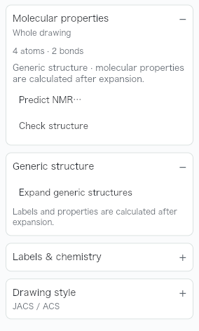
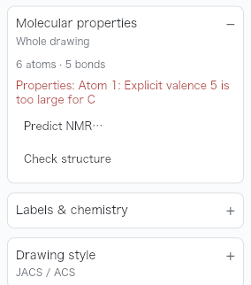
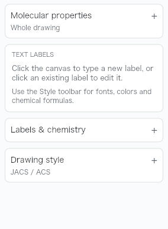
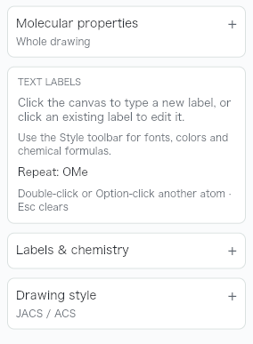
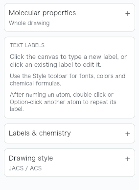
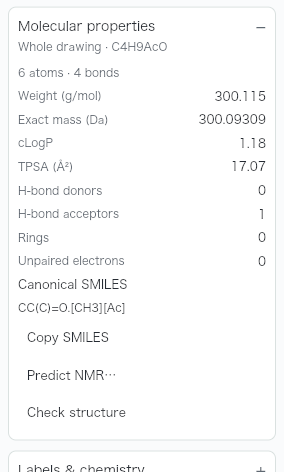
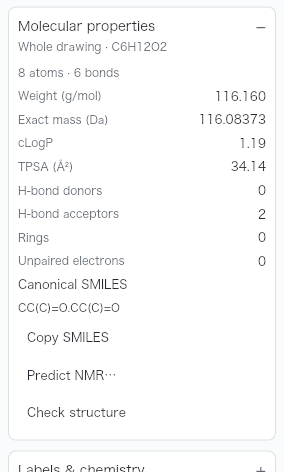

# Repeat labels with their meaning and read accurate property feedback

The Text tool shows its remembered label and the double-click and Option/Alt-click
gestures in **TEXT LABELS**. Escape or a tool change clears the memory; the panel
then shows a short repeat tip.

Repeating now keeps the committed meaning as well as the spelling. Chemical Ac
remains acetyl, a literal text label remains text, and ordinary element entry
remains elemental. A group's canonical label and optional reverse spelling travel
with it; the new atom keeps its own font and alignment. Identical characters with
a different meaning can be replaced correctly. A matching label still opens for
editing, and each applied repeat remains one Undo step.

Molecular properties explains valid generic choices with a neutral note instead
of a red “Invalid drawing” paragraph. This presentation applies only to the
engine's specific deferred-generic result. Other errors retain their warning
appearance, and an ordinary selected molecule beside generic content still
calculates normally.

Chemical edits now say **Drawing changed**. The status no longer asks users to
refresh properties that already refresh automatically, and property completion
does not replace newer feedback.

This addresses [#502](https://github.com/Ameyanagi/ReShiki/issues/502),
[#503](https://github.com/Ameyanagi/ReShiki/issues/503) and
[#505](https://github.com/Ameyanagi/ReShiki/issues/505), including the adjacent
repeat-mode defect discovered while checking the remembered-label display.

## Generic choices and real errors

Before:



After:



The explicit recalculation reached by the panel's **Check structure** button
uses the same neutral presentation. A deliberately invalid five-bond carbon
still produces a red valence error:



## Remembered label and gestures

Before, after committing OMe with the Text tool:



After:



After Escape and returning to the Text tool, the remembered-label line is gone:



Switching to Bond and back clears it too:


## Repeating Ac preserves acetyl

The input has one acetone drawn as `—COMe` and a separate ethane. Rename COMe to
Ac in its existing Chemical abbreviation mode, then repeat that label on the
ethane endpoint. Before, the new Ac was actinium; after, it is the acetyl group.
The labels alone look alike, so the property comparison and native drawing data
are part of the evidence. The original result is C4H9AcO, mass 300.115 and SMILES
`CC(C)=O.[CH3][Ac]`; the corrected result is C6H12O2, mass 116.160 and SMILES
`CC(C)=O.CC(C)=O`.

Before:



After:



The complete renderer outputs are available for the
[before drawing and properties](../images/qa-label-feedback/before-acetyl-overview.png)
and [after drawing and properties](../images/qa-label-feedback/after-acetyl-overview.png).
The [input](../../tests/fixtures/qa-label-feedback/acetyl-repeat.rsk),
[before result](../../tests/fixtures/qa-label-feedback/before-acetyl-repeat.rsk)
and [after result](../../tests/fixtures/qa-label-feedback/after-acetyl-repeat.rsk)
retain the actual atom and group data for inspection.

## Status after automatic property refresh

Both [before](../images/qa-label-feedback/before-status-overview.png) and
[after](../images/qa-label-feedback/after-status-overview.png) show the freshly
calculated C4H9NO formula, mass 87.122 and SMILES `CC(=O)N(C)C` for the CONMe2
endpoint. The status now agrees with that result.

Before:


After:


## Inputs and capture conditions

Before uses `main` at `3d80590a`; after uses source commit `488e2e50`. Both ran
the same opt-in `feedback_layout_and_visual_evidence` harness, with only that
visual test module added to the before build. These are actual Iced/wgpu
application-renderer PNGs, captured on macOS arm64 at 1280 × 820 logical pixels,
1× scale, 200% zoom, light chrome, JACS / ACS style and Publication colors.
Keyboard drawing and the grid are off. Matching pairs use identical inputs,
operations and framing. Published crops have not been resized or retouched.

- [generic-lists.rsk](../../tests/fixtures/qa-label-feedback/generic-lists.rsk)
  contains two ethane bonds with `[Cl,Br,I]` lists at opposite endpoints. Clear
  the selection and expand Molecular properties. The test obtains the actual
  engine error and repeats the same property recalculation.
- [invalid-valence.rsk](../../tests/fixtures/qa-label-feedback/invalid-valence.rsk)
  deliberately gives carbon five single bonds to fluorine to verify the warning
  presentation. It is a validation fixture, not a proposed chemical structure.
- [ethane.rsk](../../tests/fixtures/qa-label-feedback/ethane.rsk) is the input for
  the repeat help and CONMe2 status examples. With the Text tool, edit the right
  carbon to OMe and Apply. Read TEXT LABELS, press Escape and return to Text, or
  switch to Bond and back. For the status example, use Select, edit the endpoint
  to CONMe2, deselect and open Molecular properties.
- [dimethylacetamide.rsk](../../tests/fixtures/qa-label-feedback/dimethylacetamide.rsk)
  is the resulting C4H9NO drawing used in the status comparison.
- [acetyl-repeat.rsk](../../tests/fixtures/qa-label-feedback/acetyl-repeat.rsk)
  supports the chemical-meaning regression described above. The before and after
  result files expose the differing atom/group records as well as the drawing.

The tests use actual engine results, measure visible text, and check rendered
pixels to distinguish the neutral generic note from warning-red valence text.
They also verify selected ordinary molecules in a mixed generic drawing,
repeated literal/group/element meanings, automatic Ac as an element when
explicitly requested, generic-list retention, custom reverse spelling, target
alignment and Undo. A delayed property result preserves newer status feedback.

```sh
cargo test --locked -p reshiki --bin reshiki app::atom_text
cargo test --locked -p reshiki --bin reshiki app::inspector -- --include-ignored --skip inspector_workloads --test-threads=1
cargo test --locked -p reshiki --bin reshiki app::transaction_tests
```

The skipped inspector workload is a separate opt-in release benchmark. Set
`RESHIKI_LABEL_FEEDBACK_QA_DIR` to a scratch directory to regenerate full PNGs
and fixtures with the inspector command. For the matched base, add only the
same visual test module to `3d80590a` and set
`RESHIKI_LABEL_FEEDBACK_QA_BASELINE=1`.

## Native interaction check

The isolated macOS arm64 debug app built from `488e2e50` was checked with the
actual desktop pointer and keyboard. Its 1280 × 852-point window was captured at
2× scale, with light chrome, JACS / ACS style, Publication colors and keyboard
drawing off. Native views used 230% zoom for the generic input and 250% for the
Ac and CONMe2 inputs, rather than the matched renderer's 200%.

1. Open `generic-lists.rsk` and click the panel's **Check structure** button.
   The specific deferred-generic result remains neutral before and after the
   click. The [native property card](../images/qa-label-feedback/native-generic-properties.png)
   records the result after that explicit action.
2. Open `acetyl-repeat.rsk`, choose Text, click the existing COMe label, replace
   it with Ac and Apply. **Repeat: Ac** and the double-click / Option-click
   instructions appear. Double-click the right endpoint of the separate ethane.
   Properties reports **C6H12O2, 8 atoms, 6 bonds, mass 116.160** and SMILES
   `CC(C)=O.CC(C)=O`; the [native property card](../images/qa-label-feedback/native-acetyl-repeat.png)
   confirms chemical acetyl. One ⌘Z removes just that repeat and restores the
   source acetone plus ethane, **C5H12O, 6 atoms, 4 bonds, mass 88.150**.
3. Press Escape and return to Text: **Repeat: Ac** is gone and the empty-memory
   tip is visible. Rename the source back to COMe and Apply: **Repeat: COMe**
   appears. Switch to Bond and back to Text: that remembered line is gone too.
4. Open `ethane.rsk`, edit its right endpoint to CONMe2 with Text and Apply,
   then choose Select and deselect. Without clicking Check structure or Check
   drawing, the panel reports **C4H9NO, mass 87.122** and SMILES `CC(=O)N(C)C`,
   while the status remains **Drawing changed**. The [native window capture](../images/qa-label-feedback/native-changed-status.png)
   shows the drawing, refreshed properties and status together.

The native images are app-only screenshots and unresized crops of those
screenshots. The desktop app was closed after the check. The matched renderer
images above provide the before/after comparison; the native records verify the
actual interaction.

Release-note caption: **See the label the Text tool will repeat, keep its
chemical meaning, and read clear feedback for generic and refreshed drawings.**
Reuse the remembered-OMe, Ac property and generic-note images above.
