# 3D model commands and feedback QA

This change addresses [#512](https://github.com/Ameyanagi/ReShiki/issues/512),
[#518](https://github.com/Ameyanagi/ReShiki/issues/518),
[#519](https://github.com/Ameyanagi/ReShiki/issues/519), and
[#524](https://github.com/Ameyanagi/ReShiki/issues/524).

- A blocked `scale 150` query offers **Show as 2D drawing** immediately below the
  scale command. Press Down, then Return to choose it; run the scale query again.
  Each edit has its own Undo step.
- Showing a stored or newly generated model reveals its bounds if they are
  clipped. Both includes the drawing, model, and associated caption. A result
  that already fits leaves the camera alone; revealing never zooms in.
- A generation taking at least one second shows elapsed seconds on its target
  molecule. Escape cancels the native job without changing the drawing. An open
  menu or editor receives Escape first; the generation can also be cancelled
  after selecting another molecule. Stale results cannot apply after cancellation.
- A molecule shown only in 3D has **3D model controls…** at the top of Properties.
  One click opens Style, Look, Hydrogens, and the other model controls, including
  when the model section was previously collapsed. **All properties** returns
  to the ordinary section order. The ordinary 2D and Both views keep their order.

## Matched renderer evidence

Baseline: `3d80590a41b9d9e8efd818d23395ac51bd264ca8`. Fixed code:
`66adffe5`. Both use the same saved inputs, camera before the command, stored
model poses, fonts, drawing style, and operations. These PNGs come directly from
the application's Iced/Metal renderer on macOS 27.0.1, Apple M1, arm64, debug
build, at **1600 × 1000 logical pixels and scale factor 1**. No screenshot pixels
were retouched. Handles and selection markers are present because these are
selection and control examples.

The original reports used an M4 and the release build; these captures establish
behavior and layout rather than a cross-machine performance comparison.

### Scale recovery

The same selected caffeine model and caption, at 200% zoom, after entering
`scale 150` and pressing Return. The unavailable row retains its explanation;
the fixed palette adds the explicit recovery action.

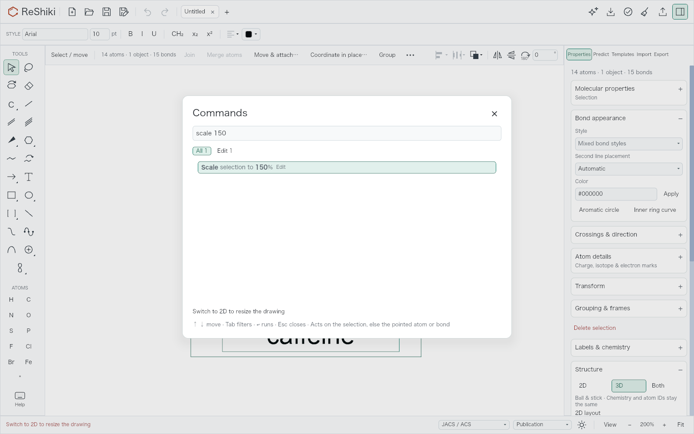

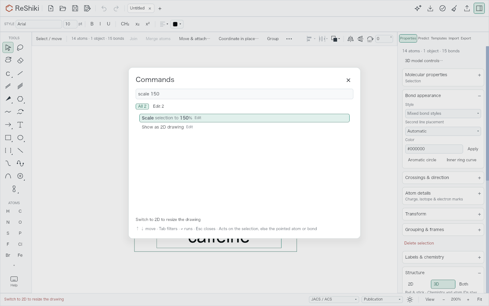

### Reveal the model

The same aspirin input and initial 250% camera, followed by **Show as 2D and 3D**.
The baseline model and caption extend beyond the visible paper. The fixed view
centers the complete result and reduces zoom to about 225%. Saved document and
selection traces are identical between runs; only the camera differs.

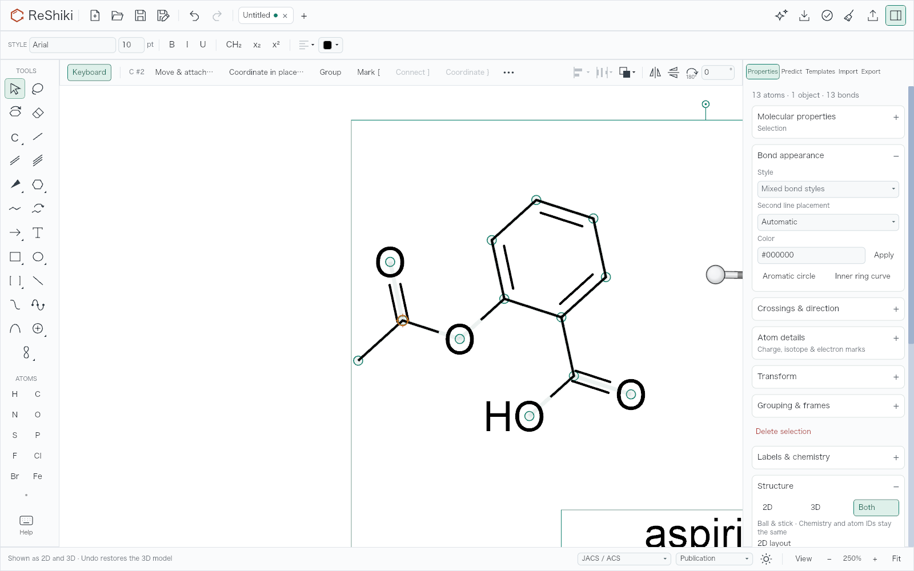

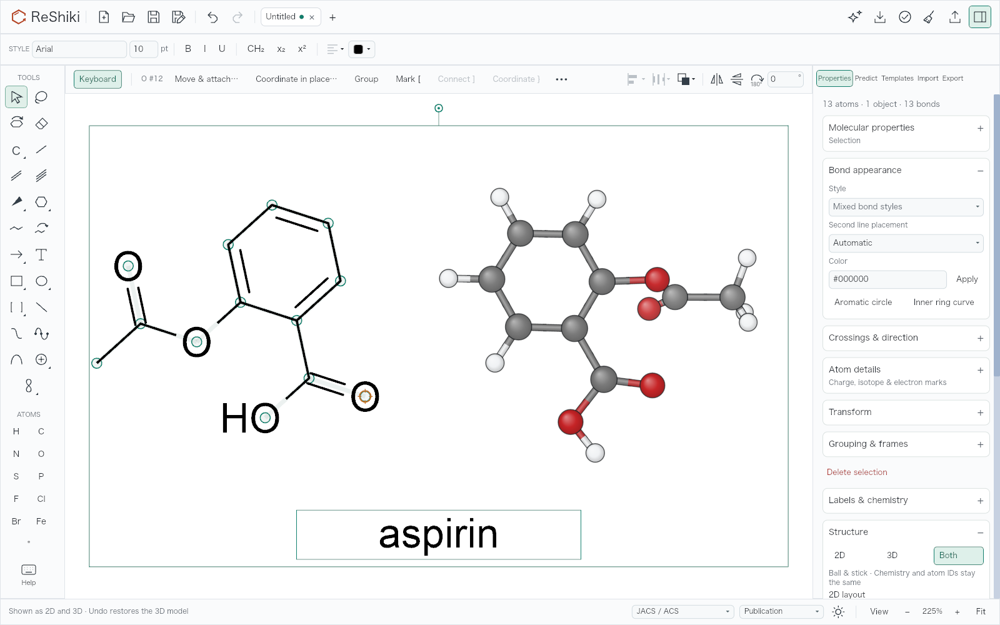

### Reach the controls

The selected caffeine model and its caption, at 200%. The model section was
explicitly remembered as collapsed in both captures. The baseline Style buttons
are below the fold. The fixed Properties view has a link at the top; activating
that actual control opens the focused view with Style visible after one click.

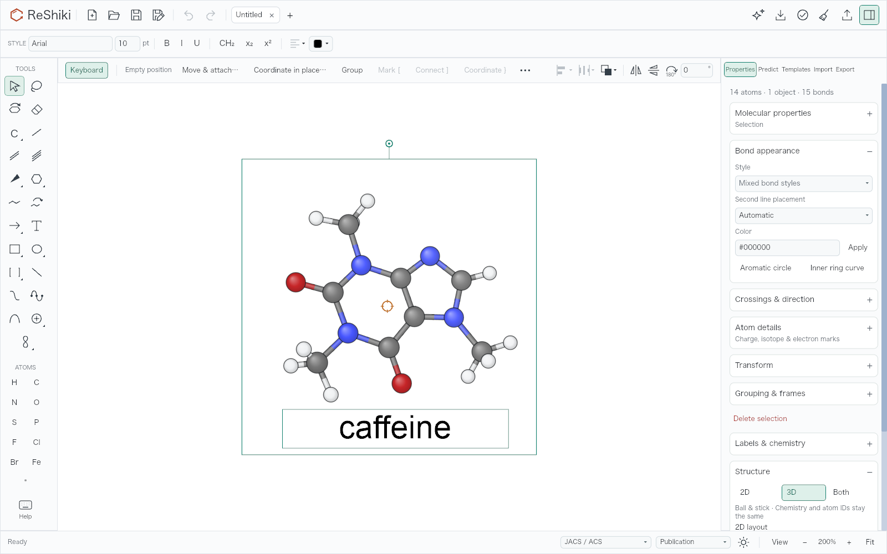

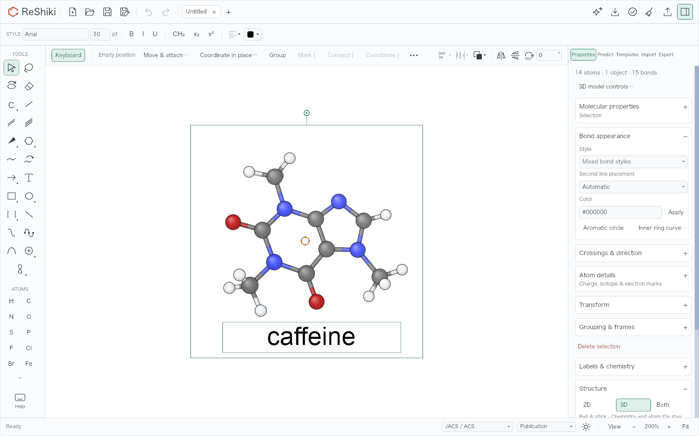

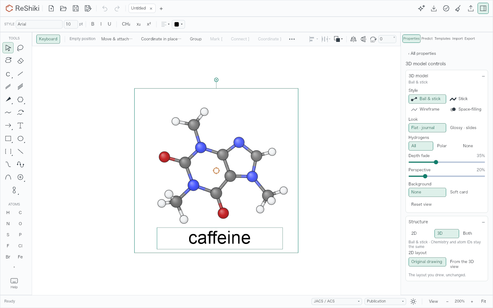

The following controls are byte-identical in the baseline and fixed runs: the
entire 2D PNG has SHA-256 prefix `a25e4630551558ff`; the Both PNG has prefix
`a29aaed2b40696c1`. Each is published once.

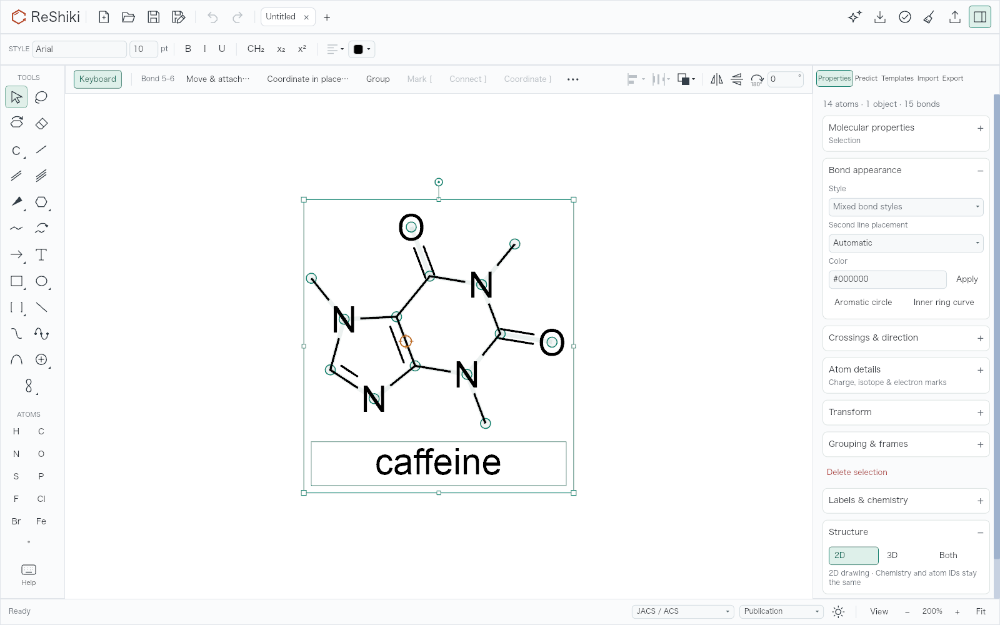

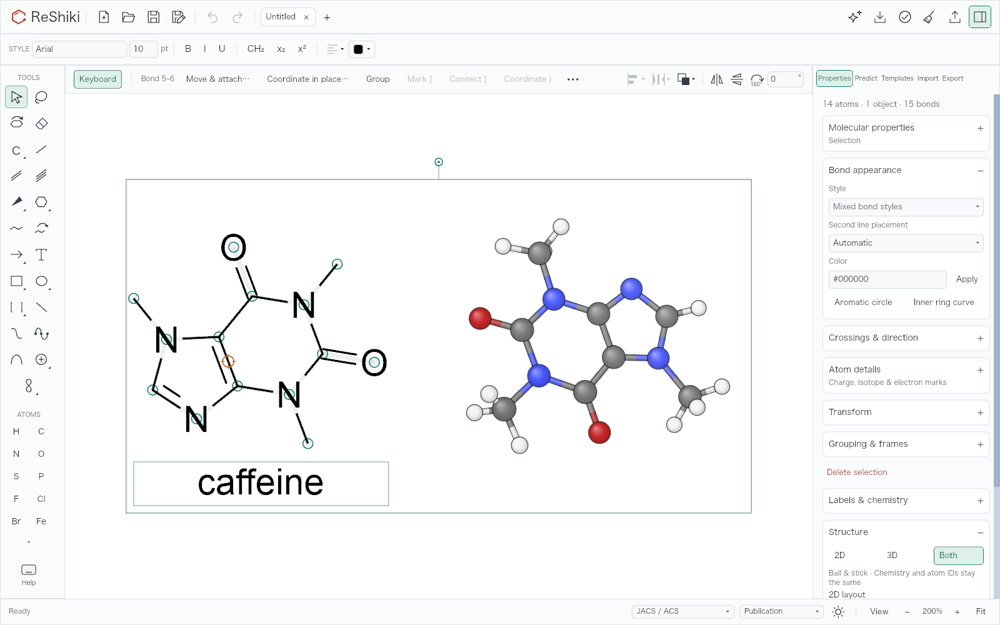

## Inputs and reproduction

The native fixtures are
[caffeine](../../tests/fixtures/models3d/controls/caffeine.rsk),
[aspirin](../../tests/fixtures/models3d/controls/aspirin.rsk), and
[paclitaxel](../../tests/fixtures/models3d/controls/paclitaxel.rsk).
[The fixture generator](../../crates/io/examples/model_controls_qa.rs) uses the
real SMILES importer, checks the resulting formulas, and generates the stored
caffeine and aspirin conformers through the native geometry worker. Paclitaxel
is saved in 2D so its first Show as command exercises actual generation.

The renderer harness is
[model_controls_qa.rs](../../src/app/workspace/model_controls_qa.rs). It also checks
that the model controls link is visible and activates, that Style is on screen
after activation, and that the Both result fits only after the fix.

```sh
RESHIKI_DATA_DIR=/tmp/reshiki-model-controls-render-data \
RESHIKI_QA_MODEL_INPUTS="$PWD/tests/fixtures/models3d/controls" \
RESHIKI_QA_MODEL_OUTPUT=/tmp/reshiki-model-controls-render-output \
cargo test -p reshiki --bin reshiki --locked \
  app::workspace::model_controls_qa::model_controls_renderer_evidence \
  -- --ignored --exact --nocapture
```

For the baseline, the same self-contained harness was temporarily added with
`RESHIKI_QA_MODELS_BASELINE=1`; cleanup restored both temporary files and verified
a clean baseline worktree.

## Native desktop interaction

The desktop checks used isolated baseline and fixed app bundles, separate empty
`RESHIKI_DATA_DIR` directories, the same saved fixtures, and the same M1/macOS
27.0.1 host. Window bounds were **1280 × 852 points**, including the native title
bar; the unmodified app-window captures are **2560 × 1704 PNGs** at Retina scale.
Native input was performed through the application, and window captures were
saved with macOS `screencapture`. No published pixels were edited.

For generation, open paclitaxel, turn keyboard drawing off with F8, select all,
set `zoom 150` in the command palette, then run **Show as 3D model**. A recorder
watched the app's actual geometry subprocess and took samples while that process
was alive. The following four-second baseline/fixed pair has the same input,
selection, 150% zoom, framing, style, and command. The baseline has only its
status-line message; the fixed canvas identifies the molecule, elapsed time, and
Escape action.

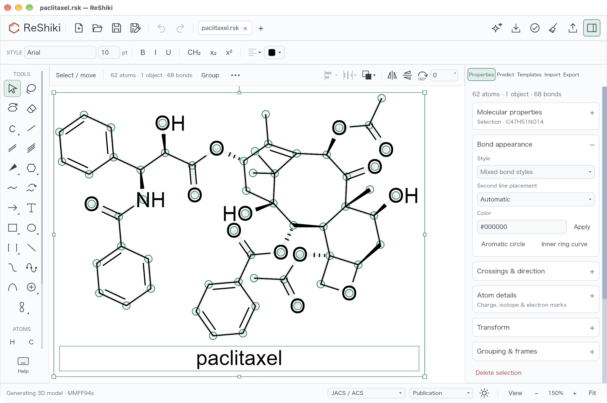

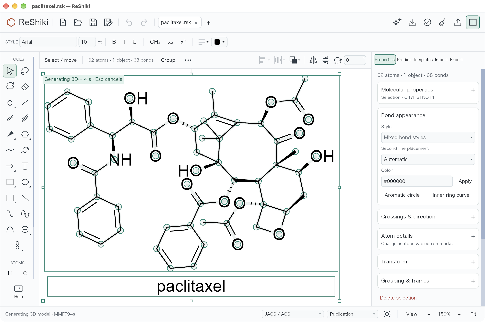

This additional one-second capture comes from a fresh retry at the same 150%
zoom. Its camera is slightly panned after Undo of an earlier completed model; it
is a timing example rather than the matched four-second comparison above. The
subprocess was observed alive in both the one- and four-second samples.

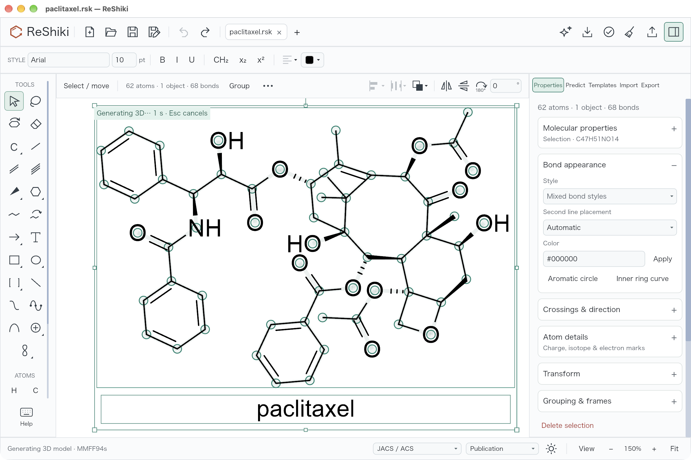

A separate native Escape run observed its geometry process alive in sample 0
and absent in samples 1–4. The application displayed **3D model cancelled ·
Drawing unchanged**, kept the original unedited 2D drawing, and added no Undo
step. Subsequent fresh generation still worked. This exercises actual task and
subprocess cancellation; the automated late-result test separately verifies
that a cancelled key cannot apply an already queued result.

The same desktop pass also verified:

- Caffeine and its caption: click **3D model controls…** once; Style, Look, and
  Hydrogens are immediately visible in the smaller native window.
- Caffeine: `scale 150`, Return, Down, Return runs the offered 2D switch; run
  `scale 150` again. The first Undo restores the unscaled 2D drawing, and the
  second restores the original 3D model with the document unedited.
- Aspirin: `zoom 250`, then **Show as 2D and 3D** reveals the drawing, model, and
  caption together. The smaller desktop paper needs about 160% zoom; this differs
  from the 225% result in the 1600 × 1000 renderer comparison.

## Automated checks

- Model UI tests: 33 passed, with two existing opt-in renderer tests excluded.
  Coverage includes stored and asynchronous reveal, rulers, a fitting 100%
  camera, pan without unnecessary zoom-out, Undo/Redo, selection changes during
  generation, the one-second feedback threshold, modal Escape precedence,
  cancellation, and late/stale results.
- Palette tests: 31 passed, including the available recovery row and two distinct
  Undo steps for switching display and scaling.
- Inspector tests: 17 passed, with two existing opt-in tests excluded. The new
  control action preserves document, revision, history, and other remembered
  section choices.
- Import tests: 18 passed after sharing the explicit-bounds reveal helper.
- Canvas redraw regression: passed. The elapsed indicator schedules one redraw
  per second and stops scheduling when no generation remains.
- Actual-renderer evidence test: passed for baseline and fixed code.
- `cargo build -p reshiki --bin reshiki --locked`: passed.
- `cargo clippy -p reshiki -p reshiki-io --all-targets --locked -- -D warnings`:
  passed. Normal commit hooks also passed workspace library/binary Clippy with
  all features and formatting.

Native cancellation uses the existing abort-on-drop task and disposable geometry
subprocess. Browser geometry still executes synchronously in-process; this change
does not make browser generation interruptible.

## Reusable captions

- **Scale recovery:** Switch back to the 2D drawing directly from a blocked scale
  command, then run the scale with its own Undo step.
- **Reveal:** Show as 3D or Both brings a clipped model into view while preserving
  a camera that already fits.
- **Generation:** Long native 3D generation shows elapsed time on the molecule;
  Escape cancels without changing the drawing.
- **Controls:** Reach a selected 3D model's Style, Look, and Hydrogens in one click
  from Properties.
