# Opening 3D faces, captioned frames and rotation hints

Opening or resetting a molecular model now chooses the proper principal-axis
rotation that follows its 2D drawing. A normal click on a model with its own
chemical-name caption exposes the model frame’s corner handles, and the caption
follows the frame throughout a resize. Selected shown models explain rotation,
roll and reset before the first drag.

This addresses [#569](https://github.com/Ameyanagi/ReShiki/issues/569),
[#570](https://github.com/Ameyanagi/ReShiki/issues/570) and
[#571](https://github.com/Ameyanagi/ReShiki/issues/571).

## Inputs and chemistry

The [native fixtures](../../tests/fixtures/model-face-handles/) were generated
through the application’s Name importer and native MMFF94s worker by
[the fixture example](../../examples/model_face_qa.rs). Caffeine is C8H10N4O2;
β-D-glucopyranose is C6H12O6 with five configured stereocentres. The
[analysis receipts](../../tests/fixtures/model-face-handles/chemistry-receipts.json)
record unchanged formula, mass, canonical isomeric SMILES, InChI and InChIKey
before and after adding the model. Atoms, bonds and conformer coordinates remain
unchanged. Camera face selection uses four proper rotations; it never reflects
coordinates or edits chemical stereochemistry. Crystal cell orientation and
saved custom rotations retain their existing behavior.

| Input             | Before / after formula | Before / after mass (g/mol) | Stored stereocentres |
| ----------------- | ---------------------- | --------------------------- | -------------------- |
| Caffeine          | C8H10N4O2              | 194.194                     | 0                    |
| β-D-glucopyranose | C6H12O6                | 180.156                     | 5                    |

## Matched renderer evidence

The baseline is `3d80590a41b9d9e8efd818d23395ac51bd264ca8`; the fixed
production source is `41ebe4d6`, with the stricter test registration in
`d4c41d76`. Captures use that production code, including those made just before
its source commit. Native binary hashes and capture receipts identify the builds.
The opt-in [real widget/renderer harness](../../src/app/workspace/model_face_qa.rs)
loads the same native drawing, conformer, framing and light theme in each source.
Both opening views use the production model constructor on the same worker
coordinates; selection/resize comparisons retain exactly the same saved pose.
Images are direct PNG output at 1600 × 1000 points. The interaction fixture
starts a fresh actual renderer on both sources, isolating its image packing from
the differently oriented hero views. The retained model body is byte-identical
in the matched pair. An existing 1× headless tile-edge fringe appears identically
in both; the native 2× and actual browser 1× model bodies are clear. No screenshot
is retouched. [Capture and build receipts](../images/qa-model-face-handles/receipts.json)
record inputs, binary/module hashes, viewport settings and checks.

| Case                                                             | Before                                                                                                                                         | After                                                                                                                                                 |
| ---------------------------------------------------------------- | ---------------------------------------------------------------------------------------------------------------------------------------------- | ----------------------------------------------------------------------------------------------------------------------------------------------------- |
| Caffeine, Both, 175%                                             | 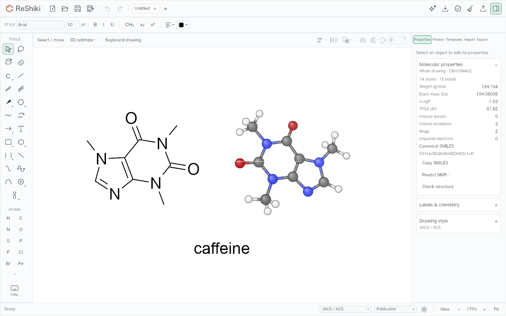      |          |
| Caffeine, 400 ms into the 750 ms morph                           | 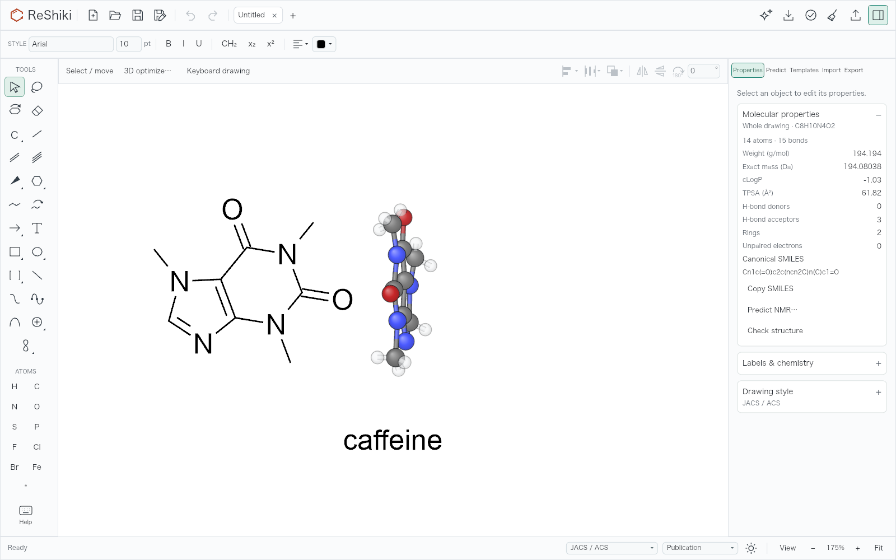  | 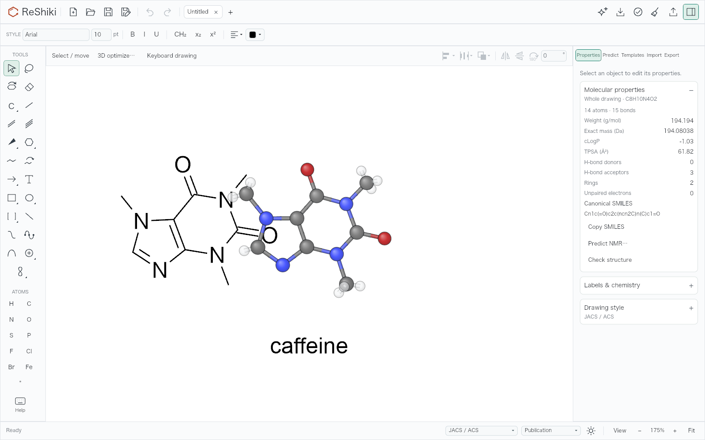                               |
| β-D-glucopyranose, Both, Glossy, 200%, inspector closed          | 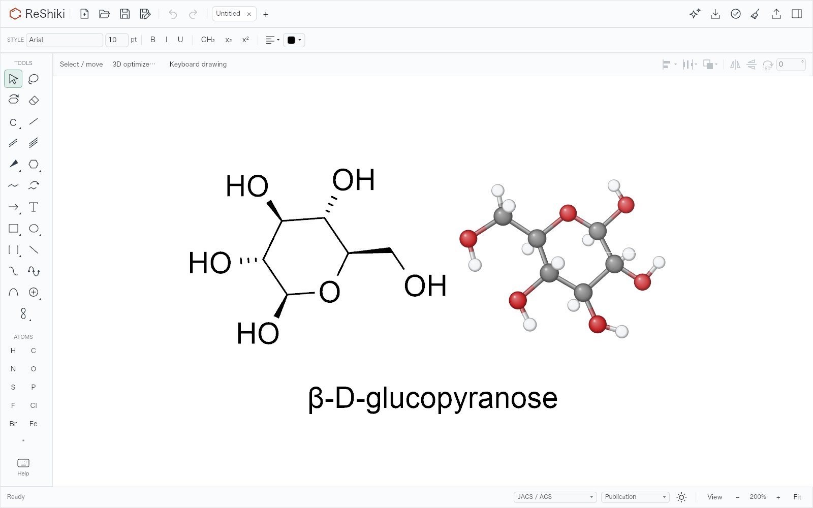 | 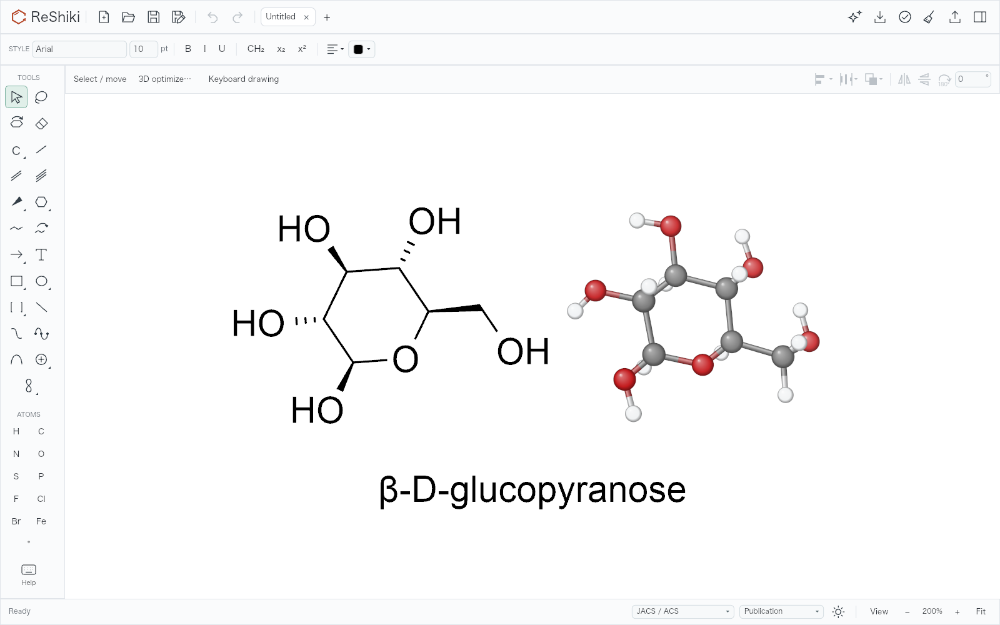                 |
| Plain click, caption included, pointer resting over empty canvas | 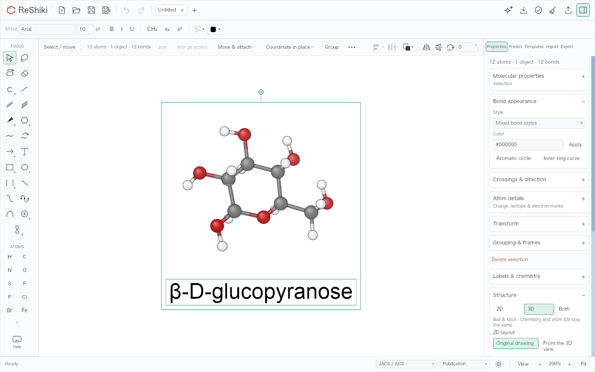      | 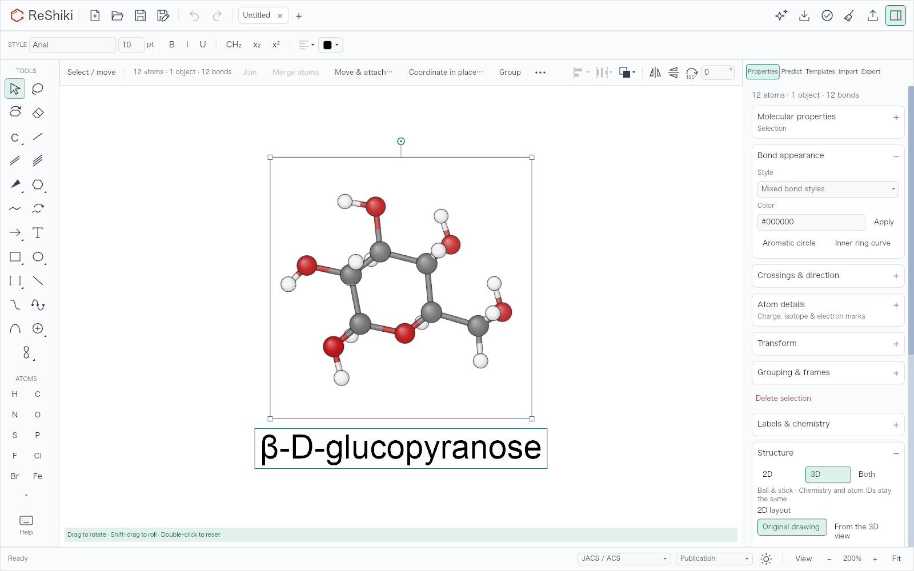 |

The resting instruction is “Drag to rotate · Shift-drag to roll · Double-click
to reset”, matching the existing instruction during a turn. Deselecting the
model, selecting an unrelated object with it, leaving the canvas, or switching
to Ring/Tilt does not show this Select/Lasso hint.

The held resize uses the same widget event path as release. Its caption already
occupies the final centered position, below the larger frame; the underlying
document changes only on release.

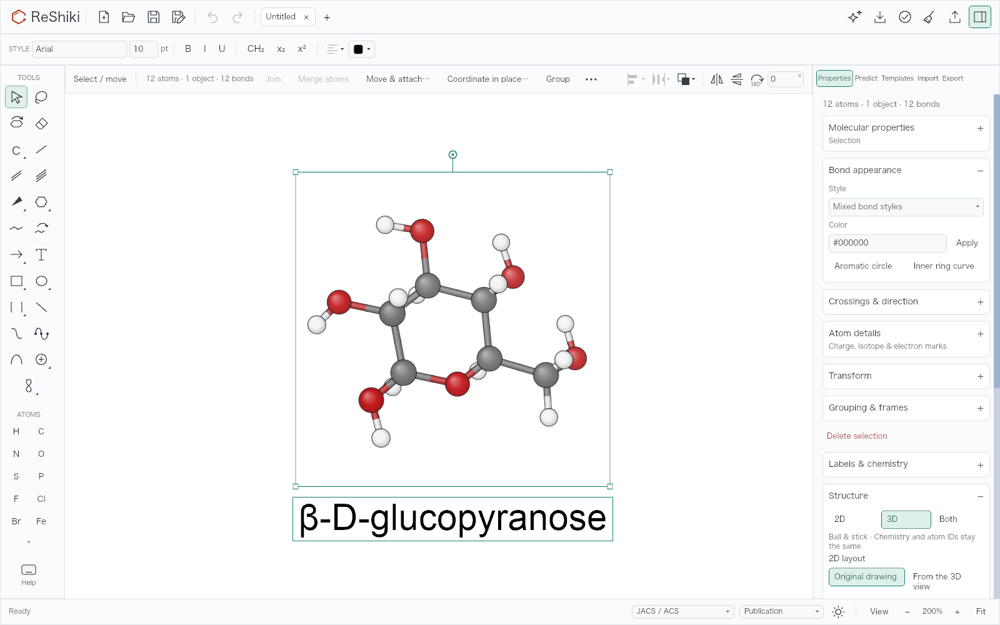

For reproduction, set `RESHIKI_QA_MODEL_FACE_INPUTS` to the fixture directory and
`RESHIKI_QA_MODEL_FACE_OUTPUT` to an empty output directory, then run:

```sh
cargo test -p reshiki --bin reshiki model_face_frames_and_hints_renderer_evidence --locked -- --ignored
```

Set `RESHIKI_QA_MODEL_FACE_BASELINE=1` only for the baseline source with the same
test-only harness. The live resize image is captured after actual widget press
and move events, before release; its underlying document is still unchanged.
A separate regression compares that preview’s caption position with the final
transaction at 50%, 100% and 200%, in 3D and Both modes.

## Native and browser checks

Native checks use isolated QA app bundles on macOS 27.0.1 (26A434) / Apple M1, separate
application data, the same fixtures, native Select clicks, corner drags and Undo.
The native window is zoomed to 1680 × 1020 points on a 2× display; these
supplemental captures have different dimensions from the deterministic renderer
comparison. The native drag API releases the pointer before observing it; the
held-drag proof therefore uses the actual renderer described above.

The native test opened the stored glucose model, chose 3D, Fit and 200%, then
clicked the model once. It selected all 12 atoms and its own caption. Dragging
the bottom-right corner enlarged the frame; one Command-Z restored the original
frame and caption. Redo followed by three Right keys moved all 12 atoms and the
caption by three world units. A native Save As receipt retains the exact name
association, all atom fields apart from position, all bonds, conformer and
force-field hydrogens. A real turn and double-click reset restored the saved
opening rotation within 1e-6. Ring and Tilt kept their existing tool controls
and did not show the resting Select hint.

| Native ordinary click before                                                                                                                  | Native ordinary click after                                                                                                                                         |
| --------------------------------------------------------------------------------------------------------------------------------------------- | ------------------------------------------------------------------------------------------------------------------------------------------------------------------- |
| 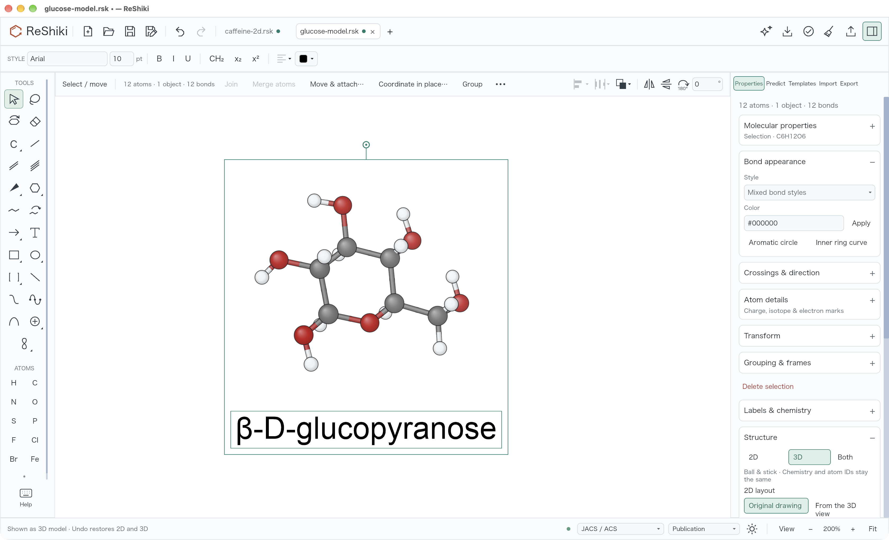 | 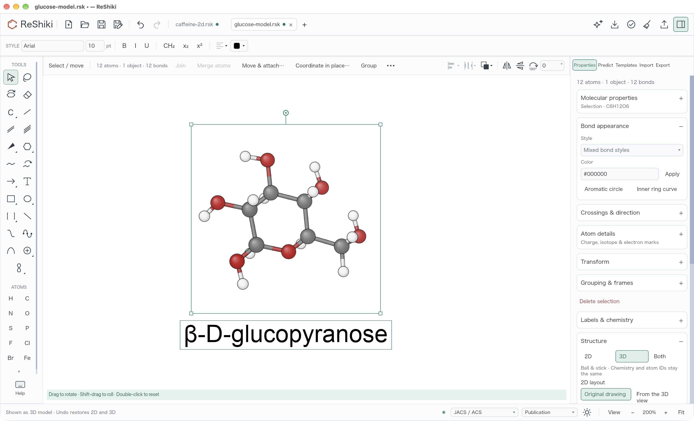 |

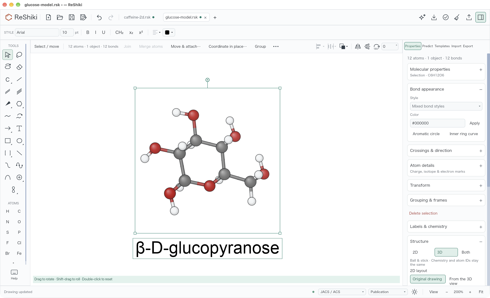

The actual WASM editor was also checked in Chromium and WebKit at 1600 × 1000,
DPR 1 and 200%, through the package’s public mount/save API and real mouse/key
events. Both browsers passed resting inside/empty-canvas hints, outside-canvas
and deselection controls, Ring/Tilt controls, actual rotation, Shift-roll,
double-click reset, held corner resize, caption retention and exact one-step
Undo. Five configured stereocentres remain, and neither browser logged a page
error. Browser Fit uses its normal command framing, so these functional captures
are separate from the matched headless camera comparison.

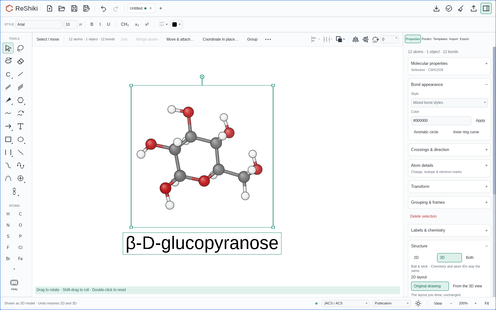


## Validation

Automated checks cover proper rotation determinants and tetrahedral signed
volume, unchanged chemical stereo/native saved views, legacy orientation ties,
crystal opening behavior, caption-only versus unrelated selections, all four
corners at several zooms, one-step Undo/Redo, later caption movement, and resting
versus active Select/Lasso/Ring/Tilt hints. Preview caption placement performs
no chemical identity check, proven with an entry counter.

No external algorithm or third-party visual material is introduced. The issue’s
original screenshots are preserved outside Git with download hashes; all
published comparison images are produced from repository code and fixtures.

The changed initial pose also exposed an old test-registration assumption:
independent f32 point-unit conversions and SVG viewport fitting displaced one
edge by about 1.5e-5 device pixels, crossing an antialias coverage sample. The
comparison now verifies all four exported viewBox values against the independent
scene bounds and verifies both physical point dimensions, then normalizes only
the root viewport for registration. The actual paint body and viewBox remain
unchanged. Raw RGBA differences, including opaque pixels, retain the existing
six-level limit and gradients retain their four-level smoothness limit.
Synthetic controls still reject displaced paint and a coupled viewBox/physical
width change. Production rendering is unchanged.

Final standalone validation: 1,114 app tests passed (122 opt-in tests ignored),
72 model 3D tests and the no-identity-work caption test passed. After adding the
independent viewport guard, all 10 tile tests passed (one opt-in test ignored).
Matched base/head renderer tests, mandatory three-package WASM Clippy, actual
three-package WASM compilation, native interaction and Chromium/WebKit runtime
checks passed. Normal hooks ran without bypassing any check.
