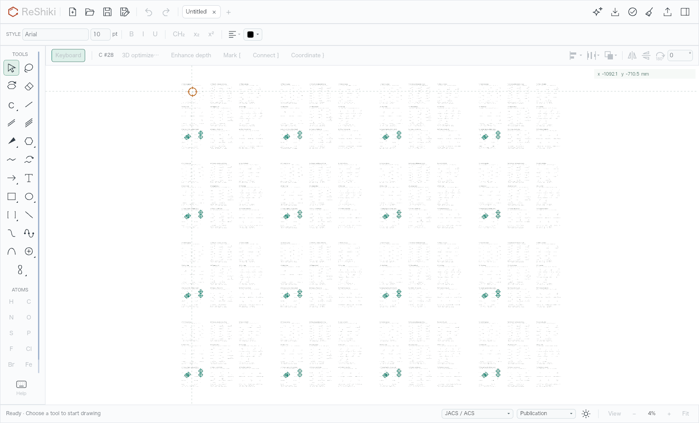
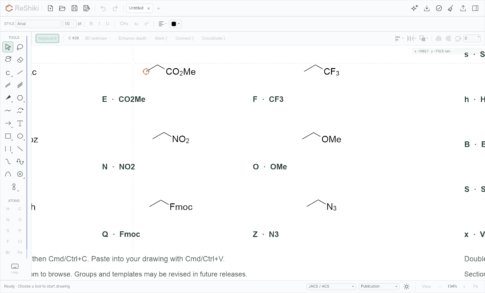
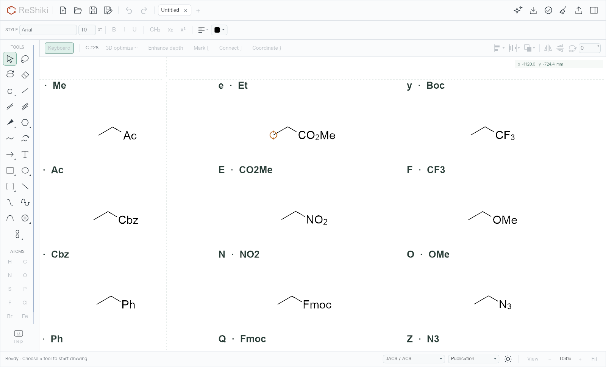
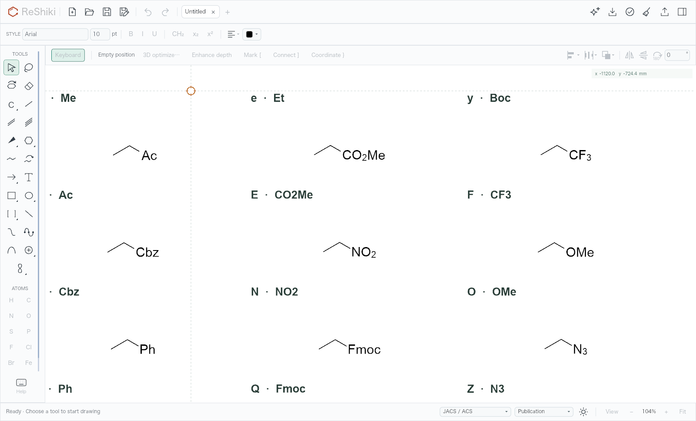
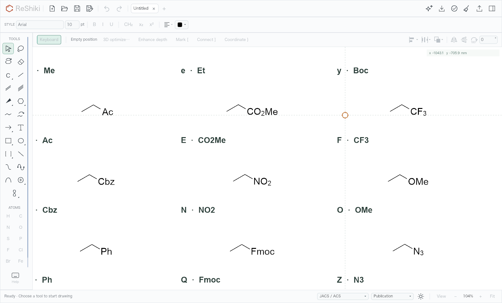
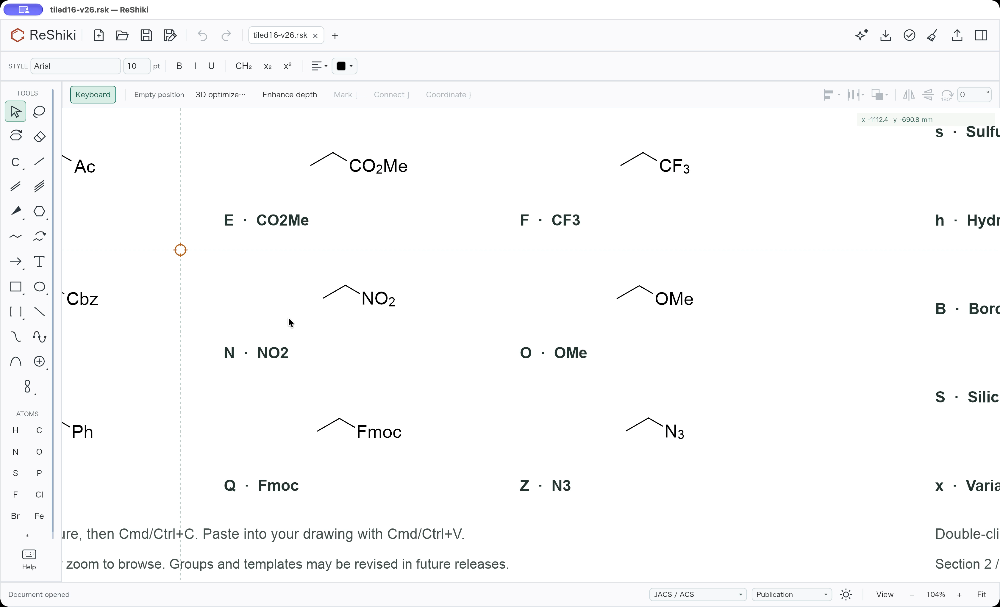
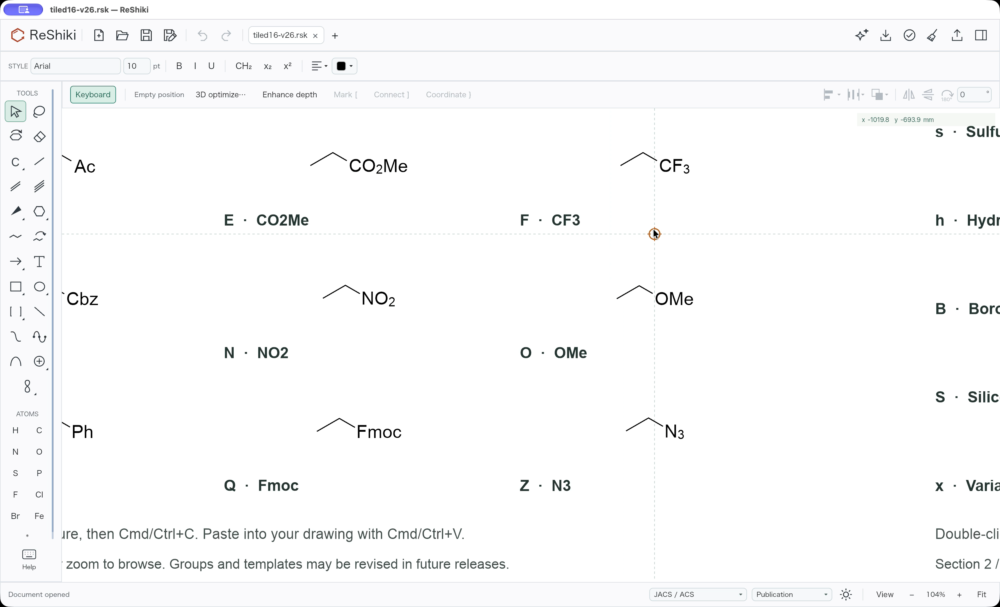
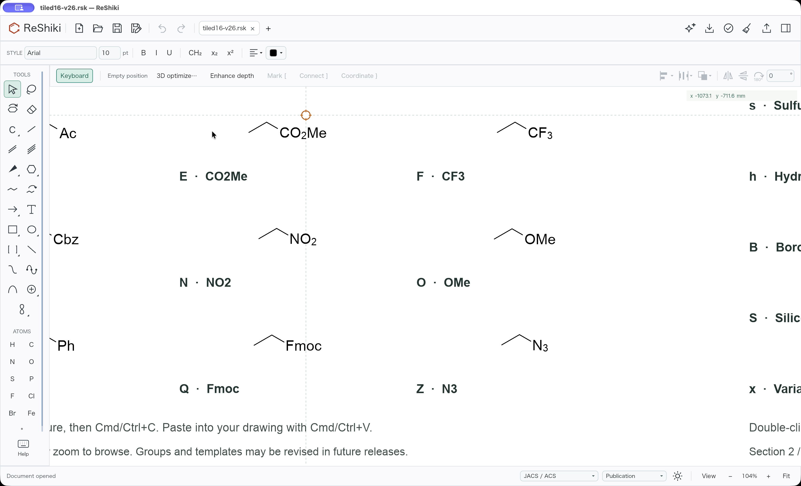
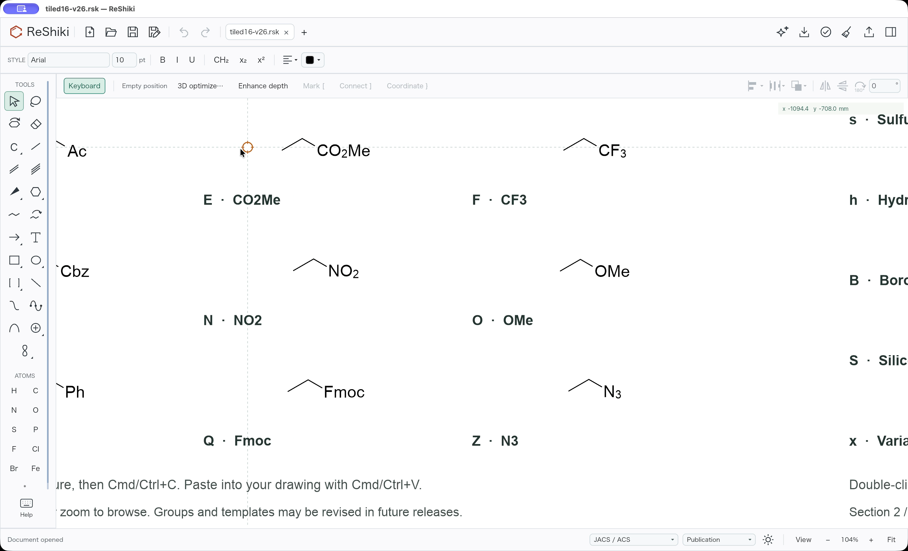
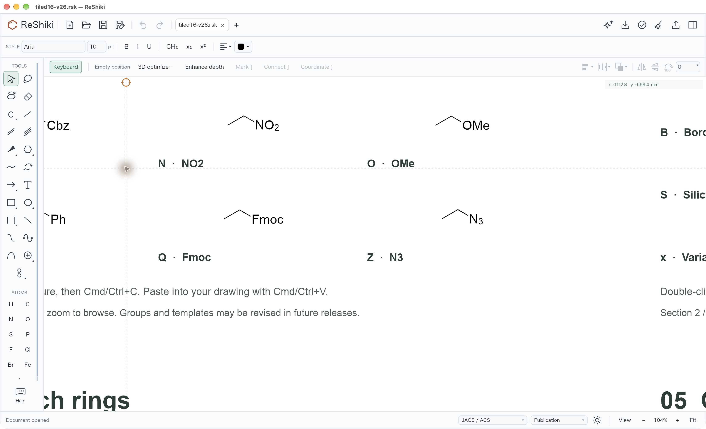

# Keyboard hotspot navigation and large-gallery hover (#572, #573)

Under review: fixes for [#572](https://github.com/Ameyanagi/ReShiki/issues/572)
and [#573](https://github.com/Ameyanagi/ReShiki/issues/573), by
[@Ameyanagi](https://github.com/Ameyanagi) in
[PR #578](https://github.com/Ameyanagi/ReShiki/pull/578).

The final matched native comparison meets the moving-pointer check in all
three predeclared phases: cursor-to-hotspot gaps of **14.08, 7.16 and 13.53 pt**,
compared with **215.63, 121.16 and 199.51 pt** before. A bond at 104% is
43.68 pt. These are spatial measurements in native video frames, with ±2 pt
measurement uncertainty; they are not event-to-paint latency or application FPS.

## Sources and fixture

- Baseline production source: `3d80590a41b9d9e8efd818d23395ac51bd264ca8`.
- Final production, tests, benchmark and capture source:
  `50c64766e69aec9a36b7b021250fe9784c74f2ca`.
- Original renderer capture commit: `324f0df53547e4e3c3f9895c90c936e5fdd90023`.
  Repeating the real-widget renderer at the final source produces the same
  eight PNGs and 151-position target trace byte for byte.
- Exact issue-linked [tiled16-v26.rsk](https://gist.githubusercontent.com/Ameyanagi/0f2d480dd9a4e8cb1843ecd12660f93f/raw/tiled16-v26.rsk):
  5,796,846 bytes, SHA-256
  `71229e202a3a0ba5765af5ac4bd94f4396613237f421cb4c828925c589b553da`.
  It contains 7,728 atom records, 6,864 bonds, 256 abbreviations, 2,112
  annotations and 16 arrows. All reported runs use this read-only drawing.

The benchmark worktrees contain matching test-only drivers. The final native
comparison uses the identical, explicitly guarded camera initializer described
below in both builds; it changes no production input, update, hit or rendering
algorithm. These branches start from the same main revision and do not depend
on the other QA fixes.

## Ownership and hit behavior

Wheel navigation resolves a pointer-owned hotspot at the point now under the
pointer, using the current zoom's picking radius. Arrow navigation, accepted
edits and history restoration own their target until actual pointer motion or
a click transfers it back. Scrolling still updates the cached pointer's world
coordinate while retaining a keyboard-owned target, so moving back over the
pointer's former world position is recognized as real motion. Wheel and native
pointer-motion packets carry canvas-relative screen positions until the app
consumes them. Mixed pan/zoom events and subsequent pointer motion in one
Iced event batch therefore resolve through the current camera. Programmatic
world-coordinate edits and gesture hints retain their existing behavior.

Pan and zoom preserve the document, selection, revision and Undo/Redo history.
The existing [stationary-pointer rule](../3d-keyboard-drawing.md) and the new
wheel-navigation reviewer rows document that distinction.

Query profiling identified exhaustive nearest-bond work and the collapsed-label
fallback as the main hover costs. The fix checks geometric distance before
group/model visibility, indexes atom positions once per bond query, and uses
the existing conservative label reach before laying out a distant collapsed
label. Final hit boxes, strict radius comparisons, tie order and reverse group
priority are unchanged. The per-query indexes preserve the first matching ID
even for an unvalidated document with duplicate IDs.

## Matched renderer evidence

Both builds use the exact fixture, JACS / ACS, Publication colors, a light
canvas, Select, keyboard drawing on, inspector closed, and a 1600 × 968 pt
client viewport. That is the client area of the issue's 1600 × 1000 pt macOS
outer window, allowing for its 32 pt title bar. PNG output is 1× and comes
directly from the actual widget/canvas renderer, without retouching.

The canvas crosshair is enabled in both renderer runs to expose the pointer
coordinate. Fit is 4.050719%; twelve actual wheel events then reach 104% at
outer-window point (439, 241), followed by twenty pan ticks of (12, 6) logical
pixels. The wheel delta is calibrated to 104% from the measured Fit value;
the issue's macOS physical scroll-script pixels are not equated with these
Iced logical input units.

| State                                 | Baseline                                                                                 | Fixed                                                                                | Check                                                                                           |
| ------------------------------------- | ---------------------------------------------------------------------------------------- | ------------------------------------------------------------------------------------ | ----------------------------------------------------------------------------------------------- |
| Fit, initial hover                    |                   |                   | Same camera and initial C #28 hotspot                                                           |
| After wheel zoom to 104%              |  |  | Baseline retains C #28 near the context row; fixed resolves the empty position at the crosshair |
| During wheel pan                      |  |  | Baseline target travels with the drawing; fixed target stays under the pointer                  |
| Synchronously rendered hover midpoint |      |      | Exact same target and pixels; this static parity frame is not a latency measurement             |

The 151-position ellipse has the same target identities and blank coordinates
in both builds. Its PNG frames at positions 0, 38, 75, 113 and 150 are
byte-for-byte identical. This checks hit/render preservation separately from
the ownership change and runtime performance.

## Corrected full-hover profiling

Actual host: Apple M1, arm64, macOS 27.0.1 (26A434), Rust 1.99.0. This differs
from the report's Apple M4. Both saved executables use the release profile,
three warm-ups and thirty samples, the same 1680 × 988 pt client viewport,
104% camera, Select, keyboard drawing on, inspector closed and crosshair on.
The workers held compiler, GPU and native input activity for the paired run.
The widget event and benchmark drivers are byte-identical between sources.

The corrected driver sends actual `CursorMoved` through the real widget's
`update`, consumes its emitted app messages, then rebuilds, lays out and draws
the widget tree. This populates the retained canvas cursor and exercises the
idle selection-hover overlay. The driver includes an input layout and a new
view layout; it excludes returned Task execution, OS delivery, physical-scale
GPU rasterization and presentation. It is a CPU workload comparison, not a
native frame-rate measurement.

| Workload                                                    | Before median / p95 (ms) | Fixed median / p95 (ms) |
| ----------------------------------------------------------- | -----------------------: | ----------------------: |
| Widget pointer event → app update → retained hover drawing  |      213.3407 / 216.2108 |       19.9917 / 20.5143 |
| Indicator preparation                                       |        10.4713 / 10.5405 |         0.0247 / 0.0268 |
| Object hit query                                            |        51.1969 / 51.4139 |         1.6020 / 1.6487 |
| Selection hit query                                         |        95.3372 / 97.0177 |         2.0075 / 2.0248 |
| Ring hit: live enumeration before / retained geometry after |        54.1133 / 55.0602 |         0.3584 / 0.3646 |

The full workload is about **10.7× faster** on this host. Component timings are
separate measurements and should not be summed. The ordinary uncached
`ring_at` remains unchanged; the new row measures the canvas's retained ring
geometry. It uses the original global enumeration and search budget, stable
radius ties, visibility and exact polygon predicate. The existing scene cache
invalidates it whenever the full document changes, including coordinate,
topology, collapsed-group, model-display and history changes. Empty explicit
marks and absent indicator candidates avoid unnecessary visibility work.

An earlier driver at source `2a6d0074` measured app update and drawing commands
without delivering widget motion, leaving the retained canvas cursor empty.
Its 58.3 → 12.6 ms result omitted the idle hover overlay and does **not** describe
the full hover workload. Native recordings exposed the remaining gap. A
bounded native phase trace then measured canvas drawing at 80.48 ms median,
while app update was 1.17 ms and compositor present-return was 0.96 ms. The
corrected driver reproduced the missing cost. A preceding accessibility
correction also removes redundant Blank→Blank Collect/Snapshot tasks, while
retaining each actual point, target identity, mark and queued-action validity.

[Machine-readable timings and hashes](qa-pointer-hover-timings.json) preserve
both the corrected scope and the earlier incomplete driver's limitation.
Reproduce the corrected comparison with the exact fixture path:

```sh
RESHIKI_PERF_HOVER_DRAWING=/path/to/tiled16-v26.rsk cargo test --release --bin reshiki app::performance::hover::native_pointer_hover_workloads --locked -- --ignored --exact --nocapture --test-threads=1
```

## Matched native interaction

Both isolated QA apps use optimized builds, separate app-data directories,
JACS / ACS, Publication colors, a light canvas, Select, keyboard drawing on,
inspector closed and crosshair on. Supported AX Zoom produces a **1680 × 1020 pt
outer window**, with a 1680 × 988 pt client and 3360 × 2040 physical pixels.
This is larger than the report's 1600 × 1000 pt outer window; both sides of this
comparison have identical observed bounds, framing, zoom and settings.

Camera setup is an explicitly disclosed QA-only difference from production:
the same 25-line initializer, enabled only by `RESHIKI_QA_HOVER_CAMERA=1`, checks
the exact fixture path and SHA and runs once after opening/fitting it. It sets
104% zoom and camera center `(-8631.204, -5557.835)`, without changing document,
selection, history or preferences. Its patch SHA-256 is
`1f9e691e22bc29f9b32b54114132c6e6f70d3b752297b756f539298bc723c87d`.
Supported CUA horizontal scroll and the reviewed custom scroll setup did not
establish the needed framing; those failed receipts are retained and the
custom scroll setup was abandoned. No input or rendering algorithm was
changed to obtain the final result.

The user explicitly authorized the bounded native replay. The reviewed helper
posts only **151 mouse-moved events over five seconds at 30 Hz**, following the
same ellipse in each exact owned window. It verifies the frontmost bundle,
executable, PID, window ID, 1680 × 1020 bounds and absence of held inputs.
The sole recording-specific guard exception admits exactly one verified
same-process 66 × 20 pt recording badge at main-window offset (6, 6). The event
generation block remains byte-identical to the original reviewed helper.
It posts no clicks, keys, modifiers or permission changes.

One passive, exact-window 12-second recording per app includes the physical
cursor. Both helpers and recorders exit successfully; their final event times
are 5.0030 and 5.0067 seconds. The original MOVs, all event logs, earlier failed
takes, source patches and binary receipts remain in the QA archive outside Git.
[The native receipt](qa-pointer-hover-native.json) gives their hashes, target
identities, timestamps, selected frame PTS and original pixel measurements.

The phases below were fixed before the final source correction. Requested
sample PTS and actual decoded image PTS match in these six frames. The physical
cursor tip is at the exact same position in each Before/After pair. Distance
uses the uppermost black pixel of the unique 16 × 29 pixel cursor component
(231 black pixels) and the center of the orange hotspot. Pixel distances are
divided by two. Published images crop only black capture padding; application
pixels are not retouched or resampled.

| Phase / capture PTS | Before                                                                            | Fixed                                                                         | Cursor-to-hotspot gap (Before → Fixed) |
| ------------------- | --------------------------------------------------------------------------------- | ----------------------------------------------------------------------------- | -------------------------------------: |
| Early / 2.75 s      |    |    |                      215.63 → 14.08 pt |
| Middle / 4.50 s     |  |  |                       121.16 → 7.16 pt |
| Late / 6.25 s       |      |      |                      199.51 → 13.53 pt |

All three fixed distances remain below the 43.68 pt bond length after adding
±2 pt measurement uncertainty. This establishes the requested representative
moving-pointer result on this host, not an all-frame maximum or a display
latency value. Video sample cadence is not application FPS. Earlier source
`2a6d0074` and `da683e85` takes failed this threshold and are retained as failed
checks; none was used to clear the final gate.

After each loop, the same supported CUA `scroll([600,800], down, 0.1)` pans the
drawing under the stationary pointer. The baseline ring moves from (300,400)
to (300,196) pt; the fixed ring stays at (300,400) pt under the pointer.
Both retain a clean title and disabled Undo/Redo. The native checks use no
document edit, and the regression tests additionally assert document,
selection, revision and history invariance.

| Baseline after pan                                                                                                | Fixed after pan                                                                                            |
| ----------------------------------------------------------------------------------------------------------------- | ---------------------------------------------------------------------------------------------------------- |
|  |  |

Both QA apps were closed and their original unmodified executables and
launchers restored after capture. No production camera initializer or trace
instrumentation is included in the PR.

## Verification

- Final model suite: **805 passed**, 10 existing opt-in tests ignored.
- Final app suite: **1,125 passed**, 125 opt-in tests ignored, using the freshly
  built native naming helper. This includes keyboard ownership and old-view
  mixed wheel/motion packets at nonzero offsets and 0.5×/2× zoom.
- Independent original atom, bond and collapsed-label queries retain strict
  radii, tie order, duplicate-ID behavior, missing endpoints and hidden models.
- Prepared-ring hits agree with live enumeration across radius ties, tilt,
  hidden drawings and topology changes. Cache reuse and invalidation cover
  coordinates, Undo/Redo, collapsed groups and 3D display changes.
- Native-window task tests prove Blank motion updates the point without
  Collect/Snapshot work, while actual target/mark and popup changes still
  refresh and reject stale queued actions.
- Final actual-renderer captures and the 151-position target trace match the
  established renderer evidence byte for byte. Final native interaction was
  independently inspected and measured.
- Strict native app/model test Clippy, mandatory three-package WebAssembly
  Clippy, formatting and normal commit hooks pass.
- The separate 4,087-test combined-workspace result predates the final overlay
  correction and remains pinned to its original source manifest; it is not
  presented as a test result for this final source. Final-head CI is required
  before merge.

Reusable caption: **A pointer-owned keyboard hotspot follows wheel navigation.
On the exact 7,728-atom gallery, corrected M1 CPU hover work falls from 213.3 ms
to 20.0 ms; three matched native phases keep the hotspot within one bond of the
physical pointer. Keyboard-selected targets retain ownership until real motion
or a click. See the QA note for camera setup and host/viewport limits.**
