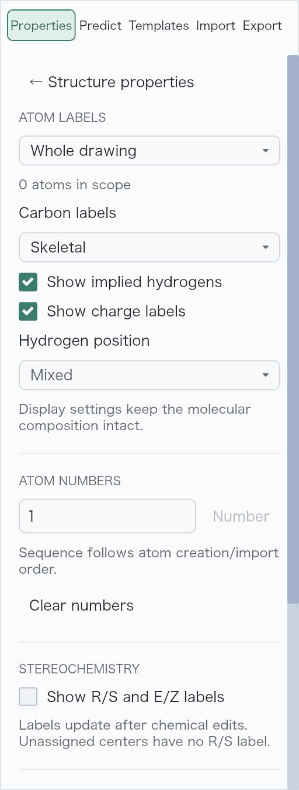
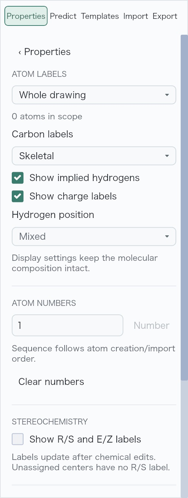
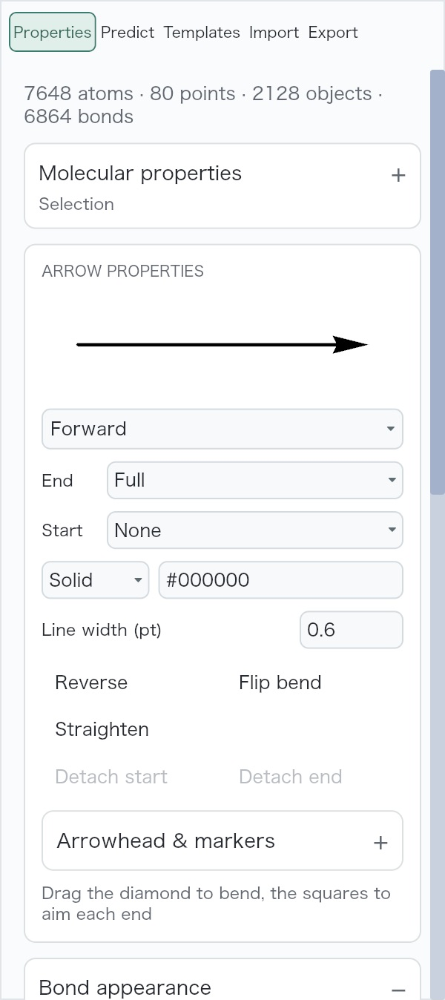
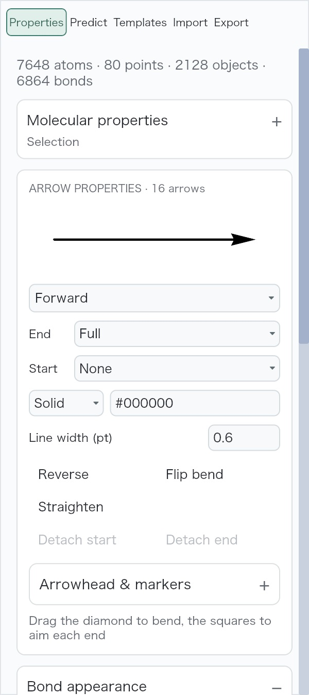
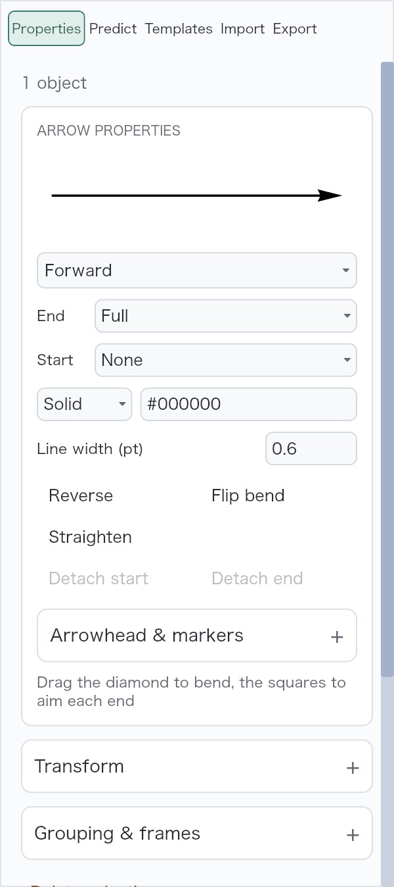
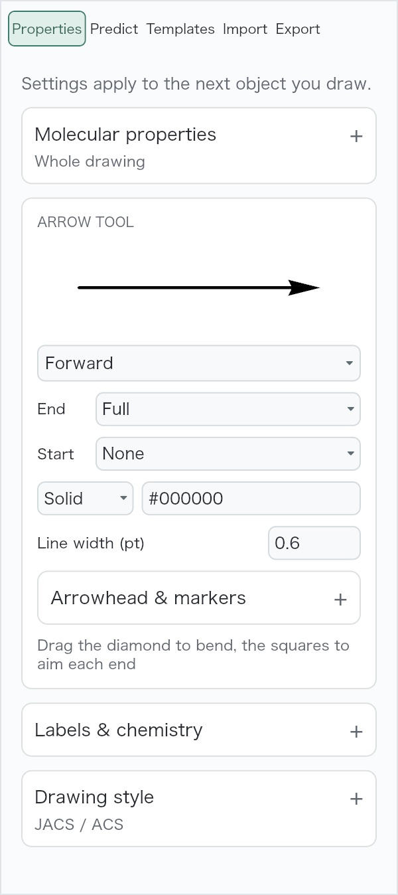

# Properties selection scope and navigation

The arrow editor now says how many selected arrows it affects when there is more
than one selected object. Selecting the complete shortcut gallery displays
**ARROW PROPERTIES · 16 arrows** beneath the overall selection summary. A single
selected arrow keeps **ARROW PROPERTIES**; the Arrow tool with no selected arrows
keeps **ARROW TOOL**. A mixed selection containing one arrow displays **1 arrow**.
The existing arrow controls and their editing scope are unchanged.

The Atom labels & numbering page now uses **‹ Properties**, matching the other
Properties sub-pages. Clicking it returns to the Properties root.

These changes address [#575](https://github.com/Ameyanagi/ReShiki/issues/575) and
[#576](https://github.com/Ameyanagi/ReShiki/issues/576).

## Matched native review

The comparison uses the PR base `3d80590a41b9d9e8efd818d23395ac51bd264ca8` and
implementation `c19c7e648f74cb85e8431dd2edb1b522b91bbc10`, built locally for macOS
arm64 and launched in separate app bundles with isolated data directories. Both
use macOS 27.0.1, the JACS / ACS drawing style, Publication colors, a light canvas,
100% drawing zoom and the same 1280 × 852-point window at 2× display scale. The
report used a larger 1600 × 1000-point window; this review checks the narrower
native layout too. Published images are lossless, unscaled crops of the actual
screenshots, with the same crop coordinates for each pair.

### Atom labels & numbering

On a fresh empty tab, open Properties → Labels & chemistry → Atom labels &
numbering. The native screenshots show the page name correction. Clicking the
new link returned to the Properties root with Labels & chemistry still expanded.

| Before                                                                                                                | After                                                                                                        |
| --------------------------------------------------------------------------------------------------------------------- | ------------------------------------------------------------------------------------------------------------ |
|  |  |

### Arrow scope

The input is the report's unchanged
[tiled16-v26.rsk](https://gist.githubusercontent.com/Ameyanagi/0f2d480dd9a4e8cb1843ecd12660f93f/raw/tiled16-v26.rsk)
(5,796,846 bytes; SHA-256
`71229e202a3a0ba5765af5ac4bd94f4396613237f421cb4c828925c589b553da`).
Open it in the native app, choose Actual size before selecting, then press
Cmd+A with Properties open. The baseline uses the file chooser; the changed
QA bundle opens the same file through its `--open` argument. The selection
summary is 7648 atoms, 80 points, 2128 objects and 6864 bonds; 16 of those objects
are arrows.

| Before                                                                                                | After                                                                                                             |
| ----------------------------------------------------------------------------------------------------- | ----------------------------------------------------------------------------------------------------------------- |
|  |  |

On a fresh tab, selecting the Arrow tool shows **ARROW TOOL**. Drawing one arrow
with a native drag selects it and shows **ARROW PROPERTIES**, without a count.
Undo restores the empty scratch drawing. The gallery input remains unchanged.

| Single selected arrow                                                                               | Arrow tool without a selection                                                                        |
| --------------------------------------------------------------------------------------------------- | ----------------------------------------------------------------------------------------------------- |
|  |  |

The [capture receipt](../images/qa-properties-clarity/capture.json) records image
hashes, crop rectangles, source commits and the original input hash. The blank
central area of the gallery at Actual size is outside these inspector crops;
the screenshots verify scope wording rather than gallery framing or performance.

## Validation

- Existing arrow-action regression passes.
- Workspace library and binary Clippy with all features passes, with warnings
  denied; Rust formatting passes.
- Web app, shared app and web-worker Clippy passes for `wasm32-unknown-unknown`,
  with warnings denied.
- Independent source review confirms the displayed count uses the same selected
  arrow predicate as property edits and the backlink keeps its navigation action.

No export, file-format or chemistry behavior changes in this patch. The captures
are visual checks, not performance measurements.
