# Molecular Properties continuity — QA #548, #550, #551, #554

Molecular Properties keeps the whole-drawing formula and molecular weight visible
while a fragment is selected. The selected fragment still has its own formula,
weight, and cut-bond hydrogen calculation. The folded header shows both scopes.
Picking H or Benzene keeps a nonempty drawing's molecular values open by default;
the Benzene placement card stays above them. Explicit header choices take
precedence. New tabs and the replacement for the last closed tab inherit the
window's last explicit Molecular header choice, while existing tabs keep their
own choices. Atom and bond counts use singular nouns for one.

Release caption: Keep whole-drawing formula and mass visible beside selected
fragments, preserve Molecular header choices in new tabs, and correct singular
atom and bond counts.

## Matched renderer evidence

Baseline: `3d80590a`. Fixed production source: `85712cde`. Both runs use the same
[test-only renderer fixture](../../src/app/workspace/layout_snapshots/property_continuity.rs),
with no baseline production modifications. The application renderer produces
1600 × 1000 PNG images on macOS arm64 with the light appearance, JACS / ACS drawing
style, Arial 10 pt labels, Publication canvas theme, and 100% zoom. The replacement images below are identically framed crops of the Properties
panel. The counts comparison uses the separate native input captures described
in #550.
The full originals are retained in the QA workspace. The source test also
captures explicit expanded and collapsed headers.

The generated native inputs are
[ethylbenzene](../fixtures/qa-property-continuity/ethylbenzene.rsk),
[benzaldehyde](../fixtures/qa-property-continuity/benzaldehyde.rsk), and
[anisole](../fixtures/qa-property-continuity/anisole.rsk). They are generated from
`CCc1ccccc1`, `O=Cc1ccccc1`, and `COc1ccccc1` through the local engine. They contain
no external structure data.

### #548 — Whole drawing and selection remain distinct

Import ethylbenzene, target the terminal CH₂–CH₃ bond, and press `2`. The bond
stays selected. The baseline folded header shows only the capped fragment
C₂H₄. The fixed header also shows the resulting whole styrene drawing as C₈H₈,
104.152 g/mol. Expanding the card retains the fragment's weight of 28.054 g/mol.
The selected bond and its controls are the subject of these images.

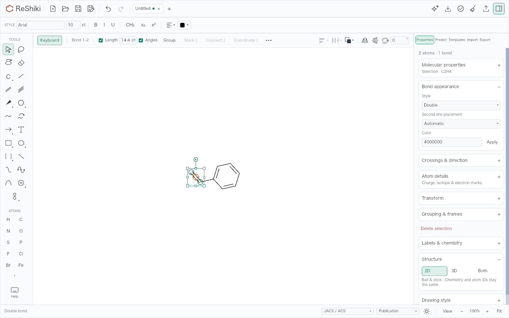

### #550 — Singular atom and bond counts

The native check follows the reported palette workflow: run `:benzene`, click
one ring carbon, run `:extend chain`, then run `:OMe`. Both apps use 100% zoom,
the same 1280 × 852 pt window (2560 × 1704 captured pixels), and the same style
and theme as the renderer examples. These identically framed Properties crops
are reduced to 300 px wide. The first fixed capture catches the normal selection
debounce; its atom/bond counts already reflect the selected endpoint. The OMe
fragment settles as capped methanol at 32.042 g/mol.

| Case               | Baseline                                                                                                            | Fixed                                                                                                           |
| ------------------ | ------------------------------------------------------------------------------------------------------------------- | --------------------------------------------------------------------------------------------------------------- |
| After Extend chain | 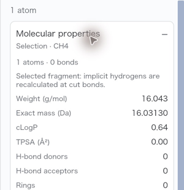 | 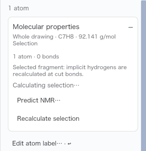 |
| After OMe          | 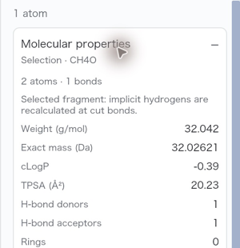                   | 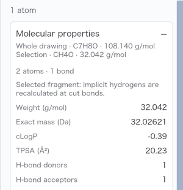                   |

### #551 — New and replacement tabs retain the explicit header choice

Expand Molecular Properties, then close the last tab. The replacement drawing
keeps the expanded choice. The baseline resets to a folded card. Closing a dirty
tab with Don't Save and both explicit choices are also covered by app tests.

| Baseline                                                                                                                        | Fixed                                                                                                                                         |
| ------------------------------------------------------------------------------------------------------------------------------- | --------------------------------------------------------------------------------------------------------------------------------------------- |
| 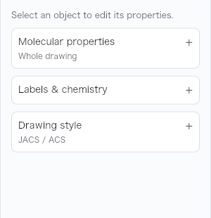 | 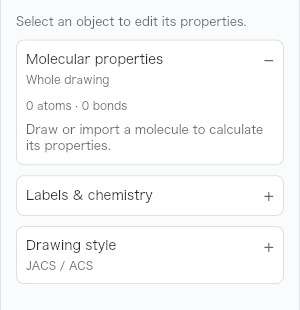 |

### #554 — Drawing tools keep the molecular values visible

Open benzaldehyde without a selection, then choose H. The fixed header and body
retain C₇H₆O and 106.124 g/mol.

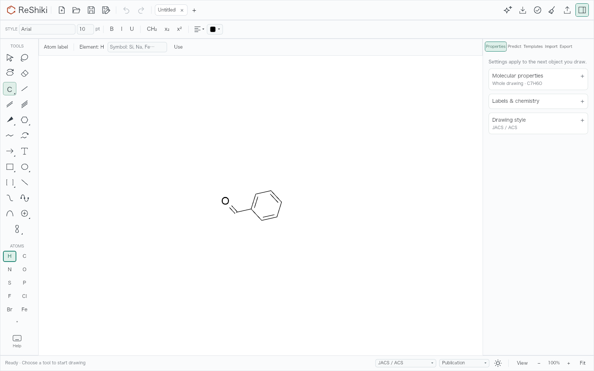

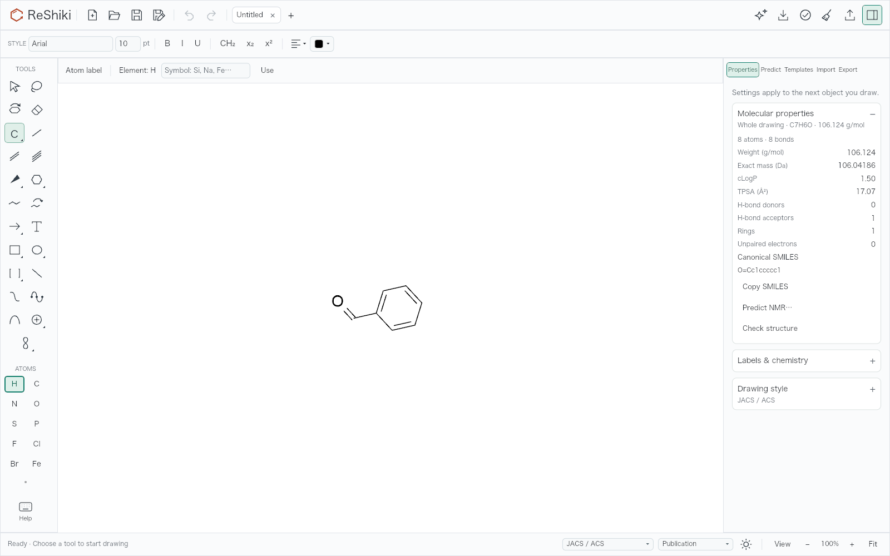

Choose Benzene. Its placement card stays visible first, followed by the open
Molecular Properties card. Both fit at 1600 × 1000.

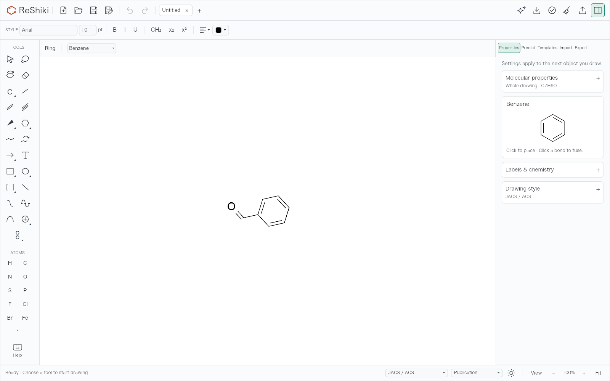

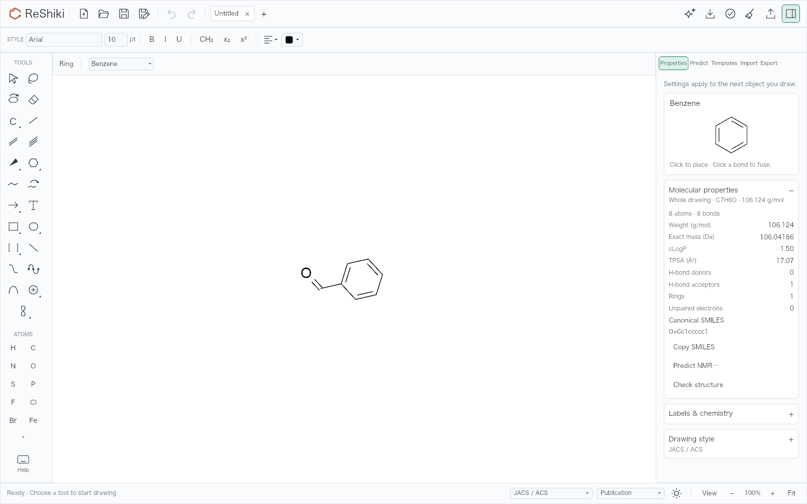

## Cache and state behavior

Whole and selected results use the drawing revision, file epoch, and atom IDs.
The panel reuses a current full-drawing analysis when available. Otherwise it
debounces a whole request, followed by a selected request, with at most one
inspector request per tab in flight. Successful results and unavailable/error outcomes
settle their keys; repeated frames do not rerun chemistry. Selection-only changes
can retain a whole result. A new revision or file epoch rejects old receipts and
immediately removes old cached formula and weight from the header. A queued timer
also checks its original key before starting work. Results route to their
originating tab through the existing tagged-task mechanism.

The shared window preference records only explicit Molecular header actions. It
seeds fresh/reset tab state and is not a persisted application setting. Other
sections and already existing tabs retain their own choices. Empty drawings
remain folded by default unless an explicit remembered choice opens them.

## Validation

- `cargo test -p reshiki --bin reshiki --locked`: 1118 passed, 123 opt-in tests
  ignored, 0 failures. The exact native executable was configured as the required
  naming helper.
- The focused inspector suite passes, including whole and selected receipts,
  stale selection/revision/file epochs, an actual tagged background-tab job and
  return, queued timer guards, cached failures and absent analysis, actual
  ethylbenzene → styrene bond key `2` with all three header choices, tab creation,
  last dirty tab Don't Save, drawing tools, singular counts, and the existing
  at-most-one default section regression.
- The opt-in `property_continuity_snapshots` renderer test passes on baseline and
  fixed source. All published images were inspected for legibility and clipping.
- Normal source commit hooks pass `cargo fmt --all --check` and workspace
  all-features Clippy with `-D warnings`.
- Test-only follow-up `35d0dab8` passes the opt-in real renderer text regression:
  the auto, expanded, and collapsed card text contains both whole styrene and
  selected-fragment masses, and a selected atom renders `1 atom · 0 bonds`.

## Native input verification

The isolated baseline and fixed macOS arm64 apps were exercised through real
mouse, keyboard, command palette, and native dialog input. The fixed executable
uses production source `85712cde`; the later commit adds tests only.

- Open the supplied ethylbenzene drawing, click its terminal bond, press `2`, and
  expand Molecular Properties. At matched 250% zoom the fixed app shows whole
  C8H8 / 104.152 g/mol and selected C2H4 / 28.054 g/mol together. The baseline
  shows only the selected fragment. Both keep the edited bond selected.
- Explicitly expand, create a new drawing with the documented native `⌘N`, then
  return to the existing tab. It retains its choice. Close the clean tab and the
  last dirty drawing with `⌘W` → Don't Save: the replacement stays expanded.
  Repeat with an explicit collapse: the new and replacement tabs stay folded.
  The issue calls New `⌘T`; the app's native binding is `⌘N`.
- Build benzene with the palette, select a ring carbon, run Extend chain, and run
  OMe. The matched native counts above show the exact reported workflow.
- Relaunch the fixed app to clear the window-only explicit preference. Open
  benzaldehyde with no selection and pick H, then the Benzene drawing tool.
  Both leave Molecular Properties expanded with C7H6O / 106.124 g/mol. The
  Benzene placement card remains visible above the values. The same baseline
  picks fold the molecular values. These native checks use matched 250% zoom;
  the settled 1600 × 1000 renderer comparisons above use matched 100% zoom.

Both isolated apps were closed after the checks. Native source captures and the
complete renderer gallery remain under `/tmp/reshiki-property-continuity/` in the
QA workspace; committed images are the reviewable evidence. The expansion
preference is intentionally window-local and does not survive an app relaunch.
