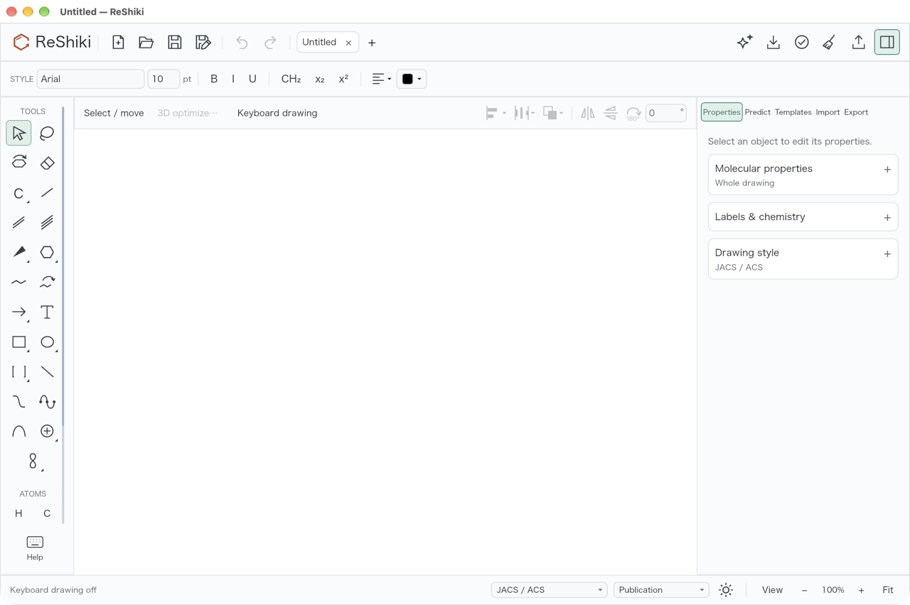
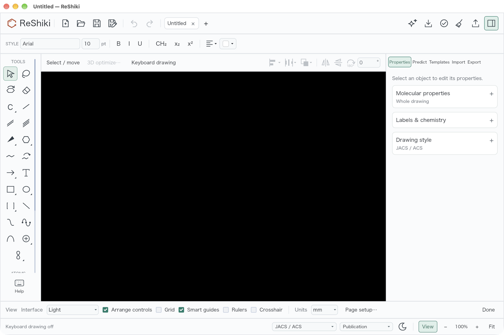

# Remember canvas brightness for new drawings

Issue [#580](https://github.com/Ameyanagi/ReShiki/issues/580) reported that the
light/dark setting did not seem to survive a restart. The sun/moon control changed
only the current document's canvas. Every new blank document started light, so the
default **Match canvas** interface also returned to light. The separate
**View → Interface** choice already persisted.

The explicit canvas brightness choice is now also kept in `appearance.json` as
`canvas_theme`, and used for new blank drawings at startup, New, and last-tab
reset. A fresh dark drawing starts clean. Opening or recovering a drawing retains
its saved canvas brightness. Undo/Redo remains a document edit and does not change
the preference for future drawings. **Light**, **Dark**, and **Match canvas** remain
independent interface preferences; a System option is not offered.

The preferences use the existing native application-data storage and browser
IndexedDB store. No document format or storage architecture changes are needed.
An explicit same-value choice retries a preference write after an earlier failure.
Older preference files retain their interface choice and default new canvases to
light until a canvas brightness is explicitly selected.

## Actual desktop restart evidence

| Baseline after choosing Dark and restarting                                                         | Fixed after the same operation                                                                                            |
| --------------------------------------------------------------------------------------------------- | ------------------------------------------------------------------------------------------------------------------------- |
|  |  |

Both runs start with separate empty QA preference folders. Launch the blank app,
press F8 to remove the keyboard-drawing marker, click the footer sun/moon button,
quit with CmdQ, and relaunch; press F8 again for the screenshots. No drawing is
opened or restored. The fixed restart has no dirty marker and no Undo step.

The native comparison uses macOS 27.0.1 arm64, a 1280 × 852 point window at 2×
display scale, 100% drawing zoom, JACS / ACS style and Publication colors. Original
2560 × 1704 screenshots are uniformly reduced to 1280 × 852 for publication, with
no drawing retouching. The verified baseline binary is optimized; the fixed binary
is the development build without debug data or incremental compilation. This
comparison demonstrates preference/restart behavior, not performance. Exact
source, binary and original/published image hashes are in the
[verification receipt](../images/qa-remember-appearance/verification.json).

An explicit **View → Interface → Light** also survives another restart while the
new drawing keeps its remembered dark canvas:



Only the two disposable QA applications were operated. Both were closed after the
checks; personal preference files were not read or changed. Native execution on
Windows/Linux was not performed; the preference and blank-document code is shared.

## Verification

Production source: `e59b1faaca5f04a169653c08687ec99777013b45`, based on
`3d80590a41b9d9e8efd818d23395ac51bd264ca8`.

Focused checks passed:

- Four settings tests use disposable directories and the real atomic file path:
  all three interface modes × both canvases, unrelated preferences, old files,
  malformed/missing files, failed write and same-settings retry.
- Seven theme/application tests, including new brightness/New/reset/tab-switch/
  opened-file/Undo/Redo controls, recovered light draft versus dark default, and
  independent interface modes.
- Five document-tab tests, including clean and reusable light/dark initialization;
  25 tab tests; 19 document-style tests (two existing opt-in tests remain ignored).
- Normal commit hooks: native workspace all-features Clippy with warnings denied,
  Rust formatting, and the documentation formatter.
- Documentation check: clean referenced-asset tree and Astro diagnostics with zero
  errors, warnings or hints; JavaScript lint and formatting checks pass.
- Required three-package WASM Clippy:
  `cargo clippy --locked -p reshiki-web -p reshiki -p reshiki-web-worker --lib --bin reshiki --target wasm32-unknown-unknown -- -D warnings`.

The actual mounted-editor checks passed in Chromium and WebKit, including immediate
reload after both brightness choices and an aborted IndexedDB write followed by
a successful same-value retry. Both engines reported no page errors; browser
versions and individual checks are included in the verification receipt.

The mounted-editor regression script is
[`scripts/qa_appearance_browser.mjs`](../../scripts/qa_appearance_browser.mjs).
Build the editor WASM/package assets first, then run with Bun and a Playwright
installation, for example:

```sh
RESHIKI_QA_PLAYWRIGHT=/absolute/path/to/playwright/index.mjs \
  RESHIKI_QA_APPEARANCE_OUTPUT=/absolute/path/to/disposable/output \
  bun scripts/qa_appearance_browser.mjs
```

It uses fresh Chromium/WebKit profiles and its own local origin, drives the actual
command UI, checks the native-document snapshot and durable IndexedDB data, and
reloads immediately after a canvas command reaches the document. It does not poll
storage or insert a durability delay before that reload. It also checks all three
interface choices, loading an existing light document with a dark default, New,
and an aborted preference transaction followed by a same-value retry. Browser
storage can still be unavailable or evicted under the existing browser policy;
failed transactions retain their existing error feedback.

## Release-note material

Caption: **ReShiki remembers the chosen canvas brightness for new drawings and the
next launch, while keeping each saved drawing's own appearance.**
