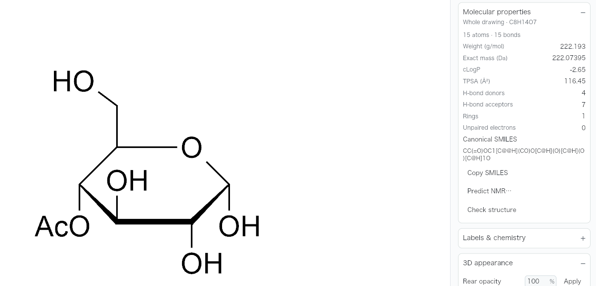
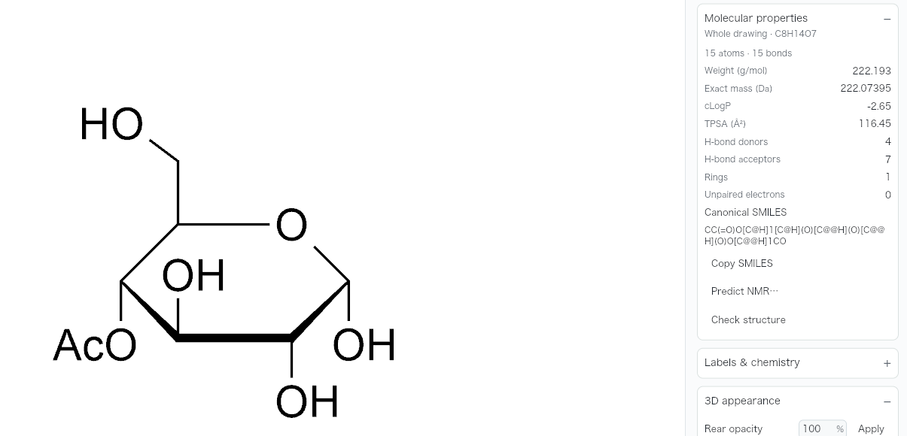
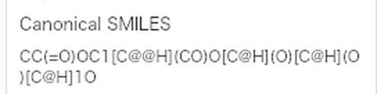
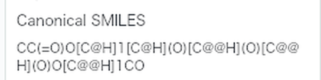
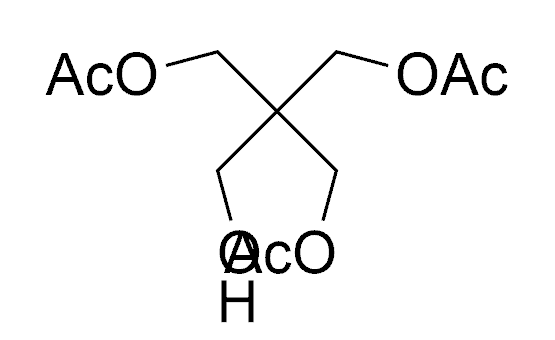
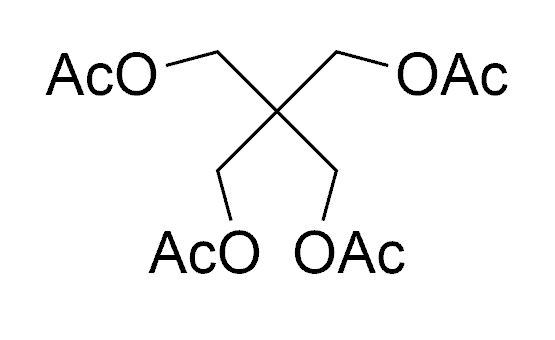
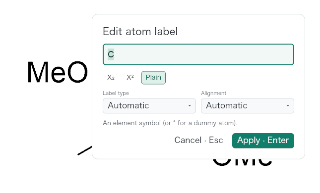
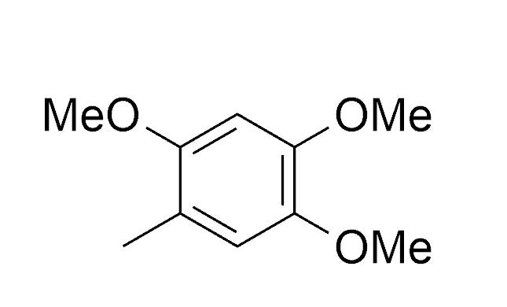

# Typed groups: stereochemistry, clear labels and repeat gestures

Shipped in 0.13.1 in [PR #568](https://github.com/Ameyanagi/ReShiki/pull/568), by @Ameyanagi.

This change addresses [#530](https://github.com/Ameyanagi/ReShiki/issues/530),
[#531](https://github.com/Ameyanagi/ReShiki/issues/531) and
[#532](https://github.com/Ameyanagi/ReShiki/issues/532). The source is
`f3bc2f29`, `a39f51cb` and `bd38c6e2`, based on `3d80590a`.

Typing a protecting group on a sugar oxygen now retains neighboring tetrahedral
configuration when the center and its complete neighbor/order set survive.
Validation uses the complete affected connected component and copies back only
stereo-tag removal decisions. It preserves physical winding by atom ID, rather
than retaining an old R/S assignment when substituent priorities change. An
inconclusive stereo check refuses the edit atomically; unrelated disconnected
invalid or generic structures do not block it. Ordinary edits without stored
stereochemistry retain their existing draft behavior.

Reversible chemical labels now test both readings against actual label ink and
visible bond strokes when placed. Each candidate uses the neighboring automatic
hydrogen placement that the real scene would produce. This matters when the
native background label refresh runs between successive edits. Explicit user
alignment stays intact. Overlapping hits prefer an atom's own element glyph,
then its nearest anchor; exact ties retain reverse paint order.

A Text-tool single click still mounts and focuses the editor immediately. With a
remembered label, its presentation waits for the same 450 ms interval used by
repeat detection. A key or IME preedit/commit reveals it immediately and reaches
the existing focused editor. A second click applies the repeat without drawing
the dialog. Matching-label double clicks still open the editor. Option/Alt
repeat follows the existing immediate action.

## Matched application renderer

The following are crops of the complete application renderer, with no drawing
retouching. Both sides use the same fixtures and actions, light appearance,
JACS / ACS drawing style, Publication theme, 200% zoom and a 1600 × 1000 logical
viewport. Before is production source `3d80590a`; after is `bd38c6e2`. The
opt-in test-only harness was also attached to the base. Properties are calculated
by the real local chemistry engine. Polyol labels refresh between every edit.

| Repro                                                                      | Before                                                                                                          | After                                                                                                                       |
| -------------------------------------------------------------------------- | --------------------------------------------------------------------------------------------------------------- | --------------------------------------------------------------------------------------------------------------------------- |
| Glucose C4 oxygen → OAc; the drawing alone conceals the lost configuration |        |       |
| Properties canonical SMILES, enlarged 2×                                   |                     |               |
| Repeat OAc onto the four polyol oxygens                                    |    |  |
| First Text-tool click on the fourth durene end, at 200 ms                  |  |          |

The [before](../../tests/fixtures/stereo-repeat/before-properties.json) and
[after](../../tests/fixtures/stereo-repeat/after-properties.json) receipts retain
the complete calculated SMILES, InChI, formula and masses.

| Result                         | Before                      | After                            |
| ------------------------------ | --------------------------- | -------------------------------- |
| Glucose C4 OAc defined centers | 4                           | 5                                |
| Product InChI stereo layer     | `/t4-,5-,6-,7?,8+/m1/s1`    | `/t4-,5-,6-,7-,8+/m1/s1`         |
| Glucose C4 OAc formula / mass  | C8H14O7 / 222.193 g/mol     | C8H14O7 / 222.193 g/mol          |
| Fourth polyol oxygen hit       | neighboring acetate, atom 9 | oxygen under the pointer, atom 5 |
| Polyol final formula / mass    | C11H18O7 / 262.258 g/mol    | C13H20O8 / 304.295 g/mol         |
| Durene repeat product          | C10H14O4                    | C10H14O4                         |

Protection changes canonical atom numbering. The chemistry tests therefore
compare every protected product with its expected stereospecific product, rather
than comparing its literal `/t` atom numbers with unprotected glucose.

## Native interaction and recording

Native checks used isolated macOS arm64 debug app bundles on macOS 27.0.1,
1280 × 852 pt windows and the same original fixtures. The baseline repeat bundle
was `f3bc2f29`, which changes stereo preservation only; its repeat presentation
matches `3d80590a`. The fixed bundle contains the `bd38c6e2` behavior, built before
the equivalent final Clippy cleanup replaced a prechecked group lookup's
`unwrap` with `?`.

- Glucose: Select C4 O, Return, type OAc, Return; whole-drawing Properties shows
  C8H14O7 / 222.193 and five configurations. Undo/Redo and OAc → OBn also passed.
  [Native C4 acetate capture](../images/qa-stereo-repeat/native-glucose-c4-OAc.png).
- Polyol at 200%: type OAc on upper left, then double-click upper right, lower
  right and lower left, allowing live label refresh between actions. Four
  labels are clear; Properties shows C13H20O8 / 304.295. One Undo returns to
  C11H18O7 with the fourth OH restored; Redo restores the tetraacetate.
  [Native tetraacetate capture](../images/qa-stereo-repeat/native-polyol-four-final.png).
  The small circle identifies the last Text-tool target.
- Durene: commit OMe on the fourth end and Undo to seed repeat memory while
  restoring the three-label input. Native double-click repeats OMe; another
  double-click on that matching OMe opens its editor. After Undo, one click
  immediately followed by typing `NH2` retains all three characters and focus.
  [Native immediate typing capture](../images/qa-stereo-repeat/native-immediate-NH2.png).

Original encoded gesture frames are retained in short, passthrough-trimmed
[before](../images/qa-stereo-repeat/recording/before-repeat.mov) and
[after](../images/qa-stereo-repeat/recording/after-repeat.mov) movies. The
[cadence receipt](../images/qa-stereo-repeat/recording/cadence.json) records source
hashes, original frame indices and timestamps, clip hashes and clip sample times.
The native movies use 222% Fit zoom on both sides; the matched renderer images
above use the requested 200%. The fixed window retains an inactive QA polyol
tab; its canvas viewport and camera match the baseline movie.

The capture samples have a median interval of 16.667 ms, with occasional
33.333 ms gaps. This is variable-rate capture with roughly 60 Hz sampling, not
an uninterrupted 60 fps claim. No frames were duplicated or resampled. Baseline
frames 328–335 show the dialog at 5.7667–5.9000 s; it is absent by 5.9167 s, a
150 ms flash. The fixed gesture's frames 280–340 cover 4.9167–6.0667 s: the
three-label input becomes the four-label product without a dialog frame.

## Regression coverage and repeat steps

Inputs are in [tests/fixtures/stereo-repeat](../../tests/fixtures/stereo-repeat).
The glucose fixture is the built-in alpha Haworth template with abbreviations
expanded. Polyol and durene are actual native depictions of `OCC(CO)(CO)CO` and
`Cc1cc(C)c(C)cc1C`. No external drawing or font material was added.

- Model atom entry filter: 47 passing tests. OAc, OBn and MeO at C1–C4, plus F/SH
  controls, retain winding and expected product InChI stereo. Native JSON and
  SMILES round trips, full 2,3,4,6-O-benzyl / 1-O-methyl protection, repeat,
  Undo/Redo, duplicate ligands, remote loss of a center, connected-generic atomic
  refusal and unchanged explicit-H/bond metadata are covered.
- Real helper/backend round trips: all twelve C1–C4 group cases and the fully
  protected sugar retain the expected product identity through native JSON,
  MOL export/import and Copy as → SMILES.
- Scene filter: 69 passing tests, including core-glyph priority, nearest-anchor
  hits, exact ties and a real variable-font fallback in an isolated test process.
  Model and Haworth controls also cover explicit alignment, glucose C4 BnO,
  durene MeO/OMe and refreshed polyol ink.
- Application atom entry filter: 36 passing tests. The opt-in widget test also
  sends actual mouse events through the full application tree, checks 27 frames
  from 0 through 433 ms without dialog ink, the exact 450 ms reveal boundary,
  focus, first-key delivery and IME preedit/commit. Application unit tests cover
  stale deadline rejection.
  A separate press inside a hidden opaque popup verifies pointer transparency
  independently of centered or anchored popup placement.
- Normal commit hooks (fmt and workspace all-features Clippy), native build and
  the three-package WASM Clippy check passed with warnings denied for project
  code. WASM interaction and Windows/Linux native UI were not manually exercised.

To regenerate head renderer evidence, copy the input fixtures into an empty
scratch directory, then run:

```sh
RESHIKI_STEREO_REPEAT_QA_DIR=/path/to/scratch \
  cargo test --locked -p reshiki --bin reshiki stereo_repeat_visual_evidence \
  -- --ignored --nocapture
cargo test --locked -p reshiki --bin reshiki \
  delayed_editor_real_pointer_focus_keyboard_and_ime -- --ignored --nocapture
cargo clippy --locked -p reshiki-web -p reshiki -p reshiki-web-worker \
  --lib --bin reshiki --target wasm32-unknown-unknown -- -D warnings
```

The placement work runs only on label edits. It measures at most 64 potentially
relevant visible labels. Unknown font reach includes all visible labels within
that same budget. An incomplete or oversized obstacle set preserves the
established reading; this change does not continuously rearrange an entire
crowded drawing after movement.

Reusable caption: **Typed protecting groups retain sugar stereochemistry,
choose a clear reading beside nearby labels and repeat without an editor flash.**
The images and original gesture clips above can be reused in the release notes.
