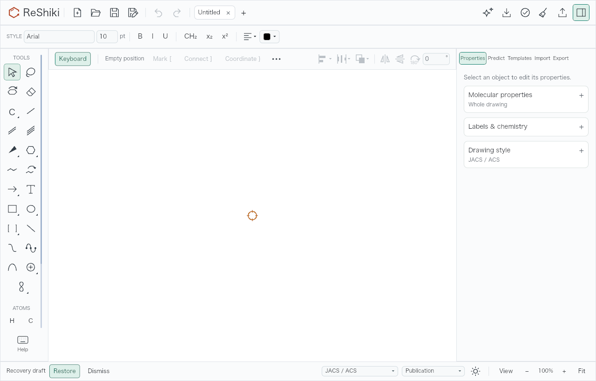
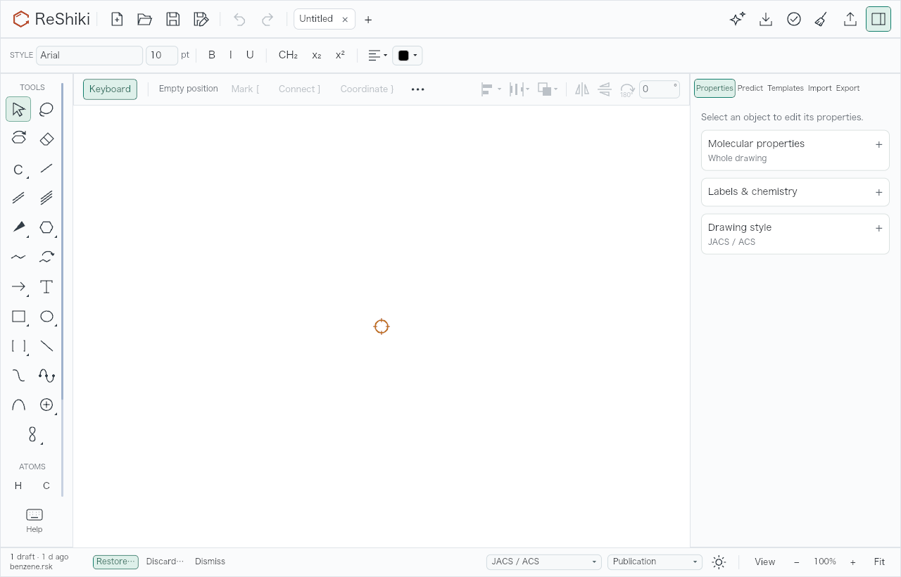
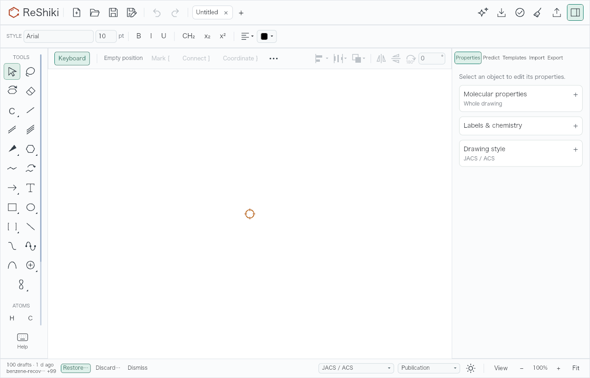
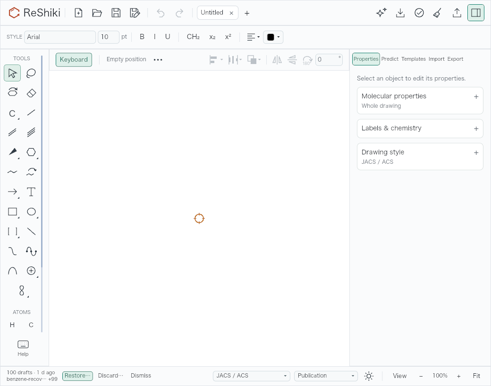
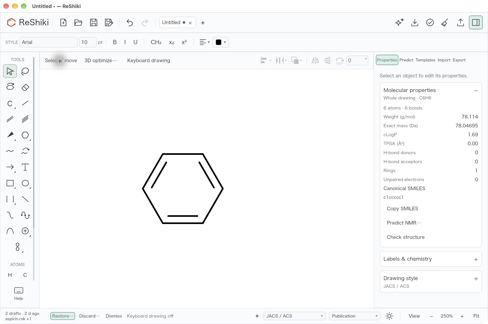
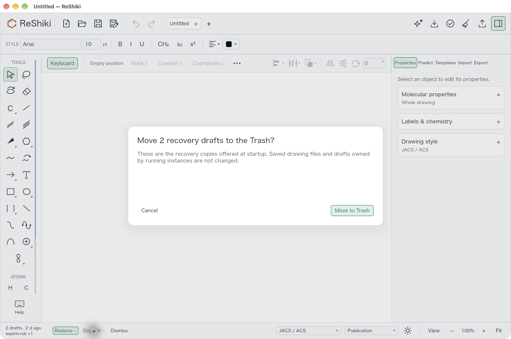
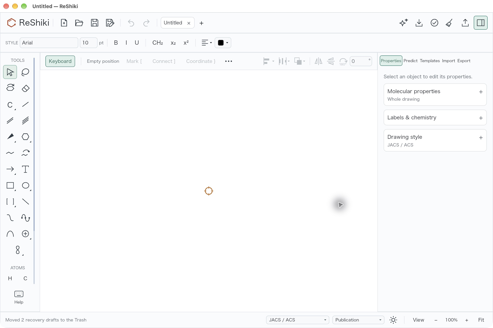
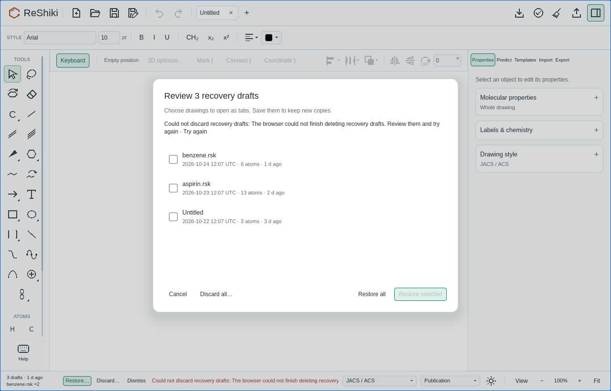
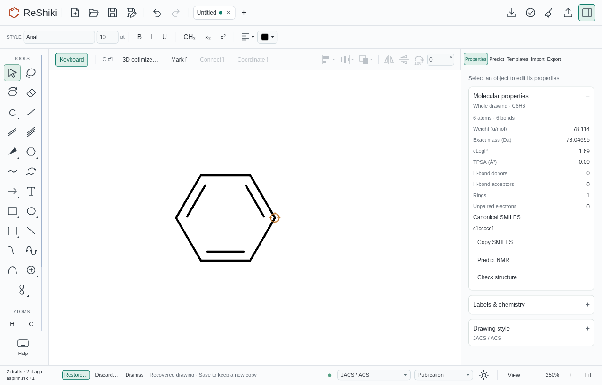
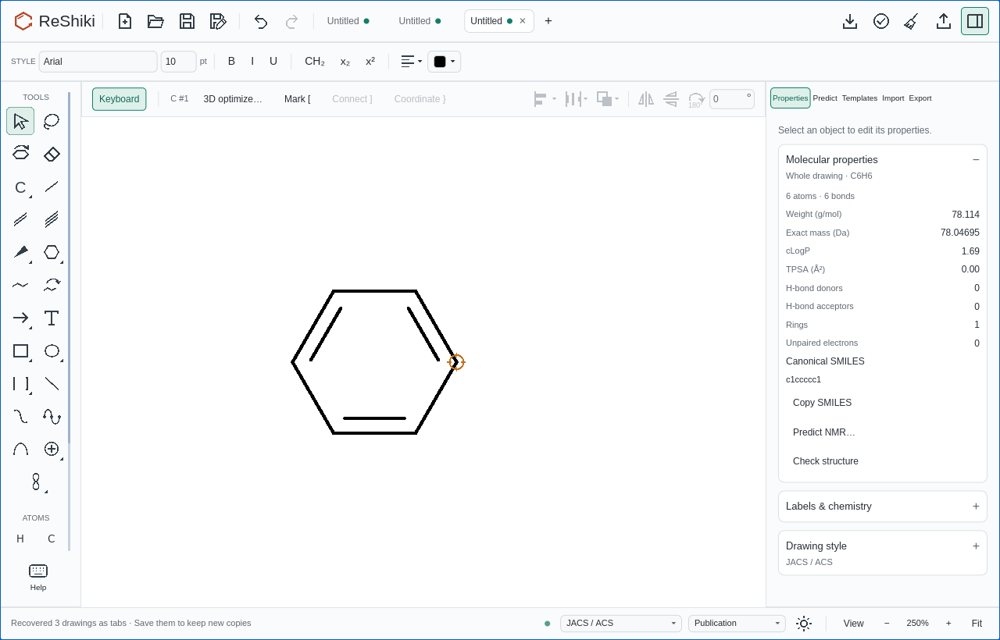

# Review and discard abandoned recovery drafts

Recovery now shows the number of drafts, the newest drawing title and its age.
**Restore…** opens a picker with drawing titles, save dates and atom counts; check
individual drawings or use **Restore all**. **Discard…** asks before moving the
offered recovery copies to the native Trash. **Dismiss** hides the offer until
the next launch and keeps the files.

Drafts belonging to a running ReShiki instance are excluded. Native discard
rechecks ownership and the offered snapshot before moving a file. The browser
has no Trash, so its confirmation explicitly says **Delete permanently**. Failed
deletion or ownership checks keep the offers and provide a retry route. A page
that cannot acquire its own session lock does not publish unprotected recovery
drafts. No automatic expiry is introduced.

## Matched banner examples

These are full application-renderer captures of the same valid recovery files,
empty drawing, JACS / ACS style, Publication output, Arial 10 pt, light theme and
100% zoom. Base: `3d80590a`; banner implementation: `f3954699`. The test-only
capture harness was also run on the base without the production fix. Both
captures use macOS 27.0.1 (26A434), Apple M1, a debug native WGPU renderer and a
1280 × 820 logical-pixel viewport. There is no image retouching.

The base renders identical PNG bytes with one and 100 offered drafts. This
shared before image applies to both comparisons:



After, one draft:



After, 100 drafts, including a long newest title:



At the minimum 1040 × 820 viewport, only the summary is shortened. All recovery
actions and the normal right-hand status controls remain reachable:



The fixtures contain benzene (`c1ccccc1`, 6 atoms), aspirin
(`CC(=O)Oc1ccccc1C(=O)O`, 13 atoms), and ethanol (`CCO`, 3 atoms). The three-draft
case uses titles `benzene.rsk`, `aspirin.rsk`, and Untitled. The 100-draft case
repeats those molecules and gives the newest draft the title
`benzene-recovery-review-after-a-very-long-session-name.rsk`. Snapshots were
initially saved at 2026-10-24 12:07 UTC and one-day intervals before that; base
and head reuse those same files. Dates in the picker and tooltip are UTC.

## Native interaction

The actual native app at `f3954699` was run with a disposable, isolated
`RESHIKI_DATA_DIR` populated only from these fixtures. Screenshots are
2560 × 1704 physical pixels on the same Mac, including its title bar. Banner,
picker and confirmation captures use 100% zoom. Restore fits the recovered
benzene drawing to 250%; keyboard drawing was then turned off for the
representative drawing capture.

1. Start with three real snapshot files and choose **Restore…**. Check only
   benzene and choose **Restore selected**. The restored drawing contains
   6 atoms and 6 bonds, formula C6H6 and molecular weight 78.114 g/mol. The other
   two offers remain.
2. Choose **Dismiss**. Verify that both remaining snapshot files still exist;
   quit and relaunch. Both are offered again.
3. Choose **Discard…**, then **Cancel**. Both files remain. Open **Discard…**
   again and choose **Move to Trash**. Both files disappear from the isolated
   recovery folder only after the operation succeeds; the app reports that two
   drafts moved to the Trash.
4. Quit and launch again. A fresh startup scan offers no recovery drafts. The
   disposable app is closed at the end of the check.








Native checking exposed an accessibility refresh gap after the app-owned
asynchronous discard receipt. Follow-up `66c1b8a6` collects a fresh tree when the
dialog closes and invalidates queued controls when the recovery dialog, pending
state, offered paths or checked paths change. Two regressions cover that receipt
and controls queued against changed selection or reused list rows.

## Browser durability and ownership checks

The mounted editor, actual IndexedDB transactions and Web Locks were exercised
in headless Chromium 156.0.8078.4 and WebKit 27.2 at `f3954699`, with the matching
app, library and worker WASM artifacts. Each browser passes all eight scenarios
below, with no page errors or unhandled Promise rejections. The
[machine-readable results](recovery-manager-browser-results.json) record the
observed file counts and injected failures.

| Scenario                                           | Result                                                                                                                                                                        |
| -------------------------------------------------- | ----------------------------------------------------------------------------------------------------------------------------------------------------------------------------- |
| Confirm permanent deletion                         | Three abandoned files become zero after transaction completion.                                                                                                               |
| Abort the deletion transaction once                | All three files and offers remain; retry deletes them.                                                                                                                        |
| Reject the owner query once                        | All three remain; retry re-queries and deletes them.                                                                                                                          |
| Restore all after that owner-query failure         | Restore re-queries owners without consuming the failed offer first; the resulting app shows three recovered tabs.                                                             |
| Restore selected after that owner-query failure    | The checked benzene draft restores after verification.                                                                                                                        |
| A second page holds one draft's owner lock         | Only the two abandoned files are deleted; the live owner's file stays.                                                                                                        |
| Reject this page's lock acquisition asynchronously | Drawing and autosave publish no unprotected draft; a healthy second page can discard only the three seeded abandoned files, while the first page's live drawing stays intact. |
| Restore a checked draft directly                   | The actual saved drawing has the expected six benzene atoms.                                                                                                                  |







## Reproduce and validate

The opt-in [capture harness](../../src/app/recovery_capture.rs) creates valid
snapshot files by importing the SMILES above through the native engine. It
preserves existing fixture files so base and head can use identical dates and
coordinates. Use a new temporary directory; do not point these checks at normal
application data.

```sh
qa_dir=$(mktemp -d "${TMPDIR:-/tmp}/reshiki-recovery-qa.XXXXXX")
RESHIKI_DATA_DIR="$qa_dir/app" \
RESHIKI_RECOVERY_QA_INPUT="$qa_dir/fixtures" \
RESHIKI_RECOVERY_QA_OUTPUT="$qa_dir/captures" \
cargo test --bin reshiki recovery_banner_evidence --locked -- --ignored
```

For the matched base, apply only this test harness and its test-only
`layout_snapshots::pass` visibility to a separate `3d80590a` checkout, and reuse
the generated fixture directory. Do not apply recovery manager source changes.

Build the editor WASM package with `scripts/build_wasm.sh`, then run the
[browser regression script](../../scripts/qa_recovery_browser.mjs) using Bun and
an installed Playwright module with Chromium and WebKit:

```sh
RESHIKI_RECOVERY_QA_INPUT="$qa_dir/fixtures" \
RESHIKI_QA_RECOVERY_BROWSER_OUTPUT="$qa_dir/browser-results" \
bun scripts/qa_recovery_browser.mjs
```

`RESHIKI_QA_PLAYWRIGHT` may name an existing Playwright module, and
`RESHIKI_QA_RECOVERY_PACKAGE` may name an isolated built editor package. Each
scenario uses a fresh browser context. The script seeds disposable IndexedDB
entries and never accesses a user's existing browser profile.

Validation includes 1,117 passing native main-binary tests (122 ignored), all
258 IO tests (5 ignored), 7 browser-storage model tests, native workspace Clippy,
WASM app/library/worker Clippy, formatting and normal commit hooks. The IO and
app tests seed actual valid snapshot files, test discard and fresh scans, retain
files on dismissal or failure, and protect running owners, changed snapshots
and symlinks. Windows uses `IFileOperation` with recycle-only and early-failure
flags, and reports failure rather than permanently deleting a recovery file.
Actual native Trash interaction was checked on macOS; Windows and Linux runtime
behavior was not exercised on this host.

Release-note caption: **Review recovery drafts by title, date and size, restore
only the drawings you need, or move abandoned copies to the Trash.** Suggested
image: the native picker above. Suggested alt text: **Recovery picker with
benzene checked, aspirin and Untitled unchecked, and Restore selected and
Restore all actions.**
