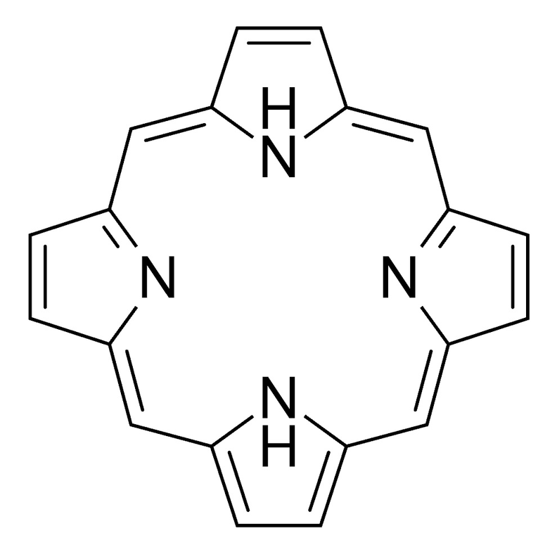
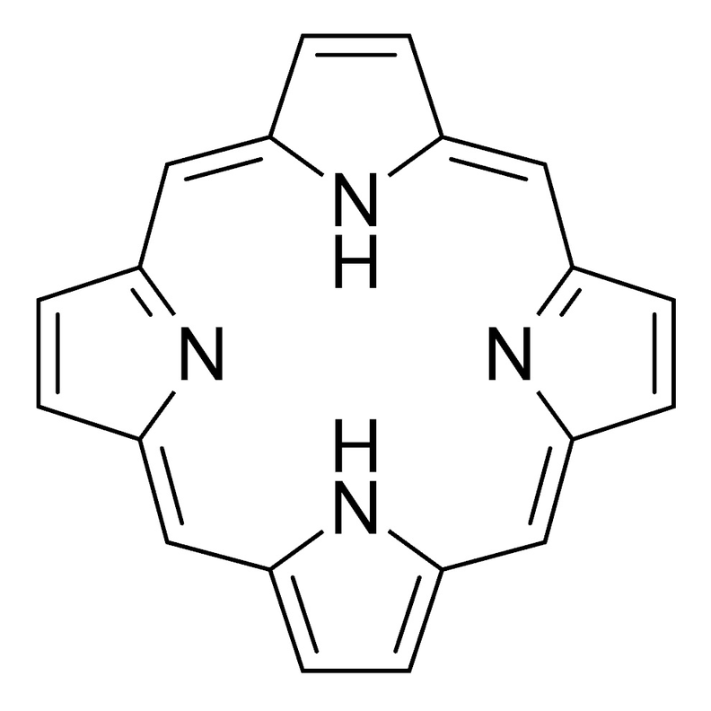
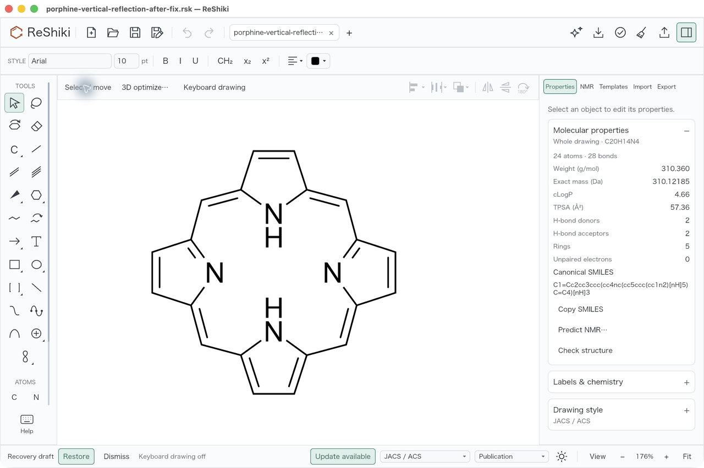

# Hydrogen labels follow reflections and rotations

Fixed hydrogen-label directions now follow the selected atoms when a drawing is
reflected or rotated. This correction is under review and unreleased.
[Porphyrin issue #88](https://github.com/Ameyanagi/ReShiki/issues/88) remains open
pending successful native ReShiki→ChemDraw editable clipboard exchange.

## Problem and correction

A vertical flip of porphine moved the two N–H atoms but retained their fixed
Above/Below label directions, placing both H labels outside the macrocycle.
The correction transforms fixed Left/Right/Above/Below directions in menu and
numeric transforms, selection-handle transforms, and pinned rotation/copy.
Auto placement and unselected atoms remain unchanged. Translation and positive
scaling preserve the chosen side; chemical and coordinate transforms are unchanged.

The direction changes before attached-arrow reconciliation measures label ink.
An already-clear endpoint and its neighboring curve control therefore keep
their transformed positions instead of moving unnecessarily around stale label
ink. Genuine overlaps still receive the normal clearance adjustment.

## Native before and after

Open the [original porphine fixture](fixtures/reflected-hydrogen-labels/porphine-source.rsk),
select the complete molecule, and click **Flip vertically** in the arrangement
toolbar. Both N–H labels should remain inside the ring. Use the toolbar's
**Undo**, then **Redo**, and save to a new file. Quit the app, relaunch it, and
open the saved file: the labels should remain inward and Undo/Redo should be
disabled for the fresh document.

| Before: fixed labels point outward                                                                                                     | After: labels remain inward                                                                                                          |
| -------------------------------------------------------------------------------------------------------------------------------------- | ------------------------------------------------------------------------------------------------------------------------------------ |
|  |  |

Actual native macOS testing passed the vertical flip, toolbar Undo/Redo, Save As,
and fresh-process reopen at **176% zoom, JACS style, Arial 10 pt**. The
[saved reflected fixture](fixtures/reflected-hydrogen-labels/porphine-vertical-reflection-after-fix.rsk)
is the document from that interaction, not a separately generated illustration.

Both comparison captures start from the same original fixture and vertical
flip. They show clean reopened results, with the inspector hidden and no
selection handles or keyboard-cursor overlay. In the earlier build, Redo in the
reopened test tab restored the outward-label defect; the candidate view is a
fresh-process reopen of the saved correction. Both full captures are
2560 × 1704 at the same 176% zoom, Arial 10 pt, and JACS style. Each uses the
identical pixel crop `(800, 500, 1790, 1490)`, uniformly resized from 990 × 990
to 792 × 792. The full fresh-reopen capture is resized to 1280 × 852.
No drawing content was altered or retouched.

## Chemical and regression checks

Public CLI analysis of the original and saved reflected drawings exited 0 with
valid results and no warnings. Both have **C20H14N4**, InChIKey
`RKCAIXNGYQCCAL-CEVVSZFKSA-N`, two donors, two acceptors, and no radicals.
Every chemical atom field and complete bond record is unchanged: **24 atoms
(20 C, 4 N), 28 bonds, 11 double bonds**. The opposite N21/N23 atoms retain one
H each; their fixed directions change Below→Above and Above→Below respectively.
Coordinate differences from a rigid reflection are at most 0.000012 world units,
within the existing fixture tolerance of 0.000030.

Seven focused tests pass. The complete model library passes **358 tests, zero
failures, ten existing ignored tests**. Strict model Clippy with warnings denied,
Rust formatting, and the diff whitespace check pass. Tests cover all three
transform paths, Auto/unselected controls, translation/scaling, the exact
porphine fixture, and attached-arrow clearance and reconciliation stability.
Before the fix, four of five original focused tests failed; the added
attached-arrow test also failed before the reconciliation ordering was corrected.

## Build and capture provenance

The declared PR base is `3d53fe7513ccfaacda681ad92b7a59e23633c9fa`.
It differs from the tested producer base only by PR #307's Linux documentation
and evidence; application source is unchanged.
The defect image uses the earlier ordinary macOS review producer
`47b14dab27f7de32120d16c11d53ab563cca1dd9`; its affected model transform sources
match the declared base. Its signed executable SHA-256 is
`5d0d995c56353e40406e37369b70060c58200ca17d9079a926fed667936a7b28`.

The corrected images use producer base
`3a39aea7d6d686ff626b5aed2c35fe3e292510a5` plus the then-uncommitted three-file
implementation and test patch with SHA-256
`889e3918a66ca72c1635f9f8d98222905b2fb0101684ed5dcc2d534ebab05fa8`.
Rust 1.99.0 built the ordinary default-feature macOS arm64 app using
`cargo build --locked -p reshiki --bin reshiki -j 2` in a fresh isolated target.
The current release bundler, payload checks, and strict ad-hoc signature
verification passed. All 4,172 tracked files and index/status guards matched
through validation, build, and packaging. The signed candidate executable hash is
`f5828e4c8cd6e259021d9c4127a6fa7d5e002615d53909458d8c76b5acb0ce0c`.
Later documentation or evidence commits are not the screenshot producer.

| Fixture          | SHA-256                                                            |
| ---------------- | ------------------------------------------------------------------ |
| Original         | `f864ffdc64d6af029b64642f04f4b56bfc7b989aca51634fc4bdc61d539e2268` |
| Saved reflection | `41342643598ffa04c72ca6656c441863001e472979cfb85b321028ce75a26e54` |

## Limits and reusable caption

Fixed labels store one of four cardinal directions. Arbitrary rotations select
the nearest side, with exact diagonal ties choosing horizontal placement;
separate small rotations can therefore differ from one combined rotation.
Reflections and quarter-turns map the directions exactly.

This native check covers the macOS reflection and saved-file workflow.
A separate native ChemDraw→ReShiki copy/paste also succeeds: the pasted editable
drawing preserves the exact 24-atom, 28-bond Kekulé graph, opposite N–H sites,
formula and InChIKey. The two unprotonated N atoms acquire explicit zero-H flags
without changing their chemistry. In the reverse direction, ordinary ReShiki
Copy followed by Paste into a new ChemDraw document produces an empty saved
CDXML page. The cause remains unresolved; issue #88 stays open for that exchange
requirement. Successful file conversion alone is not clipboard acceptance.

**Caption:** Reflect or rotate a molecule while keeping fixed hydrogen labels
on the corresponding side. Porphine's two N–H labels remain inward after a
vertical flip, Undo/Redo, and reopening the saved drawing.
