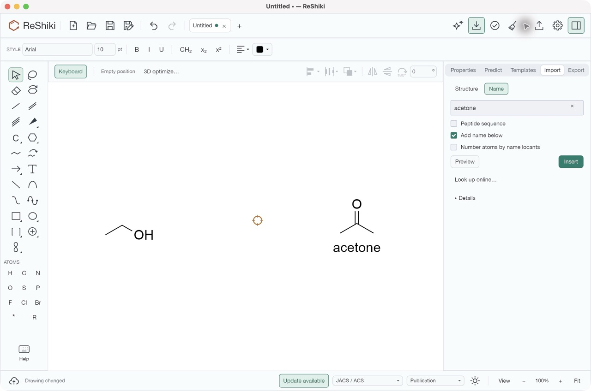
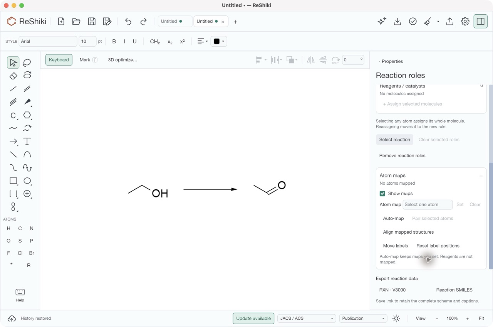

# ReShiki 0.16.0 release validation

This record lists the checks run on the 0.16.0 release preparation and the
checks that remain before the tag.
[Release notes](../changes-0.16.md) · [Release procedure](../releasing.md).

## Release preparation

The release preparation pull request sets the version to 0.16.0 in
`Cargo.toml` (`[package]` and `[workspace.package]`, which the Python package
follows) and `Cargo.lock`, moves the 52 release-note fragments into the
[release notes](../changes-0.16.md) with
`scripts/assemble_changelog.py --release 0.16.0`, adds the GitHub release
highlights in `.github/release-notes/v0.16.0.md` and updates the install
guide's file compatibility section. The npm packages take their version from
`Cargo.toml` when the tag publishes them, so `packages/editor/package.json`
and `packages/headless/package.json` are unchanged. The source is `main` at
`f25ab7eb`, the merge of
[PR #1234](https://github.com/Ameyanagi/ReShiki/pull/1234), 57 first-parent
merges after v0.15.0. Fixes merged to `main` for this release after that were folded in
the same way: [PR #1241](https://github.com/Ameyanagi/ReShiki/pull/1241)
(rings join the atoms they land on), at `524ac765`.

`VERSION` is 39 in `crates/model/src/document.rs`. `Document::file_version`
saves each drawing at the version of the newest feature it uses: 39 for a
property caption with a **Name** line or a custom name, 38 for any other
property caption linked to its molecule, 37 for an atom with more than two
radical electrons, 36 for an atom in a stereo group, 35 for an arrow with
interior nodes or a drawing style whose crossing clearance is not 1.1 pt, 34
for a two-sided residue group, 33 for a generated 3D model, model atom labels
or a plain XYZ model, 32 for ORTEP settings and 31 for a custom reaction-label
gap. Any other drawing is saved as version 30. ReShiki 0.15.0 reads up to
version 37, 0.14.0 up to 34 and 0.13.1 up to 30.

NMR shift labels from Python, the command line and MCP are atom numbers, which
every version since 30 stores, so they do not raise the version. A PNG's
editable drawing moved after the image data
([PR #1192](https://github.com/Ameyanagi/ReShiki/pull/1192)); 0.15.0's
`payload::read_png` walks every chunk until `IEND`, so it still finds it.

## Automated checks

These ran on the release preparation branch at `f25ab7eb` plus the version
change, on macOS arm64: the Rust checks on an Apple M4 Mac and the Python and
documentation checks on an Apple M1 Mac. The Rust tests ran with
`RESHIKI_INCHI_HELPER` and `RESHIKI_NAMING_HELPER` set to the debug build,
`RESHIKI_REQUIRE_INCHI_HELPER=1` and `RESHIKI_DATA_DIR` set to an empty
temporary folder:

| Check                      | Command                                                                                                                              | Result                                                                        |
| -------------------------- | ------------------------------------------------------------------------------------------------------------------------------------ | ----------------------------------------------------------------------------- |
| Build                      | `cargo build --locked --bin reshiki`                                                                                                 | Passed                                                                        |
| Version                    | `reshiki --cli --version` from the debug build                                                                                       | `reshiki 0.16.0`                                                              |
| Tag check                  | `scripts/build_release.py --tag v0.16.0 --check-tag-only`                                                                            | Passed; `v0.15.0` is refused                                                  |
| Application library tests  | `cargo test --locked -p reshiki --lib`                                                                                               | 514 passed, 14 ignored                                                        |
| Integration tests          | `cargo test --locked -p reshiki --test it -- theme_reference:: windows_version_metadata:: mcp_stdio:: mcp_tools:: headless_parity::` | 31 passed (1, 4, 14, 5 and 7)                                                 |
| Colour reference           | `cargo run --locked --example theme_colors`, then `bun fmt`                                                                          | Regenerated data matches main except `reshiki_version`                        |
| Rust format and lint       | `cargo fmt --all --check`, `cargo clippy --workspace --lib --bins --all-features --locked -- -D warnings`                            | Passed                                                                        |
| Python                     | `uv run --locked python -m unittest discover -s tests -p 'test_*.py'`                                                                | 288 passed, 12 skipped                                                        |
| Release notes              | `scripts/assemble_changelog.py --check`                                                                                              | 0 fragments left                                                              |
| JavaScript format and lint | `bun run format:check`, `bun run lint:js`                                                                                            | Passed                                                                        |
| Documentation              | `bun run docs:check`                                                                                                                 | 0 errors, 0 warnings, 0 hints                                                 |
| Website and links          | `bun run docs:build`                                                                                                                 | 13,717 local links/assets, llms.txt, agent-api.txt and 1,360 colours verified |

The pull request's Checks workflow runs the native, browser (wasm32),
Python and documentation jobs again; its results are on the pull request.

## Manual checks before the tag

The maintainer runs these on a manual **Release builds** run of the merged
`main` commit, or on its packages, and records the results here:

- [ ] **Release build:** a manual **Release builds** run passes on all six
      platforms and does not publish; see [Release build](#release-build).
- [ ] **Live reference suite:** the complete live RDKit reference tests pass
      on macOS arm64, Linux x64 and Windows x64; see
      [Live RDKit reference suite](#live-rdkit-reference-suite).
- [x] **Focus after closing reviews:** run Clean up from the toolbar and
      close its ▾ menu with Esc, and close 3D preview, atom label, Name import
      preview, Structure import, reaction mapping proposal and assistant review
      with Enter and separately with Esc (Apply/Discard where those keys are
      unavailable). After each close, Delete or Cmd+Z acts on the drawing
      without a click. Passed for every panel except assistant review, which
      was not checked; see
      [Focus after closing reviews](#focus-after-closing-reviews).
- [x] **Updater:** the Nightly channel from an older to a newer nightly on
      macOS arm64 and Arch Linux x64, and **Update and restart** to Stable
      0.15.0 on both; see [Updater](#updater). Ubuntu arm64 was not run.
- [ ] **macOS app (Apple Silicon and Intel):** the DMG opens, the app reports
      0.16.0 and moves an existing data folder to `~/.reshiki/`, opens
      **Settings** with Cmd+, and copies a drawing on a white background at
      300 dpi, shows properties with a **Name** line under a molecule and saves
      and reopens the drawing, opens a MOL file as itself and keeps it as MOL
      on **Save**. **Pending.**
- [ ] **Windows x64:** setup installs over 0.15.0, the app starts, keeps its
      data folder, names a molecule and edits an embedded drawing in
      PowerPoint. **Not run:** the maintainer chose to tag 0.16.0 with Windows
      covered by CI only. The in-app update, the unsigned-download wording, the
      Office task pane and the OLE preview were not checked on a Windows
      desktop. Windows ARM64 is covered by the CI package checks only.
      Downloads remain unsigned; see [Updater](#updater) for the publisher
      check.
- [ ] **Linux (Arch Linux x64 and Ubuntu arm64):** the portable archive starts,
      moves an existing data folder to `~/.reshiki/`, opens a drawing and an SD
      file, and names a molecule. **Pending.**
- [ ] **Browser demo:** a demo built with `scripts/build_wasm.sh` and
      `scripts/package_web_demo.sh` loads in Chrome, Safari and Firefox,
      draws, and converts a name with **Import → Name**.
- [ ] **npm packages:** the packages built by the release workflow pass their
      tests; after publication `@ameyanagi/reshiki@0.16.0` and
      `@ameyanagi/reshiki-headless@0.16.0` are `latest` (see
      [Configure npm publishing](../releasing.md#configure-npm-publishing)).
- [ ] **PyPI:** after publication `uv add reshiki` installs 0.16.0 on each
      platform, and `Molecule.from_smiles("CCO").predict_nmr("13C")` returns
      rows.
- [x] **Compatibility:** drawings saved by this branch at versions 30, 38 and
      39 checked against the published 0.15.0; see [Compatibility](#compatibility).

## Release build

Manual **Release builds**
[run 44269689222](https://github.com/Ameyanagi/ReShiki/actions/runs/44269689222)
at `f25ab7eb`: **failed**. Every package passed except macOS x64 (Intel), where
`hdiutil` failed while creating the disk image with "No space left on device".
A fix is in progress (branch `fix/intel-dmg-space`), and the run will be
repeated after it merges.

## Live RDKit reference suite

The complete live reference tests gate publication in `release.yml`.
**Checks** with `live_reference=true`
[run 44269684105](https://github.com/Ameyanagi/ReShiki/actions/runs/44269684105)
at `f25ab7eb` ran them on macOS arm64, Linux x64 and Windows x64: **failed**.
The same 6 tests failed on all three platforms:

| Shard | Test                                                                                       |
| ----- | ------------------------------------------------------------------------------------------ |
| 0     | `reshiki-io` library: `native_inchikey_is_never_called_for_any_analysis_path`              |
| 0     | `cdxml_molecular`: `malformed_and_excessive_inputs_fail_atomically`                        |
| 2     | `cdxml_bonds`: `association_is_bounded_atomic_and_handles_long_vertical_fragments`         |
| 2     | `engine_migration`: `exports_and_reimports_preserve_rdkit_chemistry_and_document_metadata` |
| 2     | `engine_migration`: `native_drawings_match_the_original_python_importer`                   |
| 3     | `native_import`: `drawing_and_coordinate_reactions_match_complete_original_responses`      |

A fix is in progress (branch `fix/live-reference-016`), and the run will be
repeated after it merges.

## Focus after closing reviews

Checked on 18 November 2026 on macOS arm64 (Apple M4) with the Nightly build
`0.15.0-nightly.20261118.44254050020.1`, built from `main` at `f25ab7eb`, the
source of this release. It ran with `RESHIKI_DATA_DIR` set to an empty folder.
Each case started with part of the drawing selected. After the panel closed,
the next keys were Delete and then Cmd+Z, with no click in between. Each pair
of screenshots shows the drawing after Delete and after Cmd+Z.

| Panel                     | Closed with                             | Delete acted | Cmd+Z acted | Screenshots                                                                                                                                                           |
| ------------------------- | --------------------------------------- | ------------ | ----------- | --------------------------------------------------------------------------------------------------------------------------------------------------------------------- |
| Clean up                  | The toolbar button (it applies at once) | yes          | yes         | [Delete](../images/release-0.16.0/focus-restore/01-cleanup-enter-delete.jpg) · [Cmd+Z](../images/release-0.16.0/focus-restore/01-cleanup-enter.jpg)                   |
| Clean up options (▾ menu) | Esc                                     | yes          | yes         | [Delete](../images/release-0.16.0/focus-restore/01-cleanup-esc-delete.jpg) · [Cmd+Z](../images/release-0.16.0/focus-restore/01-cleanup-esc.jpg)                       |
| 3D preview                | Enter                                   | yes          | yes         | [Delete](../images/release-0.16.0/focus-restore/02-3d-enter-delete.jpg) · [Cmd+Z](../images/release-0.16.0/focus-restore/02-3d-enter.jpg)                             |
| 3D preview                | Esc                                     | yes          | yes         | [Delete](../images/release-0.16.0/focus-restore/02-3d-esc-delete.jpg) · [Cmd+Z](../images/release-0.16.0/focus-restore/02-3d-esc.jpg)                                 |
| Atom label editor         | Enter                                   | yes          | yes         | [Delete](../images/release-0.16.0/focus-restore/03-atom-label-enter-delete.jpg) · [Cmd+Z](../images/release-0.16.0/focus-restore/03-atom-label-enter.jpg)             |
| Atom label editor         | Esc                                     | yes          | yes         | [Delete](../images/release-0.16.0/focus-restore/03-atom-label-esc-delete.jpg) · [Cmd+Z](../images/release-0.16.0/focus-restore/03-atom-label-esc.jpg)                 |
| Name import preview       | Enter in the name field                 | yes          | yes         | [Delete](../images/release-0.16.0/focus-restore/04-name-import-enter-delete.jpg) · [Cmd+Z](../images/release-0.16.0/focus-restore/04-name-import-enter.jpg)           |
| Name import preview       | Esc in the name field                   | yes          | yes         | [Delete](../images/release-0.16.0/focus-restore/04-name-import-esc-delete.jpg) · [Cmd+Z](../images/release-0.16.0/focus-restore/04-name-import-esc.jpg)               |
| Structure import          | **Insert** (Enter adds a line)          | yes          | yes         | [Delete](../images/release-0.16.0/focus-restore/05-structure-import-enter-delete.jpg) · [Cmd+Z](../images/release-0.16.0/focus-restore/05-structure-import-enter.jpg) |
| Structure import          | Esc in the structure field              | yes          | yes         | [Delete](../images/release-0.16.0/focus-restore/05-structure-import-esc-delete.jpg) · [Cmd+Z](../images/release-0.16.0/focus-restore/05-structure-import-esc.jpg)     |
| Reaction mapping proposal | Shift+Tab to **Apply maps**, then Enter | yes          | yes         | [Delete](../images/release-0.16.0/focus-restore/06-reaction-mapping-enter-delete.jpg) · [Cmd+Z](../images/release-0.16.0/focus-restore/06-reaction-mapping-enter.jpg) |
| Reaction mapping proposal | **Discard** (no Esc shortcut)           | yes          | yes         | [Delete](../images/release-0.16.0/focus-restore/06-reaction-mapping-esc-delete.jpg) · [Cmd+Z](../images/release-0.16.0/focus-restore/06-reaction-mapping-esc.jpg)     |

Clean up has no preview since
[PR #1207](https://github.com/Ameyanagi/ReShiki/pull/1207), so its rows are
the toolbar button and its ▾ options menu. Name and Structure import are
sidebar panels: Enter, **Insert** and Esc return keyboard focus to the drawing
and leave the sidebar open with its draft. Assistant review was not checked
because it needs a live assistant; the automated
`review_close_returns_focus_*` tests cover its local buttons.

## Updater

Checked on 18 November 2026 with fresh data folders:

| Check                                                                                                          | macOS arm64            | Arch Linux x64 |
| -------------------------------------------------------------------------------------------------------------- | ---------------------- | -------------- |
| Nightly channel, from nightly run 44213908870 to run 44254050020 (offered as **Download nightly ↗**, by hand)  | Pass                   | Pass           |
| The newer nightly's first start removes leftovers (`updates/9.9.9/`, `update-cache.json`, `.reshiki-update-*`) | Pass                   | Pass           |
| A drawing saved by the older nightly reopens in the newer one                                                  | Pass                   | Pass           |
| **Update and restart** from that nightly to Stable 0.15.0                                                      | Pass on the second run | Pass           |

On Arch Linux x64 the installed binary is byte-identical to the official
0.15.0 archive. On macOS arm64, `codesign` and `spctl` accept the installed
app and the updates folder is pruned. The first macOS run hung because a
pending Keychain prompt for the GitHub sign-in kept the app from quitting
([issue #1240](https://github.com/Ameyanagi/ReShiki/issues/1240), to be fixed
after 0.16.0). Ubuntu arm64 was not run: the test machine has no display.

On Windows x64, only the updater's publisher check was run, from the command
line: on the unsigned setup programs it returns `NotSigned` and the updater
falls back to the checksum, as designed.

## Compatibility

Checked on macOS arm64 with `reshiki --cli convert … --to smiles`. The `.rsk`
files were written by this branch's `Document::file_json`, the code the app
saves with, from phenol with the captions below; each was read by the debug
build of this branch and by the published 0.15.0 macOS arm64 download
(`reshiki-0.15.0-macos-arm64.zip`, SHA-256 checked against `SHA256SUMS`):

| Drawing                                             | Saved as | 0.16.0 | 0.15.0                                                                                          |
| --------------------------------------------------- | -------- | ------ | ----------------------------------------------------------------------------------------------- |
| No caption                                          | 30       | Opens  | Opens                                                                                           |
| Property caption with Mol. Wt. and Formula          | 38       | Opens  | Refused: "This drawing was made with a newer version of ReShiki (document version 38). Update…" |
| Property caption with a **Name** line               | 39       | Opens  | Refused: "This drawing was made with a newer version of ReShiki (document version 39). Update…" |
| Property caption with the custom name `Compound 3a` | 39       | Opens  | Refused: "This drawing was made with a newer version of ReShiki (document version 39). Update…" |

Both builds read the drawing as `Oc1ccccc1`. The 0.15.0 CLI cannot load a
data folder or preferences, so the data folder move is described from the code
([PR #1216](https://github.com/Ameyanagi/ReShiki/pull/1216)), not from a run.

## Build and verification

Moved from the [release notes](../changes-0.16.md).

- **Release builds.** Published builds use a new Cargo `dist` profile: the
  `release` profile with fat link-time optimization and one codegen unit. The
  macOS builds use thin link-time optimization, because the fat-LTO link needs
  more memory than the macOS arm64 runner has. The macOS arm64 executable goes
  from 81.4 MB to 72.6 MB and the portable archive from 33.8 MB to 32.7 MB.
  `scripts/build_release.py` and the Release builds workflow read the binary
  and its symbol file from `target/<target>/dist/`; `cargo build --release`,
  tests and development bundles are unchanged. Embedded catalogs are stored
  compressed, and TLS uses ring, so the build no longer needs CMake
  ([#1202](https://github.com/Ameyanagi/ReShiki/pull/1202);
  [Build locally](../releasing.md#build-locally)).
- **Linux arm64.** The Linux arm64 release build uses the `release` profile's
  settings (`lto = false`, 16 codegen units): its fat-LTO link peaked at
  18.6 GiB on a 16 GB runner. It now peaks at 2.8 GiB; the portable archive is
  36.7 MB instead of 35.8 MB
  ([#1213](https://github.com/Ameyanagi/ReShiki/pull/1213)).
- **Packages.** macOS disk images use LZMA compression and are about 40%
  smaller. Release executables and the Python package carry no symbols; the
  Release builds workflow keeps a separate symbol file for crash reports
  ([#1178](https://github.com/Ameyanagi/ReShiki/pull/1178)).
- **Nightly builds** are no longer made for Intel Macs: that build kept
  reaching its 100-minute limit. Stable releases still include Intel Mac
  downloads, and the **Nightly** update channel on an Intel Mac says so
  ([#1218](https://github.com/Ameyanagi/ReShiki/pull/1218)).
- **Release notes.** Each pull request adds its release note as one file in
  [`changes/unreleased/`](unreleased/README.md); `scripts/assemble_changelog.py`
  checks, assembles and moves them
  ([#1178](https://github.com/Ameyanagi/ReShiki/pull/1178)). It writes UTF-8
  whatever the Windows code page is, and the documentation workflow runs when
  it changes ([#1180](https://github.com/Ameyanagi/ReShiki/pull/1180)).
  [Writing and terms](../writing-style.md#release-notes) sets the sections of
  every release note, and release validation records live in
  `docs/changes/` ([#1190](https://github.com/Ameyanagi/ReShiki/pull/1190)).
- **Documentation.** The website sidebar follows a learning path; 29 review and
  validation records moved to `docs/changes/` with redirects; the README is a
  short landing page; [Build and test](../development.md) lists the
  prerequisites for each system; guide screenshots are lossless WebP (18.15 MB
  to 4.55 MB) ([#1190](https://github.com/Ameyanagi/ReShiki/pull/1190)). The
  old getting-started page redirects to the install guide, and
  `vendor/README.md` lists every vendored crate, checked by
  `scripts/check_vendor.py`
  ([#1178](https://github.com/Ameyanagi/ReShiki/pull/1178)). The ruviz note,
  which described a library ReShiki never used, is removed
  ([#1224](https://github.com/Ameyanagi/ReShiki/pull/1224)).
- **Tests.** The files under `tests/` build as one test binary, `it`, except
  `agent_api_windows_pipes`, `metafile_worker` and `picture_memory`; run one
  file's tests with `cargo test -p reshiki --test it theme_reference::`. The
  integration tests built in 37 seconds instead of 334 on an Apple Silicon
  Mac. On Windows, CI runs every ignored application test not named
  `manual_…` or `…_child` (145 renderer checks). Three stale capture tests are
  removed, and the [module index](../modules.md) is generated and checked
  ([#1201](https://github.com/Ameyanagi/ReShiki/pull/1201);
  [Opt-in renderer tests](../development.md#opt-in-renderer-tests)).
  `cargo test --release --bin reshiki` compiles again
  ([#1186](https://github.com/Ameyanagi/ReShiki/pull/1186)). The spiro Clean
  Up regression test covers every scope and orientation
  ([#1182](https://github.com/Ameyanagi/ReShiki/pull/1182)), and a worker test
  on Linux no longer fails when `/proc` returns `ESRCH`
  ([#1194](https://github.com/Ameyanagi/ReShiki/pull/1194)).
- **Shared test data.** The PNG preview and property rounding are in
  `reshiki-io` (`preview::png`, `Analysis::rounded`), and
  `tests/fixtures/agent-api/parity.json` holds the answers the command line,
  Python and JavaScript must all give
  ([#1188](https://github.com/Ameyanagi/ReShiki/pull/1188)).
- **CI.** The workspace tests compile once per platform and the partition jobs
  run the archive. Pull request checks keep their build cache, while release,
  nightly and corpus builds no longer save caches. The InChI helper builds for
  the host, two naming-worker tests run at a time, nextest stops a test after
  15 minutes, the **Changed fixture rows** job lists gained and lost rows, and
  the macOS Python and geometry checks share the macOS lint job. Clippy runs
  in a pre-push hook ([#1187](https://github.com/Ameyanagi/ReShiki/pull/1187),
  [#1201](https://github.com/Ameyanagi/ReShiki/pull/1201);
  [CI](../development.md#ci)). The live reference shards are rebalanced from
  measured durations, cached, and run in their own concurrency group
  ([#1174](https://github.com/Ameyanagi/ReShiki/pull/1174)).
- **0.15.0 release validation.** The preparation record of 0.15.0.
  [Validation record](release-0.15.0-validation.md) ·
  [PR #1170](https://github.com/Ameyanagi/ReShiki/pull/1170).
- **Release preparation.** Update the version, the release notes and the
  documentation for 0.16.0.
