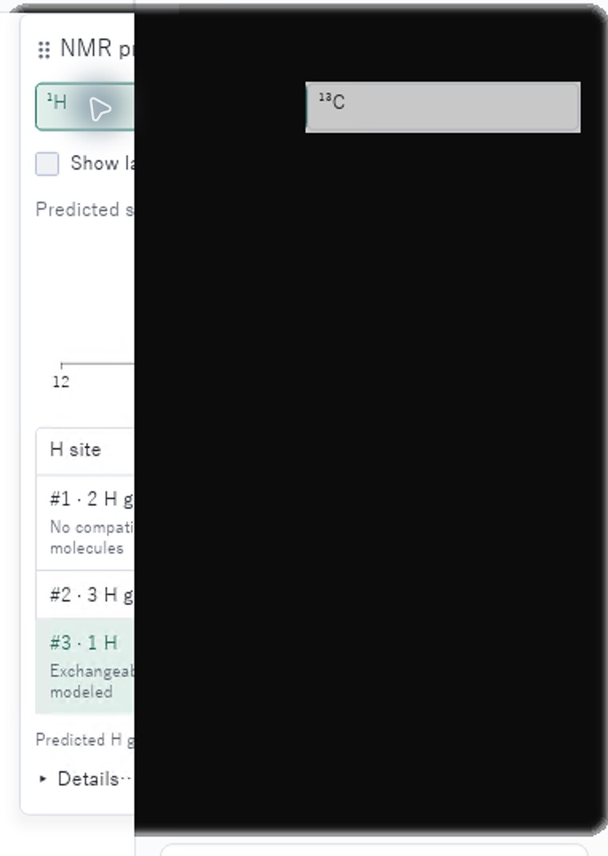
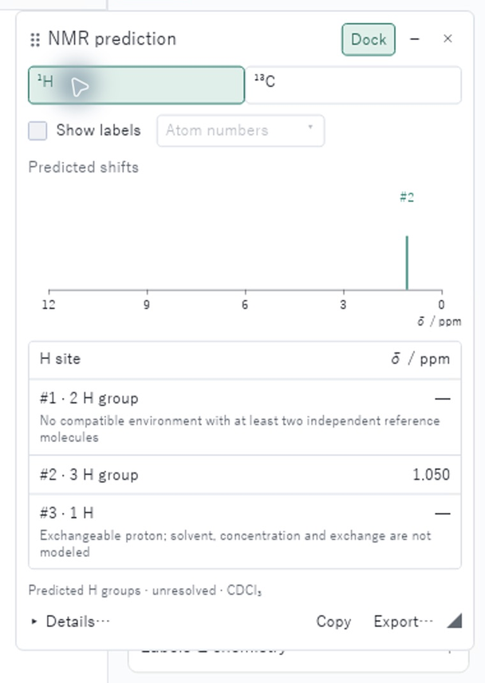
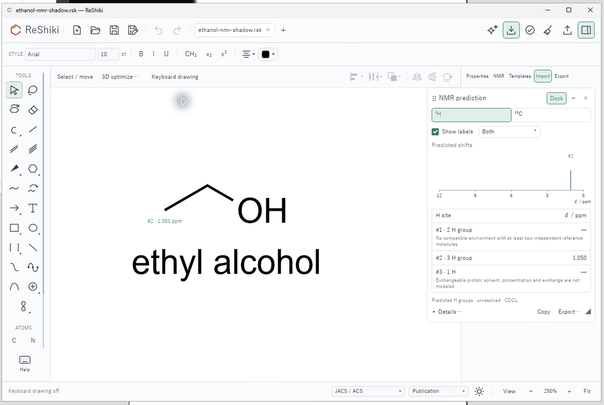

# Windows NMR surface shadows

[PR #310](https://github.com/Ameyanagi/ReShiki/pull/310) · @Ameyanagi · merged, unreleased.

With a floating NMR report open and the inspector expanded, repeated control
interactions could accumulate a black rounded shadow over most of the report on
Windows. The NMR surface now uses the existing Windows shadow guard: its border
and background remain, while the blurred shadow is omitted. macOS and Linux
retain their previous shadows. NMR predictions, controls and drawing data are
unchanged.

| Before                                                                                                | After                                                                                                         |
| ----------------------------------------------------------------------------------------------------- | ------------------------------------------------------------------------------------------------------------- |
|  |  |

These are matched crops of actual Windows application captures at **100% display
scale and 250% drawing zoom**, using the same JACS / ACS style and
[controlled ethanol drawing](fixtures/windows-nmr-shadows/ethanol.rsk).
Both 6016 × 3324 captures use the same pixel crop, `(3520, 1128)` to
`(4280, 2198)`, uniformly resized by 0.8 to 608 × 856; no content was retouched.
The corrected report remained clear after 16 control interactions. Not every
attempted nucleus click changed the selected nucleus; an explicit **¹H** click
afterward restored the proton report for the comparison. Enabling assignment
labels, opening their choices, choosing **Both**, and collapsing the report also
worked without accumulated darkening.

Reusable caption: The Windows NMR report remains readable after repeated control
interactions, with assignment labels and the Both mode still available.

To repeat the native check, open the ethanol fixture, open its floating NMR
report with the inspector expanded, interact with the report controls, then
explicitly select ¹H. Enable assignment labels, choose Both and collapse the
report. Compare at unchanged display scale and panel framing.

The baseline is the published Nightly from
[`8e381511`](https://github.com/Ameyanagi/ReShiki/commit/8e38151190eb2c3814df23a3eb166fb21c972d64)
(executable SHA-256 prefix `cf5f2df8`). The native candidate uses source
[`300434d0`](https://github.com/Ameyanagi/ReShiki/commit/300434d073646ebff872e14ea8fb592330a4ca6e)
(executable prefix `743cb076`), built through controller
[`41355de2`](https://github.com/Ameyanagi/ReShiki/commit/41355de20bd80a8f2462b553a82cda525450148b)
in [hosted review run 38137399981](https://github.com/Ameyanagi/ReShiki/actions/runs/38137399981).
The source and executable qualification is retained separately from these native
captures; the controller commit changes build pins, not the NMR implementation.

[Windows CI](https://github.com/Ameyanagi/ReShiki/actions/runs/38137315865/job/114463774712)
passed all **33 NMR tests**, including the new partial-redraw regression. Its
**24 rendering combinations** cover light/dark themes, floating and docked
reports, collapsed titles and the label popup at scale factors 1, 1.25 and 2.
Each performs 16 partial redraws and requires pixels outside the damaged region
to remain unchanged. A separate style test checks both themes and the retained
non-Windows appearance.

At final PR head
[`5a6baecf`](https://github.com/Ameyanagi/ReShiki/commit/5a6baecf52855e7d47bb7e2834392b256ed0d3a7),
[Checks run 38140195238](https://github.com/Ameyanagi/ReShiki/actions/runs/38140195238)
passed. After the [body-only contribution-license check](https://github.com/Ameyanagi/ReShiki/actions/runs/38142718286)
also passed, the final rollup was 25 successful and four expected skipped checks.
PR #310 merged at
[`6d989010`](https://github.com/Ameyanagi/ReShiki/commit/6d989010a17966b81b7cb8d0092f4d1363ea96f8).
These CI results do not change the native producers identified above.

All nine active application shadow sites now use the platform guard. The unused
iced `auto_scroll` shadow is not an active ReShiki feature. Native color-popover,
context-submenu, Help-scroll and drawing-style menu checks also remained clear.
The empty Import dock remained clear; no import execution was qualified.
Assistant checking reached the local installed/signed-in ready card before
returning to the drawing, with no prompt, Send or test connection.

The rendering scales above do not establish native high-DPI acceptance: this
desktop review was at 100% only, and [issue #108](https://github.com/Ameyanagi/ReShiki/issues/108)
remains open. Earlier successful Windows NMR checks are scoped historical
results, not a guarantee against later redraw defects. NMR coverage and
Co(en)3 accuracy are unchanged; [issue #246](https://github.com/Ameyanagi/ReShiki/issues/246)
remains open. This correction introduces no third-party material.
