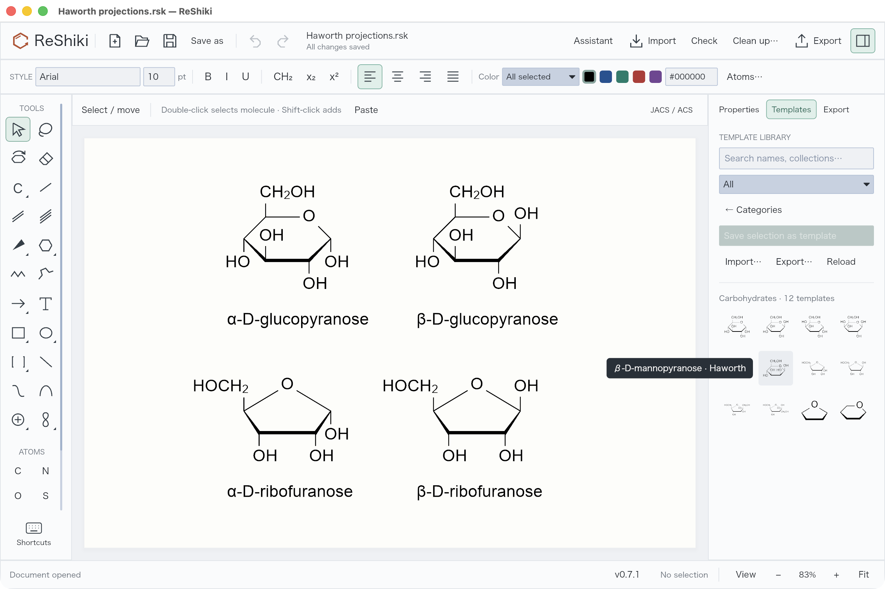
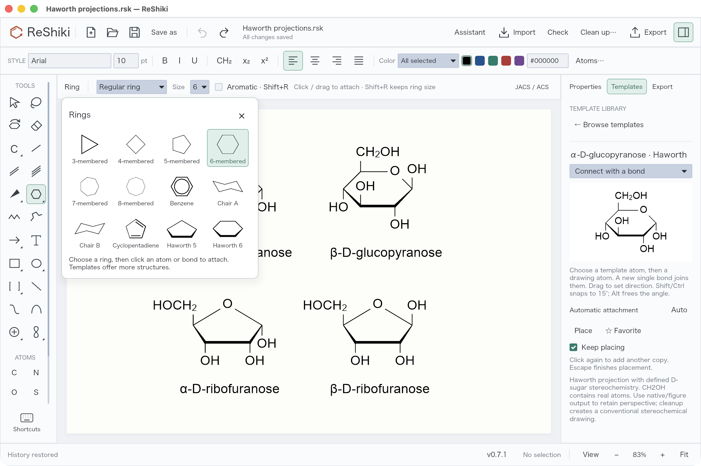
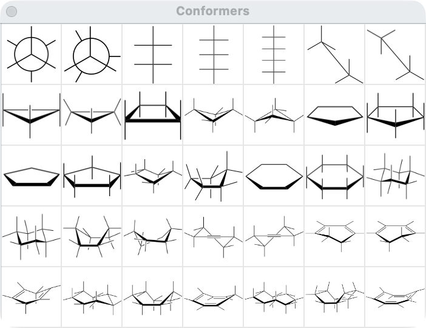

# Haworth projections

Haworth projections are available as editable ring outlines and chemically defined carbohydrate templates.

## Draw a ring or place a sugar

- Open the ring palette and choose **Haworth 5** or **Haworth 6** for a carbon ring outline. Click to place it; drag to rotate it. The front edge is bold and the two adjoining sides taper toward the back.
- Open **Templates → Carbohydrates** for oxygen-containing furanose/pyranose scaffolds and 24 defined α/β sugars: D-glucopyranose, D-galactopyranose, D-mannopyranose, D-ribofuranose, D-fructofuranose, 2-deoxy-D-ribofuranose, D-xylopyranose, L-fucopyranose, L-rhamnopyranose, N-acetyl-D-glucosamine (GlcNAc), N-acetyl-D-galactosamine (GalNAc), and D-glucopyranuronic acid (GlcA). Search accepts the full names, standard glycan symbols, `Haworth`, `alpha` and `beta`.
- Each named sugar also has a **Haworth, ring H** variant, giving 48 sugar drawings and two blank oxygen scaffolds in Carbohydrates. The default omits ring-carbon H atoms. The ring H variant draws H opposite OH, NHAc, CH₃, CH₂OH or CO₂H; deoxy C-2 and xylose C-5 have H on both faces and remain achiral. Fructose’s anomeric carbon already has two non-H branches, so it has no ring H.
- Choose a template and click empty space to place it. **Escape** returns to Select. Placement, bond appearance changes and Undo/Redo use the existing editor controls.

The sugar templates contain real atoms. **CH₂OH** is a contracted two-atom fragment, **NHAc** contains N–C(=O)–C, and **CO₂H** contains C(=O)–O with its acidic H. These groups retain their hidden atoms for atom counts, formulas and molecular identifiers. The 6-deoxy L-sugars show an explicit **CH₃** carbon label. L-fucose and L-rhamnose have C-6 down in the standard orientation; α/β describes the relationship to that terminal group, so their anomeric OH directions are reversed relative to the D-sugars. Left-facing groups use **HOCH₂** to keep the attachment on carbon. Expand a group with the usual abbreviation controls when individual atoms need editing.

## Chemistry and appearance

The 24 named sugars have explicit tetrahedral configurations, including the anomeric center. Their formulas, connectivity, canonical isomeric SMILES and standard InChIKeys are checked against independent [PubChem records](../assets/haworth-sugars.json), for both H-omitted and ring H variants. Explicit H is added as the fourth neighbor without changing the winding; achiral CH₂ carbons receive no `AtomStereo`. The original ten H-omitted documents are also pinned byte-for-byte in [a frozen native-document fixture](../tests/fixtures/haworth-original-documents.json). The ring's bold and tapered edges describe perspective; changing those edges' appearance does not erase or create stereochemistry.

Blank ring outlines and oxygen scaffolds have **no assigned stereochemistry**. Adding substituents to a scaffold does not automatically infer a carbohydrate configuration. Moving an OH label above or below a ring also does not switch the stored anomer; choose the corresponding α/β template for that change. Automatic Fischer/Haworth conversion and arbitrary sugar recognition are not included. The L-configured templates are specifically L-fucose and L-rhamnose. Preassembled nucleosides and nucleotides are available in the Nucleosides template group; general glycoside assembly is not inferred from drawings.

The conventions follow the [IUPAC Haworth drawing recommendations](https://iupac.qmul.ac.uk/drawing/stereo.html#ST-1.9). This is a drawing projection, not an energy-minimized three-dimensional conformation. Cleanup can replace it with an ordinary stereochemical layout.

## Save, copy and exchange

| Output                        | Retained information                                                                                                                                                                                              |
| ----------------------------- | ----------------------------------------------------------------------------------------------------------------------------------------------------------------------------------------------------------------- |
| Native `.rsk`                 | Editable atoms, contracted groups, configurations and perspective styling                                                                                                                                         |
| SVG, PNG, PDF and figure copy | Visible Haworth appearance                                                                                                                                                                                        |
| MOL / isomeric SMILES         | Molecular connectivity and defined stereochemistry; MOL uses conventional stereo bonds and expanded groups                                                                                                        |
| CDXML / CDX                   | Supported five/six-member Haworth drawings, including the added sugars and ring H forms, retain editable structure, stereochemistry and perspective styling; inconsistent or unsupported projections are rejected |

Drawing MOL exports mark defined tetrahedral configurations as absolute. Without this flag, ChemDraw may place them in a relative `&1` stereo group. The low-level reference writer retains RDKit's default output for compatibility tests; the application writer sets the flag. See [RDKit's chiral-flag semantics](https://rdkit.org/docs/cppapi/MolFileStereochem_8h_source.html).

Styled editable exchange checks the drawing against its stored stereochemistry. The supported convention has one bold front edge, two wedges widening toward that edge, a five- or six-member ring and unambiguous up/down substituents. Explicit H is recognized on the opposite face; two identical H substituents do not generate a stereocenter. Contracted NHAc and CO₂H groups are exported with their real atoms. Rotation and translation are supported. Moving a substituent across the ring plane without changing the stored configuration, mirroring the projection while retaining the original configuration, or distorting the ring can make the drawing inconsistent; editable export then reports an error. Native and figure exports remain available.

Import recognizes this convention in ChemDraw CDXML/CDX and ChemDraw-authored 2D V2000/V3000 MOL files. ChemDraw writes a MOL front edge as a wedge, so those files need their original bond directions retained during import. Treating all three front edges as ordinary stereobonds loses the configurations at the back of the ring. This recognition is limited to the tested convention, and does not provide general Fischer/Haworth conversion or arbitrary carbohydrate recognition.

See the [complete ChemDraw format study](haworth-interchange.md) for the 14-structure matrix, reproducible capture commands, clipboard formats and limits of each type of output.

## Verification

Computer-use checks against **ChemDraw 26.0.0.6599 on macOS**, September 24, 2026:

- Opened ChemDraw's **Conformers** and **Hexoses** palettes, placed its five/six-member projection examples and inspected the front-edge geometry and substituent directions. The comparison below shows ChemDraw's own Conformers palette.
- Opened all ten ReShiki sugar MOL exports in ChemDraw, selected each molecule and copied its SMILES from ChemDraw's clipboard. All ten standard InChIKeys matched their independent PubChem records. The captured outputs are retained in [haworth-chemdraw.json](../tests/fixtures/haworth-chemdraw.json).
- The first MOL check exposed unwanted `&1` relative-stereo labels. Repeating the import after setting the absolute flag removed those labels. This checks chemical interchange; the MOL file does not preserve the exact Haworth artwork.
- In the optimized ReShiki desktop build, browsed the 12 carbohydrate templates, placed α-D-glucopyranose, checked one-step Undo/Redo, and placed a five-member Haworth outline with formula C₅H₁₀.

The September ChemDraw captures above cover the original ten sugars; they are not new desktop captures of the added sugars. Automated checks now cover all 24 PubChem identities and their ring H variants, α/β distinctions, D/L substituent directions, real CH₂OH/NHAc/CO₂H groups and visible CH₃, five/six-member ring closure, rotation, copy/remapping, native round trips, molecular and figure exports, absolute MOL flags, perspective edge styling and editor Undo/Redo.

`cargo run --locked --example haworth_qa -- artifacts/haworth-qa` generates editable examples and exchange files for desktop checks. Generated output remains outside the tracked source tree.

The fourteen added anomers were fetched independently from PubChem PUG REST by their names on November 2, 2026, before comparing the generated structures. Each frozen row records its queried name, PubChem title, stereochemical SMILES, molecular formula, standard InChIKey, CID, record URL and property-request URL. Both display variants use the same identity reference. The identity gate imports the frozen SMILES independently, compares canonical isomeric SMILES and formula, and checks the generated document’s standard InChIKey directly against the frozen key. Cleanup, native save/copy/rotation and molecular/editable export round trips must retain that key. H-omitted defaults retain their geometry and native serialization.

| Sugar pair             |    α CID |  β CID |
| ---------------------- | -------: | -----: |
| 2-deoxy-D-ribofuranose | 11908474 | 439576 |
| D-xylopyranose         |     6027 | 125409 |
| L-fucopyranose         |   439554 | 444863 |
| L-rhamnopyranose       |   439710 | 439730 |
| GlcNAc                 |    82313 |  24139 |
| GalNAc                 |    84265 | 440552 |
| GlcA                   |   444791 | 441478 |
