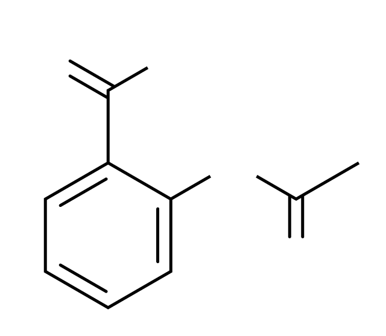
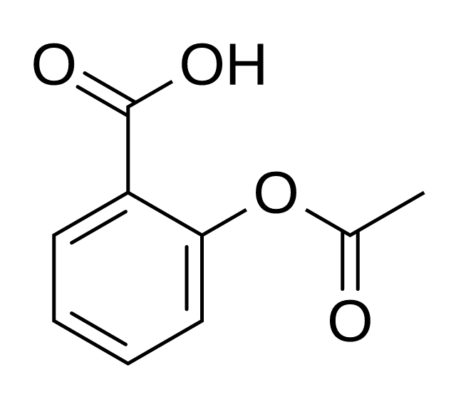
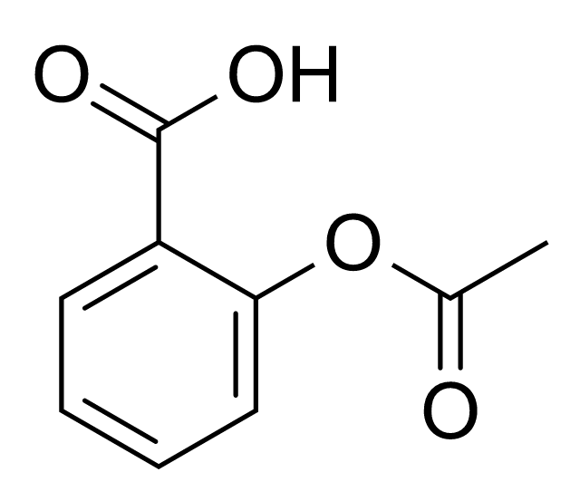
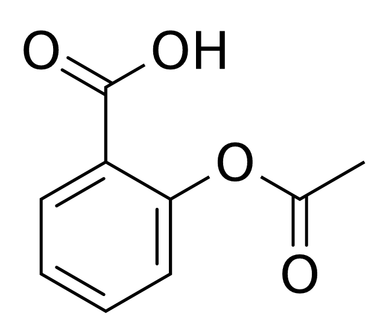

# Python package

ReShiki's experimental Python API draws, converts and analyzes structures with
the editor's Rust engine. It requires Python 3.10 or later and runs without the
desktop application. Install it with `uv add reshiki` or `pip install reshiki`.
From 0.14.0, each ReShiki release publishes abi3 wheels
with the app's version for macOS, Windows and Linux on x64 and ARM64; see
[Releasing](releasing.md#configure-pypi-publishing).

## Draw and analyze

```python
import reshiki

aspirin = reshiki.Molecule.from_smiles("CC(=O)Oc1ccccc1C(=O)O")
styled = aspirin.clean().with_style("JACS / ACS", font_size=12)
styled.save("aspirin.png", width=300)
svg = styled.svg()
pdf = styled.pdf()
print(aspirin.properties().formula)
```

`Molecule`, `Reaction` and `Drawing` are immutable. `clean()` and
`with_style(style, **overrides)` return new objects, so they can be chained.
Jupyter displays each object as SVG.

`properties()` returns a frozen dataclass with the same fields as
[`reshiki --cli analyze`](agent-cli.md#analyze): `formula`, `display_formula`,
`mass`, `exact_mass`, `logp`, `tpsa`, `donors`, `acceptors`, `rings`, `inchi`,
`inchikey`, `smiles` and `unpaired_electrons`.

## Inputs and outputs

Use explicit constructors `from_smiles(text)`, `from_molfile(text)`,
`from_inchi(text)`, `from_cdxml(text)` and `from_name(name, online=False)`.
Names resolve offline by default. Pass `online=True` to look up a complete name
in PubChem instead:

```python
aspirin = reshiki.Molecule.from_name("aspirin", online=True)
```

Online lookup requires a unique complete-name match and imports stereospecific
SMILES without dropping components. ReShiki verifies that layout preserves its
molecular identity; ambiguous or unsupported results raise `ValueError`.
Connection failures and request timeouts raise their corresponding Python
exceptions. Each network request has a 15-second timeout. Offline lookup never
contacts PubChem.

`reshiki.parse(text, format=None)` detects the input format. `Drawing.open(path)`
uses a file's extension, including extensionless POSCAR and CONTCAR names. It
accepts native `.rsk`, MOL/SDF, RXN, SMILES/reaction SMILES, InChI, CDXML, binary CDX,
CIF, PDB/ENT, POSCAR/CONTCAR/`.vasp` and XYZ/extXYZ. Crystal imports use the
[existing crystal readers](crystal-structures.md).

Render with `png()`, `svg()` or `pdf()`, and export with `cdxml()`, `mol()`,
`sdf()`, `smiles()`, `inchi()` or `rsk()`. PNG, PDF and native drawings return
bytes; chemical text and SVG return strings. `save(path, **options)` chooses the
output format from the extension. EMF raises `NotImplementedError` pending a
headless exporter.

SVG output draws text as outlines, so every viewer shows the glyphs, positions
and sizes that `png()` draws, whatever fonts it has. Pass `text="live"` to keep
`<text>` elements that stay editable and searchable; a viewer without Arial then
substitutes its own font, and labels can look narrower or wider than in the
PNG. `svg()`, `render()`, `convert()`, `save()` and `render_many()` accept
`text=`; other formats ignore it.

```python
drawing = reshiki.Drawing.open("rutile.vasp")
drawing.save("rutile.svg")
png = reshiki.render("CCO", format="png", width=300)
mol = reshiki.convert("CCO", to="mol")
analysis = reshiki.properties("CCO")
```

## Import warnings

Some inputs import with a change or an assumption: a SMILES bond of any order
(`~`) is drawn as a single bond, and stereo on an extended double bond
(C=C=C=C) is dropped. The app shows such a warning in its
status bar and `reshiki --cli` prints it as `reshiki: warning:`. The Python
package issues it as a `reshiki.StructureWarning`, a `UserWarning`, through
Python's `warnings` module, attributed to your line of code:

```python
molecule = reshiki.Molecule.from_smiles("C~C")
# demo.py:3: StructureWarning: Bond C1–C2 has any order (~); bond order assumed
# single
```

The import still returns the drawing. Python's default filter shows a warning
once per line of code. The standard `warnings` filters collect warnings, hide
them, or turn them into errors:

```python
import warnings

with warnings.catch_warnings(record=True) as caught:
    warnings.simplefilter("always", reshiki.StructureWarning)
    molecule = reshiki.Molecule.from_smiles(text)
messages = [str(warning.message) for warning in caught]

warnings.simplefilter("error", reshiki.StructureWarning)  # refuse such inputs
```

Batches report warnings with the results; see
[Batches and integrations](#batches-and-integrations).

## Styles and image dimensions

`reshiki.styles()` lists the editor's [document styles](drawing-styles.md).
Create a reusable `reshiki.Style("JACS / ACS", font_size=12)`, pass it as
`style=` to a render method, or supply overrides directly, such as
`molecule.svg(font_size=12)`. Overrides use points for physical dimensions.

Bind a style once to reuse it across constructors and functional exports:

```python
custom_style = reshiki.with_style("JACS / ACS", font_family="sans-serif", font_size=12)
aspirin = custom_style.Molecule.from_smiles("CC(=O)Oc1ccccc1C(=O)O")
named = custom_style.Molecule.from_name("aspirin", online=True)
svg = custom_style.render("CCO", "svg", width=300)
pngs = custom_style.render_many(["CCO", "c1ccccc1O"], width=300)
```

The context offers `Drawing`, `Molecule` and `Reaction` constructors and the same
`parse`, `render`, `convert` and `render_many` operations as the module. Returned
objects keep their normal types. The equivalent object-first form is
`reshiki.Molecule.from_smiles(text).with_style(custom_style.style)`.

Contexts are immutable. `custom_style.with_style(font_size=14)` combines new
overrides with the saved settings; the latest value for a setting wins. Passing
an explicit style name or `Style` selects a new base. Per-call export overrides
take precedence over the context's settings. Configuration can be applied before
or after construction; `clean()` remains an operation on the drawing.
Saved styles include explicit default values, so applying a reset context also
turns off settings already enabled on a drawing. Keyword-only updates to an
individual drawing preserve its other settings.

Labels use the requested font when available, then generic sans-serif. Where
Arial is not installed, as on most Linux systems and containers, ReShiki draws
Arial with its bundled Liberation Sans, which has Arial's character widths.
Labels are then laid out as on macOS and Windows, even with no fonts installed
at all. The same faces stand in for Helvetica when it is missing too. An
installed Arial always takes precedence. After installing system fonts, restart Python or the Jupyter
kernel before rendering again.

Aspirin rendered with `png(width=640)` in a `python:3.12-slim` container shows
the effect. The before images use PyPI 0.14.0. With the bundled faces, both
containers lay the labels out as macOS does with its real Arial (on the right);
only the letter shapes of Liberation Sans and Arial differ slightly.

| Font environment   | 0.14.0                                                                                            | Bundled Arial fallback                                                                             | macOS, real Arial                                                         |
| ------------------ | ------------------------------------------------------------------------------------------------- | -------------------------------------------------------------------------------------------------- | ------------------------------------------------------------------------- |
| No fonts installed |   |  |  |
| DejaVu Sans only   |  |               |  |

PNG size follows the style's physical bond length and its default resolution.
Use `dpi=` to set resolution, or `width=` and/or `height=` to fit a pixel box
while preserving the aspect ratio.

## Batches and integrations

`render_many(items, format="png", errors="none", **options)` renders in parallel
while releasing Python's GIL. It returns a list with `None` for failed rows and
an `.errors` list of `(index, message)` pairs. Use `errors="raise"` to raise on
a failed row. Import warnings are not issued as Python warnings here: the
result's `.warnings` lists them as `(index, message)` pairs, in row order.

```python
pngs = reshiki.render_many(["CCO", "C1CC", "C~C"], width=300)
print(pngs.errors)    # [(1, '...')]
print(pngs.warnings)  # [(2, 'Bond C1–C2 has any order (~); bond order assumed single')]
```

The Excel extra uses openpyxl and embeds PNG images:

```python
import reshiki

reshiki.excel.add_structures(
    "compounds.xlsx", smiles="A", into="B",
    out="compounds-drawn.xlsx", width=300, header=True,
)
```

Install `reshiki[excel]` for this helper. The header defaults to row 1; use
`header=False` to render from row 1, or `start_row=` to choose the first row.
Import warnings are issued as `StructureWarning`s that start with the source
cell, such as `A3: The input marks a molecule's stereo configuration as relative …`.

Install `reshiki[pandas]` and explicitly import `reshiki.pandas` to register
the pandas Series accessor:

```python
import pandas as pd
import reshiki.pandas

series = pd.Series(["CCO", "O"])
images = series.reshiki.png(width=300)
descriptors = series.reshiki.properties()
```

The accessor provides `.png()`, `.svg()` and `.properties()`. `.png()` and
`.svg()` keep the batch's errors and import warnings in the result's
`attrs["reshiki_errors"]` and `attrs["reshiki_warnings"]`; `.properties()`
reads each row on its own and issues `StructureWarning`s. Optional
dependencies load when their integration is used. RDKit interoperability uses
`Molecule.from_rdkit(mol)` and `molecule.to_rdkit()` through MOL blocks when
RDKit is installed.

Editable Office pictures depend on
[issue #462](https://github.com/Ameyanagi/ReShiki/issues/462). EMF export remains
a follow-up.

## Build and check locally

From the repository root, with Rust and uv installed:

```sh
uv run --no-project --python 3.12.15 python scripts/license_notices.py
uvx maturin@1.15.0 build --manifest-path crates/python/Cargo.toml --locked --out artifacts/python
uv run --no-project --python 3.12.15 python scripts/check_python_wheel_notices.py 'artifacts/python/*.whl'
uv sync --project crates/python --all-extras --no-install-project
uv run --project crates/python --no-sync --with ./artifacts/python/*.whl --with rdkit pytest crates/python/tests
uv run --project crates/python --no-sync ruff check crates/python/python crates/python/tests
uv run --project crates/python --no-sync ruff format --check crates/python/python crates/python/tests
uv run --project crates/python --no-sync ty check --project crates/python
```

The package version comes from the Rust workspace version. No desktop executable
or external InChI helper is required by the wheel.
The ignored `crates/python/wheel-licenses/` staging directory contains the project
licenses and consolidated notices for the selected target's Rust dependencies.
Pass `--target` to the notice generator when cross-compiling. Maturin includes
these files under the wheel's `.dist-info/licenses/` and declares them with
`License-File` metadata.
