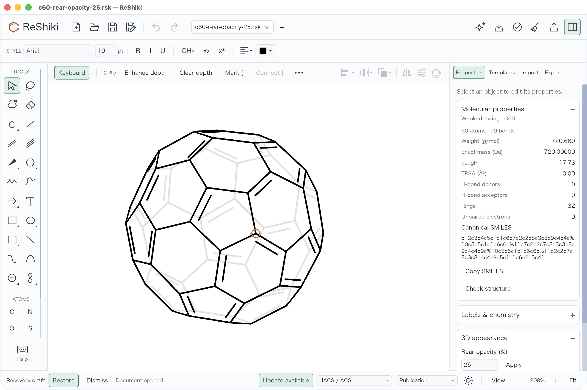

# Rear opacity

Available in Nightly builds; not in ReShiki 0.11.0.

Rear opacity makes the bonds behind the front face of a 3D molecule lighter,
while the outline you can see stays solid. It changes only the drawing's
appearance, not the molecule.

## Use it

1. Open a drawing with 3D coordinates, for example C60 or a MOL file with 3D
   coordinates. Select part of a molecule to change that molecule, or clear the
   selection to change every molecule in the drawing.
2. Open **Properties → 3D appearance**.
3. Type a percentage from 0 to 100 in **Rear opacity** and choose **Apply**, or
   press Enter.

**100%** is the default and keeps the drawing opaque. **25%** leaves the rear
bonds faint, and **0%** hides them. Undo restores the previous setting. Tilting
the molecule later keeps the setting.

## Limits

- **3D appearance** appears only for molecules with depth. Flat 2D molecules
  look the same at any setting.
- A `.rsk` file keeps the setting. SVG, PNG and PDF keep the look.
- MOL, SMILES and InChI report that they do not keep rear opacity. CDXML and
  CDX cannot keep it either; set rear opacity to 100% first, or use a `.rsk`
  file or a figure format.
- **EMF for Office** accepts only 0% or 100% and suggests SVG, PDF or PNG
  otherwise.

## Implementation notes

Rear opacity applies to view-occluded cage surfaces, so the exposed rim stays
solid at every setting and after 3D tilt. The target is the complete covalent
molecule of the selection, or every molecule when nothing is selected.
Opacity works against both light and dark backgrounds and in transparent
figure exports; at 0% the background shows through. Molecular identity and the
retained XYZ coordinates stay unchanged; tilt rotates the retained XYZ. The
[visibility correction record](changes/rear-visibility-20261010.md) describes
the corrected cage visibility, desktop checks and limits.
