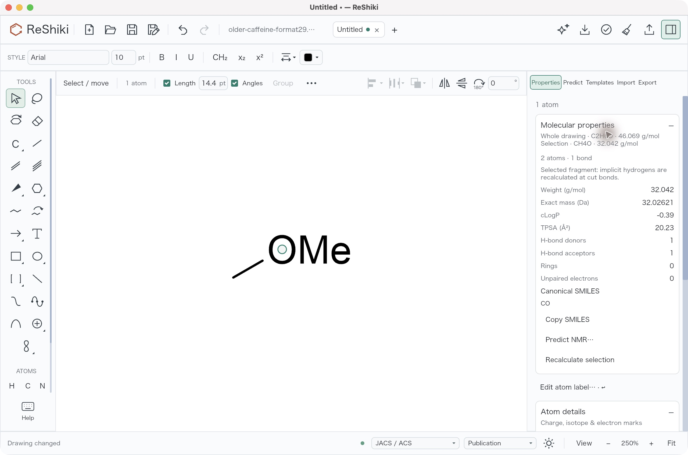
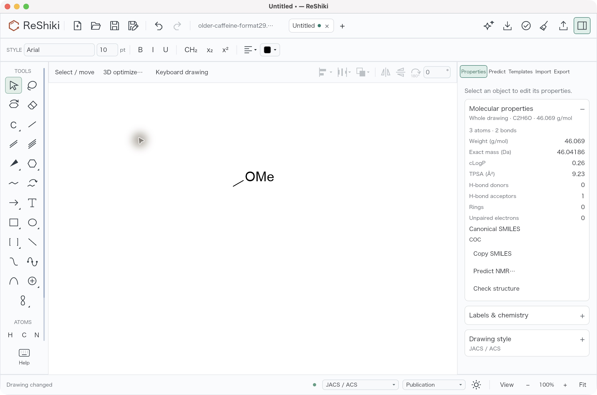
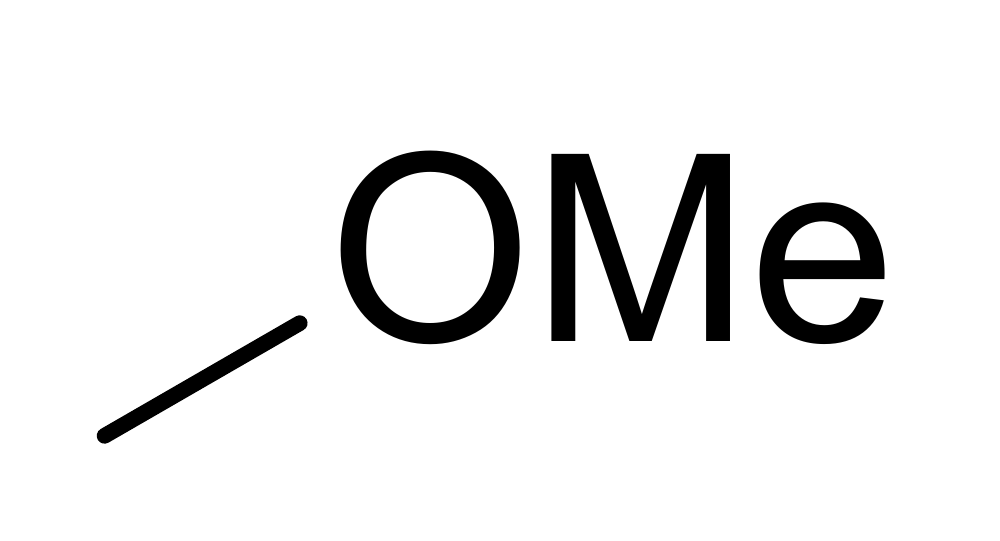
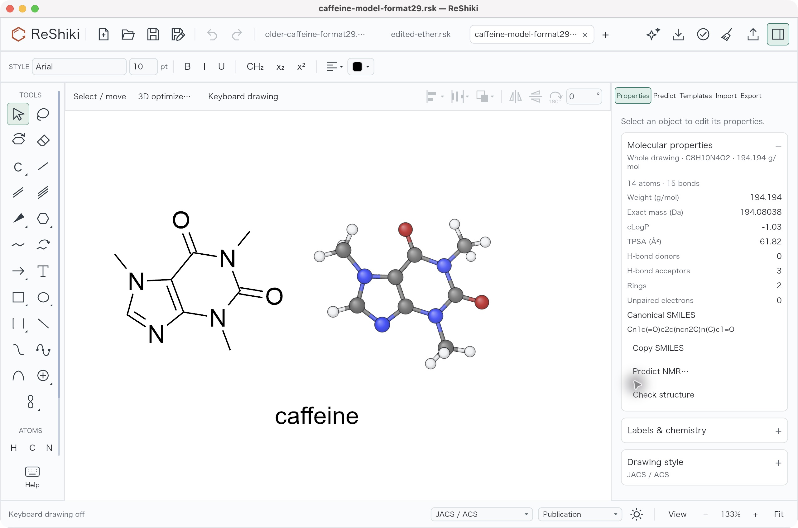
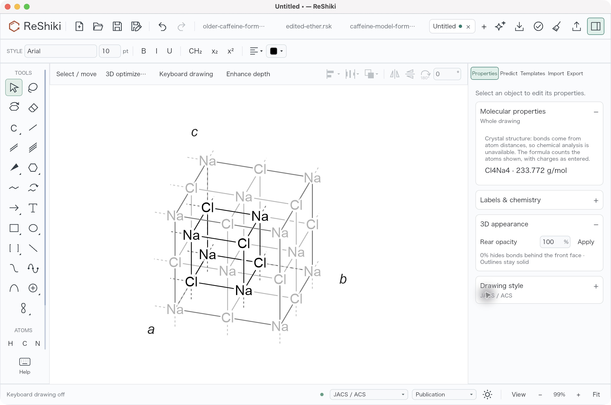

# ReShiki 0.13.1 release validation

This record distinguishes the release preparation, unsigned manual packages,
and eventual signed public downloads. The checks below retain the source and
package identities they actually tested. [Release notes](changes-0.13.1.md) ·
[Release procedure](releasing.md).

## Initial source and preparation

The initial preparation and package reviews below retain their historical
sources. All four [completion follow-ups](#completion-follow-ups) are merged at
main checkpoint [`91ea325d`](https://github.com/Ameyanagi/ReShiki/commit/91ea325d8d2c3f9300c47eaefebd60c2590f2239),
with applicable PR checks and comment review passed. Main integration CI and
final publication remain pending; the final release commit and replacement tag
have not been selected.

All 28 QA source pull requests merged before release preparation
[PR #583](https://github.com/Ameyanagi/ReShiki/pull/583) was merged. Its frozen head was
`55dd647d70dea1eb234fb1d7d5fab7d432e42aa8`; the complete functional base was
[`8e139268`](https://github.com/Ameyanagi/ReShiki/commit/8e1392684dc627ab93f91f5c6443ddaa61ff2b39).
The preparation changed version, release notes and current documentation
metadata, with no production behavior change relative to that base.

The frozen preparation head had a successful CI rollup across 33 contexts and
no unresolved review comments. Expected conditional or manual-publication jobs
were skipped, rather than counted as successful executions. One Windows
PowerShell argument-test invocation timed out
without an assertion failure; the same head passed both Windows manual-package
test jobs and the single failed-job retry. No source change was made
for that timeout. The manual package review passed before #583 merged.

The first tagged release attempt used
[`8d3493d92582d57b6ad2ee07506f331db3b5535c`](https://github.com/Ameyanagi/ReShiki/commit/8d3493d92582d57b6ad2ee07506f331db3b5535c).
Its [Checks](https://github.com/Ameyanagi/ReShiki/actions/runs/40243297153),
[Documentation](https://github.com/Ameyanagi/ReShiki/actions/runs/40243297073),
[Wayland clipboard](https://github.com/Ameyanagi/ReShiki/actions/runs/40243297074)
and [Nix](https://github.com/Ameyanagi/ReShiki/actions/runs/40243297098) workflows
passed before the `v0.13.1` tag was created.

Every new save uses **document format 30**. Older drawings remain readable;
ReShiki 0.13.0 reads at most format 29 and refuses format 30 with update guidance.
The distance-derived bond provenance implementation introduced this format;
release metadata did not change it.

## Finding coverage and credits

The release inventory contains 64 findings, grouped into the 28 pull requests
below. Each group is credited to @Ameyanagi in the release notes and contributor
list. The linked review records retain their original source, input, platform,
measurements and limits; their successful checks do not establish checks on the
final release preparation or published packages.

| Pull request                                          | Findings                                                                                                                                                                                                                                                                                                                                             | Original evidence and limits                        |
| ----------------------------------------------------- | ---------------------------------------------------------------------------------------------------------------------------------------------------------------------------------------------------------------------------------------------------------------------------------------------------------------------------------------------------- | --------------------------------------------------- |
| [#535](https://github.com/Ameyanagi/ReShiki/pull/535) | [#513](https://github.com/Ameyanagi/ReShiki/issues/513)                                                                                                                                                                                                                                                                                              | [Review](changes/qa-513.md)                         |
| [#536](https://github.com/Ameyanagi/ReShiki/pull/536) | [#522](https://github.com/Ameyanagi/ReShiki/issues/522)                                                                                                                                                                                                                                                                                              | [Review](changes/qa-522.md)                         |
| [#537](https://github.com/Ameyanagi/ReShiki/pull/537) | [#490](https://github.com/Ameyanagi/ReShiki/issues/490)                                                                                                                                                                                                                                                                                              | [Review](changes/qa-490.md)                         |
| [#538](https://github.com/Ameyanagi/ReShiki/pull/538) | [#515](https://github.com/Ameyanagi/ReShiki/issues/515)                                                                                                                                                                                                                                                                                              | [Review](changes/artemisinin-depiction.md)          |
| [#539](https://github.com/Ameyanagi/ReShiki/pull/539) | [#507](https://github.com/Ameyanagi/ReShiki/issues/507)                                                                                                                                                                                                                                                                                              | [Review](changes/long-chain-layout.md)              |
| [#540](https://github.com/Ameyanagi/ReShiki/pull/540) | [#514](https://github.com/Ameyanagi/ReShiki/issues/514)                                                                                                                                                                                                                                                                                              | [Review](changes/qa-514.md)                         |
| [#541](https://github.com/Ameyanagi/ReShiki/pull/541) | [#521](https://github.com/Ameyanagi/ReShiki/issues/521)                                                                                                                                                                                                                                                                                              | [Review](changes/qa-521.md)                         |
| [#542](https://github.com/Ameyanagi/ReShiki/pull/542) | [#516](https://github.com/Ameyanagi/ReShiki/issues/516), [#520](https://github.com/Ameyanagi/ReShiki/issues/520)                                                                                                                                                                                                                                     | [Review](changes/qa-crystal-metadata.md)            |
| [#543](https://github.com/Ameyanagi/ReShiki/pull/543) | [#492](https://github.com/Ameyanagi/ReShiki/issues/492), [#493](https://github.com/Ameyanagi/ReShiki/issues/493), [#498](https://github.com/Ameyanagi/ReShiki/issues/498), [#500](https://github.com/Ameyanagi/ReShiki/issues/500), [#509](https://github.com/Ameyanagi/ReShiki/issues/509)                                                          | [Review](changes/qa-atom-label-editor.md)           |
| [#544](https://github.com/Ameyanagi/ReShiki/pull/544) | [#496](https://github.com/Ameyanagi/ReShiki/issues/496), [#501](https://github.com/Ameyanagi/ReShiki/issues/501), [#510](https://github.com/Ameyanagi/ReShiki/issues/510)                                                                                                                                                                            | [Review](changes/drawing-panel-state.md)            |
| [#545](https://github.com/Ameyanagi/ReShiki/pull/545) | [#494](https://github.com/Ameyanagi/ReShiki/issues/494), [#495](https://github.com/Ameyanagi/ReShiki/issues/495), [#497](https://github.com/Ameyanagi/ReShiki/issues/497), [#504](https://github.com/Ameyanagi/ReShiki/issues/504), [#506](https://github.com/Ameyanagi/ReShiki/issues/506)                                                          | [Review](changes/qa-drawing-geometry-2026-10-25.md) |
| [#557](https://github.com/Ameyanagi/ReShiki/pull/557) | [#511](https://github.com/Ameyanagi/ReShiki/issues/511), [#523](https://github.com/Ameyanagi/ReShiki/issues/523), [#525](https://github.com/Ameyanagi/ReShiki/issues/525), [#526](https://github.com/Ameyanagi/ReShiki/issues/526), [#527](https://github.com/Ameyanagi/ReShiki/issues/527), [#528](https://github.com/Ameyanagi/ReShiki/issues/528) | [Review](changes/qa-browser-polish.md)              |
| [#558](https://github.com/Ameyanagi/ReShiki/pull/558) | [#517](https://github.com/Ameyanagi/ReShiki/issues/517)                                                                                                                                                                                                                                                                                              | [Review](changes/qa-crystal-substitution.md)        |
| [#559](https://github.com/Ameyanagi/ReShiki/pull/559) | [#508](https://github.com/Ameyanagi/ReShiki/issues/508)                                                                                                                                                                                                                                                                                              | [Review](changes/qa-508-import-performance.md)      |
| [#560](https://github.com/Ameyanagi/ReShiki/pull/560) | [#502](https://github.com/Ameyanagi/ReShiki/issues/502), [#503](https://github.com/Ameyanagi/ReShiki/issues/503), [#505](https://github.com/Ameyanagi/ReShiki/issues/505)                                                                                                                                                                            | [Review](changes/qa-label-feedback.md)              |
| [#561](https://github.com/Ameyanagi/ReShiki/pull/561) | [#512](https://github.com/Ameyanagi/ReShiki/issues/512), [#518](https://github.com/Ameyanagi/ReShiki/issues/518), [#519](https://github.com/Ameyanagi/ReShiki/issues/519), [#524](https://github.com/Ameyanagi/ReShiki/issues/524)                                                                                                                   | [Review](changes/qa-model-controls.md)              |
| [#562](https://github.com/Ameyanagi/ReShiki/pull/562) | [#546](https://github.com/Ameyanagi/ReShiki/issues/546), [#547](https://github.com/Ameyanagi/ReShiki/issues/547), [#549](https://github.com/Ameyanagi/ReShiki/issues/549)                                                                                                                                                                            | [Review](changes/qa-help-polish.md)                 |
| [#563](https://github.com/Ameyanagi/ReShiki/pull/563) | [#491](https://github.com/Ameyanagi/ReShiki/issues/491)                                                                                                                                                                                                                                                                                              | [Review](changes/recovery-manager.md)               |
| [#564](https://github.com/Ameyanagi/ReShiki/pull/564) | [#548](https://github.com/Ameyanagi/ReShiki/issues/548), [#550](https://github.com/Ameyanagi/ReShiki/issues/550), [#551](https://github.com/Ameyanagi/ReShiki/issues/551), [#554](https://github.com/Ameyanagi/ReShiki/issues/554)                                                                                                                   | [Review](changes/qa-property-continuity.md)         |
| [#565](https://github.com/Ameyanagi/ReShiki/pull/565) | [#499](https://github.com/Ameyanagi/ReShiki/issues/499)                                                                                                                                                                                                                                                                                              | [Review](changes/qa-export-feedback.md)             |
| [#566](https://github.com/Ameyanagi/ReShiki/pull/566) | [#533](https://github.com/Ameyanagi/ReShiki/issues/533), [#534](https://github.com/Ameyanagi/ReShiki/issues/534)                                                                                                                                                                                                                                     | [Review](changes/qa-inspector-motion.md)            |
| [#567](https://github.com/Ameyanagi/ReShiki/pull/567) | [#552](https://github.com/Ameyanagi/ReShiki/issues/552), [#553](https://github.com/Ameyanagi/ReShiki/issues/553), [#555](https://github.com/Ameyanagi/ReShiki/issues/555), [#556](https://github.com/Ameyanagi/ReShiki/issues/556)                                                                                                                   | [Review](changes/qa-drawing-polish.md)              |
| [#568](https://github.com/Ameyanagi/ReShiki/pull/568) | [#530](https://github.com/Ameyanagi/ReShiki/issues/530), [#531](https://github.com/Ameyanagi/ReShiki/issues/531), [#532](https://github.com/Ameyanagi/ReShiki/issues/532)                                                                                                                                                                            | [Review](changes/qa-stereo-repeat.md)               |
| [#577](https://github.com/Ameyanagi/ReShiki/pull/577) | [#575](https://github.com/Ameyanagi/ReShiki/issues/575), [#576](https://github.com/Ameyanagi/ReShiki/issues/576)                                                                                                                                                                                                                                     | [Review](changes/qa-properties-clarity.md)          |
| [#578](https://github.com/Ameyanagi/ReShiki/pull/578) | [#572](https://github.com/Ameyanagi/ReShiki/issues/572), [#573](https://github.com/Ameyanagi/ReShiki/issues/573)                                                                                                                                                                                                                                     | [Review](changes/qa-pointer-hover.md)               |
| [#579](https://github.com/Ameyanagi/ReShiki/pull/579) | [#569](https://github.com/Ameyanagi/ReShiki/issues/569), [#570](https://github.com/Ameyanagi/ReShiki/issues/570), [#571](https://github.com/Ameyanagi/ReShiki/issues/571)                                                                                                                                                                            | [Review](changes/qa-model-face-handles.md)          |
| [#581](https://github.com/Ameyanagi/ReShiki/pull/581) | [#580](https://github.com/Ameyanagi/ReShiki/issues/580)                                                                                                                                                                                                                                                                                              | [Review](changes/qa-remember-appearance.md)         |
| [#582](https://github.com/Ameyanagi/ReShiki/pull/582) | [#574](https://github.com/Ameyanagi/ReShiki/issues/574)                                                                                                                                                                                                                                                                                              | [Review](changes/large-selection-copy-feedback.md)  |

## Local preparation checks

These checks ran on macOS ARM64 against the complete source base above plus
this release metadata. They do not establish checks on signed or published
packages. The preparation CI and package results are recorded separately below.

| Check                            | Observed result                                                                                                           |
| -------------------------------- | ------------------------------------------------------------------------------------------------------------------------- |
| Theme generation                 | Regenerated all five themes; parsed data matches the source base after removing only `reshiki_version` (0.13.0 → 0.13.1). |
| Theme and version-resource tests | 1 theme-reference test and 4 host-independent Windows resource-version tests passed.                                      |
| Release Python modules           | `tests.test_release`, `tests.test_prepare_nightly` and `tests.test_release_downloads`: 28 tests passed.                   |
| Documentation diagnostics        | 0 errors, 0 warnings and 0 hints.                                                                                         |
| Documentation build              | 13,829 local links/assets, llms.txt, agent-api.txt and 1,360 published colours verified.                                  |
| Coverage and inherited evidence  | All 64 findings, 28 PR groups, 23 central-note images and original review links retained.                                 |

## Dated merged-PR comment snapshot

The [comment audit](images/release-0.13.1/security-manual/merged-pr-comment-audit.json)
at **2026-10-26 04:19:51 UTC** covered all 30 then-merged source/preparation/
reference-repair PRs. It found zero actionable items, zero inline review threads
and zero unresolved threads. All 30 observed timeline entries were Copilot
quota notices; this does **not** mean Copilot completed code review. PR #586 was
excluded and monitored separately. This is a dated API snapshot, not a statement
about future comments.

## Historical unsigned manual review at 55dd647d

The six-platform feature-branch [Release run 40238703860](https://github.com/Ameyanagi/ReShiki/actions/runs/40238703860)
completed successfully at exact preparation head `55dd647d`. Static review
covered all ten packages, six portable archive manifests, actual architectures,
version/source metadata, required notices and checksum sidecars. Platform jobs
also completed their packaging/runtime checks. These were unsigned test
artifacts, with ad-hoc macOS signatures; they do not establish the signature or
notarization of public downloads.

This review predates the security dependency changes. It remains evidence only
for `55dd647d`; the current security package smoke is recorded below.

The unmodified Mac ARM ZIP had SHA-256
`8de814c49a740cfd369c5a22e8be3b1d672db9834c42780037229cd5bf445a74`.
A bounded graphical smoke ran on **Apple M1, arm64, macOS 27.0.1 (26A434)**
with isolated application data and output folders. The app reported 0.13.1;
network-denied CLI ethanol analysis returned C2H6O and the expected InChI with
Python, uv and checkout support unavailable.

A format 29 caffeine drawing opened. Native keyboard drawing and the atom
label editor created an OMe group; Properties reported C2H6O, COC and
46.069 g/mol. Native Copy reported success, and the packaged CLI exported a
one-page PDF whose [OMe drawing was rendered and inspected](images/release-0.13.1/ether-pdf.png). An actual Save
recorded format 30, and closing and reopening that file restored the drawing.
The official Mac ARM 0.13.0 CLI refused the actual saved file with “Update
ReShiki to open it” guidance.

A saved caffeine model displayed in Both view beside Properties. Opening NaCl
CIF displayed a projected cell, Cl4Na4 composition, 233.772 g/mol and the
explicit distance-derived-bond analysis notice.

All nine app-file hashes matched before and after the smoke. The owned app was
closed; no offered recovery draft was restored or discarded. The
[compact smoke receipt](images/release-0.13.1/manual-smoke.json) records identities,
image hashes and scope. The original native captures are JPEG, 2560 × 1696 px;
these copies retain the original bytes under matching `.jpg` extensions.

This package smoke did not repeat all 64 fixes, artemisinin depiction,
performance measurements, conformer generation, or external Office/ChemDraw
paste. The saved-model check is narrower than the earlier source-specific
3D evidence. No Intel, Windows or Linux graphical runtime is claimed.

## First stable release attempt

The first `v0.13.1` attempt used source `8d3493d9`.
[Release run 40246080829](https://github.com/Ameyanagi/ReShiki/actions/runs/40246080829)
completed with **failure**. All six platform builds and both macOS signing jobs
succeeded. Nine live-reference shards failed on expectations predating the
intentional cleanup-refusal wording, reaction ink placement and the NCI/2808
ring-template layout changes. Shard 3 passed on all three reference platforms.
The nine failed logs were retained and inventoried; the
[compact attempt receipt](images/release-0.13.1/first-release-attempt.json)
records the job identities and conclusions.

The publication, browser-demo and npm jobs were **skipped**. No public release
or public assets were created by this attempt. Successful signing jobs are
workflow results, not a local verification of public package signatures.

[Test-only repair PR #584](https://github.com/Ameyanagi/ReShiki/pull/584), at
`c00b0b27a819aedb21090e4ff8f25a0a67ba3397`, updates these reference contracts.
It preserves the frozen Python worker and strict chemistry, stereochemistry,
identity and full-response comparisons. The affected cleanup, native cleanup,
reaction drawing, native routing, native import, IO reference guards and engine
migration suites passed locally on macOS ARM64. Strict reference-test Clippy,
the required three-package WASM Clippy and normal commit hooks also passed.
The repair merged as
[`bceea7a5`](https://github.com/Ameyanagi/ReShiki/commit/bceea7a5be914bdf40521b153533df2db237b852).
All applicable main CI passed: [Checks](https://github.com/Ameyanagi/ReShiki/actions/runs/40255625142)
and [Wayland clipboard](https://github.com/Ameyanagi/ReShiki/actions/runs/40255625141).
Application and packaging behavior is unchanged by this test-only repair.
These results do not establish a replacement stable release result.

## Security and Nix CI at d658a67e

[PR #586](https://github.com/Ameyanagi/ReShiki/pull/586) addresses
[security #585](https://github.com/Ameyanagi/ReShiki/issues/585) and
[CI #588](https://github.com/Ameyanagi/ReShiki/issues/588) at
`d658a67e82735aaaaccab4173b8e8dbfc7269a48`. It merged as
`9a9b2dc679f486b4fd79d84fbab5d93fc5efc2f4`, with the exact tested tree. The
minimal implementation retains the Rust/npm/Python dependency fixes and
Bun/uv/Node pins while removing the custom scanner, attestation and runtime-policy
frameworks. PR additions fell from 7,116 to 1,217 lines, about 83%.

CI uses the standard SHA-pinned **Determinate Nix action 3.24.1**. A 49-line
first-step Node bootstrap remains because observed hosted runners supply Node
24.21.0; it verifies official Node 24.22.1 artifact hashes before replacement.
`setup-node` alone does not change the runtime used by JavaScript actions.
The flake selects official prebuilt **rustc and Cargo 1.99.1**, with all three
archive hashes pinned. Original GTK dependencies and full chemical/PNG install
checks remain. A short build step checks the actual dry-run plan for source
LLVM/Rust/Cargo builds, then runs the full flake check with lock changes and
source fallback disabled.

The maintainer explicitly accepts stock pinned nixpkgs curl/Brotli/FreeType
build-library advisories; their global overlays are removed. The
[dated assessment](https://github.com/Ameyanagi/ReShiki/blob/d658a67e82735aaaaccab4173b8e8dbfc7269a48/docs/changes/security-dependency-audit.md)
retains the prior OSV scan's **eight findings**: six maintenance notices and
two scoped exposures from 1,226 queried Cargo/npm/PyPI versions. The
[original hosted audit receipt](images/release-0.13.1/security-manual/hosted-audit-b956e463-verification.json)
remains dated evidence, not a recurring scan gate or a universal CVE-free claim.
The unavailable Dependabot alert inventory remains qualified in its
[original receipt](images/release-0.13.1/security-manual/dependabot-availability.json).

The [exact-source local receipt](images/release-0.13.1/accepted-followups/security-minimal-d658a67e-local.json)
records the archived `d658a67e` tree tested on `amearch`. Complete Linux
`nix flake check` and the original installed-binary checks passed in
**380.77 s (about 6 m 21 s)**. The log started **one application derivation and
zero source toolchain builds**. All three cache-aware plans and eight build-step
controls passed. ARM/macOS evidence is dry-run metadata, not full native builds.
The local test reused the existing Nix daemon/store cache with `sandbox=false`;
it is **not a cold-build benchmark** and did not execute the GitHub vendor action.

The Python unit/regression suite at `cbf9949d` ran 218 tests: **213 passed and
five skipped**. Mocked package/Windows fixtures do not establish actual package
acceptance. All six minimal Node sandbox cases and applicable normal hooks
passed. These results retain their tested-source scope; the receipt records the
later exact-source Linux result separately.

The [hosted Nix matrix](https://github.com/Ameyanagi/ReShiki/actions/runs/40341634327)
passed on Linux ARM64 in **10m18s**, Linux x64 in **13m07s**, and macOS ARM64 in
**17m51s**, with original install checks and zero source LLVM/Rust/Cargo builds.
[Checks](https://github.com/Ameyanagi/ReShiki/actions/runs/40341634300),
Documentation, contribution-license and Wayland also passed: **25 successful PR
contexts and three expected skips**, with no actionable review comments.
The focused follow-ups' main-merge status is recorded below; final release
acceptance remains separate. No additional manual Release workflow was dispatched.

Historical evidence remains source-qualified. Initial application validation at
`48eaa508` passed 3,128 native tests and 206 JavaScript/WASM/desktop comparisons;
its [receipt](images/release-0.13.1/security-first-ci.json) is unchanged. At
`b956e463`, full Mac/Linux ARM Nix application checks passed, but Linux x64
**timed out at six hours before the app build**. The earlier custom runtime
[checkpoint](images/release-0.13.1/completion-checkpoint/ci-and-runtime.json),
its [Mac runtime receipt](images/release-0.13.1/security-manual/root-nix-macos-runtime-b956e463.json),
[compiler-only graph review](images/release-0.13.1/accepted-followups/compiler-only-graph-review.json),
[pre-minimal local build](images/release-0.13.1/accepted-followups/nix-prebuilt-1.99.1-local.json)
and [b9c7941e metadata repair](images/release-0.13.1/accepted-followups/nix-runner-metadata-b9c7941e.json)
remain **superseded historical receipts**, not descriptions of current CI.
The unsigned `3d3eed65` packages below retain their own artifact identities.

## Historical security-package validation at 3d3eed65

The unsigned [six-platform manual run, 40264759989](https://github.com/Ameyanagi/ReShiki/actions/runs/40264759989),
at exact security head `3d3eed6593d0b02eab6976f31a8cefac08a36fb3`, completed
successfully. Static review of all **ten packages and six portable archives**
passed: checksums/sidecars, actual architectures, version/source manifests,
single application executable and required notices, including the full
CDLA license. The original [static receipt](images/release-0.13.1/security-manual/manual-static-receipt.json)
has SHA-256 `c3f8424f779fbbd90987dd558c0bbecc6f039fa12d8c54b776e6e7120a60aa57`.
The independent [root acceptance](images/release-0.13.1/security-manual/root-manual-package-acceptance.json)
records the package digests, receipt verification and accepted manual gate.
This completes the unsigned manual package review, separately from Nix and
future signed-public-package verification.

These packages and the native smoke below remain **`3d3eed65` artifacts**.
Application sources, dependency locks and release-packaging scripts are unchanged
by the subsequent timeout/runtime CI repairs. The new CI scripts and tests do
change the complete Nix source tree; it is not byte-identical to the tree tested
at `3d3eed65`. The [complete source-scope comparison](images/release-0.13.1/security-manual/root-manual-source-scope-b956e463.json)
records all seven changed CI/documentation/test paths through `b956e463`; it is
not a comparison against the later Rust 1.99.1/workflow/policy-test tree. Those
later CI/toolchain changes preserve production application code, dependency
locks and release-packaging implementation but do change the build toolchain
and complete Nix source tree. No identical Nix derivation, output or package
bytes are asserted. No new manual package run is
claimed. The application-input equivalence does not make future commit metadata
or signatures identical. Final public packages require their own source-stamp,
checksum and signing verification. Subsequent production fixes described below
also require the final tag build to cover the new application source; these
older packages are not current acceptance for those fixes. No additional manual
Release rehearsal is planned.

The Mac ARM portable ZIP used for the native smoke has SHA-256
`a735c9b054adafe0a1b273e7b8e94a7c189b6f08afd0be7c0102a30b6e8802e2`.
The [source and dependency identity receipt](images/release-0.13.1/security-manual/source-qualification.json)
records the Cargo lock hash and updated TLS/Tokio dependency versions.

The unmodified packaged app was tested on **Apple M1, arm64, macOS 27.0.1
(26A434)** in new isolated data/output folders. Native and CLI version checks
reported 0.13.1. Network-denied ethanol analysis returned C2H6O and the expected
InChI with an empty PATH, Python/uv/checkout overrides unavailable and HOME
unchanged. An older format 29 caffeine drawing loaded through CLI and GUI.

Native keyboard drawing and the atom label editor produced an OMe group.
Whole and selected Properties matched C2H6O, COC, 46.069 g/mol and three atoms
with two bonds. Native Copy reported “Editable drawing and images copied.”

An actual native Save wrote format 30. Closing the tab and reopening that file
restored a clean title, disabled Undo and the same chemistry. The official
unmodified 0.13.0 Mac ARM CLI refused that actual file with update guidance.
The [reopened drawing](images/release-0.13.1/security-manual/reopened-format30.jpg)
was captured. Packaged CLI PDF export produced 9,615 bytes; its Poppler render
was inspected and the OMe group/bond are clear and unclipped.

The saved caffeine model opened in Both view beside Properties. Opening NaCl
CIF displayed the projected cell, Cl4Na4, 233.772 g/mol and the explicit
analysis-unavailable notice for distance-derived bonds.

All nine app-file hashes remained identical before and after, and strict deep
ad-hoc signature verification still passed. The owned app exited; the final
native inventory reported it stopped. The [smoke receipt](images/release-0.13.1/security-manual/smoke-receipt.json)
records the exact source, package, inputs, checks and original image hashes.
Independent [smoke verification](images/release-0.13.1/security-manual/root-smoke-verification.json)
checked all seven image hashes and the equal app inventories, and inspected
the drawing, model, crystal and PDF previews. This Mac ARM package-review gate
passed with its recorded limits.

This is historical package smoke at `3d3eed65`, not evidence for future signed
public assets. It does not repeat the 64-finding QA, artemisinin depiction,
performance measurements, fresh conformer generation or external Office/
ChemDraw paste. No Intel, Windows or Linux graphical runtime is claimed.

## Completion follow-ups

| Change                       | Pull request                                          | Tested source | Main status                                                                                                  |
| ---------------------------- | ----------------------------------------------------- | ------------- | ------------------------------------------------------------------------------------------------------------ |
| Reaction-reference coverage  | [#589](https://github.com/Ameyanagi/ReShiki/pull/589) | `34a21da8`    | Merged as [`44ea4f74`](https://github.com/Ameyanagi/ReShiki/commit/44ea4f746674d1aeba5de58d02c17af065d80a29) |
| Large-selection Commands     | [#590](https://github.com/Ameyanagi/ReShiki/pull/590) | `6e7722bb`    | Merged as [`b5977bea`](https://github.com/Ameyanagi/ReShiki/commit/b5977bea269e28ca309bc6a1e2cf2328cab3b4fd) |
| Portable synthetic paste     | [#591](https://github.com/Ameyanagi/ReShiki/pull/591) | `f1174fec`    | Merged as [`b4e2a3c4`](https://github.com/Ameyanagi/ReShiki/commit/b4e2a3c48e4b2b06984d68baf53be91fd102b587) |
| Large-selection PDF feedback | [#592](https://github.com/Ameyanagi/ReShiki/pull/592) | `b5b22c98`    | Merged as [`91ea325d`](https://github.com/Ameyanagi/ReShiki/commit/91ea325d8d2c3f9300c47eaefebd60c2590f2239) |

On 2026-10-26 UTC, #589 merged at 16:30:29, #591 at 16:32:04, #590 at
16:44:59 and #592 at 16:48:17. PRs #589 and #591 each had 20 successful PR
contexts; #590 and #592 each had 22, including both Wayland jobs. All four had
three expected skips and zero actionable comments.
These source-specific checks do not establish final package acceptance.

A scheduled main [Checks run, 40295742094](https://github.com/Ameyanagi/ReShiki/actions/runs/40295742094),
failed three Linux reference shards on the same synthetic owned map/stereo ink
assertion. The focused [fix at `34a21da8`](https://github.com/Ameyanagi/ReShiki/commit/34a21da80846371927175ab43b83e2abf02ff95a)
on `fix/qa-reference-owned-ink` passed seven unit tests and one real production
import regression, plus normal hooks. The [focused receipt](images/release-0.13.1/completion-checkpoint/reference-owned-ink.json)
keeps that local scope. Required live [Checks run 40308091132](https://github.com/Ameyanagi/ReShiki/actions/runs/40308091132)
completed **successfully: 31 successful jobs, one expected skip and all twelve
live-reference shards passed**. The [hosted and Linux verification](images/release-0.13.1/accepted-followups/reference-live-and-linux-verification.json)
also records the exact original assertion failing on amearch and the separately
rebuilt candidate passing the focused 7 + 1 checks plus 48 relevant test
invocations across nine commands, including overlapping execution. This is
bounded Linux reproduction, not a universal automatic-indicator guarantee.
The workflow was Checks, **not Release**.

The large-selection command-palette fix for [issue #587](https://github.com/Ameyanagi/ReShiki/issues/587)
is pushed as [`6e7722bb`](https://github.com/Ameyanagi/ReShiki/commit/6e7722bba434e5c30688774ff27d5d11285c7138).
It passed 34 focused tests, an optimized native build, bounded native usability,
native/WASM Clippy and normal hooks. The [evidence snapshot](images/release-0.13.1/completion-checkpoint/palette-and-firefox.json)
qualifies the native check as usability rather than precise latency; no native
screenshot artifact was saved. It merged in
[PR #590](https://github.com/Ameyanagi/ReShiki/pull/590).

The Firefox synthetic-paste harness correction is pushed as
[`f1174fec`](https://github.com/Ameyanagi/ReShiki/commit/f1174fec418e61529cc7da32e83aae858c8cec87).
Current-source synthetic paste passed Firefox, Chromium and WebKit. The same
evidence snapshot preserves the source/harness qualification. This is browser
harness evidence, not a native clipboard or external Office paste guarantee.

The current-source [#574 follow-up at `b5b22c98`](https://github.com/Ameyanagi/ReShiki/blob/b5b22c98901a7341928454799a0b8cdc5c085e86/docs/changes/large-selection-copy-feedback-current-source.md)
merged in [PR #592](https://github.com/Ameyanagi/ReShiki/pull/592) with the verified
narrow query changes. In its controlled matched M1
comparison, warm median accepted-command to Preparing presentation improved
**64.026666 → 30.036 ms**, and completion improved
**815.803042 → 661.366375 ms**. Preparing appeared on the first requested draw
with menus closed throughout. The [portable timing receipt](images/release-0.13.1/accepted-followups/copy-pdf-current-source-timings.json)
retains the exact base, production/instrumentation patch, binary/log identities
and warmup plus three quiet warm trials per build.

**The 33.3 ms median budget is met in this controlled M1 comparison.** The
original M4 hardware, 1600 × 1000 pt window, NO₂-chain target, pointer-off
condition, physical-click latency and GPU scanout remain unverified. Timing
starts at the accepted application command and ends at successful compositor
submission; no logging overhead is subtracted. Three warm trials do not
establish a latency distribution or an uninstrumented universal deadline.

The final PDFs each have one page, 776,466 bytes and sixteen indirect objects.
Their complete resolved object graphs/trailer and overview/detail rendered
pixels match. **Raw serialization and object IDs differ**; byte identity is
not claimed for this final pair. Graph comparison preserves stream hashes,
array order and multiplicity while normalizing serialization order/object IDs/
xref offsets. Both rendered comparisons have zero differing RGBA pixels.

All **77 focused tests** passed on Mac and the exact frozen Linux patch, with
two existing opt-in renderer ignores. Required native/WASM lint and normal
hooks passed. Independent [source/test verification](images/release-0.13.1/accepted-followups/root-performance-verification.json)
rehashes 23 local files and both remote test ELFs and matches the fourteen-file
final source freeze. These results are not Linux timing or final package
acceptance. The original intermediate candidate is retained as historical
evidence and is superseded by this source-pinned result.

For [issue #507](https://github.com/Ameyanagi/ReShiki/issues/507), independent
[verification](images/release-0.13.1/completion-checkpoint/polymer-timing.json)
checked 99 files, 96 commands and five equal complete chemical-analysis pairs.
The recorded M1 release comparison showed **8–41% median whole-command
overhead**, not engine-only timings or a universal no-regression result. The
original source, input and hardware qualifications remain attached to that
frozen measurement.

All five inputs now also have [native before/after Fit captures](images/release-0.13.1/507-native-fit/README.md)
and actual CLI PNG renders from the same identified 0.13.0 and `3d3eed65` builds.
Eight native captures used fresh imports; the two baseline peptides used native
Open of preserved RSKs whose geometry and stereobonds match the baseline CLI
outputs after the old import became unobservable. This route difference is
documented. Fixed peptide labels and wedges are too small at 4% Fit for individual
detail claims; the existing closeups and geometry/stereo checks supply those.

| Input               | CLI before                                                               | CLI after                                                               |
| ------------------- | ------------------------------------------------------------------------ | ----------------------------------------------------------------------- |
| Polystyrene ×30     | [PNG](images/release-0.13.1/507-cli-render/polystyrene30-before.png)     | [PNG](images/release-0.13.1/507-cli-render/polystyrene30-after.png)     |
| Polystyrene ×75     | [PNG](images/release-0.13.1/507-cli-render/polystyrene75-before.png)     | [PNG](images/release-0.13.1/507-cli-render/polystyrene75-after.png)     |
| Polystyrene ×100    | [PNG](images/release-0.13.1/507-cli-render/polystyrene100-before.png)    | [PNG](images/release-0.13.1/507-cli-render/polystyrene100-after.png)    |
| Alanine ×200        | [PNG](images/release-0.13.1/507-cli-render/alanine200-before.png)        | [PNG](images/release-0.13.1/507-cli-render/alanine200-after.png)        |
| Poly-L-alanine ×200 | [PNG](images/release-0.13.1/507-cli-render/stereo-alanine200-before.png) | [PNG](images/release-0.13.1/507-cli-render/stereo-alanine200-after.png) |

The [CLI receipt](images/release-0.13.1/507-cli-render/receipt.json) records all ten
successful network-denied commands and output hashes. `--width 3200 --height 2000`
sets maximum dimensions, not a fixed canvas. Neither these images nor the native
captures are final signed-package acceptance or new timing measurements.

The four source heads retain original author **@Ameyanagi** in
[#589](https://github.com/Ameyanagi/ReShiki/pull/589),
[#590](https://github.com/Ameyanagi/ReShiki/pull/590),
[#591](https://github.com/Ameyanagi/ReShiki/pull/591) and
[#592](https://github.com/Ameyanagi/ReShiki/pull/592). Contributor and release-note
credit landed first in [#593](https://github.com/Ameyanagi/ReShiki/pull/593), merged
as `eed6f76f9d37115bacf7e7fa6b5c948bc14d2438` after its own CI/comment review.
All four source PRs are merged. The original 64-finding/28-group table above
remains the original inventory; final main CI and release acceptance are still pending.

## Published source and verification (pending)

At the **2026-10-26 16:12 UTC** checkpoint, the `v0.13.1` release API returned **404**.
No replacement stable source/run or public release has been selected. No
additional Release workflow was dispatched for these follow-ups. The old,
unpublished `v0.13.1` tag still points to first-attempt source `8d3493d9`; it has
not been replaced. Public downloads, local macOS
signature/notarization verification, Gatekeeper assessment and web/npm results
remain pending. The [Mac verifier contract](images/release-0.13.1/security-manual/public-macos-verifier-contract.json)
requires `verify_macos.py HANDOFF.json --source FINAL_40_HEX_SHA`, with exactly
one ARM and one Intel ZIP/DMG pair. There is no fixed `8d3493d9` source default.
Syntax, help and invalid-input checks passed; no actual public assets have been
processed. Execution still awaits the final tagged source and checksum-verified
public downloads.

Windows production signing remains disabled; Windows and Linux downloads are
unsigned. Both macOS architectures require Developer ID signing, notarization,
stapled tickets and Gatekeeper verification before publication.

## Measurement and hardware limits

The earlier [pointer-hover QA record](changes/qa-pointer-hover.md) met three
predeclared spatial checks on its recorded M1 host: 14.08/7.16/13.53 pt gaps,
against a 43.68 pt bond with ±2 pt uncertainty. The
[large-selection PDF record](changes/large-selection-copy-feedback.md) reported
53.678 ms for its earlier source-pinned sample. That remains historical evidence,
not the current #574 result: the accepted current-source follow-up above
measured 64.026666 → 30.036 ms on M1. That controlled median meets 33.3 ms;
the original M4/window/NO₂/pointer-off/physical-input/scanout conditions remain
unverified. These measurements are not final package benchmarks, application
FPS or all-frame maxima.

This release record preserves the original scopes of those checks. Published
package verification will not imply broad graphical acceptance on unavailable
hardware or new performance guarantees.
