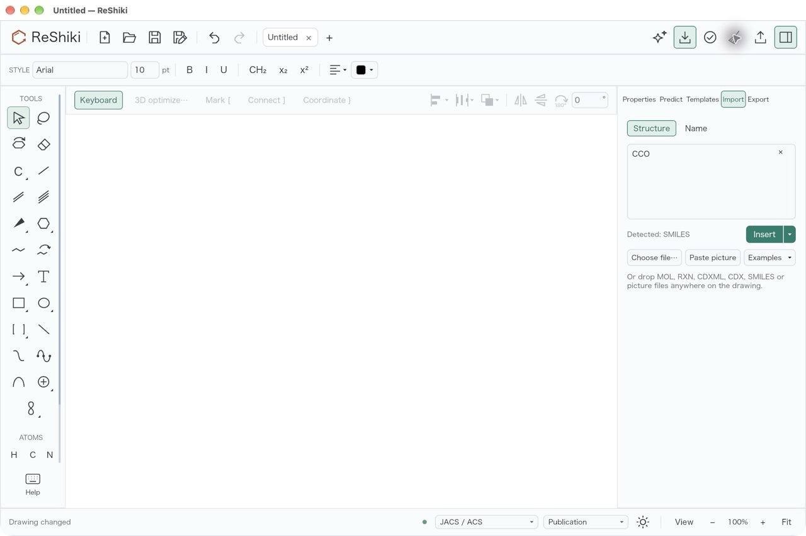
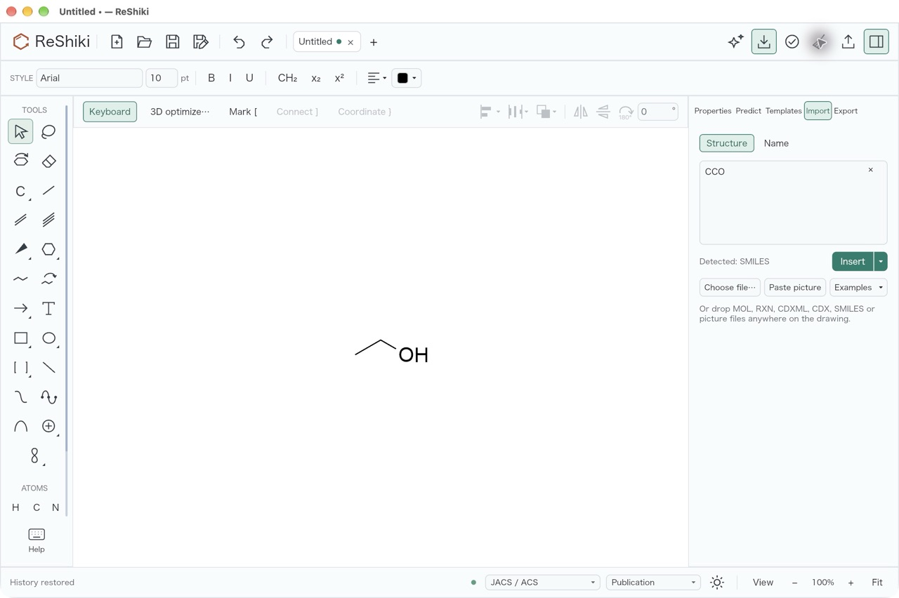
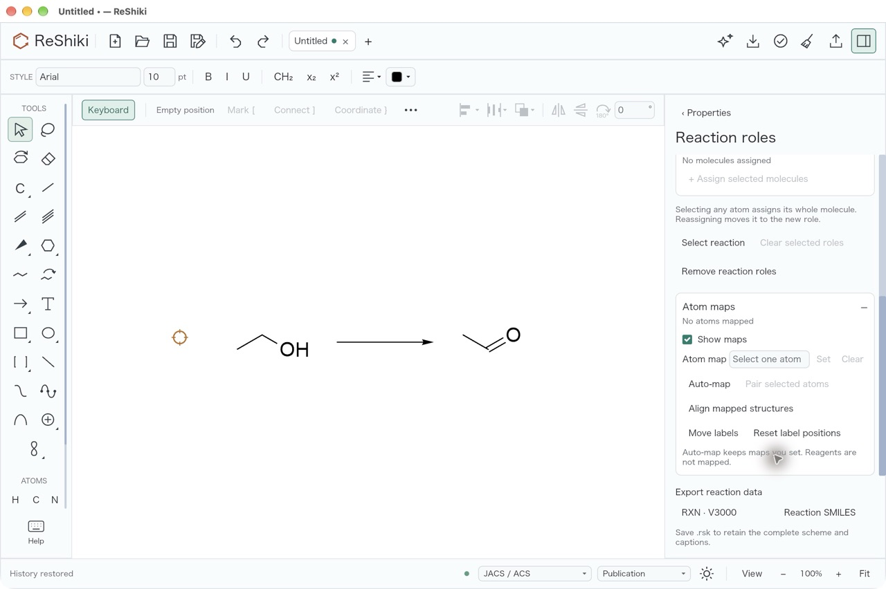

# ReShiki 0.14.0 release validation

This record lists the checks run on the 0.14.0 release preparation and the
checks that remain, and the [published release](#after-the-release): the tag
run, the public downloads and the package registries.
[Release notes](changes-0.14.md) · [Release procedure](releasing.md).

## Release preparation

The release preparation pull request sets the version to 0.14.0 in
`Cargo.toml` (`[package]` and `[workspace.package]`, which the Python package
follows) and `Cargo.lock`, moves the unreleased changes into the
[release notes](changes-0.14.md), adds the GitHub release highlights in
`.github/release-notes/v0.14.0.md` and updates the install guide's file
compatibility section. The npm package takes its version from `Cargo.toml`
when the tag publishes it, so `packages/editor/package.json` is unchanged.

Native output still uses document version 30 unless a drawing needs a newer
format: 31 for a custom reaction-label gap, 32 for ORTEP settings, 33 for a
generated 3D model, model atom labels or a plain XYZ model, and 34 for a
two-sided residue group (`VERSION` is 34 in `crates/model/src/document.rs`).
ReShiki 0.13.1 reads up to version 30.

0.14.0 is the first release that publishes the `reshiki` Python package to
PyPI.

## Automated checks

These ran locally on the release preparation branch, on macOS ARM64, with
`RESHIKI_INCHI_HELPER` and `RESHIKI_NAMING_HELPER` set to the debug build and
`RESHIKI_REQUIRE_INCHI_HELPER=1`:

| Check                      | Command                                                                                                                                    | Result                                                                        |
| -------------------------- | ------------------------------------------------------------------------------------------------------------------------------------------ | ----------------------------------------------------------------------------- |
| Version                    | `reshiki --version` and `reshiki --cli --version` from a debug build                                                                       | `reshiki 0.14.0` (before: `reshiki 0.13.1`)                                   |
| Tag check                  | `scripts/build_release.py --tag v0.14.0 --check-tag-only`                                                                                  | Passed; `v0.13.1` is refused                                                  |
| Rust format                | `cargo fmt --all --check`                                                                                                                  | Passed                                                                        |
| Rust lint                  | `cargo clippy --workspace --lib --bins --all-features --locked -- -D warnings`                                                             | Passed                                                                        |
| Browser lint               | `cargo clippy -p reshiki-web -p reshiki -p reshiki-web-worker --lib --bin reshiki --target wasm32-unknown-unknown --locked -- -D warnings` | Passed                                                                        |
| Colour reference           | `cargo run --locked --example theme_colors`, then `cargo test --locked --test theme_reference`                                             | Regenerated data matches main except `reshiki_version`; 1 passed              |
| Windows version resource   | `cargo test --locked --test windows_version_metadata`                                                                                      | 4 passed                                                                      |
| Agent API version          | `cargo test --locked --test mcp_stdio --test mcp_tools --test headless_parity`                                                             | 25 passed                                                                     |
| Release Python modules     | `python -m unittest tests.test_release tests.test_prepare_nightly tests.test_release_downloads`                                            | 28 passed                                                                     |
| JavaScript format and lint | `bun run format:check`, `bun run lint:js`                                                                                                  | Passed                                                                        |
| Documentation              | `bun run docs:check`                                                                                                                       | 0 errors, 0 warnings, 0 hints                                                 |
| Website and links          | `bun run docs:build`                                                                                                                       | 14,453 local links/assets, llms.txt, agent-api.txt and 1,360 colours verified |

The pull request's Checks workflow runs the native, browser (wasm32),
Python and documentation jobs again; its results are on the pull request.

## Manual checks before the tag

The maintainer runs these on a manual **Release builds** run of the merged
`main` commit, or on its packages, and records the results here:

- [ ] **Release build:** a manual **Release builds** run passes on all six
      platforms and does not publish.
- [x] **Focus after closing reviews:** in the release build, close Clean up,
      3D preview, atom label, Name import preview, Structure import, reaction
      mapping proposal and assistant review with Enter and separately with Esc
      (Apply/Discard where those keys are unavailable). After each close,
      Delete or Cmd+Z acts on the drawing without a click. Passed for every
      panel except assistant review, which was not checked; see
      [Focus after closing reviews](#focus-after-closing-reviews).
- [ ] **macOS app (Apple Silicon and Intel):** the DMG opens, the app reports
      0.14.0, draws and names a molecule with its status tag, imports a salt by
      name, inserts a Fischer projection and converts it to wedges, shows a 3D
      model, updates it after an edit and saves and reopens the drawing.
- [ ] **Windows x64:** setup installs over 0.13.1, the app starts, names a
      molecule, shows a 3D model and opens a crystal file. Windows ARM64 is
      covered by the CI package checks only. Downloads remain unsigned.
- [ ] **Linux (Arch Linux x64 and Ubuntu arm64):** the portable archive starts,
      opens a drawing and names a molecule.
- [ ] **Browser demo:** a demo built with `scripts/build_wasm.sh` and
      `scripts/package_web_demo.sh` loads in Chrome, Safari and Firefox,
      draws with touch, saves back to the opened file in Chrome, converts a
      name with **Import → Name** and predicts NMR.
- [ ] **npm package:** the package built by the release workflow passes its
      tests; after publication `@ameyanagi/reshiki@0.14.0` is `latest`.
- [ ] **PyPI:** the pending trusted publisher for `reshiki` exists on pypi.org;
      after publication `uv add reshiki` installs 0.14.0 on each platform.
- [ ] **Compatibility:** a plain drawing saved by 0.14.0 opens in 0.13.1; a
      drawing with a generated 3D model saved by 0.14.0 is refused by 0.13.1
      with the request to update; a drawing saved by 0.13.1 opens in 0.14.0.

## Focus after closing reviews

Checked on 8 November 2026 with a release build (`cargo build --release`) of
the release branch at `1ebfcbdd`, on macOS ARM64, in an app bundle whose
`RESHIKI_DATA_DIR` pointed at an empty folder. Each case started with part of
the drawing selected. After the panel closed, the next keys were Delete and
then Cmd+Z, with no click in between. Each pair of screenshots shows the
drawing after Delete and after Cmd+Z.

| Panel                     | Closed with                    | Delete acted | Cmd+Z acted | Screenshots                                                                                                                                                     |
| ------------------------- | ------------------------------ | ------------ | ----------- | --------------------------------------------------------------------------------------------------------------------------------------------------------------- |
| Clean up preview          | Enter                          | yes          | yes         | [Delete](images/release-0.14.0/focus-restore/01-cleanup-enter-delete.jpg) · [Cmd+Z](images/release-0.14.0/focus-restore/01-cleanup-enter.jpg)                   |
| Clean up preview          | Esc                            | yes          | yes         | [Delete](images/release-0.14.0/focus-restore/01-cleanup-esc-delete.jpg) · [Cmd+Z](images/release-0.14.0/focus-restore/01-cleanup-esc.jpg)                       |
| 3D preview                | Enter                          | yes          | yes         | [Delete](images/release-0.14.0/focus-restore/02-3d-enter-delete.jpg) · [Cmd+Z](images/release-0.14.0/focus-restore/02-3d-enter.jpg)                             |
| 3D preview                | Esc                            | yes          | yes         | [Delete](images/release-0.14.0/focus-restore/02-3d-esc-delete.jpg) · [Cmd+Z](images/release-0.14.0/focus-restore/02-3d-esc.jpg)                                 |
| Atom label editor         | Enter                          | yes          | yes         | [Delete](images/release-0.14.0/focus-restore/03-atom-label-enter-delete.jpg) · [Cmd+Z](images/release-0.14.0/focus-restore/03-atom-label-enter.jpg)             |
| Atom label editor         | Esc                            | yes          | yes         | [Delete](images/release-0.14.0/focus-restore/03-atom-label-esc-delete.jpg) · [Cmd+Z](images/release-0.14.0/focus-restore/03-atom-label-esc.jpg)                 |
| Name import preview       | Enter in the name field        | yes          | yes         | [Delete](images/release-0.14.0/focus-restore/04-name-import-enter-delete.jpg) · [Cmd+Z](images/release-0.14.0/focus-restore/04-name-import-enter.jpg)           |
| Name import preview       | Esc in the name field          | yes          | yes         | [Delete](images/release-0.14.0/focus-restore/04-name-import-esc-delete.jpg) · [Cmd+Z](images/release-0.14.0/focus-restore/04-name-import-esc.jpg)               |
| Structure import          | **Insert** (Enter adds a line) | yes          | yes         | [Delete](images/release-0.14.0/focus-restore/05-structure-import-enter-delete.jpg) · [Cmd+Z](images/release-0.14.0/focus-restore/05-structure-import-enter.jpg) |
| Structure import          | Esc in the structure field     | yes          | yes         | [Delete](images/release-0.14.0/focus-restore/05-structure-import-esc-delete.jpg) · [Cmd+Z](images/release-0.14.0/focus-restore/05-structure-import-esc.jpg)     |
| Reaction mapping proposal | Enter on **Apply maps**        | yes          | yes         | [Delete](images/release-0.14.0/focus-restore/06-reaction-mapping-enter-delete.jpg) · [Cmd+Z](images/release-0.14.0/focus-restore/06-reaction-mapping-enter.jpg) |
| Reaction mapping proposal | **Discard** (no Esc shortcut)  | yes          | yes         | [Delete](images/release-0.14.0/focus-restore/06-reaction-mapping-esc-delete.jpg) · [Cmd+Z](images/release-0.14.0/focus-restore/06-reaction-mapping-esc.jpg)     |

Name and Structure import are sidebar panels: Enter, **Insert** and Esc return
keyboard focus to the drawing and leave the sidebar open with its draft.
Assistant review was not checked because it needs live assistant credentials;
the automated `review_close_returns_focus_*` tests cover its local buttons.







## Live RDKit reference suite

The complete live reference tests gate publication in `release.yml`. The
weekly run had failed since 5 October 2026 because the engine changed after
0.13.1 without a live run ([issue #1037](https://github.com/Ameyanagi/ReShiki/issues/1037)).
Before the tag, the regressions were fixed and the intended changes were
compared narrowly:

- **Fixed:** wedge-flagged SMILES keep their stereoisomer
  ([#1045](https://github.com/Ameyanagi/ReShiki/pull/1045)); `@`/`@@` tags
  decide wedge flags without coordinates
  ([#1050](https://github.com/Ameyanagi/ReShiki/pull/1050)); reaction SMILES
  keep stated E/Z ([#1051](https://github.com/Ameyanagi/ReShiki/pull/1051));
  3D MOL InChI uses the file's coordinates
  ([#1058](https://github.com/Ameyanagi/ReShiki/pull/1058)); RXN, allene, tag
  and atropisomer axis fixes
  ([#1059](https://github.com/Ameyanagi/ReShiki/pull/1059),
  [#1062](https://github.com/Ameyanagi/ReShiki/pull/1062),
  [#1063](https://github.com/Ameyanagi/ReShiki/pull/1063)).
- **Intended changes compared against the RDKit-parity result:**
  [#1047](https://github.com/Ameyanagi/ReShiki/pull/1047) and
  [#1065](https://github.com/Ameyanagi/ReShiki/pull/1065).
- **Known issues kept as exact case lists:**
  [#1042](https://github.com/Ameyanagi/ReShiki/issues/1042) and
  [#1048](https://github.com/Ameyanagi/ReShiki/issues/1048); see
  [Known limits](changes-0.14.md#known-limits).

The complete suite then ran on the release branch on macOS ARM64, Linux x64
and Windows x64:
[run 42465554525](https://github.com/Ameyanagi/ReShiki/actions/runs/42465554525)
passed all 12 reference shards and the other 19 jobs (one skipped by design).

## After the release

[ReShiki 0.14.0](https://github.com/Ameyanagi/ReShiki/releases/tag/v0.14.0)
was published on 8 November 2026 from `59a104b52ab23610a22fd942343367ad235c0a89`,
the merge of the release preparation pull request
([#1028](https://github.com/Ameyanagi/ReShiki/pull/1028)), by
[release run 42475474500](https://github.com/Ameyanagi/ReShiki/actions/runs/42475474500).
Every job passed: the six platform packages, the Python wheels, macOS signing
for ARM64 and Intel (sign, notarize, staple and verify), the complete live
reference tests on macOS ARM64, Linux x64 and Windows x64, and publishing.
Windows signing was skipped as configured; Windows and Linux downloads are
unsigned.

| Channel                                                                      | Version | Notes                                                                                   |
| ---------------------------------------------------------------------------- | ------- | --------------------------------------------------------------------------------------- |
| [GitHub release](https://github.com/Ameyanagi/ReShiki/releases/tag/v0.14.0)  | 0.14.0  | 10 packages and `SHA256SUMS`                                                            |
| [npm `@ameyanagi/reshiki`](https://www.npmjs.com/package/@ameyanagi/reshiki) | 0.14.0  | `latest`, with a provenance statement                                                   |
| [PyPI `reshiki`](https://pypi.org/project/reshiki/0.14.0/)                   | 0.14.0  | First release; six abi3 wheels (macOS ARM64/x64, Linux x64/arm64, Windows x64/ARM64)    |
| [Browser demo](https://reshiki.com/demo/)                                    | 0.14.0  | `web_demo` job; the Documentation deploy was rerun after a GitHub token request timeout |

`SHA256SUMS`:

```text
1715bd181d7acec340b0d48566ff0a10912135411202befc65d9222e8c87f533  reshiki-0.14.0-macos-arm64.dmg
4467f00bcce91852f58204b120984f7f6ab9976b9cdeed6c7d18639ecbd4bfd1  reshiki-0.14.0-macos-arm64.zip
9bfc0a09fcfe341eabd799bf6e6890e3fed9a762228a411615a23ea3ead06784  reshiki-0.14.0-macos-x64.dmg
be249a1d5560c17829605eec6e937ad15d282ffabfac62fcd8ce02b9e3098392  reshiki-0.14.0-macos-x64.zip
9bce863ba0f31cf36f9bcb7ed3e7de6e815b1e929a4c8a9520d868fc926dd17a  reshiki-0.14.0-windows-x64-setup.exe
27396402effb9c78f2c5002c64988faf94b19f672831223d02e98c3fd5559076  reshiki-0.14.0-windows-x64.zip
ec72ccde533433644f4af8be41dd9a8b150d0f00978e3db0cb1cf479762fb2e5  reshiki-0.14.0-windows-arm64-setup.exe
735412f473ed1fdca3531c38bfc76e5debb8ea8699cc209b4475437603abb3b2  reshiki-0.14.0-windows-arm64.zip
28ce8b5ad69dbf134a21e5a6bce578578f88e0d3428b62be225ca701bbd34fa0  reshiki-0.14.0-linux-x64.tar.gz
697fbf8c3f7554396877409bc804596d0b43c2b84fac49e37ffe9496f793e1ca  reshiki-0.14.0-linux-arm64.tar.gz
```

The tag was pushed with the maintainer's approval after the live reference
run and the focus check passed. The remaining manual checks above (release
build run, macOS app, Windows install, Linux archives, browser demo,
npm/PyPI installs and file compatibility) were not run before the tag and
stay open for the published downloads.
