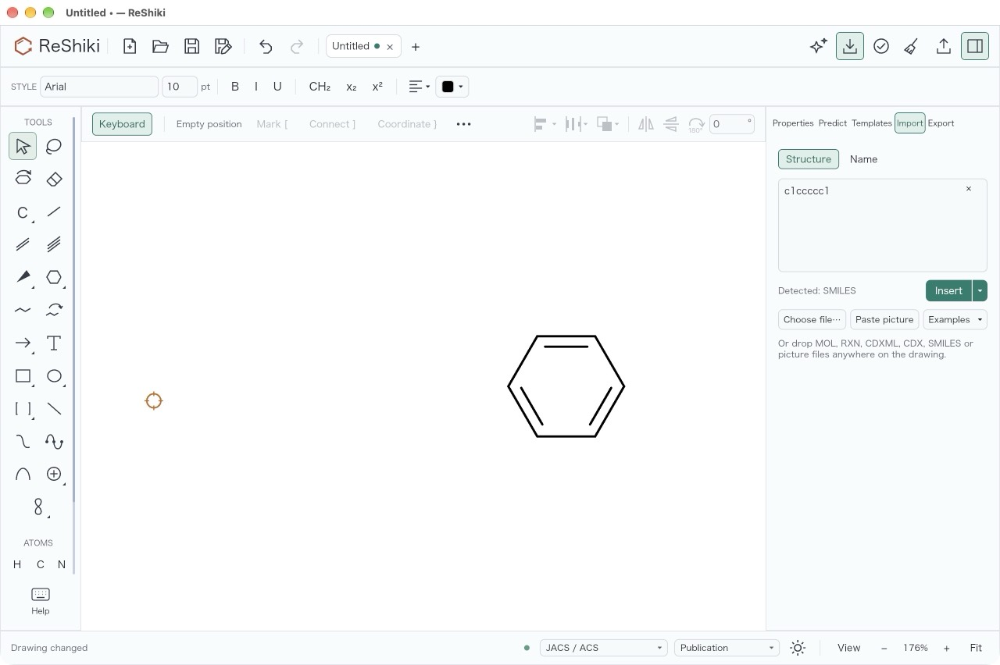
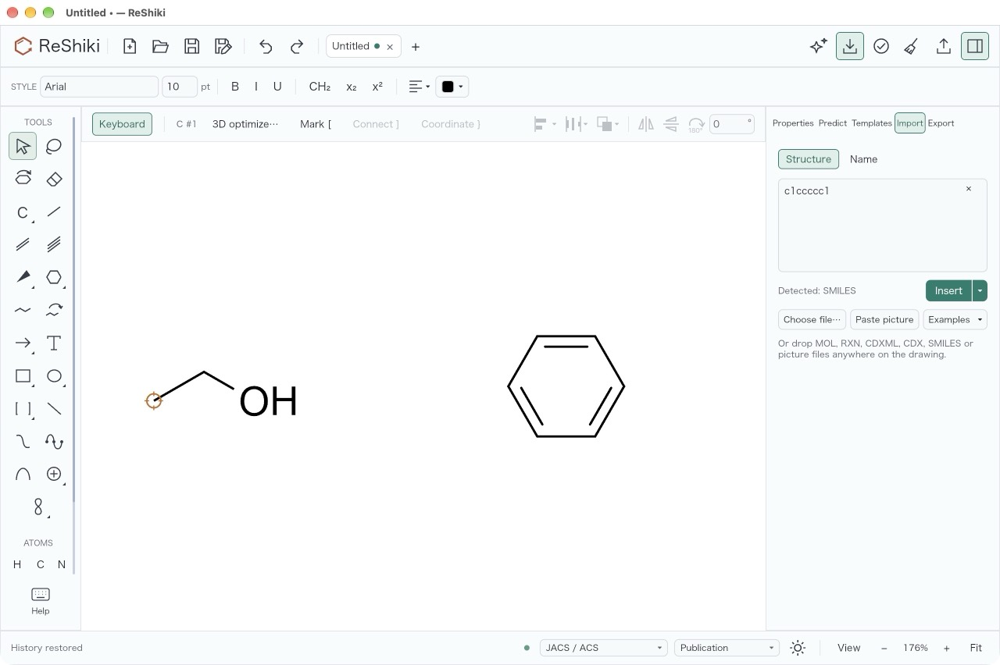
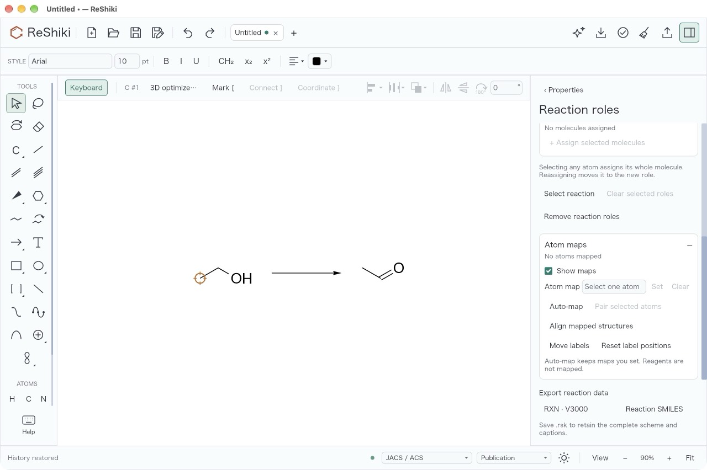

# ReShiki 0.15.0 release validation

This record lists the checks run on the 0.15.0 release preparation and the
checks that remain before the tag.
[Release notes](changes-0.15.md) · [Release procedure](releasing.md).

## Release preparation

The release preparation pull request sets the version to 0.15.0 in
`Cargo.toml` (`[package]` and `[workspace.package]`, which the Python package
follows) and `Cargo.lock`, moves the unreleased changes into the
[release notes](changes-0.15.md), adds the GitHub release highlights in
`.github/release-notes/v0.15.0.md` and updates the install guide's file
compatibility section. The npm package takes its version from `Cargo.toml`
when the tag publishes it, so `packages/editor/package.json` is unchanged.
The source is `main` at `d400b928`, the merge of
[PR #1168](https://github.com/Ameyanagi/ReShiki/pull/1168).

`VERSION` is 37 in `crates/model/src/document.rs`. `Document::file_version`
saves each drawing at the version of the newest feature it uses: 37 for an
atom with more than two radical electrons, 36 for an atom in a stereo group,
35 for an arrow with interior nodes, 34 for a two-sided residue group, 33 for
a generated 3D model, model atom labels or a plain XYZ model, 32 for ORTEP
settings and 31 for a custom reaction-label gap. Any other drawing is saved as
version 30. ReShiki 0.14.0 reads up to version 34, and 0.13.1 up to 30.

A drawing style with a crossing clearance other than 1.1 pt adds
`crossing_clearance_pt` without raising the version. ReShiki 0.14.0's
`DrawingStyle` refuses unknown fields, so 0.14.0 cannot open such a drawing or
`.reshiki-style` file; see [Compatibility](#compatibility).

## Automated checks

These ran locally on the release preparation branch, on macOS arm64, with
`RESHIKI_INCHI_HELPER` and `RESHIKI_NAMING_HELPER` set to the debug build,
`RESHIKI_REQUIRE_INCHI_HELPER=1` and `RESHIKI_DATA_DIR` set to an empty
temporary folder:

| Check                      | Command                                                                                         | Result                                                                        |
| -------------------------- | ----------------------------------------------------------------------------------------------- | ----------------------------------------------------------------------------- |
| Build                      | `cargo build --locked --bin reshiki`                                                            | Passed                                                                        |
| Version                    | `reshiki --cli --version` from the debug build                                                  | `reshiki 0.15.0`                                                              |
| Tag check                  | `scripts/build_release.py --tag v0.15.0 --check-tag-only`                                       | Passed; `v0.14.0` is refused                                                  |
| Application library tests  | `cargo test --locked -p reshiki --lib`                                                          | 388 passed, 10 ignored                                                        |
| Rust format                | `cargo fmt --all --check`                                                                       | Passed                                                                        |
| Colour reference           | `cargo run --locked --example theme_colors`, then `cargo test --locked --test theme_reference`  | Regenerated data matches main except `reshiki_version`; 1 passed              |
| Windows version resource   | `cargo test --locked --test windows_version_metadata`                                           | 4 passed                                                                      |
| Agent API version          | `cargo test --locked --test mcp_stdio --test mcp_tools --test headless_parity`                  | 26 passed                                                                     |
| Release Python modules     | `python -m unittest tests.test_release tests.test_prepare_nightly tests.test_release_downloads` | 28 passed                                                                     |
| JavaScript format and lint | `bun run format:check`, `bun run lint:js`                                                       | Passed                                                                        |
| Documentation              | `bun run docs:check`                                                                            | 0 errors, 0 warnings, 0 hints                                                 |
| Website and links          | `bun run docs:build`                                                                            | 15,102 local links/assets, llms.txt, agent-api.txt and 1,360 colours verified |

The pull request's Checks workflow runs the native, browser (wasm32),
Python and documentation jobs again; its results are on the pull request.

## Manual checks before the tag

The maintainer runs these on a manual **Release builds** run of the merged
`main` commit, or on its packages, and records the results here:

- [ ] **Release build:** a manual **Release builds** run passes on all six
      platforms and does not publish; see [Release build](#release-build).
- [ ] **Live reference suite:** the complete live RDKit reference tests pass
      on macOS arm64, Linux x64 and Windows x64; see
      [Live RDKit reference suite](#live-rdkit-reference-suite).
- [x] **Focus after closing reviews:** in the release build, close Clean up,
      3D preview, atom label, Name import preview, Structure import, reaction
      mapping proposal and assistant review with Enter and separately with Esc
      (Apply/Discard where those keys are unavailable). After each close,
      Delete or Cmd+Z acts on the drawing without a click. Passed for every
      panel except assistant review, which was not checked; see
      [Focus after closing reviews](#focus-after-closing-reviews).
- [ ] **macOS app (Apple Silicon and Intel):** the DMG opens, the app reports
      0.15.0, marks a stereocentre as `and1` and exports it as MOL V3000 and
      CXSMILES, adds a node to a curved arrow, copies a drawing as a picture
      and pastes it back as an editable drawing, and saves and reopens the
      drawing.
- [ ] **Windows x64:** setup installs over 0.14.0, the app starts, names a
      molecule, pastes a **Copy** into a web app as a picture and edits an
      embedded drawing in PowerPoint without the frame growing. Windows ARM64
      is covered by the CI package checks only. Downloads remain unsigned.
- [ ] **Linux (Arch Linux x64 and Ubuntu arm64):** the portable archive starts,
      opens a drawing, names a molecule, and **Copy** pastes SMILES into a
      plain-text box.
- [ ] **Browser demo:** a demo built with `scripts/build_wasm.sh` and
      `scripts/package_web_demo.sh` loads in Chrome, Safari and Firefox,
      draws, shows outlined text in a copied SVG and converts a name with
      **Import → Name**.
- [ ] **npm package:** the package built by the release workflow passes its
      tests; after publication `@ameyanagi/reshiki@0.15.0` is `latest`.
- [ ] **PyPI:** after publication `uv add reshiki` installs 0.15.0 on each
      platform, and an SVG from `render` draws its text as outlines.
- [ ] **Compatibility:** a plain drawing saved by 0.15.0 opens in 0.14.0; a
      drawing with a stereo group saved by 0.15.0 is refused by 0.14.0 with
      the request to update; a drawing saved by 0.14.0 opens in 0.15.0.

## Release build

Manual **Release builds**
[run 43372643607](https://github.com/Ameyanagi/ReShiki/actions/runs/43372643607)
at `d400b928`.

**Failed.** Five of the six platform packages built and passed their checks:
macOS arm64, Windows x64, Windows ARM64, Linux x64 and Linux arm64. The macOS
x64 job failed in **Test native chemistry on Intel macOS**: `reshiki-io` had
634 passed and 2 failed, both only on Intel macOS:

- `engine::native_import::atrop_tests::coupled_axes_import_warns_exactly_for_missing_stereo`:
  "Labels changed on re-preparation".
- `engine::native_import::template_retry::tests::a_template_that_increases_collisions_is_not_published`:
  4 collisions where the test expects 2.

These need a fix on `main` and a new **Release builds** run before the tag.

## Live RDKit reference suite

The complete live reference tests gate publication in `release.yml`.
**Checks** with `live_reference=true`
[run 43372640285](https://github.com/Ameyanagi/ReShiki/actions/runs/43372640285)
at `d400b928` runs them on macOS arm64, Linux x64 and Windows x64.

**Not passed; still running when this record was written.** Two shards had
already failed:

- **Linux x64, shard 2:** `reaction_drawing` failed in
  `reaction_drawings_match_native_scene_assembly`. Two RXN fixtures with
  enhanced stereo groups, `molecule/0/source/two_centers_and.mol` and
  `molecule/1/source/two_centers_or.mol`, now import, while the frozen
  reference still refuses them ("Enhanced stereo groups are not supported yet;
  import was cancelled."). This is the intended change from
  [PR #1141](https://github.com/Ameyanagi/ReShiki/pull/1141); the reference
  needs to accept it.
- **Windows x64, shard 3:** `reaction_smiles` failed in
  `cx_reaction_smiles_preserves_global_annotation_targets` with 60 mismatches.
  For large CXSMILES stereo-group numbers (`cx/syntax/10218`, `10219`, `10225`
  and others) the group `read_id` is 2147483649 or 4294967295 in ReShiki and
  2147483647 in RDKit on Windows.

The other Linux x64 shards passed. The macOS arm64 and the remaining Windows
x64 shards were still running.

## Focus after closing reviews

Checked on 13 November 2026 on macOS arm64 with a release build
(`cargo build --release --locked --bin reshiki`) of `main` at `d400b928`, the
same code as the release branch apart from the version bump. The binary's
SHA-256 is `9b4a87c6ac88585947a69a0996c05e7013deb6c4498ebe5c10efad987ce7287c`.
It ran in an app bundle whose `RESHIKI_DATA_DIR` pointed at an empty folder.
Each case started with part of the drawing selected. After the panel closed,
the next keys were Delete and then Cmd+Z, with no click in between. Each pair
of screenshots shows the drawing after Delete and after Cmd+Z.

| Panel                     | Closed with                    | Delete acted | Cmd+Z acted | Screenshots                                                                                                                                                     |
| ------------------------- | ------------------------------ | ------------ | ----------- | --------------------------------------------------------------------------------------------------------------------------------------------------------------- |
| Clean up preview          | Enter                          | yes          | yes         | [Delete](images/release-0.15.0/focus-restore/01-cleanup-enter-delete.jpg) · [Cmd+Z](images/release-0.15.0/focus-restore/01-cleanup-enter.jpg)                   |
| Clean up preview          | Esc                            | yes          | yes         | [Delete](images/release-0.15.0/focus-restore/01-cleanup-esc-delete.jpg) · [Cmd+Z](images/release-0.15.0/focus-restore/01-cleanup-esc.jpg)                       |
| 3D preview                | Enter                          | yes          | yes         | [Delete](images/release-0.15.0/focus-restore/02-3d-enter-delete.jpg) · [Cmd+Z](images/release-0.15.0/focus-restore/02-3d-enter.jpg)                             |
| 3D preview                | Esc                            | yes          | yes         | [Delete](images/release-0.15.0/focus-restore/02-3d-esc-delete.jpg) · [Cmd+Z](images/release-0.15.0/focus-restore/02-3d-esc.jpg)                                 |
| Atom label editor         | Enter                          | yes          | yes         | [Delete](images/release-0.15.0/focus-restore/03-atom-label-enter-delete.jpg) · [Cmd+Z](images/release-0.15.0/focus-restore/03-atom-label-enter.jpg)             |
| Atom label editor         | Esc                            | yes          | yes         | [Delete](images/release-0.15.0/focus-restore/03-atom-label-esc-delete.jpg) · [Cmd+Z](images/release-0.15.0/focus-restore/03-atom-label-esc.jpg)                 |
| Name import preview       | Enter in the name field        | yes          | yes         | [Delete](images/release-0.15.0/focus-restore/04-name-import-enter-delete.jpg) · [Cmd+Z](images/release-0.15.0/focus-restore/04-name-import-enter.jpg)           |
| Name import preview       | Esc in the name field          | yes          | yes         | [Delete](images/release-0.15.0/focus-restore/04-name-import-esc-delete.jpg) · [Cmd+Z](images/release-0.15.0/focus-restore/04-name-import-esc.jpg)               |
| Structure import          | **Insert** (Enter adds a line) | yes          | yes         | [Delete](images/release-0.15.0/focus-restore/05-structure-import-enter-delete.jpg) · [Cmd+Z](images/release-0.15.0/focus-restore/05-structure-import-enter.jpg) |
| Structure import          | Esc in the structure field     | yes          | yes         | [Delete](images/release-0.15.0/focus-restore/05-structure-import-esc-delete.jpg) · [Cmd+Z](images/release-0.15.0/focus-restore/05-structure-import-esc.jpg)     |
| Reaction mapping proposal | Enter on **Apply maps**        | yes          | yes         | [Delete](images/release-0.15.0/focus-restore/06-reaction-mapping-enter-delete.jpg) · [Cmd+Z](images/release-0.15.0/focus-restore/06-reaction-mapping-enter.jpg) |
| Reaction mapping proposal | **Discard** (no Esc shortcut)  | yes          | yes         | [Delete](images/release-0.15.0/focus-restore/06-reaction-mapping-esc-delete.jpg) · [Cmd+Z](images/release-0.15.0/focus-restore/06-reaction-mapping-esc.jpg)     |

Name and Structure import are sidebar panels: Enter, **Insert** and Esc return
keyboard focus to the drawing and leave the sidebar open with its draft.
Assistant review was not checked because it needs live assistant credentials;
the automated `review_close_returns_focus_*` tests cover its local buttons.

## Compatibility

Checked on macOS arm64 with `reshiki --cli convert … --to smiles`, reading
the same small drawing (anisole) with the debug build of this branch and with
the published 0.14.0 macOS arm64 download:

| Drawing                                            | 0.15.0 | 0.14.0                                                                                          |
| -------------------------------------------------- | ------ | ----------------------------------------------------------------------------------------------- |
| Version 30, default style                          | Opens  | Opens                                                                                           |
| Version 30, style with `crossing_clearance_pt` 0.5 | Opens  | Refused: "Could not open document: unknown field `crossing_clearance_pt`, expected one of …"    |
| Version 36 header                                  | Opens  | Refused: "This drawing was made with a newer version of ReShiki (document version 36). Update…" |

The style-file reader in 0.14.0 (`document_styles::load_bytes`) parses the same
`DrawingStyle`, so a `.reshiki-style` file with the field is refused there too.
